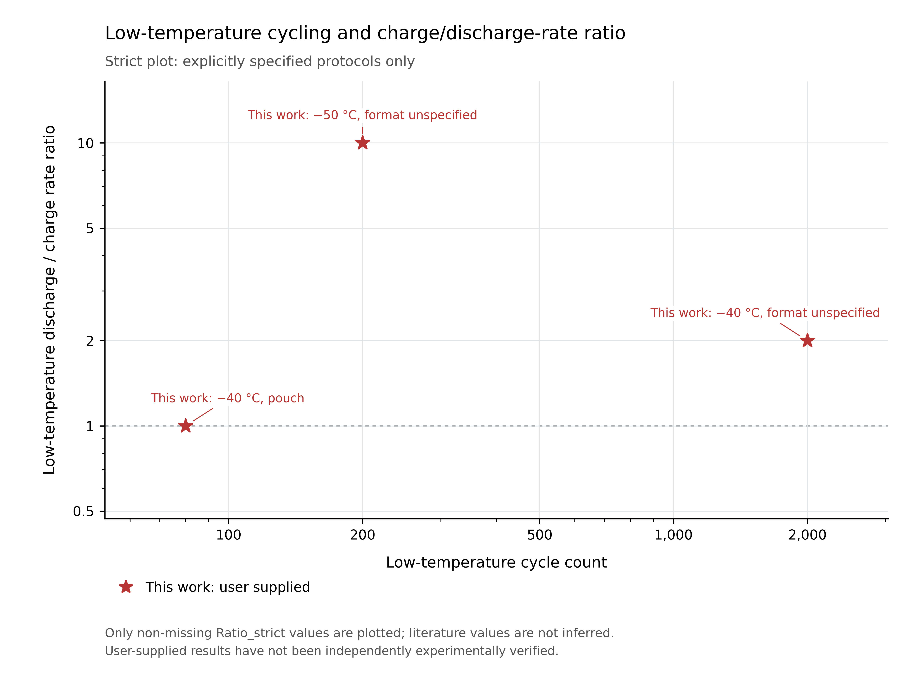
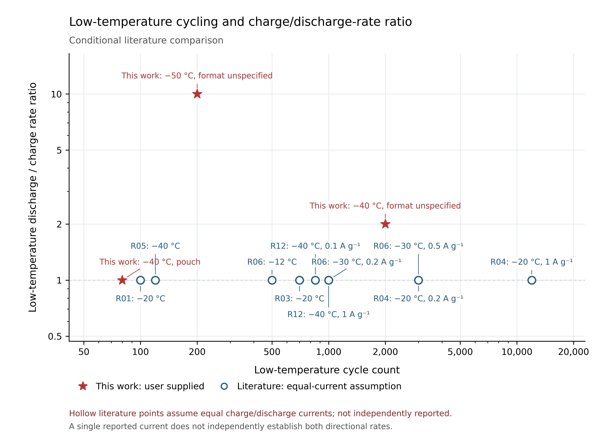

# V2：低温循环圈数与放电/充电倍率比

本轮复核原有 **169个字段**，更新10处，追加4条同篇独立循环记录。主表仍为12篇独立文献、17条条件记录；未达到20篇，部分字段仍为NR/NV。

## 下载与重绘

- [Origin可直接打开的XLSX](origin-data-v2.xlsx?raw=true)
- [严格图XY数据CSV](Origin_strict_XY.csv?raw=true)
- [条件图XY数据CSV](Origin_conditional_XY.csv?raw=true)
- [全部22条绘图/排除记录CSV](Origin_all_records.csv)
- [修订性能对比Excel](battery-performance-v2.xlsx?raw=true)
- [V2全部文件与新增原始证据ZIP](audit-and-plot-v2.zip?raw=true)
- [逐项核验、原文冲突和Origin操作](verification-and-origin-guide.md)

X为同次低温循环试验的圈数；Y为该次试验放电倍率/充电倍率，无量纲。两轴Log10；CSV保存原始数值，没有预先取对数。它是按指定坐标绘制的循环次数–倍率比图，非通常能量–功率坐标的Ragone图。

## 严格图：可明确计算的协议

[矢量PDF](strict_rate_ratio_vs_cycles.pdf?raw=true) · [可编辑SVG](strict_rate_ratio_vs_cycles.svg?raw=true)

三个This work点来自用户原模板，已核对转录与算术，未独立验证实验：(2000,2)、(200,10)、(80,1)。前两项封装未注明，第三项为软包。当前文献未取得足以独立拆分该次循环充、放电倍率的证据，严格图不自动填比值1。

## 条件性比较：文献点需要对称假设

[矢量PDF](conditional_rate_ratio_vs_cycles.pdf?raw=true) · [可编辑SVG](conditional_rate_ratio_vs_cycles.svg?raw=true)

包含3个用户点及10个文献测试点，**10个文献点不等于10篇文献**。全部空心点的比值1均基于“单一共同GCD/循环电流按充放电对称解释”的假设，不是分别报告或独立核实的两向倍率比。CSV中 `Ratio_strict` 为空、`Ratio_assumed=1`、`Symmetry_assumption=true`。不可删除这一说明将其当成已完全核实的投稿数据。

原表K3的最高放电倍率10C与J3的2000圈不属于同一试验条件，不能画(2000,20)；J3正确为(2000,2)。各论文循环数是不同容量保持率下的展示/试验终点，不是统一80%失效寿命。R05采用主图显示120圈；124圈是同一实验的后续Source Data末端，仅作审计，不重复计点。

## Origin操作

打开XLSX的 `Strict_XY` 或 `Conditional_XY`，A列 `Cycles_X` 指定为X、B列 `Rate_ratio_Y` 为Y，画Scatter，再把两轴设Log10。按 `Symmetry_assumption` 分组，文献假设点用空心符号，This work用红星；标签列包含Ref、温度与原始电流。CSV编码UTF-8，空值不得改成0或1。

## 复核补全

R02补40圈/0.5C室温条件；R03补高载量室温软包150圈；R05确认−40°C窗口0.6–3.0V。R06新增图内印刷端值计算的107.2%/3000及98.3%/1000，并保留正文与图注的电流冲突。R12取得公开完整正文，补RT循环/倍率、低温电解液及850圈/0.5C、1000圈/5C两个独立试验。

R07/R08/R09/R10/R11的剩余全文/SI缺项继续标NV。新CEJ候选取得官方SI，但未核实全DIB低温循环，未纳入主表/图。分区仍为2025中科院大类分区公开二级来源，官方原表未取得。

[返回文献总目录](../README.md)
