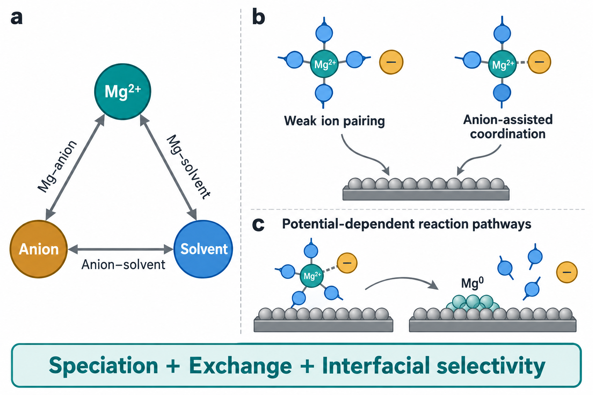
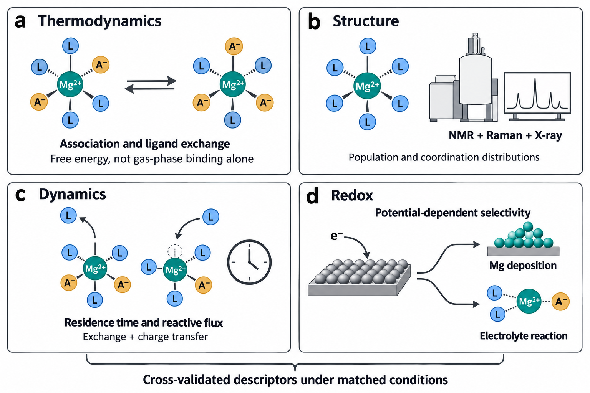
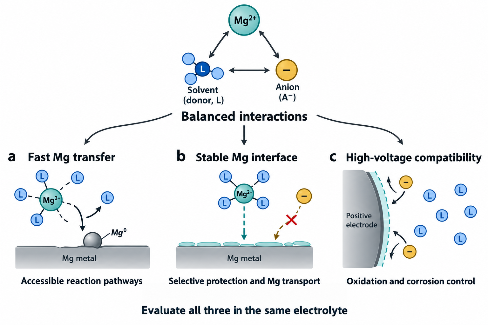
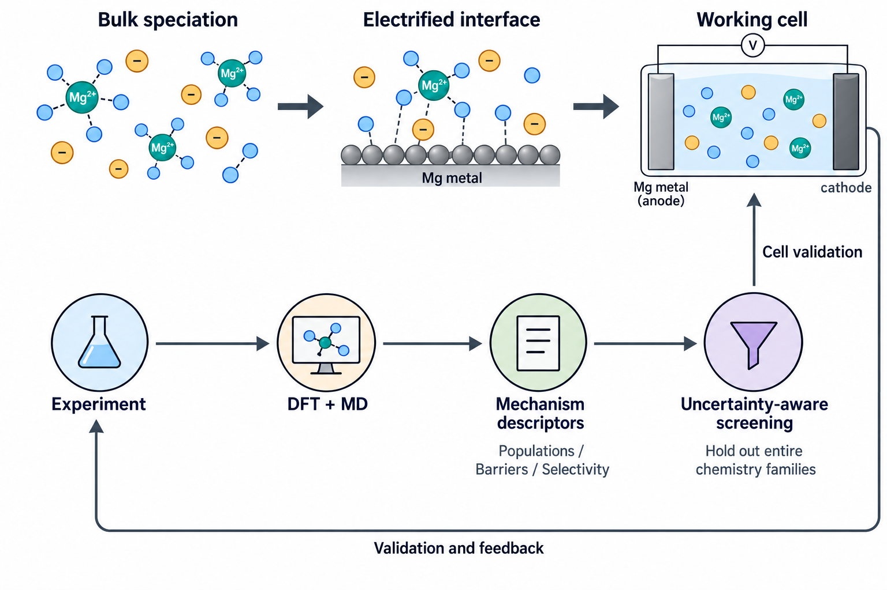

# Quantifying Ternary Interactions for Rational Magnesium Electrolyte Design

## Abstract

Magnesium electrolyte development has produced chemically diverse solutions capable of reversible metal deposition, yet their design remains difficult to generalize. A central ambiguity concerns anion participation in the Mg²⁺ solvation shell. Weak ion pairing can facilitate magnesium electrochemistry, whereas selected anion-containing complexes can also support rapid interfacial reactions. These observations expose the limitations of treating coordination strength as a single performance descriptor. This Perspective develops a quantitative framework for the coupled interactions among Mg²⁺, anions, and solvents. We distinguish equilibrium speciation from ligand-exchange kinetics and potential-dependent reaction selectivity, and examine how these quantities connect bulk solution chemistry to magnesium deposition, interphase formation, and oxidative stability. Thermodynamic calculations, quantitative spectroscopy, time-resolved measurements, and electrochemical analysis are organized into a complementary toolbox, with particular attention to what each method can establish. We propose design principles that favor accessible magnesium-transfer pathways while controlling parasitic reduction, interphase resistance, and oxidation at practical positive electrodes. Integrating these descriptors with multiscale simulation and uncertainty-aware data analysis offers a route to testable electrolyte predictions. The resulting research agenda calls for matched measurement conditions and a minimum quantitative reporting standard, supporting the development of electrolytes compatible with both magnesium metal and high-voltage cathodes.

Keywords: magnesium metal batteries; solvation structures; ternary interactions; ligand exchange; interfacial electrochemistry

## 1. Introduction

### 1.1. Divalent magnesium and the limits of lithium electrolyte intuition

The electrolyte is a principal determinant of whether magnesium metal can function as a rechargeable negative electrode. The early magnesium battery prototype coupled an organohaloaluminate electrolyte with a Chevrel-phase positive electrode, demonstrating that reversible magnesium deposition and insertion could coexist in one cell.[1,2,3] Subsequent electrolyte families expanded the accessible chemistry, but the compatibility of an electrolyte with magnesium metal has continued to constrain cathode choice and operating voltage.[4,5,6,7] This history places electrolyte research at the center of the magnesium battery problem. It also shows why a successful formulation can remain difficult to reproduce with another salt or solvent, even when their familiar macroscopic properties appear similar.

Mg²⁺ and Li⁺ differ in ways that complicate the transfer of lithium-based electrolyte design rules. The higher charge density of Mg²⁺ generally strengthens its interactions with donor atoms and counterions, increases the importance of multidentate coordination, and couples ion association to solvent organization.[8] The consequences extend beyond a larger energy cost for removing a ligand. Ion-pair populations, ligand-exchange pathways, the charge of transported complexes, and their response to an electrified surface can all change together. Coordination by anions or chloride-containing ligands may alter the identity of the electroactive precursor rather than simply perturb an otherwise fixed Mg²⁺ solvation shell.[2,9,10]

Interphase behavior introduces a further distinction. Lithium electrolytes frequently rely on decomposition products that protect the negative electrode while permitting lithium-ion transport. Many products formed on magnesium instead impede ion transfer, making a familiar lithium strategy of promoting salt decomposition unreliable without direct evidence of magnesium permeability.[11,12,13] This does not imply that every magnesium interphase must be absent or that every anion-derived product is detrimental. It requires the transport properties and formation pathways of a particular interphase to be demonstrated. Likewise, high elemental abundance or a favorable volumetric capacity does not guarantee a safe, competitive cell. Electrodeposition morphology, electrolyte flammability, usable cathode capacity, and inactive cell components remain relevant. Quantitative electrolyte design must therefore connect molecular interactions to the actual operating interfaces.

### 1.2. The missing system-level description of ternary interactions

Contemporary electrolyte studies have made substantial progress through weakly coordinating salts, mixed solvents, and functional additives. Magnesium borohydride and subsequent halogen-free carborane electrolytes established important routes, while fluorinated alkoxyborates and alkoxyaluminates enlarged the range of salts compatible with magnesium metal.[14,15,16,17,18,19,20,21,22] Amine–ether and phosphate-containing formulations subsequently demonstrated that comparatively conventional salts can support much more favorable magnesium electrochemistry when their surrounding chemical environment changes.[23,24,25,26,27,28,29] Recent studies have extended this progress to data-driven dynamic-solvation models, solvent–anion counterpoise, and dipole-mediated coordination control.[30,31,32] These results argue for molecular design, but they also reveal the shortcomings of explaining each improvement with an isolated descriptor. The remaining challenge is to establish which descriptors retain predictive value across these chemically distinct systems.

A typical analysis correlates performance with a donor number, a calculated Mg–ligand binding energy, or a fraction of contact ion pairs. Each quantity is useful within a defined comparison. None specifies the complete sequence by which a solution species becomes a deposited magnesium atom. A solvent can strengthen its interaction with Mg²⁺ while excluding a decomposition-prone anion. An anion can change coordination geometry, stabilize an intermediate, or modify surface adsorption. A cosolvent can influence anion association without entering the first solvation shell. Thus, the same measured coordination change can arise through different underlying interactions, with different consequences at the electrode.[33,34,35,36]

We use ternary interactions to describe the coupled Mg²⁺–anion, Mg²⁺–solvent, and anion–solvent relationships. The term identifies a chemical system rather than a strictly three-body potential or a composition diagram. In a real liquid, polarization, multiple ligands, concentration, and the electrode environment make these relationships many-body and state dependent. Anion–solvent interactions include electrostatic and dispersion contributions, preferential solvation, and, where chemically justified, hydrogen bonding or acid–base equilibria. They should not automatically be assigned to hydrogen bonding. Similarly, a reported interaction energy is not a directly measured mechanical force. Force along a specified coordinate is the derivative of an appropriate free-energy profile, and its interpretation depends on that coordinate and the surrounding environment. These distinctions are necessary if quantitative language is to lead to reproducible design rather than a more elaborate form of empirical correlation.

### 1.3. The central proposition of this Perspective

The most revealing test of a ternary description is the apparent anion-participation paradox. Both reduced anion coordination and selected anion-containing coordination environments have been associated with favorable magnesium deposition.[34,9,10,37,36] Their coexistence undermines a universal ranking in which weaker binding or fewer coordinated anions must always be better. We propose that these observations can be reconciled by considering the abundance of reactive species, their interconversion, and the competition between magnesium transfer and electrolyte reaction at the operating potential. This is a hypothesis for organizing and testing mechanisms, rather than evidence that every successful formulation follows the same pathway.

Our argument follows the molecular event through increasing levels of description. We first examine why opposite trends in anion participation need not imply contradictory chemistry. We then assemble methods that quantify thermodynamics, coordination populations, molecular dynamics, and redox behavior. These measurements support design principles for faster magnesium transfer, a compatible metal interface, and stability at high-voltage positive electrodes. Finally, we consider how multiscale calculations and data-driven screening can turn those principles into falsifiable predictions. The objective is an electrolyte with an accessible productive pathway under realistic cell conditions, not merely an electrolyte that produces a detectable magnesium deposit. Figure 1 summarizes the relationship between the ternary chemical system and its alternative interfacial routes.

## 2. The Anion Participation Paradox in Magnesium Electrolytes

### 2.1. Weak ion pairing and rapid interfacial kinetics

Weakly coordinating anions offer a compelling route to magnesium-compatible electrolytes. Distributing negative charge across bulky anions can reduce close association with Mg²⁺, while suitable chemical structures avoid the corrosive free-halide chemistry of earlier formulations.[16,17,18,19,20] Importantly, weak coordination is a property of an anion in a particular solvent and concentration range. It does not guarantee complete dissociation, freedom from aggregation, or stability against all negative-electrode reactions. Changes in solvent denticity and salt concentration can alter speciation even when the anion remains nominally weakly coordinating.[21,22,8]

The weakly ion-pairing electrolyte reported by Li and co-workers provides a particularly relevant example of formulation-level control.[34] As summarized by Zhang and co-workers, combining ether solvents, a fluorinated ether, and triethyl phosphate improves the electrochemical behavior of an Mg(TFSI)₂ electrolyte.[33] The mechanistic interest lies in separating the functions of those ingredients. A donor-rich local environment can shield Mg²⁺ from TFSI⁻ coordination, while other components modify solvent activity, association, and the availability of species near the interface. The observation supports weak ion pairing as an effective design route within that chemical system. It does not establish that excluding anions is a universal requirement for magnesium transfer.

Several processes can explain why reduced anion participation improves a particular electrolyte. Removing a reduction-sensitive anion from the immediate coordination environment can decrease its access to a reactive precursor. A changed solvent shell can alter reorganization and ligand-exchange kinetics. Changes in complex charge and correlated motion can also affect the supply of species to the electrode. These explanations require different measurements. Spectroscopy may establish a decrease in contact-ion-pair abundance but cannot independently identify which of these processes controls the deposition current. Likewise, faster cycling does not reveal whether the improvement originates in bulk transport, interfacial kinetics, or a less resistive interphase. A strong mechanistic analysis should therefore retain weak ion pairing as a measured structural feature and test its connection to the competing reaction pathways separately.

Figure 1. Ternary interactions and the anion-participation paradox. a) Mg²⁺–anion, Mg²⁺–solvent, and anion–solvent interactions define a coupled chemical environment. The triangle represents interacting species, not a ternary composition phase diagram. b) Weak ion pairing and anion-assisted coordination illustrate alternative precursor environments that can support productive interfacial chemistry in appropriate formulations. c) Potential-dependent rearrangement connects solvated precursors to magnesium deposition and ligand release. Ligand numbers and metal atoms are illustrative symbols and do not specify coordination numbers, molecular structures, stoichiometry, or an elementary two-electron mechanism. All panels are conceptual schematics without experimental data.

### 2.2. Anion-assisted solvation and favorable reaction pathways

The complementary observation is that some anion-containing environments also support reversible magnesium chemistry. Chloride-containing electrolytes are the historically clearest example: their solution species, coordination structures, and conditioning behavior strongly influence electrochemical activity.[2,38,39,40,9,10] These formulations contain multiple chemically distinct species, and the beneficial effects of chloride cannot be reduced to a single increase in the number of coordinated anions. Chloride can affect speciation, surface adsorption, and passivation chemistry simultaneously. Chloride-assisted performance therefore provides mechanistic evidence for useful anion participation while also exposing corrosion and compatibility limitations.

Studies of chloride effects and interfacial electrolyte stability further motivate a pathway-based interpretation.[41,37,36] A coordinated ligand can change the relative stability of a solvated precursor and a partially reduced intermediate. It may influence which bonds rearrange as the complex approaches the surface or suppress a solvent decomposition channel under the conditions studied. Surface adsorption supplies another route: a ligand can modify the local electrolyte environment and the relative access of reactive species without reproducing its bulk coordination state at the interface. Evidence for any one of these processes should not be generalized to every anion or interpreted as proof of concerted ligand release.

Nonhalide formulations make the question more demanding. Increasing the participation of a fragile anion may expose it to reduction and promote a blocking interphase, even if a calculated shell-removal energy decreases. Conversely, excluding that anion can leave a strongly bound solvent environment whose exchange is kinetically slow. Li and co-workers provide a direct nonhalide example in amine-based electrolytes: their study reports that cation–anion pairing weakens amine coordination and suppresses amine reduction and hydrogen evolution.[28] Here, increased anion participation protects the solvent environment rather than simply lowering the strength of every interaction. Functional amines and phosphates offer additional routes through this trade-off, but their reported roles include competitive coordination, adsorption, solution equilibria, and interphase formation.[23,42,27,28,29,35] These mechanisms can coexist or dominate at different stages of cycling. The relevant design variable is therefore the specific anion–solvent–Mg ensemble and its accessible interfacial pathways. Anion participation alone does not determine the sign of the performance change.

### 2.3. Energetic balance and the possibility of cooperative release

The paradox becomes less surprising when equilibrium binding is separated from a reaction barrier. Removing a ligand from an isolated cluster to vacuum is different from exchanging it with another solution ligand, releasing it into a surrounding liquid, or rearranging a complex at an electrified surface. A strongly bound initial state can still access a comparatively favorable reaction pathway if the transition configuration and products receive sufficient stabilization. Conversely, a weakly associated species can react slowly if its interfacial orientation, exchange dynamics, or electron-transfer coupling is unfavorable. These possibilities follow from comparing entire pathways rather than one bond in the initial solvation shell.[8,43,36]

The 2026 solvent–anion counterpoise study brings this interpretation into direct focus.[31] Its authors use machine learning to identify a balanced Mg²⁺–solvent and Mg²⁺–anion environment and report a synchronous desolvation pathway, together with an MgH₂-based interphase. This result motivates asking whether coordinated release is transferable beyond that amine formulation and how its contribution can be separated from interphase effects. Cooperative release is therefore a useful, testable mechanism to assess across electrolyte families. An anion-assisted complex could reorganize through correlated solvent and anion motions, avoiding a high-energy intermediate that would occur during independent sequential detachment. This proposal does not mean that stronger binding inherently lowers a barrier. It predicts a particular path on a multidimensional free-energy surface, with a transition region involving coupled changes in Mg–donor coordination. Evidence would require an interfacial free-energy calculation or time-resolved observations consistent with that coupling. A lower optimized cluster energy, a Raman shift, or an improved Coulombic efficiency cannot alone establish concerted release.

For rapidly interconverting precursor states, a useful coarse-grained relation is:

$$k_{\mathrm{eff}}(U)=\sum_i p_i(U)k_i(U)$$

Here, pᵢ denotes the population of precursor state i in the environment relevant to transfer, and kᵢ is the effective rate constant for its productive pathway at electrode potential U. Each kᵢ may summarize several elementary events. When interconversion is slow relative to transfer, the population-weighted expression is insufficient and coupled population balances are needed. The formulation also requires a competing set of rate constants for solvent reaction, anion reaction, and other parasitic processes. A minor species can dominate the productive flux if it reacts sufficiently quickly, while an abundant species can contribute mainly to side reactions. The anion-participation paradox thus points to an experimentally actionable question: which populations supply magnesium-transfer flux, and how does the ternary chemical environment change their selectivity?

## 3. A Quantitative Toolbox for Ternary Interactions

### 3.1. Thermodynamics and the relevant energy landscape

A thermodynamic descriptor begins with a defined chemical transformation. For Mg²⁺–anion association, this requires specifying the solvated states, the number and identity of displaced ligands, and the activities used in the equilibrium constant. For solvent exchange, the reference should include the incoming ligand and the released ligand in a consistent environment. The association or exchange free energy then describes an equilibrium preference. For a defined exchange equilibrium, ΔG° = −RT ln K relates the standard molar free energy to an equilibrium constant formed from dimensionless activities; R is the gas constant and T the temperature. This quantity should not be labeled a desolvation barrier unless a transition state or a free-energy saddle connecting the states has actually been determined.

Electronic-structure calculations can clarify local chemistry when used within those constraints. A series of cluster calculations with identical charge, ligand accounting, and reference states can compare candidate transformations. Solvation corrections, entropy, conformational sampling, and the coordination environment become particularly important when charged complexes are compared. Apparent improvements caused by inconsistent ligand numbers or by comparing a singly charged complex with a doubly charged bare ion can overwhelm the chemistry being investigated. Gas-phase binding energies remain useful for identifying plausible interactions, but their absolute values should not be treated as liquid-state equilibrium constants or electrode reaction energies.[8,43,36]

Figure 2. Complementary measurements for quantitative electrolyte analysis. a) Association and ligand-exchange thermodynamics quantify the populations accessible in a specified liquid environment. b) NMR, vibrational spectroscopy, and X-ray measurements constrain coordination structures and their distributions. c) Molecular exchange measurements and reactive-flux analysis address the time scales connecting those structures. d) Redox measurements at controlled potential distinguish productive magnesium transfer from electrolyte reaction. The toolbox requires cross-validation under matched concentration, temperature, impurity, and electrode conditions. Ligand symbols and their counts are illustrative rather than exact molecular formulas or coordination numbers. Instrument symbols are illustrative, and no plotted or numerical experimental results are implied.

Molecular dynamics can supply the surrounding liquid environment, while enhanced sampling can generate a potential of mean force along a specified coordinate.[44,45] Coordination numbers, ion separation, and ligand orientation may each be relevant. A one-dimensional profile can conceal an alternative low-barrier route if the missing coordinate relaxes too slowly. For a proposed cooperative-release mechanism, at least the coupled Mg–solvent and Mg–anion coordination changes should be examined, and sampling convergence should be established rather than assumed. The choice of classical force field is also consequential: divalent-ion polarization and charge-transfer effects may not be represented adequately by a fixed-charge model. Selected ab initio calculations and measured structure can constrain that model, although they do not eliminate its uncertainty.

The electrode adds a thermodynamic variable that is absent from bulk cluster screening. Adsorption and reduction pathways depend on electrode potential, surface charge, the electric field, and the evolving interphase. Constant-potential or grand-canonical calculations provide a more appropriate starting point than assigning all states the charge of a neutral slab.[46] These approaches still require choices about surface structure, solvent sampling, and the treatment of electrolyte screening. The practical aim is a conditional energy landscape with transparent reference states and uncertainty, allowing an experimental comparison at the same potential and composition. A universal ranking derived from one isolated-cluster calculation is unlikely to survive those changes in environment.

### 3.2. Spectroscopy and quantitative coordination distributions

Spectroscopy links an electrolyte formulation to the populations that calculations attempt to describe. Raman and infrared measurements can reveal changes in anion and solvent environments, while NMR can constrain ligand coordination, molecular motion, and chemical equilibria.[9,10,47,28,35] Their strength lies in combined assignments across concentration and composition series. A single shifted band demonstrates a changed vibrational environment; it does not directly measure an interaction free energy or prove that one coordination species controls electrodeposition.

Quantitative interpretation requires attention to what the instrument weights. The area of a Raman component depends on its scattering response as well as its population. Deconvolving a band into several peaks does not make the fitted areas equal to species fractions unless the assignments and response factors support that conversion. NMR chemical shifts can be averaged by rapid exchange, and relaxation or exchange signals can reflect several processes. Two-dimensional correlation measurements may identify spatial proximity or exchange, depending on the experiment, but they should not be interpreted automatically as a unique bond. Isotopic labeling, independent chemical standards, and predicted spectra are useful where assignments remain ambiguous.

Direct magnesium spectroscopy is challenging because ²⁵Mg has limited sensitivity and quadrupolar behavior. Measurements on solvent nuclei and suitable anion nuclei often provide complementary constraints, but their observables must be connected explicitly to magnesium coordination. X-ray absorption or scattering can supply information about local distances and broader liquid structure. These methods have their own resolution and model dependence; a fitted average coordination number can remain compatible with several distributions. Electrospray mass spectrometry and isolated crystal structures can identify chemically plausible complexes, although ionization and crystallization select species and change their environment. Neither should be treated as a quantitative census of an undisturbed working electrolyte.

The reporting target should therefore be a distribution with stated uncertainty, supported by orthogonal measurements and simulation. Relevant quantities include the fraction of associated states, the number of donor atoms around magnesium, ligand identity and denticity, and the exchange regime in which the spectrum was measured. Coordination by six donor atoms does not necessarily mean coordination by six solvent molecules. This distinction matters particularly for glymes and mixed-donor molecules. Measurements across a designed concentration or cosolvent series can then test whether the proposed descriptor changes monotonically, whether a new species appears, and whether the electrochemical response follows the same trend. The most convincing evidence identifies where a structural trend ceases to predict performance.

### 3.3. Kinetics and the hierarchy of time scales

Equilibrium populations specify which states are accessible, whereas kinetics specifies whether those states can supply the required flux. Ligand residence times, exchange correlations, diffusion, adsorption, interfacial electron transfer, nucleation, and ion passage through an interphase occupy different parts of the deposition process. Their relative importance can change with temperature, potential, current, and cycling history. A static solvation image cannot identify the slowest event.[8,43,36]

Simulations should distinguish continuous residence from intermittent association. A ligand that briefly leaves a distance cutoff and rapidly returns can generate very different residence-time estimates depending on the definition. The cutoff, survival function, fitting interval, trajectory length, and treatment of rebinding should be reported. Diffusion coefficients require adequate sampling and finite-size assessment, particularly when comparing simulation boxes or compositions.[48] Ionic conductivity also depends on correlated motion, so a Nernst–Einstein estimate based on independent ions can misrepresent a strongly associated electrolyte. Neither total conductivity nor solvent self-diffusion is an adequate substitute for the availability and mobility of electroactive magnesium species.

Experiments can interrogate different levels of this hierarchy. Exchange-sensitive NMR and temperature-dependent spectroscopy can constrain molecular dynamics where the relevant signals are accessible. Temperature-dependent electrochemical measurements can yield apparent activation parameters, but viscosity, solution populations, and interphase evolution may change simultaneously. Electrochemical impedance can separate some response time scales when a physically justified model and appropriate controls are used. A fitted resistance does not by itself identify a desolvation step, and several equivalent circuits can fit the same spectrum. Current transients provide information about induction, nucleation, and growth, provided mass transport and electrode geometry are considered.

Classical electron-transfer theory supplies useful concepts such as reorganization energy and driving force.[49] Applying a simple outer-sphere expression directly to magnesium deposition is nevertheless a modeling assumption. Metal deposition can involve adsorption, ligand rearrangement, sequential charge transfer, nucleation, and changes in the electronic environment. These processes may not obey the assumptions of one elementary outer-sphere event. A calculated reorganization energy should therefore be tied to a specified reaction and compared with kinetic observations, rather than presented as a complete explanation of a deposition overpotential. The useful endpoint is a discriminating experiment: for example, determine whether a change in molecular exchange precedes a change in charge-transfer behavior when bulk conductivity and electrode history are controlled. Such comparisons can establish which time scale the electrolyte design actually changes.

### 3.4. Redox behavior and the limitations of orbital descriptors

The electroactive complex must reach a reactive configuration without predominantly reducing its ligands or counterions. This requirement connects solvation chemistry to the electronic structure of the entire complex and to the surface on which reduction occurs.[43,36] Coordination can shift the relative favorability of solvent and anion reactions, but the interpretation depends on the molecular environment and reaction products. A solvent that is stable as a free molecule may behave differently when coordinated to Mg²⁺, adsorbed on a surface, or exposed to an interphase catalytic site.

Frontier orbital calculations are useful for locating candidate sites for oxidation or reduction. They can guide which chemical transformations deserve closer examination. Isolated HOMO and LUMO energies are not equivalent to experimentally measured oxidation and reduction potentials. Charged-state relaxation, solvation, bond cleavage, proton transfer where relevant, and reaction entropy can alter the free energies. An orbital concentrated on an anion signals a possible vulnerability rather than proving that anion reduction dominates magnesium deposition. The associated reaction barrier and interfacial access remain necessary parts of the explanation.[13,36]

Electrochemical stability measurements likewise need a defined operational meaning. The onset observed in a voltammetric sweep depends on electrode material, surface area, scan rate, current threshold, temperature, and the electrolyte's ability to form a film. A high anodic onset on a relatively inert small electrode can coexist with substantial parasitic oxidation on a porous, charged cathode. Comparing stability windows across studies without these conditions can obscure the actual differences among electrolyte formulations. Potentiostatic holds, repeated cycling, gas analysis, and interphase-sensitive characterization help determine whether a low current represents genuine stability, kinetic suppression, or a growing resistive film.

Reduction and oxidation should ultimately be expressed as competing conditional pathways. At the negative electrode, useful measurements distinguish magnesium deposition, chemically initiated electrolyte reaction, and electrochemically driven side reactions. At the positive electrode, they distinguish solvent oxidation, anion oxidation, current-collector corrosion, and cathode-specific reactions. At a specified deposition condition, productive faradaic selectivity can be defined as the magnitude of the magnesium-deposition partial current divided by the sum of deposition and parasitic faradaic-current magnitudes. This selectivity differs from cycle-integrated Coulombic efficiency, and chemical corrosion introduces losses outside that instantaneous current ratio. The electron balance should be checked against deposited or stripped magnesium and identifiable reaction products where possible. This approach does not require a perfectly inert electrolyte; it requires evidence that the net reactions and any resulting interphases remain compatible with useful ion transport and sustained cell operation.

## 4. Design Principles Based on the Balance of Ternary Interactions

### 4.1. Principle one Optimizing desolvation kinetics

The first design principle is to increase the productive flux through accessible magnesium-transfer pathways. This formulation includes changes in precursor abundance, ligand exchange, interfacial reorganization, and charge transfer. It avoids the assumption that the best electrolyte must minimize all Mg–ligand interactions. Successful mixed-solvent formulations illustrate how replacing one ligand with a stronger donor can improve electrochemistry by changing the entire coordination and reaction environment.[23,24,25,26,27,28] Weakly paired formulations demonstrate a complementary route in which anion exclusion and an appropriate solvent environment act together.[34]

A rational screening sequence should identify the dominant bulk populations, test their exchange dynamics, and then examine which species participate near the electrode. Solvent denticity and steric accessibility provide useful variables. A multidentate ligand may stabilize a compact shell while making sequential rearrangement different from that of several independent monodentate ligands. A mixed shell can create chemically distinct donor sites and alternative exit pathways. A recent boron-based electrolyte study illustrates another variable: dipole interactions are reported to weaken Mg²⁺–ligand coordination while an excess oxazinane–borane ingredient regulates an organic–inorganic interphase.[32] The coexistence of these effects supports examining molecular exchange and surface chemistry together. It also prevents assigning the entire electrochemical improvement to a bulk coordination change without a separating control. Neither denticity nor steric accessibility is automatically favorable. The same ligand can become a kinetic trap if its replacement is too slow or if its interface reaction produces blocking products. The screening target is therefore a balance between sufficient solvation for dissolution and transport and sufficient pathway accessibility for transfer.

Figure 3. Coordinated electrolyte design across three performance requirements. Tuning the same Mg²⁺–anion–solvent environment affects a) access to magnesium-transfer pathways, b) the balance between interfacial protection and magnesium transport, and c) oxidation and corrosion at high-voltage positive electrodes. The sketches illustrate design objectives rather than experimentally established material structures or a universally optimal composition. An interphase shown as permeable represents a required property that must be measured for a particular electrolyte. The three objectives should be tested in the same formulation and under compatible operating conditions.

Anion–solvent chemistry deserves equal attention. Changing the environment around an anion can alter its association with Mg²⁺ without requiring the cosolvent to dominate magnesium coordination. This possibility is especially relevant to mixed-donor solvents and formulations with substantial activity changes. Where protonated species or acid–base processes are proposed, their populations and origin must be measured rather than assumed from the presence of an amino group.[35] Trace water, solvent purity, and magnesium surface history can then become mechanistic variables instead of uncontrolled details. A matched comparison that keeps these variables constant is more informative than a large set of unrelated recipes.

The decisive performance test should separate transport from interfacial reaction. Compare electrolytes using controlled electrode preparation, magnesium inventory, deposited areal capacity, current density, and temperature. Assess induction and conditioning rather than reporting only favorable steady-state cycles. Complement deposition–stripping data with evidence of metallic magnesium and a check on side-product formation. A lower measured overpotential may reflect a more conductive electrolyte, a changed reference potential, or a different electrode surface as well as faster interfacial transfer. Establishing which contribution changes is essential if the design rule is to transfer to another salt or cathode.

### 4.2. Principle two Improving magnesium metal compatibility

The second principle is to favor interfaces that preserve magnesium transfer while limiting cumulative electrolyte consumption and metal loss. Compatibility involves more than the initial appearance of a deposit. A formulation may enable deposition onto a relatively clean substrate but subsequently produce an interphase that changes the reaction pathway. Conversely, a conditioning process can create a more favorable environment after substantial chemical or electrochemical evolution.[40,11,12,26] Such behavior is scientifically important, but the conditioning cost and changing composition belong in the performance assessment.

Adsorption, chemical stabilization of solution species, and interphase formation provide distinct routes to compatibility. Chloride-containing formulations have motivated analyses of adsorbed species and their effects on passivation.[41,37,50,51,52] Functional amines and phosphates have prompted models involving competitive coordination, interfacial adsorption, and decomposition-derived protection.[42,28,29,35] These models should be treated as alternatives to discriminate, or as processes that coexist under defined conditions. A molecule detected on the surface may be an adsorbate, a reaction product, or a residue introduced during sample handling. Its presence alone does not establish the operative protective mechanism.

A useful interphase must suppress undesirable electron transfer or chemical attack without imposing prohibitive resistance to magnesium transport. Chemical composition is a necessary part of that assessment but not a sufficient one. Reports assigning magnesium permeability to a particular nitrogen-, phosphate-, or hydride-containing component require direct transport evidence, consideration of defects and interfaces, and stability during cycling.[33,12,29,35] A low calculated migration barrier in an ideal crystal cannot by itself identify the transport pathway through a heterogeneous electrochemical film. Similarly, detection of a decomposition product should not be equated automatically with either beneficial protection or complete passivation.

Mechanistic tests should connect the interphase to current and material balances. Time-dependent impedance and chemical analysis can reveal whether a film continues to grow. Controlled air-free transfer can reduce ambiguity from post-mortem oxidation, while depth-sensitive and spatially resolved measurements can identify heterogeneity. Comparison before and after conditioning is especially valuable. For claimed acid–base or hydrogen-containing mechanisms, isotopic labeling and gas analysis can distinguish plausible pathways, although interpreting these experiments requires careful accounting for exchange reactions. Zhang and co-workers emphasize the competing activation and passivation processes in such electrolytes.[33] A quantitative extension should identify their rates, dependence on potential, and contribution to cumulative losses.

This principle also clarifies the role of Coulombic efficiency. Efficiency is essential, but its value depends on the cycling protocol, substrate, stripping cutoff, deposit size, and treatment of residual metal. A long symmetric-cell lifetime can coexist with consumption of a large magnesium reservoir and does not establish the inventory efficiency of a practical full cell. The desired interface should demonstrate sustained transfer at relevant capacities with bounded electrolyte consumption. Those conditions connect molecular selectivity to the eventual limits on energy density and service life.

### 4.3. Principle three Extending high-voltage oxidative stability

The third principle is to evaluate positive-electrode compatibility while the same electrolyte remains functional at magnesium metal. Increasing donor strength or introducing a reactive additive may improve the negative electrode but create an oxidative vulnerability. Conversely, strongly electron-withdrawing anion chemistry can improve oxidation resistance while leaving solvent coordination or negative-electrode chemistry unfavorable.[18,19,21,22,29,34] Thus, oxidative stability belongs in the ternary design problem from the beginning, rather than being added after the preferred deposition electrolyte has been selected.

Coordination can change the oxidation propensity of a solvent, and reducing the activity of free solvent can change the available reaction pathways. Such effects are potentially useful, but they also influence viscosity, conductivity, association, and the exchange processes needed for magnesium transfer. A high-concentration or multicomponent formulation should therefore be analyzed in terms of activities and species populations, not simply the nominal salt concentration. The solvent in the outer coordination environment and the solvent adsorbed at a positive electrode can contribute to oxidation even when the first solvation shell appears favorable. Bulk coordination measurements alone cannot establish the cathode-facing electrolyte structure.

Halide-mediated formulations highlight a separate limitation: favorable magnesium kinetics can accompany current-collector corrosion and insufficient high-voltage compatibility.[38,39,9,10,41] Replacing corrosive chemistry with suitable weakly coordinating anions is a rational strategy, but halide-free does not automatically mean chemically inert or corrosion-free under every condition. Stability tests should include the intended collector, separators, and other exposed components, alongside the active cathode. They should also distinguish electrolyte oxidation from a cathode reaction that changes the electrolyte environment.

Positive-electrode performance introduces further interpretation challenges. A reversible capacity does not alone prove that Mg²⁺ is the sole storage species. Residual alkali ions, protons, solvent co-insertion, or conversion reactions can contribute, depending on the electrode and electrolyte.[33,4] Demonstrating the intended mechanism requires chemically appropriate controls and material balance. Furthermore, an electrolyte improvement does not necessarily resolve slow magnesium diffusion within the solid cathode. The full-cell interpretation must separate interfacial transfer from solid-state transport and changes in the electrode structure.

Recent high-rate electrolyte studies make the identity of the positive-electrode reaction especially important.[31] A cathode-normalized capacity reported for a magnesium/fluorinated-carbon cell addresses a different question from reversible Mg²⁺ insertion into a high-voltage host or the energy density of a complete rechargeable cell. Such demonstrations should be interpreted using their specific cathode chemistry, mass basis, and cycling protocol. The operational target is a joint envelope of negative- and positive-electrode performance. Within a specified temperature, rate, capacity, and voltage range, the electrolyte should support efficient magnesium cycling while bounding oxidative loss and corrosion. Useful evaluation combines voltage holds and chemical diagnostics with sustained full-cell cycling and accounting for electrolyte volume and magnesium excess. A formulation that meets these conditions offers much stronger evidence for a transferable design rule than separate favorable tests on unrelated electrodes. Figure 3 expresses this requirement as three objectives of the same chemical system, without implying that one universal composition maximizes all of them.

## 5. Integrating Theory and Data-Driven Design

Figure 4. A proposed loop connecting multiscale calculations, quantitative experiments, and electrolyte screening. Bulk speciation, the electrified interface, and the working cell require distinct models and validation targets. Experiments and DFT/MD calculations supply mechanism descriptors for uncertainty-aware screening, followed by testing in the intended cell chemistry and feedback into the next design cycle. Holding out entire chemistry families tests transfer beyond closely related formulations. The arrows describe a proposed research workflow, and the figure does not imply a demonstrated predictive accuracy or a universal mechanism.

### 5.1. High-throughput screening and data-driven inference

High-throughput electrolyte screening becomes valuable when the target and the comparison conditions are sufficiently clear. A large set of calculated solvent binding energies can identify chemical diversity, but it is poorly aligned with the cell problem if it omits anion identity, concentration, surface conditions, and parasitic chemistry. The ternary framework suggests a more informative hierarchy. Low-cost calculations and basic physicochemical measurements can reject unsuitable candidates. More detailed calculations and spectroscopy can characterize the surviving coordination ensembles. Interfacial experiments and full-cell tests should then evaluate the pathways that screening predicts.

The data structure matters as much as the regression model. Each record should include salt and solvent identity, component fractions on an unambiguous basis, temperature, impurity levels, and the protocol used to obtain the target. Conditioning history, substrate, deposited capacity, reference-electrode convention, and voltage limits are essential for electrochemical outcomes. A reported Coulombic efficiency detached from these variables is not a transferable training label. Molecular identifiers and measured distributions should be retained alongside aggregate descriptors so that later analysis can distinguish different mechanisms that share an average coordination number or donor property.

Data-driven magnesium electrolyte design is already an active research direction: a 2025 Energy & Environmental Science study explicitly connects electrolyte screening to dynamic-solvation models.[30] The 2026 counterpoised-electrolyte study further links machine-learning selection to a proposed magnesium-transfer mechanism.[31] These examples shift the open question toward generalization, uncertainty, and the evidentiary connection between a model descriptor and an interfacial pathway. Their value depends on testing those connections across salts, ligands, and operating conditions. Models should predict quantities that can be checked. Association populations, exchange trends, the likelihood of a particular reaction branch, or performance under a tightly standardized protocol offer clearer targets than a generic label of electrolyte quality. Mechanistic descriptors can complement molecular representations without presuming that the proposed mechanism is complete. Their added value should be tested against simpler baselines and against models using composition alone. Otherwise, a complex model may reproduce known chemistry without learning the pathway that supposedly motivates its design.

Machine-learning interatomic potentials offer a route to broader sampling when trained on suitable electronic-structure data.[53] For reactive electrolyte interfaces, coverage must include relevant coordination states, charges, surfaces, and reaction products. Extrapolation should be detected, and uncertainty should inform the next calculation or experiment. Separate chemical families should be held out during model assessment, rather than distributing close analogues randomly across training and test sets. The same principle applies to experimental data: splitting individual cycles from one formulation between training and testing can greatly exaggerate generalization.

Active learning can direct effort toward informative candidates, as demonstrated in battery optimization contexts outside magnesium electrolyte chemistry.[54] That precedent establishes a methodological opportunity, not evidence that a lithium-derived model will predict magnesium formulations. A magnesium-specific implementation should balance predicted performance, uncertainty, chemical diversity, and the cost of obtaining mechanistic evidence. Negative and null results are particularly valuable because they reveal where a favorable bulk descriptor fails at the interface. The objective is a screening loop that explains and predicts a controlled change in behavior, with uncertainties that remain credible for unfamiliar salts and solvents.

### 5.2. Connecting molecular simulation to operating-cell behavior

Multiscale integration should preserve the quantities being transferred between models. Bulk simulations can supply distributions, diffusion, and exchange statistics, provided their force fields and sampling reproduce relevant measurements.[8,48] Selected electronic-structure calculations can constrain ligand chemistry and reaction possibilities. Interface calculations then need to examine how the applied potential, adsorption, and interphase alter the precursor ensemble and its pathways.[43,36,46] Passing a bulk-average coordination number directly into a model of metal deposition loses much of the information the molecular analysis was intended to provide.

The required bridge is a reaction network that connects solution states to interfacial intermediates and products. This network may include ligand exchange, adsorption, partial charge transfer, magnesium deposition, and competing electrolyte reactions. Free-energy surfaces and transition rates provide its parameters where they can be calculated reliably. Enhanced sampling and carefully chosen collective variables can assist in identifying competing routes, but predicted rare-event kinetics require additional validation.[44,45] The population-weighted rate expression introduced in Section 2.3 is one limiting reduction of this network; its applicability depends on the relative rates of interconversion and transfer.

At larger scales, interfacial fluxes and transport coefficients can feed models of concentration gradients, current distribution, and electrolyte depletion. Nucleation and growth introduce evolving surface area and morphology. Interphase formation changes both transport and electron transfer with time. These feedbacks explain why a favorable initial-state descriptor may lose predictive power after conditioning or extended cycling. A simulation program should state which feedbacks it includes and compare the resulting predictions with measured transients, temperature responses, and changes in interface chemistry. Agreement with one endpoint efficiency is insufficient to validate every intermediate assumption.

A practical route is to integrate a limited, well-characterized series before attempting chemical universality. Select one salt family and a small number of structurally related donor mixtures. Measure populations and exchange behavior across a defined concentration range, calculate competing interfacial pathways at controlled potential, and test the predicted kinetic ordering on identically prepared electrodes. The model should also predict a condition under which that ordering changes or fails. This deliberate challenge is more informative than calibrating an increasingly flexible model to all available observations.

The final validation belongs in a working cell. Transfer of an interfacial rate constant from a clean model surface to a practical magnesium electrode is a hypothesis. Transfer to a cathode-facing interface is another. Joint measurements on the same electrolyte should establish which descriptors retain predictive value after realistic exposure to both electrodes and after the electrolyte composition evolves. Figure 4 presents this progression as an iterative experimental–computational loop. The architecture is useful because it makes missing evidence visible and directs new measurements toward the assumptions that most strongly affect the next prediction.

## 6. Conclusions and Future Outlook

### 6.1. A molecular basis for electrolyte design

Magnesium electrolyte development has established several routes to reversible metal deposition, including complex halide chemistry, weakly coordinating salts, and functional mixed-solvent formulations. Their diversity is a scientific advantage, provided the mechanisms are compared at a level that can accommodate it. Recent dynamic-solvation, counterpoised-interaction, and dipole-regulation studies show that quantitative molecular design is emerging in concrete formulations.[30,31,32] The next step is to test transfer across chemistry families and establish a shared measurement basis. The apparent success of both reduced and selected increased anion participation indicates that coordination counts and isolated binding energies cannot independently define electrolyte quality. Equilibrium populations, molecular exchange, and interfacial selectivity jointly determine which available states contribute productive magnesium-transfer flux.

The proposed ternary framework gives those relationships a common description. It recognizes that changing a solvent can alter anion association and redox behavior, while changing an anion can alter ligand exchange and surface chemistry. It also preserves the distinction between a measured structural change and a demonstrated causal pathway. Cooperative release, selective adsorption, and permeable interphase formation remain useful hypotheses only when their evidence and operating conditions are explicit. Rational molecular design becomes possible when a descriptor predicts a response to a controlled chemical change and identifies the conditions under which that prediction should fail.

### 6.2. A minimum standard with three quantitative elements

We propose a minimum reporting standard organized around three quantitative elements. The first is equilibrium structure and thermodynamics: report species or coordination distributions, association or exchange descriptors where accessible, and the composition, temperature, impurity conditions, and uncertainties needed to interpret them. The second is dynamics and productive transfer: characterize an appropriate molecular exchange or transport quantity together with interfacial kinetics, clearly separating measured apparent parameters from assigned elementary barriers. The third is reaction selectivity and operational stability: quantify magnesium cycling losses and competing electrolyte reactions, assess interphase resistance, and evaluate oxidation and corrosion at the intended positive electrode.

This standard is a proposal for future studies, not an existing consensus or a requirement that every laboratory use one instrument. The measurement combination should match the mechanism being claimed. A study invoking rapid ligand exchange needs kinetic evidence. A study invoking an Mg²⁺-conducting interphase needs evidence of transport and persistence. A study invoking an extended stability window needs a test relevant to the working cathode. All three elements should refer to the same electrolyte and a compatible set of operating conditions. Raw spectra, analysis conventions, electrode histories, and negative results make those comparisons more reproducible and more useful for data-driven research.

### 6.3. Compatibility with both magnesium metal and high-voltage cathodes

The long-term objective is to reconcile efficient magnesium-metal cycling with positive-electrode operation that produces meaningful cell energy and lifetime. The molecular mechanisms that activate the negative electrode can introduce oxidative liabilities, while high-voltage solvent or salt choices can create a kinetically or chemically unfavorable magnesium interface. The relevant achievement is consequently a joint operating envelope verified in a full cell, with realistic accounting for electrolyte and metal inventories. Solvation engineering is necessary to this objective, although it cannot by itself remove every solid-state transport limitation of a magnesium cathode.

The next advances should be judged by the explanations and predictions they enable as well as by improved cycling curves. Quantitative measurements that distinguish competing pathways can resolve the anion-participation paradox without forcing chemically distinct electrolytes into one mechanism. Multiscale calculations can then test where that interpretation survives at the electrode, and data-driven screening can select the most informative new chemistry. A field built on these connections would move beyond proof that magnesium can be deposited toward a molecularly accountable design of electrolytes that remain functional at both electrodes.

## References

[1] Aurbach et al. Prototype systems for rechargeable magnesium batteries. Nature (2000). https://doi.org/10.1038/35037553

[2] Aurbach et al. Electrolyte Solutions for Rechargeable Magnesium Batteries Based on Organomagnesium Chloroaluminate Complexes. Journal of The Electrochemical Society (2002). https://doi.org/10.1149/1.1429925

[3] Gregory et al. Nonaqueous Electrochemistry of Magnesium: Applications to Energy Storage. Journal of The Electrochemical Society (1990). https://doi.org/10.1149/1.2086553

[4] Liang et al. Current status and future directions of multivalent metal-ion batteries. Nature Energy (2020). https://doi.org/10.1038/s41560-020-0655-0

[5] Saha et al. Rechargeable magnesium battery: Current status and key challenges for the future. Progress in Materials Science (2014). https://doi.org/10.1016/j.pmatsci.2014.04.001

[6] Shuai et al. Progress in retrospect of electrolytes for secondary magnesium batteries. Coordination Chemistry Reviews (2020). https://doi.org/10.1016/j.ccr.2020.213478

[7] Deivanayagam et al. Progress in development of electrolytes for magnesium batteries. Energy Storage Materials (2019). https://doi.org/10.1016/j.ensm.2019.05.028

[8] Rajput et al. The Coupling between Stability and Ion Pair Formation in Magnesium Electrolytes from First-Principles Quantum Mechanics and Classical Molecular Dynamics. Journal of the American Chemical Society (2015). https://doi.org/10.1021/jacs.5b01004

[9] Sa et al. Role of Chloride for a Simple, Non-Grignard Mg Electrolyte in Ether-Based Solvents. ACS Applied Materials & Interfaces (2016). https://doi.org/10.1021/acsami.6b03193

[10] Salama et al. Structural Analysis of Magnesium Chloride Complexes in Dimethoxyethane Solutions in the Context of Mg Batteries Research. The Journal of Physical Chemistry C (2017). https://doi.org/10.1021/acs.jpcc.7b05452

[11] Mohtadi et al. The metamorphosis of rechargeable magnesium batteries. Joule (2021). https://doi.org/10.1016/j.joule.2020.12.021

[12] Zhang et al. The origin of anode–electrolyte interfacial passivation in rechargeable Mg-metal batteries. Energy & Environmental Science (2023). https://doi.org/10.1039/d2ee03270h

[13] Xu Electrolytes and Interphases in Li-Ion Batteries and Beyond. Chemical Reviews (2014). https://doi.org/10.1021/cr500003w

[14] Mohtadi et al. Magnesium Borohydride: From Hydrogen Storage to Magnesium Battery. Angewandte Chemie International Edition (2012). https://doi.org/10.1002/anie.201204913

[15] Shao et al. Coordination Chemistry in magnesium battery electrolytes: how ligands affect their performance. Scientific Reports (2013). https://doi.org/10.1038/srep03130

[16] Carter et al. Boron Clusters as Highly Stable Magnesium‐Battery Electrolytes. Angewandte Chemie International Edition (2014). https://doi.org/10.1002/anie.201310317

[17] Tutusaus et al. An Efficient Halogen‐Free Electrolyte for Use in Rechargeable Magnesium Batteries. Angewandte Chemie International Edition (2015). https://doi.org/10.1002/anie.201412202

[18] Zhang et al. Novel Design Concepts of Efficient Mg‐Ion Electrolytes toward High‐Performance Magnesium–Selenium and Magnesium–Sulfur Batteries. Advanced Energy Materials (2017). https://doi.org/10.1002/aenm.201602055

[19] Zhao-Karger et al. A new class of non-corrosive, highly efficient electrolytes for rechargeable magnesium batteries. Journal of Materials Chemistry A (2017). https://doi.org/10.1039/c7ta02237a

[20] Luo et al. A Stable, Non‐Corrosive Perfluorinated Pinacolatoborate Mg Electrolyte for Rechargeable Mg Batteries. Angewandte Chemie International Edition (2019). https://doi.org/10.1002/anie.201902009

[21] Herb et al. A Fluorinated Alkoxyaluminate Electrolyte for Magnesium-Ion Batteries. ACS Energy Letters (2016). https://doi.org/10.1021/acsenergylett.6b00356

[22] Mandai et al. Remarkable electrochemical and ion-transport characteristics of magnesium-fluorinated alkoxyaluminate–diglyme electrolytes for magnesium batteries. Materials Advances (2021). https://doi.org/10.1039/d1ma00448d

[23] Hou et al. Solvation sheath reorganization enables divalent metal batteries with fast interfacial charge transfer kinetics. Science (2021). https://doi.org/10.1126/science.abg3954

[24] Zhang et al. Constructing Efficient Mg(CF3SO3)2 Electrolyte via Tailoring Solvation and Interface Chemistry for High‐Performance Rechargeable Magnesium Batteries. Advanced Energy Materials (2023). https://doi.org/10.1002/aenm.202301795

[25] Fan et al. A Simple Halogen-Free Magnesium Electrolyte for Reversible Magnesium Deposition through Cosolvent Assistance. ACS Applied Materials & Interfaces (2020). https://doi.org/10.1021/acsami.9b18833

[26] Fan et al. Evolution of the Dynamic Solid Electrolyte Interphase in Mg Electrolytes for Rechargeable Mg-Ion Batteries. ACS Applied Materials & Interfaces (2022). https://doi.org/10.1021/acsami.2c13037

[27] Wang et al. Solvent Molecule Design Enables Excellent Charge Transfer Kinetics for a Magnesium Metal Anode. ACS Energy Letters (2023). https://doi.org/10.1021/acsenergylett.2c02525

[28] Li et al. Stable Cycling of Mg Metal Anodes by Regulating the Reactivity of Mg2+ Solvation Species. Advanced Energy Materials (2024). https://doi.org/10.1002/aenm.202301544

[29] Zhao et al. Tailoring Coordination in Conventional Ether‐Based Electrolytes for Reversible Magnesium‐Metal Anodes. Angewandte Chemie International Edition (2022). https://doi.org/10.1002/anie.202205187

[30] Li et al. Data-driven design of advanced magnesium-battery electrolyte via dynamic solvation models. Energy & Environmental Science (2025). https://doi.org/10.1039/d5ee01304f

[31] Zhang et al. Solvent–Anion Counterpoised Electrolyte Enables High‐Rate Magnesium Metal Batteries. Angewandte Chemie International Edition (2026). https://doi.org/10.1002/anie.2598559

[32] Ji et al. Dipole-Interaction-Tailored Solvation Structure and Interface Chemistry for B-Based Magnesium Electrolyte at High Current Density. The Journal of Physical
Chemistry Letters (2026). https://doi.org/10.1021/acs.jpclett.6c02608

[33] Zhang et al. Critical Ingredients Revitalize Magnesium‐Metal Batteries: Rationality and Challenges. Advanced Materials (2025). https://doi.org/10.1002/adma.202417652

[34] Li et al. A weakly ion pairing electrolyte designed for high voltage magnesium batteries. Energy & Environmental Science (2024). https://doi.org/10.1039/d3ee02861e

[35] Wang et al. Synergy between the coordination and trace ionization of co-solvents enables reversible magnesium electroplating/stripping behavior. Energy & Environmental Science (2024). https://doi.org/10.1039/d3ee02450d

[36] Kopač Lautar et al. Electrolyte Reactivity in the Double Layer in Mg Batteries: An Interface Potential-Dependent DFT Study. Journal of the American Chemical Society (2020). https://doi.org/10.1021/jacs.9b12474

[37] Wang et al. Reversible Electrochemical Interface of Mg Metal and Conventional Electrolyte Enabled by Intermediate Adsorption. ACS Energy Letters (2020). https://doi.org/10.1021/acsenergylett.9b02211

[38] Mizrahi et al. Electrolyte Solutions with a Wide Electrochemical Window for Rechargeable Magnesium Batteries. Journal of The Electrochemical Society (2008). https://doi.org/10.1149/1.2806175

[39] Doe et al. Novel, electrolyte solutions comprising fully inorganic salts with high anodic stability for rechargeable magnesium batteries. Chem. Commun. (2014). https://doi.org/10.1039/c3cc47896c

[40] See et al. The Interplay of Al and Mg Speciation in Advanced Mg Battery Electrolyte Solutions. Journal of the American Chemical Society (2016). https://doi.org/10.1021/jacs.5b10987

[41] Connell et al. Tuning the Reversibility of Mg Anodes via Controlled Surface Passivation by H2O/Cl– in Organic Electrolytes. Chemistry of Materials (2016). https://doi.org/10.1021/acs.chemmater.6b03227

[42] Liu et al. Interfacial Engineering of Magnesiophilic Coordination Layer Stabilizes Mg Metal Anode. Angewandte Chemie International Edition (2023). https://doi.org/10.1002/anie.202302617

[43] Yu et al. Instability at the Electrode/Electrolyte Interface Induced by Hard Cation Chelation and Nucleophilic Attack. Chemistry of Materials (2017). https://doi.org/10.1021/acs.chemmater.7b03404

[44] Torrie et al. Nonphysical sampling distributions in Monte Carlo free-energy estimation: Umbrella sampling. Journal of Computational Physics (1977). https://doi.org/10.1016/0021-9991(77)90121-8

[45] Laio et al. Escaping free-energy minima. Proceedings of the National Academy of Sciences (2002). https://doi.org/10.1073/pnas.202427399

[46] Sundararaman et al. Grand canonical electronic density-functional theory: Algorithms and applications to electrochemistry. The Journal of Chemical Physics (2017). https://doi.org/10.1063/1.4978411

[47] Yang et al. Quantifying the Correlation between Coordination Chemistry, Interfacial Formation, and Electrochemical Performances for Mg Battery Electrolytes. ACS Applied Energy Materials (2024). https://doi.org/10.1021/acsaem.3c03261

[48] Yeh et al. System-Size Dependence of Diffusion Coefficients and Viscosities from Molecular Dynamics Simulations with Periodic Boundary Conditions. The Journal of Physical Chemistry B (2004). https://doi.org/10.1021/jp0477147

[49] Marcus On the Theory of Oxidation-Reduction Reactions Involving Electron Transfer. I. The Journal of Chemical Physics (1956). https://doi.org/10.1063/1.1742723

[50] Zhang et al. Borohydride-Based Interphase Enabling Reversible Magnesium Metal Anode in Conventional Electrolytes. ACS Energy Letters (2024). https://doi.org/10.1021/acsenergylett.4c00757

[51] Yang et al. Realizing horizontal magnesium platelet deposition and suppressed surface passivation for high-performance magnesium metal batteries. Energy & Environmental Science (2024). https://doi.org/10.1039/d3ee02317f

[52] Sun et al. Non-nucleophilic electrolyte with non-fluorinated hybrid solvents for long-life magnesium metal batteries. Energy & Environmental Science (2023). https://doi.org/10.1039/d2ee03235j

[53] Behler et al. Generalized Neural-Network Representation of High-Dimensional Potential-Energy Surfaces. Physical Review Letters (2007). https://doi.org/10.1103/physrevlett.98.146401

[54] Attia et al. Closed-loop optimization of fast-charging protocols for batteries with machine learning. Nature (2020). https://doi.org/10.1038/s41586-020-1994-5
