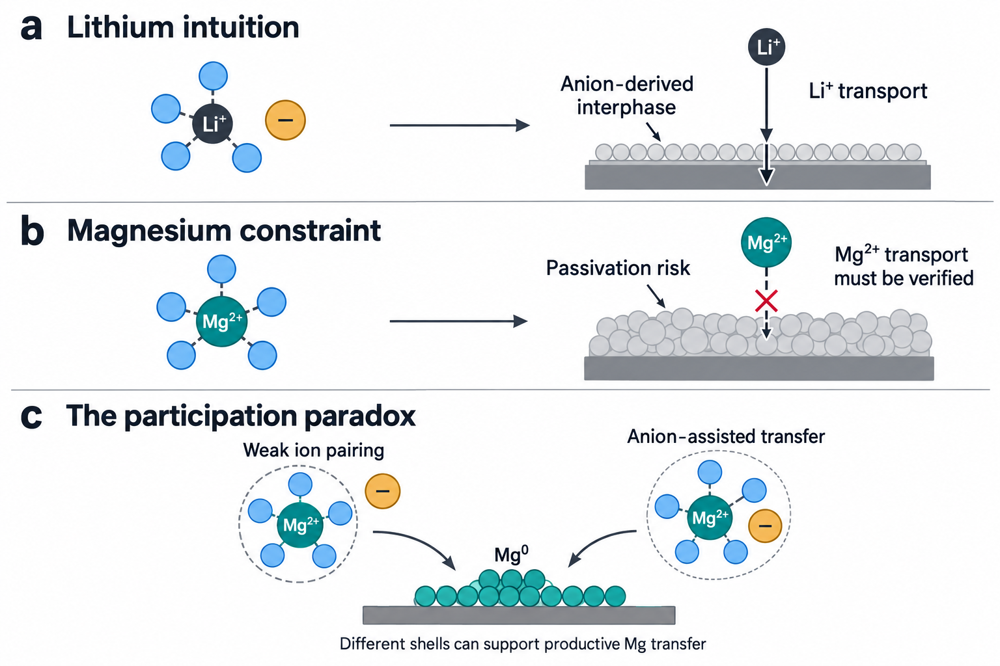
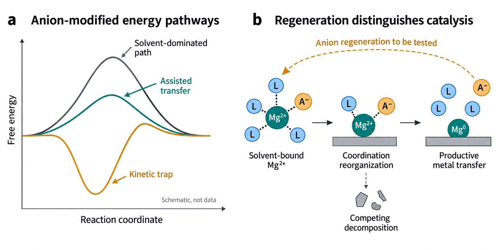
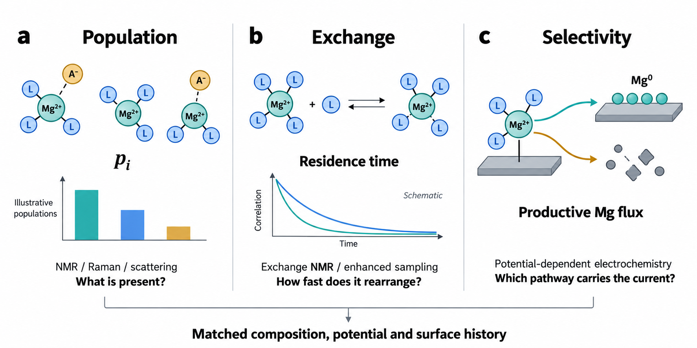
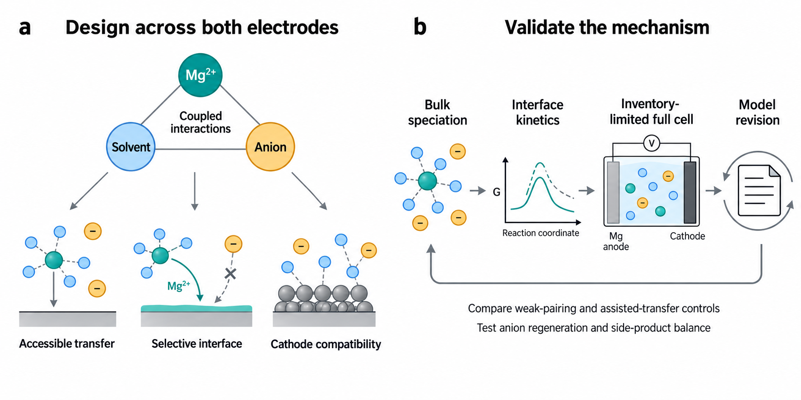

# Anion Regulated Desolvation in Magnesium Electrolytes

## Abstract

Anions are often brought into a battery electrolyte's first solvation shell to direct interphase formation. For magnesium, this interpretation misses an earlier and potentially decisive function: changing the energy landscape through which a strongly solvated divalent ion becomes a metal atom. The distinction matters because products that support lithium transport can obstruct magnesium transfer, and because both weakly paired and selected anion-containing magnesium electrolytes exhibit favourable kinetics. This Perspective examines that apparent contradiction through the coupled interactions among Mg²⁺, anions and solvents. We argue that shell-entering anions should be evaluated first as desolvation energy regulators and, where regeneration is demonstrated, as desolvation catalysts, rather than being interpreted only as precursors to a solid electrolyte interphase. Their value depends on the productive reaction pathways they open, not on coordination abundance alone. We distinguish equilibrium populations, ligand-exchange dynamics and potential-dependent selectivity, then connect these quantities to quantitative spectroscopy, free-energy calculations and electrochemical measurements. The resulting design principles seek accessible magnesium transfer, a persistent and permeable metal interface, and compatibility with the intended positive electrode. Finally, we propose a falsifiable measurement standard and a computational–experimental workflow that can discriminate energy regulation from sacrificial decomposition. Resolving the anion-participation paradox in this way would replace transferable-looking lithium analogies with mechanisms that can be tested in magnesium cells.

Keywords: magnesium metal batteries; anion participation; desolvation catalysis; solvation dynamics; interfacial energy landscape

## 1. Introduction

### 1.1. Magnesium and lithium require different electrolyte logic

The electrolyte problem in a magnesium battery begins at the point where dissolved magnesium must become metal. Aurbach and colleagues' prototype established that an organohaloaluminate electrolyte could support both reversible magnesium deposition and insertion into a Chevrel-phase positive electrode.[1,2,3] Subsequent progress has produced organoboron formulations, inorganic chloride complexes and chemically distinct boron-based salts, expanding the available coordination chemistry without removing the difficulty of combining metal compatibility with useful positive-electrode operation.[4,5,6,7] The defining challenge is therefore broader than finding a liquid that conducts ions or produces a magnesium deposit. It is to identify a solution chemistry whose charge carriers can reach a productive interfacial pathway repeatedly while the same electrolyte survives exposure to both electrodes.

Lithium electrolyte research supplies an extensive chemical vocabulary, but its most familiar design narrative needs qualification when applied to magnesium. In many lithium systems, increasing anion participation or decreasing free-solvent activity is useful partly because it changes the species reduced at the negative electrode and the interphase they produce.[8,9,10] Salt-rich lithium electrolytes and superconcentrated acetonitrile formulations exemplify how collective solution organisation can alter electrochemical behaviour, rather than simply changing the properties of an isolated solvent.[11,12] These observations do not establish that anion-rich shells are universally preferable even for lithium. They establish that solvation, reaction selectivity and interphase chemistry are coupled. The magnesium question is which part of that coupling remains beneficial when the transported ion is divalent and the metal is readily passivated.

Mg²⁺ generally interacts more strongly than Li⁺ with comparable donor environments. Its greater charge density promotes substantial solvent polarisation, multidentate coordination and sensitivity to counterion association.[13,14] Removing one donor can reorganize the remaining shell; changing an anion can alter ligand residence times, precursor charge and the accessible interfacial configurations. The ion approaching the electrode need not be a solvent-only Mg²⁺ complex with a passive counterion in the background. Chloride-containing species illustrate how the identity of the transferable complex can change with composition.[15,16] Desolvation is consequently not well represented by the energy required to detach an arbitrarily selected solvent molecule from one gas-phase cluster. It is a sequence, or a coupled set of events, within a responsive liquid and an electric field.

The interphase creates a second, independent difference. The solid electrolyte interphase concept describes a route by which reduction products can limit electron leakage while allowing continued ionic transport.[17,18] The existence of a protective lithium interphase does not establish that analogous compounds, defect structures or composite films will transport Mg²⁺ adequately. Magnesium studies repeatedly connect decomposition and contamination to passivation, although selected engineered interfaces can sustain useful cycling.[19,20,21] A composition described as beneficial in lithium therefore cannot be assigned the same function in magnesium from elemental analysis alone. The relevant evidence is sustained magnesium transfer through the particular interface under its operating conditions.

These differences create a cognitive paradox. A rule drawn from lithium may favour bringing anions close to the cation to seed a protective interphase. A rule drawn from the strong coordination of Mg²⁺ may favour excluding them to avoid deeper ion-pair traps. Yet magnesium formulations exist in which deliberately reorganized, anion-containing coordination environments support favourable kinetics.[22,23] Treating one rule as correct and the other as an exception obscures the shared problem: neither shell occupancy nor the eventual decomposition product specifies the route by which magnesium crosses the interface. Figure 1 places the lithium analogy and the magnesium contradiction within the same mechanistic question.

### 1.2. The bottleneck is a missing description of coupled interactions

Electrolyte discovery still depends heavily on recipe changes that alter several molecular and interfacial variables at once. Donor number, dielectric response, average coordination number and calculated binding energy each describe a useful aspect of a formulation. None identifies, on its own, the state that supplies magnesium to the electrode or the transformation that limits its transfer.[24,25,26,27] A stronger donor may improve dissolution while slowing ligand departure. A weaker ion pair may increase the population of charged carriers while exposing a coordinated solvent to reduction. A strongly associated precursor may be productive if its ligands rearrange readily at the surface, yet ineffective if it becomes a slowly exchanging reservoir. The same macroscopic improvement can therefore arise from different microscopic changes.

The relevant system contains three coupled relationships: Mg²⁺–solvent coordination, Mg²⁺–anion association and anion–solvent organisation. Perturbing one changes the chemical environment of the other two. Electronic effects in Grignard-derived electrolytes provide an early example of composition influencing electrochemical behaviour through more than a nominal salt concentration.[28] Mixed-donor and cosolvent formulations extend this principle: a component can alter anion availability or solvent activity without becoming the dominant ligand of magnesium.[29,30] The question is not which pairwise attraction should be minimised. It is how their combined rearrangement changes the free-energy differences and transition pathways relevant to metal transfer.

Two additional distinctions are essential. Bulk speciation differs from the distribution of reactive configurations near an electrode, and a thermodynamically stable electrolyte differs from one that remains operational because productive reactions outcompete decomposition.[31] The applied potential, adsorption and the pre-existing surface can select a minor bulk species or produce an intermediate absent from an equilibrium spectrum. Likewise, a lower total resistance can arise from improved conductivity, removal of a blocking layer or altered charge transfer. A mechanism becomes transferable only when its descriptor is connected to the particular contribution that changed. This requires population measurements, dynamic information and interfacial reaction accounting on the same chemical series.

### 1.3. Scope and central proposition

This Perspective connects the anion-participation paradox to quantitative tools, molecular design rules and computational integration. Its central proposition is that the mechanistically prior value of an anion entering the first Mg²⁺ solvation shell is its capacity to regulate desolvation and interfacial reorganization energies. An anion can replace a restrictive solvent configuration, redistribute local polarisation or help connect solution and surface-bound intermediates. These effects can precede irreversible decomposition and may explain productive transfer without requiring a beneficial anion-derived film. Where the anion is regenerated over repeated transfer events, the function can be described as desolvation catalysis. Where regeneration remains unproven, energy regulation is the more defensible term.

We develop this argument as a testable interpretation of existing electrolyte chemistry, rather than a universal assertion that anion coordination is catalytic. Recent counterpoised-interaction and dynamic-solvation studies make the hypothesis concrete, while weak-pairing formulations supply an indispensable comparison.[23,32,33] The analysis asks when an anion-containing state lowers the relevant barrier, when it instead creates a trap, and how either outcome can be distinguished from sacrificial interphase formation. It then identifies the measurements needed to connect these molecular effects to efficient magnesium cycling and positive-electrode compatibility. The objective is a design logic that remains accountable when the salt, solvent, potential or electrode history changes.

## 2. The Anion Participation Paradox in Magnesium Electrolytes

Figure 1. Why lithium electrolyte intuition does not uniquely determine magnesium electrolyte design. a) An anion-derived interphase can support lithium transport in an appropriate lithium system. b) Analogous decomposition in a magnesium system can obstruct transfer; magnesium permeability must be established experimentally. c) Weak ion pairing and selected anion-assisted coordination offer distinct routes to productive magnesium transfer. The juxtaposition defines the participation paradox rather than a universal ranking of electrolyte families. Circles, first-shell boundaries and films are schematic; their counts, thicknesses and geometries do not represent measured structures.

### 2.1. Weak ion pairing opens a productive route

Reducing anion participation can be effective when association stabilizes an unreactive precursor or promotes an unfavourable decomposition channel. The weakly ion-pairing Mg(TFSI)₂ electrolyte reported by Li and colleagues provides a direct example of solvent design used to facilitate pair dissociation while enabling magnesium cycling and high-voltage operation.[33] Earlier studies of TFSI-based formulations also show why a nominally convenient salt does not guarantee metal compatibility: the solvent environment and interfacial history remain decisive.[34,35,36] The transferable inference is that unnecessary association can be removed from the productive pathway. It is not that all anions should remain outside the first shell under every condition.

Weakly coordinating boron-cluster and fluorinated borate salts provide a complementary chemical route. Their development includes closo-borane and carborane electrolytes, efficient halogen-free formulations, and salts whose bulky ligand environments reduce the tendency towards strongly bound magnesium–counterion states.[37,38,39,40,41] These families should not be grouped merely because they contain boron. Their solubility, accessible solvent coordination, reductive chemistry and surface response differ. Comparing them with TFSI-based solutions is particularly informative when the same solvent and substrate are used, because anion identity can change interfacial behaviour even before a large change in an average coordination descriptor is apparent.[42]

Anion exclusion also carries costs. It can leave magnesium surrounded by persistent solvent donors, and it can shift the electrochemical liability towards those donors. A highly dissociated solution may therefore be a favourable transport medium but an unfavourable reaction medium. The observed rate depends on the availability of reactive configurations as well as the number and mobility of charged species. A bulk conductivity increase cannot distinguish these contributions, especially where ion correlations and neutral complexes change with formulation. A weak-pairing interpretation becomes persuasive when dissociation, exchange behaviour and controlled magnesium-transfer measurements change consistently across a composition series.

The strongest test is a counterfactual within one chemical family. Vary anion association while controlling solvent activity, temperature, impurity content and electrode preparation; then ask whether the population change predicts the kinetic ordering after transport corrections. If the ordering disappears on a preconditioned electrode, surface activation may dominate. If it persists but exchange slows, the presumed connection between weaker association and easier desolvation needs revision. Such outcomes are scientifically useful because they locate the boundary of the descriptor. Weak pairing is a mechanism to evaluate, rather than an endpoint that substitutes for a mechanism.

### 2.2. Anion participation can regulate desolvation before a film forms

The competing route is illustrated most clearly by magnesium chloride chemistry. MgCl₂ can improve chloride-containing electrolytes, and structural work identifies chloride-containing magnesium complexes whose coordination differs substantially from a simple solvent-only Mg²⁺ ion.[43,44,16,45] The associated literature documents chemically distinct routes to active solutions, including mixtures based on magnesium hexamethyldisilazide and MgCl₂ and chloride-complex formulations that avoid a lengthy conditioning stage.[46,47,48] These observations establish that counterion-containing precursors can participate in successful magnesium electrochemistry. They do not imply that their success arises exclusively from desolvation or that every chloride ligand performs the same role.

This distinction is important because chloride can also alter adsorption, impurity reactions and the persistence of passivating products. Operando mass-sensitive work comparing stable borate and more reactive TFSI electrolytes, each with and without chloride, directly links changes in passivation-layer evolution to electrolyte chemistry.[49] The same component may thus contribute both to a solution-state transfer pathway and to maintenance of the surface on which that pathway operates. Assigning all of its effect to the first shell would be as incomplete as assigning it all to a film. The mechanistic task is to separate these contributions without removing the chemistry that couples them.

Functional ligand formulations expose a related limitation of a simple weak-binding rule. Solvation-sheath reorganization with methoxyethyl amine chelants enables favourable charge-transfer behaviour in divalent-metal electrolytes.[22] Magnesium triflate formulations, phosphate-containing mixed shells and purposefully designed solvent molecules extend the evidence that changing coordination identity can activate otherwise difficult metal interfaces.[50,51,52,53] The relevant change may be redistribution of bond strength, altered denticity, improved access to a surface-bound intermediate or a different electronic response during reduction. A donor that binds strongly in one state can still facilitate transfer if it reorganizes the ensemble into a lower-barrier pathway.

The counterpoised-electrolyte study provides an explicit version of this argument. It connects the balance of Mg²⁺–solvent and Mg²⁺–anion interactions to a proposed synchronous desolvation route, while also reporting an MgH₂-containing interphase.[23] These are related but separable mechanistic propositions. Lowering a transfer barrier does not require that the anion be consumed, whereas film formation does involve chemical conversion of one or more electrolyte components. The first-shell anion can therefore be an energy regulator before it is a precursor to any solid product. Demonstrating that sequence would identify what the molecular design changes at the earliest rate-relevant stage.

Evidence for a beneficial interphase does not remove this distinction. An all-magnesium, perfluorinated-alkoxide electrolyte has been reported to form a stable hybrid interphase and enable sustained cycling.[54] Such a result supports the possibility of useful interphase chemistry in magnesium; it does not make decomposition the default explanation for every anion-containing shell. A film-focused interpretation should explain why the film persists and transports magnesium. An energy-focused interpretation should explain why a coordinated precursor reaches metal transfer more readily. Where both occur, separate evidence is needed for both. The prior question is what the anion does to the pathway before its chemical fate is decided.

### 2.3. The relevant variable is a pathway barrier

The paradox arises when a static descriptor is asked to predict a dynamic reaction. Anion occupancy measures how often a coordination motif occurs. An association free energy measures its relative stability under specified conditions. Neither gives the activation free energy for leaving that motif, approaching an electrode or transferring charge. A more strongly populated state can carry more productive flux if it offers a sufficiently accessible transition route. Conversely, an abundant, apparently weakly bound state can contribute little when a subsequent rearrangement or side reaction controls the outcome.[14,55,31] The appropriate comparison is therefore between complete reaction pathways, not between isolated pairwise attractions.

We use energy regulation to describe three plausible anion functions. First, solvent replacement can change the number and topology of donors that must reorganize near the surface. Second, anion-mediated redistribution of polarisation can change how the remaining solvent bonds respond as the coordination number or magnesium charge changes. Third, transient coordination or adsorption can connect solution configurations to surface-bound intermediates without requiring complete ligand removal in the bulk liquid. These functions are hypotheses whose importance will depend on the formulation. They do not require equal numerical Mg–anion and Mg–solvent binding energies, and no single optimum energy difference is implied.

Anions can also produce the opposite outcome. Deep association minima, slowly exchanging aggregates or surface-bound complexes that favour electrolyte reduction can reduce the productive transfer rate. Figure 2 contrasts an assisted route with a trapped route using a schematic energy landscape. The escape barrier must be measured relative to the populated intermediate, rather than inferred from the absolute height of a curve. A lower-energy complex is not intrinsically easier to discharge. The design target is sufficient stabilization for dissolution and transport, combined with a low-barrier connection to the productive interfacial state.

In a limiting regime where local precursor states interconvert rapidly compared with their transfer, an effective reaction rate can be written as a population-weighted sum:

k_eff(U) = Σᵢ pᵢ(U) kᵢ(U)

Here, pᵢ(U) denotes the population of precursor state i in the relevant near-interface ensemble at potential U, and kᵢ(U) its conditional transfer rate. Bulk spectral populations cannot be substituted for pᵢ(U) without an interfacial model or an experimental justification. Nor does this expression describe the current by itself: concentrations, mass transport, adsorption coverage and competing reactions remain necessary. When interconversion is slow, a kinetic network must replace the equilibrium-weighted approximation. The equation is useful because it shows how the same effective rate can arise from different combinations of population and pathway accessibility.

The phrase desolvation catalyst requires an additional criterion. A coordinated anion must facilitate the productive transition and return to a state capable of assisting another event, without net consumption in that proposed cycle. Otherwise it is a promoter, a reactant or a sacrificial film precursor. Demonstrating a lower barrier is sufficient to support energy regulation but insufficient to prove catalysis. Regeneration, anion balance and the exclusion of dominant sacrificial activation are decisive. A persistent kinetic benefit during continued metal transfer would be consistent with catalysis; it becomes compelling only when accompanied by chemical evidence that the proposed facilitator survives or is regenerated.

This criterion redirects the research question. Instead of asking whether more anion coordination is good or bad, ask which anion-containing configuration alters the rate-relevant transition, under what potential, and with what chemical fate. It also explains why weak pairing and assisted coordination need not compete for one universally optimal shell. One avoids an unproductive state; the other creates a productive connection between states. Both can accelerate magnesium transfer when they change the bottleneck in the correct direction. Their distinction should be visible in population, exchange and selectivity measurements rather than inferred retrospectively from a cycling curve.

Figure 2. Shell-entering anions as conditional energy regulators and candidate desolvation catalysts. a) Schematic free-energy routes illustrate a solvent-dominated barrier, a lower assisted-transfer barrier and a deeply populated intermediate with a substantial escape barrier. Curves have a common endpoint for visual comparison and are not calculated or measured profiles; the relevant trap barrier is referenced to its local minimum. b) An anion may facilitate coordination reorganization before metal transfer. A dashed return arrow identifies regeneration as a testable requirement for catalysis, while a competing branch represents decomposition. Ligand symbols and charges describe generic states, not a balanced molecular reaction or established electron-transfer sequence.

For a fixed overall reaction at a fixed potential, a catalyst changes activation pathways without changing the net equilibrium free-energy difference. Energy regulation has a broader meaning here because electrolyte composition can change the precursor ensemble and the conditional reaction free energies as well as the barriers. Keeping those meanings separate prevents the term catalyst from becoming a synonym for any useful additive. It also distinguishes assisted desolvation from the stronger claim that an anion directly catalyses the entire two-electron deposition process. The observed metal product does not establish the sequence of elementary electron transfers, and an anion can facilitate a ligand-rearrangement step without determining the subsequent charge-transfer mechanism. A complete account should identify the facilitated step, the species that returns after it and the conditions under which that cycle competes successfully with decomposition.

## 3. A Quantitative Toolbox for Ternary Interactions

### 3.1. Thermodynamics and the relevant energy landscape

A thermodynamic descriptor begins with a defined chemical transformation. For Mg²⁺–anion association, this requires specifying the solvated states, the number and identity of displaced ligands, and the activities used in the equilibrium constant. For solvent exchange, the reference should include the incoming ligand and the released ligand in a consistent environment. The association or exchange free energy then describes an equilibrium preference. For a defined exchange equilibrium, ΔG° = −RT ln K relates the standard molar free energy to an equilibrium constant formed from dimensionless activities; R is the gas constant and T the temperature. This quantity should not be labelled a desolvation barrier unless a transition state or a free-energy saddle connecting the states has actually been determined.

Electronic-structure calculations resolve local chemistry only when the compared transformations share consistent reference states. A series of cluster calculations with identical charge, ligand accounting, and reference states can compare candidate transformations. Solvation corrections, entropy, conformational sampling, and the coordination environment become particularly important when charged complexes are compared. Apparent improvements caused by inconsistent ligand numbers or by comparing a singly charged complex with a doubly charged bare ion can overwhelm the chemistry being investigated. Gas-phase binding energies remain useful for identifying plausible interactions, but their absolute values should not be treated as liquid-state equilibrium constants or electrode reaction energies.[14,55,31]

Molecular dynamics can supply the surrounding liquid environment, while enhanced sampling can generate a potential of mean force along a specified coordinate.[56,57] Coordination numbers, ion separation, and ligand orientation may each be relevant. A one-dimensional profile can conceal an alternative low-barrier route if the missing coordinate relaxes too slowly. For a proposed cooperative-release mechanism, at least the coupled Mg–solvent and Mg–anion coordination changes should be examined, and sampling convergence should be established rather than assumed. The choice of classical force field is also consequential: divalent-ion polarisation and charge-transfer effects may not be represented adequately by a fixed-charge model. Selected ab initio calculations and measured structure can constrain that model, although they do not eliminate its uncertainty.

The electrode adds a thermodynamic variable that is absent from bulk cluster screening. Adsorption and reduction pathways depend on electrode potential, surface charge, the electric field, and the evolving interphase. Constant-potential or grand-canonical calculations provide a more appropriate starting point than assigning all states the charge of a neutral slab.[58] These approaches still require choices about surface structure, solvent sampling, and the treatment of electrolyte screening. The target is a conditional energy landscape whose reference states and uncertainty permit comparison with experiment at the same potential and composition. A universal ranking derived from one isolated-cluster calculation is unlikely to survive those changes in environment.

The quantity that matters for assisted desolvation is the difference between a populated precursor and the transition region that connects it to productive transfer. This suggests comparing free-energy surfaces for matched solvent and anion environments, rather than reporting the most favourable energy from several differently composed clusters. Population estimates from biased simulations also need uncertainty and overlap diagnostics. Multistate reweighting provides a rigorous methodological basis for combining sampled equilibrium states, provided the simulations actually connect the relevant regions.[59] It cannot repair a missing pathway. For magnesium, a useful calculation should therefore show which coordination variables are sampled, which rearrangements remain unresolved and whether the proposed assisted route survives a change in the sampling representation.

### 3.2. Spectroscopy and quantitative coordination distributions

Spectroscopy links an electrolyte formulation to the populations that calculations attempt to describe. Raman and infrared measurements can reveal changes in anion and solvent environments, while NMR can constrain ligand coordination, molecular motion, and chemical equilibria.[15,16,60,61,30] Their strength lies in combined assignments across concentration and composition series. A single shifted band demonstrates a changed vibrational environment; it does not directly measure an interaction free energy or prove that one coordination species controls electrodeposition.

Quantitative interpretation requires attention to what the instrument weights. The area of a Raman component depends on its scattering response as well as its population. Deconvolving a band into several peaks does not make the fitted areas equal to species fractions unless the assignments and response factors support that conversion. NMR chemical shifts can be averaged by rapid exchange, and relaxation or exchange signals can reflect several processes. Two-dimensional correlation measurements may identify spatial proximity or exchange, depending on the experiment, but they should not be interpreted automatically as a unique bond. Isotopic labelling, independent chemical standards, and predicted spectra are useful where assignments remain ambiguous.

Direct magnesium spectroscopy is challenging because ²⁵Mg has limited sensitivity and quadrupolar behaviour. Measurements on solvent nuclei and suitable anion nuclei often provide complementary constraints, but their observables must be connected explicitly to magnesium coordination. X-ray absorption or scattering can supply information about local distances and broader liquid structure. These methods have their own resolution and model dependence; a fitted average coordination number can remain compatible with several distributions. Electrospray mass spectrometry and isolated crystal structures can identify chemically plausible complexes, although ionisation and crystallization select species and change their environment. Neither should be treated as a quantitative census of an undisturbed working electrolyte.

The reporting target should therefore be a distribution with stated uncertainty, supported by orthogonal measurements and simulation. Relevant quantities include the fraction of associated states, the number of donor atoms around magnesium, ligand identity and denticity, and the exchange regime in which the spectrum was measured. Coordination by six donor atoms does not necessarily mean coordination by six solvent molecules. This distinction matters particularly for glymes and mixed-donor molecules. Measurements across a designed concentration or cosolvent series can then test whether the proposed descriptor changes monotonically, whether a new species appears, and whether the electrochemical response follows the same trend. The most convincing evidence identifies where a structural trend ceases to predict performance.

Boron-based electrolytes illustrate why ligand identity must remain visible in the analysis. Magnesium borohydride chemistry and subsequent coordination studies established that ligand choice can alter electrochemical performance, while later boron-cluster salts access different counterion environments.[62,63,37] Treating all of these systems as one boron-derived coordination class would hide the interactions the descriptor is meant to resolve. A spectroscopy-led comparison should distinguish hydride-containing anions, cluster anions and fluorinated alkoxyborates, and should retain the solvent's denticity. The same average number of donor atoms can arise from different numbers of molecules and different exchange pathways. Structural evidence is strongest when these alternatives are tested explicitly rather than absorbed into a single fitted coordination number.

### 3.3. Kinetics and the hierarchy of time scales

Equilibrium populations specify which states are accessible, whereas kinetics specifies whether those states can supply the required flux. Ligand residence times, exchange correlations, diffusion, adsorption, interfacial electron transfer, nucleation, and ion passage through an interphase occupy different parts of the deposition process. Their relative importance can change with temperature, potential, current, and cycling history. A static solvation image cannot identify the slowest event.[14,55,31]

Simulations should distinguish continuous residence from intermittent association. A ligand that briefly leaves a distance cutoff and rapidly returns can generate very different residence-time estimates depending on the definition. The cutoff, survival function, fitting interval, trajectory length, and treatment of rebinding should be reported. Diffusion coefficients require adequate sampling and finite-size assessment, particularly when comparing simulation boxes or compositions.[64] Ionic conductivity also depends on correlated motion, so a Nernst–Einstein estimate based on independent ions can misrepresent a strongly associated electrolyte. Neither total conductivity nor solvent self-diffusion is an adequate substitute for the availability and mobility of electroactive magnesium species.

Experiments can interrogate different levels of this hierarchy. Exchange-sensitive NMR and temperature-dependent spectroscopy can constrain molecular dynamics where the relevant signals are accessible. Temperature-dependent electrochemical measurements can yield apparent activation parameters, but viscosity, solution populations, and interphase evolution may change simultaneously. Electrochemical impedance can separate some response time scales when a physically justified model and appropriate controls are used. A fitted resistance does not by itself identify a desolvation step, and several equivalent circuits can fit the same spectrum. Current transients provide information about induction, nucleation, and growth, provided mass transport and electrode geometry are considered.

Classical electron-transfer theory supplies useful concepts such as reorganization energy and driving force.[65] Applying a simple outer-sphere expression directly to magnesium deposition is nevertheless a modelling assumption. Metal deposition can involve adsorption, ligand rearrangement, sequential charge transfer, nucleation, and changes in the electronic environment. These processes may not obey the assumptions of one elementary outer-sphere event. A calculated reorganization energy should therefore be tied to a specified reaction and compared with kinetic observations, rather than presented as a complete explanation of a deposition overpotential. A discriminating experiment would determine whether a change in molecular exchange precedes a change in charge-transfer behaviour when bulk conductivity and electrode history are controlled. This comparison identifies the time scale that the electrolyte design changes.

Deposit morphology supplies a further kinetic discriminator, but it must be interpreted after molecular exchange and mass transport have been separated. Work distinguishing kinetic- and diffusion-driven magnesium growth, together with observations of dendrite growth in Mg(TFSI)₂/glyme cells, shows that magnesium does not have one intrinsically uniform deposition morphology.[66,67] A smoother deposit can result from a changed nucleation density, local transport or surface chemistry as well as from faster desolvation. Correlating morphology with an anion coordination fraction therefore leaves several causal routes open. The useful test is whether the proposed transfer mechanism predicts the morphology response when current density, substrate and deposited capacity are varied independently.

### 3.4. Redox behaviour and the limitations of orbital descriptors

The electroactive complex must reach a reactive configuration without predominantly reducing its ligands or counterions. This requirement connects solvation chemistry to the electronic structure of the entire complex and to the surface on which reduction occurs.[55,31] Coordination can shift the relative favorability of solvent and anion reactions, but the interpretation depends on the molecular environment and reaction products. A solvent that is stable as a free molecule may behave differently when coordinated to Mg²⁺, adsorbed on a surface, or exposed to an interphase catalytic site.

Frontier orbital calculations are useful for locating candidate sites for oxidation or reduction. They can guide which chemical transformations deserve closer examination. Isolated HOMO and LUMO energies are not equivalent to experimentally measured oxidation and reduction potentials. Charged-state relaxation, solvation, bond cleavage, proton transfer where relevant, and reaction entropy can alter the free energies. An orbital concentrated on an anion signals a possible vulnerability rather than proving that anion reduction dominates magnesium deposition. The associated reaction barrier and interfacial access remain necessary parts of the explanation.[9,31]

Electrochemical stability measurements likewise need a defined operational meaning. The onset observed in a voltammetric sweep depends on electrode material, surface area, scan rate, current threshold, temperature, and the electrolyte's ability to form a film. A high anodic onset on a relatively inert small electrode can coexist with substantial parasitic oxidation on a porous, charged cathode. Comparing stability windows across studies without these conditions can obscure the actual differences among electrolyte formulations. Potentiostatic holds, repeated cycling, gas analysis, and interphase-sensitive characterisation help determine whether a low current represents genuine stability, kinetic suppression, or a growing resistive film.

Reduction and oxidation should ultimately be expressed as competing conditional pathways. At the negative electrode, useful measurements distinguish magnesium deposition, chemically initiated electrolyte reaction, and electrochemically driven side reactions. At the positive electrode, they distinguish solvent oxidation, anion oxidation, current-collector corrosion, and cathode-specific reactions. At a specified deposition condition, productive faradaic selectivity can be defined as the magnitude of the magnesium-deposition partial current divided by the sum of deposition and parasitic faradaic-current magnitudes. This selectivity differs from cycle-integrated Coulombic efficiency, and chemical corrosion introduces losses outside that instantaneous current ratio. The electron balance should be checked against deposited or stripped magnesium and identifiable reaction products where possible. This approach does not require a perfectly inert electrolyte; it requires evidence that the net reactions and any resulting interphases remain compatible with useful ion transport and sustained cell operation.

The history of magnesium plating from organic solvents also cautions against identifying the measured cathodic current with one reaction.[68,3] A claim of anion-mediated acceleration should account for deposited metal, not only for an earlier reduction onset. In practice, coupled current, mass and chemical measurements can test whether a formulation changes productive transfer or merely opens another reduction channel. The same logic applies to a proposed catalyst: persistence of a low overpotential is evidence of sustained activity, but chemical analysis must establish whether that activity is maintained by a regenerated species or by continuous consumption of a large electrolyte reservoir. Redox selectivity gives the energy-regulation hypothesis its operational meaning.

Figure 3. Three distinct measurements required to interpret anion-assisted magnesium transfer. a) Coordination populations constrain which precursor states are present. b) Exchange and residence-time measurements constrain how quickly those states reorganize. c) Potential-dependent reaction analysis determines which accessible pathway carries productive magnesium flux rather than electrolyte decomposition. Bar heights and decay curves are illustrative and contain no measured values; ligand counts do not specify molecular formulas. The quantities should be cross-validated at matched composition, temperature, potential and surface history.

## 4. Design Principles Based on the Balance of Ternary Interactions

### 4.1. Principle one Optimising desolvation kinetics

The first design principle is to increase the productive flux through accessible magnesium-transfer pathways. Precursor abundance, ligand exchange, interfacial reorganization and charge transfer can each contribute to that flux. It avoids the assumption that the best electrolyte must minimise all Mg–ligand interactions. Successful mixed-solvent formulations illustrate how replacing one ligand with a stronger donor can improve electrochemistry by changing the entire coordination and reaction environment.[22,51,29,69,52,61] Weakly paired formulations demonstrate a complementary route in which anion exclusion and an appropriate solvent environment act together.[33]

A rational screening sequence should identify the dominant bulk populations, test their exchange dynamics, and then examine which species participate near the electrode. Solvent denticity and steric accessibility provide useful variables. A multidentate ligand may stabilise a compact shell while making sequential rearrangement different from that of several independent monodentate ligands. A mixed shell can create chemically distinct donor sites and alternative exit pathways. A recent boron-based electrolyte study illustrates another variable: dipole interactions are reported to weaken Mg²⁺–ligand coordination while an excess oxazinane–borane ingredient regulates an organic–inorganic interphase.[70] The coexistence of these effects supports examining molecular exchange and surface chemistry together. It also prevents assigning the entire electrochemical improvement to a bulk coordination change without a separating control. Neither denticity nor steric accessibility is automatically favourable. The same ligand can become a kinetic trap if its replacement is too slow or if its interface reaction produces blocking products. The screening target is therefore a balance between sufficient solvation for dissolution and transport and sufficient pathway accessibility for transfer.

Anion–solvent chemistry deserves equal attention. Changing the environment around an anion can alter its association with Mg²⁺ without requiring the cosolvent to dominate magnesium coordination. This possibility is especially relevant to mixed-donor solvents and formulations with substantial activity changes. Where protonated species or acid–base processes are proposed, their populations and origin must be measured rather than assumed from the presence of an amino group.[30] Trace water, solvent purity, and magnesium surface history can then become mechanistic variables instead of uncontrolled details. A matched comparison that keeps these variables constant is more informative than a large set of unrelated recipes.

The decisive performance test should separate transport from interfacial reaction. Compare electrolytes using controlled electrode preparation, magnesium inventory, deposited areal capacity, current density, and temperature. Assess induction and conditioning rather than reporting only favourable steady-state cycles. Complement deposition–stripping data with evidence of metallic magnesium and a check on side-product formation. A lower measured overpotential may reflect a more conductive electrolyte, a changed reference potential, or a different electrode surface as well as faster interfacial transfer. Establishing which contribution changes is essential if the design rule is to transfer to another salt or cathode.

Two multicomponent formulations illustrate why anion–solvent interactions belong in this screening sequence. A fluorinated-ether cosolvent has been reported to interact with chloride and favour charged ion–solvent clusters in a chloride-containing magnesium electrolyte; a high-entropy formulation using lithium triflate and trimethyl phosphate was reported to change the magnesium coordination environment while also promoting an interfacial layer.[71,72] These examples support treating the shell and its surrounding liquid as a coupled chemical system. They also show why several mechanisms may improve together. A proposed energy regulator should be tested through a matched comparison that separates precursor charge and mobility, ligand rearrangement, and the persistence of the resulting interface. Otherwise an improved cycling trace cannot identify which of these changes carried the benefit.

A useful comparison set would span three predicted regimes rather than only a preferred and a poor electrolyte. The first would retain weak association with the same principal solvent. The second would introduce an anion environment predicted to facilitate rearrangement. The third would deliberately stabilise a slowly exchanging associated state. Matching viscosity and conductivity exactly may be impractical, but measuring them permits their contributions to be constrained. The hypothesis should predict the ordering of a defined interfacial observable and a molecular exchange quantity before electrochemical screening. It should also predict how that ordering changes with potential or temperature. An intermediate coordination fraction performing best would then be interpretable as a consequence of competing pathways, rather than as evidence for a universally optimal fraction of first-shell anions.

### 4.2. Principle two Improving magnesium metal compatibility

The second principle is to favour interfaces that preserve magnesium transfer while limiting cumulative electrolyte consumption and metal loss. Compatibility involves more than the initial appearance of a deposit. A formulation may enable deposition onto a relatively clean substrate but subsequently produce an interphase that changes the reaction pathway. Conversely, a conditioning process can create a more favourable environment after substantial chemical or electrochemical evolution.[73,19,20,69] The conditioning cost and changing composition are therefore part of the performance assessment.

Adsorption, chemical stabilization of solution species, and interphase formation provide distinct routes to compatibility. Studies of controlled surface passivation, intermediate adsorption, borohydride-derived interphases, deposition morphology and hybrid-solvent chemistry illustrate distinct approaches to preserving magnesium transfer.[74,75,76,77,78] Functional amines and phosphates have prompted models involving competitive coordination, interfacial adsorption, and decomposition-derived protection.[79,61,53,30] These models should be treated as alternatives to discriminate, or as processes that coexist under defined conditions. A molecule detected on the surface may be an adsorbate, a reaction product, or a residue introduced during sample handling. Its presence alone does not establish the operative protective mechanism.

A useful interphase must suppress undesirable electron transfer or chemical attack without imposing prohibitive resistance to magnesium transport. Chemical composition is a necessary part of that assessment but not a sufficient one. Reports assigning magnesium permeability to a particular nitrogen-, phosphate-, or hydride-containing component require direct transport evidence, consideration of defects and interfaces, and stability during cycling.[21,53,30,23,76] A low calculated migration barrier in an ideal crystal cannot by itself identify the transport pathway through a heterogeneous electrochemical film. Similarly, detection of a decomposition product should not be equated automatically with either beneficial protection or complete passivation.

Mechanistic tests should connect the interphase to current and material balances. Time-dependent impedance and chemical analysis can reveal whether a film continues to grow. Controlled air-free transfer can reduce ambiguity from post-mortem oxidation, while depth-sensitive and spatially resolved measurements can identify heterogeneity. Comparison before and after conditioning is especially valuable. For claimed acid–base or hydrogen-containing mechanisms, isotopic labelling and gas analysis can distinguish plausible pathways, although interpreting these experiments requires careful accounting for exchange reactions. Zhang and co-workers emphasise the competing activation and passivation processes in such electrolytes.[21] A quantitative extension should identify their rates, dependence on potential, and contribution to cumulative losses.

This principle also clarifies the role of Coulombic efficiency. Efficiency is essential, but its value depends on the cycling protocol, substrate, stripping cutoff, deposit size, and treatment of residual metal. A long symmetric-cell lifetime can coexist with consumption of a large magnesium reservoir and does not establish the inventory efficiency of a practical full cell. The desired interface should demonstrate sustained transfer at relevant capacities with bounded electrolyte consumption. Those conditions connect molecular selectivity to the eventual limits on energy density and service life.

Surface activation offers a concrete alternative explanation for an apparent desolvation improvement. In a Mg/S electrolyte, LiCl-assisted solubilization of MgCl₂ was linked to exposure of fresh magnesium and lower polarisation.[80] Conditioning-free additives and mixed borohydride formulations provide other routes by which a practical electrolyte can change its interfacial behaviour.[81,82] These chemistries belong in the analysis because a coordination descriptor measured before cycling may coexist with substantial changes during activation. The counterfactual is straightforward: compare the electrolyte on fresh and deliberately preconditioned surfaces, while checking whether its solution composition changed. A benefit that depends mainly on removing a blocking product should be described as surface activation even if a solvation change accompanies it.

Gradient and hybrid interphases deserve a similarly explicit comparison. Strong-solvent-coordination formulations and perfluorinated-alkoxide systems have been reported to generate useful interfaces, demonstrating that magnesium passivation can sometimes be managed through designed film chemistry.[83,54] Those observations broaden the available strategies but do not displace the need to identify the conducting pathway. In particular, transport through a heterogeneous film may involve defects, internal boundaries or transiently exposed metal rather than the bulk lattice of its most abundant component. For anion-assisted transfer, the useful distinction is whether the kinetic gain appears before film development, persists after the solution is replaced, or requires continuing access to the coordinating anion. These observations separate molecular facilitation from a durable interphase contribution.

### 4.3. Principle three Extending high-voltage oxidative stability

The third principle is to evaluate positive-electrode compatibility while the same electrolyte remains functional at magnesium metal. Increasing donor strength or introducing a reactive additive may improve the negative electrode but create an oxidative vulnerability. Conversely, strongly electron-withdrawing anion chemistry can improve oxidation resistance while leaving solvent coordination or negative-electrode chemistry unfavorable.[84,39,85,86,53,33] Thus, oxidative stability belongs in the ternary design problem from the beginning, rather than being added after the preferred deposition electrolyte has been selected.

Coordination can change the oxidation propensity of a solvent, and reducing the activity of free solvent can change the available reaction pathways. Such effects are potentially useful, but they also influence viscosity, conductivity, association, and the exchange processes needed for magnesium transfer. A high-concentration or multicomponent formulation should therefore be analysed in terms of activities and species populations, not simply the nominal salt concentration. The solvent in the outer coordination environment and the solvent adsorbed at a positive electrode can contribute to oxidation even when the first solvation shell appears favourable. Bulk coordination measurements alone cannot establish the cathode-facing electrolyte structure.

Halide-mediated formulations highlight a separate limitation: favourable magnesium kinetics can accompany current-collector corrosion and insufficient high-voltage compatibility.[87,88,15,16,74] Replacing corrosive chemistry with suitable weakly coordinating anions is a rational strategy, but halide-free does not automatically mean chemically inert or corrosion-free under every condition. Stability tests should include the intended collector, separators, and other exposed components, alongside the active cathode. They should also distinguish electrolyte oxidation from a cathode reaction that changes the electrolyte environment.

Positive-electrode performance introduces further interpretation challenges. A reversible capacity does not alone prove that Mg²⁺ is the sole storage species. Residual alkali ions, protons, solvent co-insertion, or conversion reactions can contribute, depending on the electrode and electrolyte.[21,89] Demonstrating the intended mechanism requires chemically appropriate controls and material balance. Furthermore, an electrolyte improvement does not necessarily resolve slow magnesium diffusion within the solid cathode. The full-cell interpretation must separate interfacial transfer from solid-state transport and changes in the electrode structure.

Recent high-rate electrolyte studies make the identity of the positive-electrode reaction especially important.[23] A cathode-normalized capacity reported for a magnesium/fluorinated-carbon cell addresses a different question from reversible Mg²⁺ insertion into a high-voltage host or the energy density of a complete rechargeable cell. Such demonstrations should be interpreted using their specific cathode chemistry, mass basis, and cycling protocol. The operational target is a joint envelope of negative- and positive-electrode performance. Within a specified temperature, rate, capacity, and voltage range, the electrolyte should support efficient magnesium cycling while bounding oxidative loss and corrosion. Useful evaluation combines voltage holds and chemical diagnostics with sustained full-cell cycling and accounting for electrolyte volume and magnesium excess. A formulation that meets these conditions offers much stronger evidence for a transferable design rule than separate favourable tests on unrelated electrodes. Figure 4 expresses this requirement as three objectives of the same chemical system, without implying that one universal composition maximizes all of them.

Carborane development offers a particularly clear opportunity to separate redox stability from solubility and coordination. Smaller cluster anions have been introduced as non-corrosive, halide-free magnesium electrolytes, and modification at boron vertices has been reported to improve solubility without compromising the reported chemical and redox stability.[90,91] Such changes should be assessed alongside the first-shell and exchange descriptors rather than classified only by their anodic onset. A chloride-free formulation based on a tetrabutylammonium triflate additive provides another composition-specific route to extended anodic operation.[92] Its relevance is not that triflate universally solves the magnesium problem, but that additive chemistry must be judged by both its metal-facing and cathode-facing consequences.

Cathode identity is equally consequential. Compatibility with sulfur was a central target of an early structurally characterised magnesium electrolyte, whereas chloride-free magnesium–quinone cells and magnesium-storage organic polymers probe different coordination and charge-storage reactions.[93,94,95] These examples should not be ranked using capacity alone. Sulfur conversion, carbonyl coordination and insertion hosts ask different questions of the electrolyte and can have different soluble intermediates or side reactions. A desolvation-promoting design becomes practically useful when it retains its advantage in the intended cell chemistry, with the dominant stored species and mass basis established. Reporting those distinctions preserves the mechanistic connection between solution design and cell performance.

## 5. Integrating Theory and Data-Driven Design

### 5.1. High-throughput screening and data-driven inference

High-throughput electrolyte screening becomes valuable when the target and the comparison conditions are sufficiently clear. A large set of calculated solvent binding energies can identify chemical diversity, but it is poorly aligned with the cell problem if it omits anion identity, concentration, surface conditions, and parasitic chemistry. The ternary framework suggests a more informative hierarchy. Low-cost calculations and basic physicochemical measurements can reject unsuitable candidates. More detailed calculations and spectroscopy can characterise the surviving coordination ensembles. Interfacial experiments and full-cell tests should then evaluate the pathways that screening predicts.

A predictive model requires chemically and experimentally defined data. Each record should include salt and solvent identity, component fractions on an unambiguous basis, temperature, impurity levels, and the protocol used to obtain the target. Conditioning history, substrate, deposited capacity, reference-electrode convention, and voltage limits are essential for electrochemical outcomes. A reported Coulombic efficiency detached from these variables is not a transferable training label. Molecular identifiers and measured distributions should be retained alongside aggregate descriptors so that later analysis can distinguish different mechanisms that share an average coordination number or donor property.

Data-driven magnesium electrolyte design is already an active research direction: a 2025 Energy & Environmental Science study explicitly connects electrolyte screening to dynamic-solvation models.[32] The 2026 counterpoised-electrolyte study further links machine-learning selection to a proposed magnesium-transfer mechanism.[23] These examples shift the open question toward generalisation, uncertainty, and the evidentiary connection between a model descriptor and an interfacial pathway. Their value depends on testing those connections across salts, ligands, and operating conditions. Models should predict quantities that can be checked. Association populations, exchange trends, the likelihood of a particular reaction branch, or performance under a tightly standardised protocol offer clearer targets than a generic label of electrolyte quality. Mechanistic descriptors can complement molecular representations without presuming that the proposed mechanism is complete. Their added value should be tested against simpler baselines and against models using composition alone. Otherwise, a complex model may reproduce known chemistry without learning the pathway that supposedly motivates its design.

Machine-learning interatomic potentials offer a route to broader sampling when trained on suitable electronic-structure data.[96] For reactive electrolyte interfaces, coverage must include relevant coordination states, charges, surfaces, and reaction products. Extrapolation should be detected, and uncertainty should inform the next calculation or experiment. Separate chemical families should be held out during model assessment, rather than distributing close analogues randomly across training and test sets. The same principle applies to experimental data: splitting individual cycles from one formulation between training and testing can greatly exaggerate generalisation.

Active learning can direct effort toward informative candidates, as demonstrated in battery optimisation contexts outside magnesium electrolyte chemistry.[97] That precedent establishes a methodological opportunity, not evidence that a lithium-derived model will predict magnesium formulations. A magnesium-specific implementation should balance predicted performance, uncertainty, chemical diversity, and the cost of obtaining mechanistic evidence. Negative and null results are particularly valuable because they reveal where a favourable bulk descriptor fails at the interface. The objective is a screening loop that explains and predicts a controlled change in behaviour, with uncertainties that remain credible for unfamiliar salts and solvents.

Simulation-based learning must also distinguish a model that samples molecular motion from one that predicts a battery outcome. Machine-learning molecular dynamics has been applied to magnesium chloride–amine electrolytes to investigate interface stability and kinetics.[98] Such work addresses the cost of sampling chemically responsive trajectories. The next validation question is whether the sampled precursor distributions and reaction events reproduce independent measurements under the same conditions. A potential trained on bulk configurations can be accurate there and still fail near a charged surface. The useful training set should therefore include the states that distinguish weak-pairing, assisted-transfer and decomposition pathways, with explicit tests on configurations outside the most densely sampled family.

### 5.2. Connecting molecular simulation to operating-cell behaviour

Multiscale integration should preserve the quantities being transferred between models. Bulk simulations can supply distributions, diffusion, and exchange statistics, provided their force fields and sampling reproduce relevant measurements.[14,64] Selected electronic-structure calculations can constrain ligand chemistry and reaction possibilities. Interface calculations then need to examine how the applied potential, adsorption, and interphase alter the precursor ensemble and its pathways.[55,31,58] Passing a bulk-average coordination number directly into a model of metal deposition loses much of the information the molecular analysis was intended to provide.

The required bridge is a reaction network that connects solution states to interfacial intermediates and products. This network may include ligand exchange, adsorption, partial charge transfer, magnesium deposition, and competing electrolyte reactions. Free-energy surfaces and transition rates provide its parameters where they can be calculated reliably. Enhanced sampling and carefully chosen collective variables can assist in identifying competing routes, but predicted rare-event kinetics require additional validation.[56,57] The population-weighted rate expression introduced in Section 2.3 is one limiting reduction of this network; its applicability depends on the relative rates of interconversion and transfer.

At larger scales, interfacial fluxes and transport coefficients can feed models of concentration gradients, current distribution, and electrolyte depletion. Nucleation and growth introduce evolving surface area and morphology. Interphase formation changes both transport and electron transfer with time. These feedbacks explain why a favourable initial-state descriptor may lose predictive power after conditioning or extended cycling. A simulation program should state which feedbacks it includes and compare the resulting predictions with measured transients, temperature responses, and changes in interface chemistry. Agreement with one endpoint efficiency is insufficient to validate every intermediate assumption.

A practical route is to integrate a limited, well-characterised series before attempting chemical universality. Select one salt family and a small number of structurally related donor mixtures. Measure populations and exchange behaviour across a defined concentration range, calculate competing interfacial pathways at controlled potential, and test the predicted kinetic ordering on identically prepared electrodes. The model should also predict a condition under which that ordering changes or fails. This deliberate challenge is more informative than calibrating an increasingly flexible model to all available observations.

The final validation belongs in a working cell. Transfer of an interfacial rate constant from a clean model surface to a practical magnesium electrode is a hypothesis. Transfer to a cathode-facing interface is another. Joint measurements on the same electrolyte should establish which descriptors retain predictive value after realistic exposure to both electrodes and after the electrolyte composition evolves. Figure 4 presents this progression as an iterative experimental–computational loop. This progression exposes missing evidence and directs measurements towards the assumptions that most strongly affect the next prediction.

Robustness to impurities provides a useful challenge for any transferred mechanism. A hybrid AlCl₃/MgCl₂/Mg(TFSI)₂ electrolyte has been reported to tolerate substantial introduced water while remaining active, in contrast to the sensitivity of many magnesium formulations.[99] This is evidence for that formulation's operational chemistry, not permission to treat water as irrelevant in other systems. A multiscale model should predict whether a perturbation changes precursor populations, promotes passivation or is buffered by another reaction. Testing the response to a controlled impurity addition can reveal a missing reaction branch that an apparently successful dry-electrolyte model would never encounter. Such challenges make the eventual design rule more credible in a working cell.

Figure 4. Designing and validating a mechanism that remains useful at both electrodes. a) Coupled magnesium–anion–solvent interactions must provide accessible transfer, a selective magnesium interface and compatibility with the intended positive electrode. b) A proposed feedback loop connects bulk speciation, interface kinetics, an inventory-limited full cell and model revision. Matched weak-pairing and assisted-transfer controls, anion regeneration and side-product balance are explicit validation targets. Films, clusters, energy profiles and cell components are schematic. The loop does not represent a demonstrated predictive accuracy or a universally optimal formulation.

The interfacial ensemble deserves particular attention in this bridge. A negative electric field can change the local abundance and orientation of charged complexes, but electrostatic exclusion of a free anion does not prove that an anion cannot approach as part of a positively charged complex. Specific adsorption can further change the distribution. Thus, the relevant precursor charge and its ligand identities should remain explicit when bulk populations are transferred into a surface model.[15,16,31] The model should resolve whether an anion leaves before adsorption, remains during coordination reorganization or reacts in the double layer. These alternatives predict different potential dependence and different anion fates. Treating them as one generic desolvation event would discard precisely the information needed to distinguish weak-pairing and assisted-transfer routes.

## 6. Conclusions and Future Outlook

### 6.1. Reframing the role of the first-shell anion

Magnesium electrolyte research needs a different starting question from the most familiar lithium interphase narrative. A shell-entering anion should first be examined for what it does to the energy landscape of a strongly solvated divalent precursor. Its mechanistically prior value can be to redistribute coordination constraints, enable ligand reorganization and lower the barrier to productive metal transfer. This function may operate before decomposition and need not be explained by the eventual composition of a solid electrolyte interphase. Where anion regeneration is demonstrated, desolvation catalysis is an appropriate description. Where it is not, desolvation energy regulation remains both a useful concept and a more precise claim.

The distinction resolves the apparent contradiction between weak-pairing and anion-assisted electrolytes without assigning them one common microscopic mechanism. Weak pairing can remove a slowly exchanging or reactive precursor from the transfer network. Selected coordination can create a more accessible connection between solution and interfacial states. Their shared outcome is an increase in productive magnesium flux, but the chemistry that produces that outcome differs.[33,23] The important descriptor is a conditional pathway through the coupled Mg²⁺–anion–solvent landscape, interpreted together with precursor populations and competing reactions. Neither the smallest binding energy nor the largest anion coordination number is a general design target.

This perspective also changes how anion-derived products should be interpreted. A protective film, an inactive deposit and a regenerated facilitator are chemically distinct outcomes. Detecting an anion-derived component does not establish which role dominated the kinetic improvement. Conversely, observing rapid metal transfer before an appreciable film develops would support, but not by itself prove, a direct coordination-mediated route. Future studies should deliberately separate the transfer-promoting function from cumulative decomposition. The resulting mechanisms will be more useful than a classification based solely on whether the final interface contains an anion-derived element.

### 6.2. A measurement standard that makes the proposition falsifiable

We propose three quantitative elements for future magnesium electrolyte studies. The first is the precursor ensemble: measure coordination and association distributions under stated composition, temperature and impurity conditions, and report the uncertainty of the model used to extract them. The second is pathway accessibility: obtain exchange or residence-time information and an interfacial kinetic observable that can be connected through a defined reaction model. The third is productive selectivity: distinguish deposited magnesium from electrochemical and chemical electrolyte losses, while following interface resistance and stability at the intended positive electrode. These elements should refer to the same formulation and an explicitly related set of operating conditions.

The standard is a research proposal rather than an established consensus, and it does not prescribe one instrument. Its purpose is to align the evidence with the claim. A coordination argument needs structural evidence; a lower desolvation barrier needs a dynamic or kinetic connection; a catalytic argument additionally needs regeneration and material balance. Computational agreement is most informative when it predicts an independent observable or a change in kinetic ordering. A model fitted to one average coordination number and one cycling efficiency cannot validate every intermediate in a proposed transfer mechanism.

An especially discriminating experiment would compare weak-pairing and anion-assisted solutions on identically prepared magnesium surfaces while independently tracking anion fate. First identify the bulk ensembles and the ligand-exchange regime. Then measure potential-dependent transfer behaviour before and after controlled surface conditioning. Finally, quantify anion depletion, soluble transformation products and deposited species over the accumulated magnesium throughput. If the assisted route remains faster without proportional anion consumption, and the returned anion retains its facilitating function, the catalytic interpretation gains support. If improvement tracks irreversible anion loss or preformed-film coverage instead, an interphase or sacrificial activation mechanism becomes more likely. A hybrid outcome should be reported as such.

Perturbations provide further tests. A change in solvent denticity should alter an assisted rearrangement differently from simple ion-pair dissociation. A potential change can alter anion adsorption or precursor charge without preserving the bulk kinetic ordering. An impurity challenge can reveal whether apparent energy regulation actually depends on removal of a blocking layer. None of these responses should be assumed in advance. Their value is that a proposed mechanism must predict them before the result is known. Reporting negative outcomes and the conditions under which a design rule fails is essential to building a transferable account of magnesium chemistry.

### 6.3. From a molecular mechanism to a useful operating cell

The practical objective is a single electrolyte that combines efficient magnesium-metal cycling with meaningful positive-electrode operation. A desolvation-promoting anion or ligand can still be oxidatively vulnerable, corrosive or excessively consumed. A stable, weakly coordinating salt can still leave solvent exchange or solid-state cathode transport too slow. The design problem therefore has several coupled constraints; it cannot be solved by optimising the negative electrode in isolation.[100,89] The appropriate endpoint is an operating envelope measured with the intended cathode, current collectors, electrolyte inventory and magnesium excess, including the composition changes that accumulate during cycling.

The most promising next advances will join molecular selectivity to cell-level accounting. Dynamic-solvation models, counterpoised interactions and dipole-regulated formulations provide concrete starting systems for this effort.[32,23,70] A small, well-controlled series that predicts and verifies a change in pathway accessibility can be more informative than an extensive collection of unrelated high-efficiency formulations. Once the causal connection is established, multiscale calculations and data-driven screening can explore its chemical range, identify competing failure modes and select the next experiment.

The central conclusion is consequently a change in emphasis. In magnesium electrolytes, first-shell anions should be designed and evaluated as agents that regulate the energy of metal transfer, with desolvation catalysis reserved for demonstrated regeneration. Their conversion into an interphase is a separate chemical possibility whose benefit requires its own evidence. Keeping these functions distinct places the magnesium–lithium difference and the anion-participation paradox on a common, testable basis. It also moves electrolyte design towards the outcome that matters: productive magnesium transfer that remains efficient as the interface evolves and both electrodes do useful work.

## References

1. **Prototype systems for rechargeable magnesium batteries** D. Aurbach, Z. Lu, A. Schechter, Y. Gofer, H. Gizbar, R. Turgeman, Y. Cohen, M. Moshkovich, E. Levi, Nature 2000, 407, 724-727. https://doi.org/10.1038/35037553

2. **Electrolyte Solutions for Rechargeable Magnesium Batteries Based on Organomagnesium Chloroaluminate Complexes** D. Aurbach, H. Gizbar, A. Schechter, O. Chusid, H. E. Gottlieb, Y. Gofer, I. Goldberg, J. Electrochem. Soc. 2002, 149, A115-A121. https://doi.org/10.1149/1.1429925

3. **Nonaqueous Electrochemistry of Magnesium: Applications to Energy Storage** T. D. Gregory, R. J. Hoffman, R. C. Winterton, J. Electrochem. Soc. 1990, 137, 775-780. https://doi.org/10.1149/1.2086553

4. **Electrochemical performance of novel electrolyte solutions based on organoboron magnesium salts** Y. Guo, F. Zhang, J. Yang, F. Wang, Electrochem. Commun. 2012, 18, 24-27. https://doi.org/10.1016/j.elecom.2012.01.026

5. **A novel electrolyte system without a Grignard reagent for rechargeable magnesium batteries** F.-f. Wang, Y.-s. Guo, J. Yang, Y. Nuli, S.-i. Hirano, Chem. Commun. 2012, 48, 10763. https://doi.org/10.1039/c2cc35857c

6. **Highly soluble alkoxide magnesium salts for rechargeable magnesium batteries** C. Liao, B. Guo, D.-e. Jiang, R. Custelcean, S. M. Mahurin, X.-G. Sun, S. Dai, J. Mater. Chem. A 2014, 2, 581-584. https://doi.org/10.1039/c3ta13691d

7. **Boron–Based Electrolytes for Rechargeable Magnesium Batteries: Biography and Perspective** W. Ren, M. Cheng, Y. Wang, D. Zhang, Y. Yang, J. Yang, J. Wang, Y. NuLi, Batteries Supercaps 2022, 5, e202200263. https://doi.org/10.1002/batt.202200263

8. **Nonaqueous Liquid Electrolytes for Lithium-Based Rechargeable Batteries** K. Xu, Chem. Rev. 2004, 104, 4303-4418. https://doi.org/10.1021/cr030203g

9. **Electrolytes and Interphases in Li-Ion Batteries and Beyond** K. Xu, Chem. Rev. 2014, 114, 11503-11618. https://doi.org/10.1021/cr500003w

10. **Advances and issues in developing salt-concentrated battery electrolytes** Y. Yamada, J. Wang, S. Ko, E. Watanabe, A. Yamada, Nat. Energy 2019, 4, 269-280. https://doi.org/10.1038/s41560-019-0336-z

11. **A new class of Solvent-in-Salt electrolyte for high-energy rechargeable metallic lithium batteries** L. Suo, Y.-S. Hu, H. Li, M. Armand, L. Chen, Nat. Commun. 2013, 4, 1481. https://doi.org/10.1038/ncomms2513

12. **Unusual Stability of Acetonitrile-Based Superconcentrated Electrolytes for Fast-Charging Lithium-Ion Batteries** Y. Yamada, K. Furukawa, K. Sodeyama, K. Kikuchi, M. Yaegashi, Y. Tateyama, A. Yamada, J. Am. Chem. Soc. 2014, 136, 5039-5046. https://doi.org/10.1021/ja412807w

13. **Organic Electrolyte Design for Rechargeable Batteries: From Lithium to Magnesium** H. Zhang, L. Qiao, M. Armand, Angew. Chem., Int. Ed. 2022, 61, e202214054. https://doi.org/10.1002/anie.202214054

14. **The Coupling between Stability and Ion Pair Formation in Magnesium Electrolytes from First-Principles Quantum Mechanics and Classical Molecular Dynamics** N. N. Rajput, X. Qu, N. Sa, A. K. Burrell, K. A. Persson, J. Am. Chem. Soc. 2015, 137, 3411-3420. https://doi.org/10.1021/jacs.5b01004

15. **Role of Chloride for a Simple, Non-Grignard Mg Electrolyte in Ether-Based Solvents** N. Sa, B. Pan, A. Saha-Shah, A. A. Hubaud, J. T. Vaughey, L. A. Baker, C. Liao, A. K. Burrell, ACS Appl. Mater. Interfaces 2016, 8, 16002-16008. https://doi.org/10.1021/acsami.6b03193

16. **Structural Analysis of Magnesium Chloride Complexes in Dimethoxyethane Solutions in the Context of Mg Batteries Research** M. Salama, I. Shterenberg, L. J.W. Shimon, K. Keinan-Adamsky, M. Afri, Y. Gofer, D. Aurbach, J. Phys. Chem. C 2017, 121, 24909-24918. https://doi.org/10.1021/acs.jpcc.7b05452

17. **The Electrochemical Behavior of Alkali and Alkaline Earth Metals in Nonaqueous Battery Systems—The Solid Electrolyte Interphase Model** E. Peled, J. Electrochem. Soc. 1979, 126, 2047-2051. https://doi.org/10.1149/1.2128859

18. **Review—SEI: Past, Present and Future** E. Peled, S. Menkin, J. Electrochem. Soc. 2017, 164, A1703-A1719. https://doi.org/10.1149/2.1441707jes

19. **The metamorphosis of rechargeable magnesium batteries** R. Mohtadi, O. Tutusaus, T. S. Arthur, Z. Zhao-Karger, M. Fichtner, Joule 2021, 5, 581-617. https://doi.org/10.1016/j.joule.2020.12.021

20. **The origin of anode–electrolyte interfacial passivation in rechargeable Mg-metal batteries** J. Zhang, J. Liu, M. Wang, Z. Zhang, Z. Zhou, X. Chen, A. Du, S. Dong, Z. Li, G. Li, G. Cui, Energy Environ. Sci. 2023, 16, 1111-1124. https://doi.org/10.1039/d2ee03270h

21. **Critical Ingredients Revitalize Magnesium‐Metal Batteries: Rationality and Challenges** J. Zhang, Z. Zhang, H. Zhou, J. Liu, A. Du, S. Dong, X. Zhou, Q. Wang, G. Li, G. Cui, Adv. Mater. 2025, 37, 2417652. https://doi.org/10.1002/adma.202417652

22. **Solvation sheath reorganization enables divalent metal batteries with fast interfacial charge transfer kinetics** S. Hou, X. Ji, K. Gaskell, P.-f. Wang, L. Wang, J. Xu, R. Sun, O. Borodin, C. Wang, Science 2021, 374, 172-178. https://doi.org/10.1126/science.abg3954

23. **Solvent–Anion Counterpoised Electrolyte Enables High‐Rate Magnesium Metal Batteries** M. Zhang, R. Li, W. Zhao, R. Li, Z. Fan, X. Yang, Angew. Chem., Int. Ed. 2026, 65, e2598559. https://doi.org/10.1002/anie.2598559

24. **Rechargeable magnesium battery: Current status and key challenges for the future** P. Saha, M. K. Datta, O. I. Velikokhatnyi, A. Manivannan, D. Alman, P. N. Kumta, Prog. Mater. Sci. 2014, 66, 1-86. https://doi.org/10.1016/j.pmatsci.2014.04.001

25. **Progress in retrospect of electrolytes for secondary magnesium batteries** H. Shuai, J. Xu, K. Huang, Coord. Chem. Rev. 2020, 422, 213478. https://doi.org/10.1016/j.ccr.2020.213478

26. **Progress in development of electrolytes for magnesium batteries** R. Deivanayagam, B. J. Ingram, R. Shahbazian-Yassar, Energy Storage Mater. 2019, 21, 136-153. https://doi.org/10.1016/j.ensm.2019.05.028

27. **Recent progress of magnesium electrolytes for rechargeable magnesium batteries** Q. Sun, S. Luo, R. Huang, S. Yan, X. Lin, Coord. Chem. Rev. 2024, 515, 215956. https://doi.org/10.1016/j.ccr.2024.215956

28. **Study of electronic effect of Grignard reagents on their electrochemical behavior** Y. Guo, J. Yang, Y. NuLi, J. Wang, Electrochem. Commun. 2010, 12, 1671-1673. https://doi.org/10.1016/j.elecom.2010.08.015

29. **A Simple Halogen-Free Magnesium Electrolyte for Reversible Magnesium Deposition through Cosolvent Assistance** S. Fan, G. M. Asselin, B. Pan, H. Wang, Y. Ren, J. T. Vaughey, N. Sa, ACS Appl. Mater. Interfaces 2020, 12, 10252-10260. https://doi.org/10.1021/acsami.9b18833

30. **Synergy between the coordination and trace ionization of co-solvents enables reversible magnesium electroplating/stripping behavior** M. Wang, W. Sun, K. Zhang, Z. Zhang, A. Du, S. Dong, J. Zhang, J. Liu, X. Chen, Z. Zhou, F. Li, Z. Li, G. Li, G. Cui, Energy Environ. Sci. 2024, 17, 630-641. https://doi.org/10.1039/d3ee02450d

31. **Electrolyte Reactivity in the Double Layer in Mg Batteries: An Interface Potential-Dependent DFT Study** A. Kopač Lautar, J. Bitenc, T. Rejec, R. Dominko, J.-S. Filhol, M.-L. Doublet, J. Am. Chem. Soc. 2020, 142, 5146-5153. https://doi.org/10.1021/jacs.9b12474

32. **Data-driven design of advanced magnesium-battery electrolyte via dynamic solvation models** R. Li, W. Zhao, Z. Fan, M. Zhang, J. Li, R. Li, Z. Zuo, X. Yang, Energy Environ. Sci. 2025, 18, 6790-6798. https://doi.org/10.1039/d5ee01304f

33. **A weakly ion pairing electrolyte designed for high voltage magnesium batteries** C. Li, R. D. Guha, A. Shyamsunder, K. A. Persson, L. F. Nazar, Energy Environ. Sci. 2024, 17, 190-201. https://doi.org/10.1039/d3ee02861e

34. **Evaluation of (CF3SO2)2N−(TFSI) Based Electrolyte Solutions for Mg Batteries** I. Shterenberg, M. Salama, H. D. Yoo, Y. Gofer, J.-B. Park, Y.-K. Sun, D. Aurbach, J. Electrochem. Soc. 2015, 162, A7118-A7128. https://doi.org/10.1149/2.0161513jes

35. **Magnesium(II) Bis(trifluoromethane sulfonyl) Imide-Based Electrolytes with Wide Electrochemical Windows for Rechargeable Magnesium Batteries** S.-Y. Ha, Y.-W. Lee, S. W. Woo, B. Koo, J.-S. Kim, J. Cho, K. T. Lee, N.-S. Choi, ACS Appl. Mater. Interfaces 2014, 6, 4063-4073. https://doi.org/10.1021/am405619v

36. **Electrochemical cycling of Mg in Mg[TFSI] 2 /tetraglyme electrolytes** Z. Ma, M. Kar, C. Xiao, M. Forsyth, D. R. MacFarlane, Electrochem. Commun. 2017, 78, 29-32. https://doi.org/10.1016/j.elecom.2017.03.018

37. **Boron Clusters as Highly Stable Magnesium‐Battery Electrolytes** T. J. Carter, R. Mohtadi, T. S. Arthur, F. Mizuno, R. Zhang, S. Shirai, J. W. Kampf, Angew. Chem., Int. Ed. 2014, 53, 3173-3177. https://doi.org/10.1002/anie.201310317

38. **An Efficient Halogen‐Free Electrolyte for Use in Rechargeable Magnesium Batteries** O. Tutusaus, R. Mohtadi, T. S. Arthur, F. Mizuno, E. G. Nelson, Y. V. Sevryugina, Angew. Chem., Int. Ed. 2015, 54, 7900-7904. https://doi.org/10.1002/anie.201412202

39. **A new class of non-corrosive, highly efficient electrolytes for rechargeable magnesium batteries** Z. Zhao-Karger, M. E. Gil Bardaji, O. Fuhr, M. Fichtner, J. Mater. Chem. A 2017, 5, 10815-10820. https://doi.org/10.1039/c7ta02237a

40. **A Stable, Non‐Corrosive Perfluorinated Pinacolatoborate Mg Electrolyte for Rechargeable Mg Batteries** J. Luo, Y. Bi, L. Zhang, X. Zhang, T. L. Liu, Angew. Chem., Int. Ed. 2019, 58, 6967-6971. https://doi.org/10.1002/anie.201902009

41. **An Efficient Bulky Mg[B(Otfe)4]2 Electrolyte and Its Derivatively General Design Strategy for Rechargeable Magnesium Batteries** W. Ren, D. Wu, Y. NuLi, D. Zhang, Y. Yang, Y. Wang, J. Yang, J. Wang, ACS Energy Lett. 2021, 6, 3212-3220. https://doi.org/10.1021/acsenergylett.1c01411

42. **Comparative Study of Mg(CB11H12)2 and Mg(TFSI)2 at the Magnesium/Electrolyte Interface** R. Jay, A. W. Tomich, J. Zhang, Y. Zhao, A. De Gorostiza, V. Lavallo, J. Guo, ACS Appl. Mater. Interfaces 2019, 11, 11414-11420. https://doi.org/10.1021/acsami.9b00037

43. **MgCl2: The Key Ingredient to Improve Chloride Containing Electrolytes for Rechargeable Magnesium-Ion Batteries** B. Pan, J. Huang, N. Sa, S. M. Brombosz, J. T. Vaughey, L. Zhang, A. K. Burrell, Z. Zhang, C. Liao, J. Electrochem. Soc. 2016, 163, A1672-A1677. https://doi.org/10.1149/2.0821608jes

44. **A facile approach using MgCl2 to formulate high performance Mg2+ electrolytes for rechargeable Mg batteries** T. Liu, Y. Shao, G. Li, M. Gu, J. Hu, S. Xu, Z. Nie, X. Chen, C. Wang, J. Liu, J. Mater. Chem. A 2014, 2, 3430. https://doi.org/10.1039/c3ta14825d

45. **Highly active electrolytes for rechargeable Mg batteries based on a [Mg 2 (μ-Cl) 2 ] 2+ cation complex in dimethoxyethane** Y. Cheng, R. M. Stolley, K. S. Han, Y. Shao, B. W. Arey, N. M. Washton, K. T. Mueller, M. L. Helm, V. L. Sprenkle, J. Liu, G. Li, Phys. Chem. Chem. Phys. 2015, 17, 13307-13314. https://doi.org/10.1039/c5cp00859j

46. **The unexpected discovery of the Mg(HMDS) 2 /MgCl 2 complex as a magnesium electrolyte for rechargeable magnesium batteries** C. Liao, N. Sa, B. Key, A. K. Burrell, L. Cheng, L. A. Curtiss, J. T. Vaughey, J.-J. Woo, L. Hu, B. Pan, Z. Zhang, J. Mater. Chem. A 2015, 3, 6082-6087. https://doi.org/10.1039/c5ta00118h

47. **A conditioning-free magnesium chloride complex electrolyte for rechargeable magnesium batteries** J. H. Ha, B. Adams, J.-H. Cho, V. Duffort, J. H. Kim, K. Y. Chung, B. W. Cho, L. F. Nazar, S. H. Oh, J. Mater. Chem. A 2016, 4, 7160-7164. https://doi.org/10.1039/c6ta01684g

48. **Recent advances on MgCl2 based electrolytes for rechargeable Mg batteries** S. He, K. V. Nielson, J. Luo, T. L. Liu, Energy Storage Mater. 2017, 8, 184-188. https://doi.org/10.1016/j.ensm.2016.12.001

49. **Influence of Chloride and Electrolyte Stability on Passivation Layer Evolution at the Negative Electrode of Mg Batteries Revealed by operando EQCM‐D** B. W. Schick, V. Vanoppen, M. Uhl, M. Kruck, S. Riedel, Z. Zhao‐Karger, E. J. Berg, X. Hou, T. Jacob, Angew. Chem., Int. Ed. 2024, 63, e202413058. https://doi.org/10.1002/anie.202413058

50. **A High-Performance Magnesium Triflate-based Electrolyte for Rechargeable Magnesium Batteries** D.-T. Nguyen, A. Y. S. Eng, M.-F. Ng, V. Kumar, Z. Sofer, A. D. Handoko, G. S. Subramanian, Z. W. Seh, Cell Rep. Phys. Sci. 2020, 1, 100265. https://doi.org/10.1016/j.xcrp.2020.100265

51. **Constructing Efficient Mg(CF3SO3)2 Electrolyte via Tailoring Solvation and Interface Chemistry for High‐Performance Rechargeable Magnesium Batteries** D. Zhang, Y. Wang, Y. Yang, Y. Zhang, Y. Zhao, M. Pan, Y. Sun, S. Chen, X. Liu, J. Wang, Y. NuLi, Adv. Energy Mater. 2023, 13, 2301795. https://doi.org/10.1002/aenm.202301795

52. **Solvent Molecule Design Enables Excellent Charge Transfer Kinetics for a Magnesium Metal Anode** F. Wang, H. Hua, D. Wu, J. Li, Y. Xu, X. Nie, Y. Zhuang, J. Zeng, J. Zhao, ACS Energy Lett. 2023, 8, 780-789. https://doi.org/10.1021/acsenergylett.2c02525

53. **Tailoring Coordination in Conventional Ether‐Based Electrolytes for Reversible Magnesium‐Metal Anodes** W. Zhao, Z. Pan, Y. Zhang, Y. Liu, H. Dou, Y. Shi, Z. Zuo, B. Zhang, J. Chen, X. Zhao, X. Yang, Angew. Chem., Int. Ed. 2022, 61, e202205187. https://doi.org/10.1002/anie.202205187

54. **Stable Solid Electrolyte Interphase In Situ Formed on Magnesium‐Metal Anode by using a Perfluorinated Alkoxide‐Based All‐Magnesium Salt Electrolyte** J. Xiao, X. Zhang, H. Fan, Y. Zhao, Y. Su, H. Liu, X. Li, Y. Su, H. Yuan, T. Pan, Q. Lin, L. Pan, Y. Zhang, Adv. Mater. 2022, 34, 2203783. https://doi.org/10.1002/adma.202203783

55. **Instability at the Electrode/Electrolyte Interface Induced by Hard Cation Chelation and Nucleophilic Attack** Y. Yu, A. Baskin, C. Valero-Vidal, N. T. Hahn, Q. Liu, K. R. Zavadil, B. W. Eichhorn, D. Prendergast, E. J. Crumlin, Chem. Mater. 2017, 29, 8504-8512. https://doi.org/10.1021/acs.chemmater.7b03404

56. **Nonphysical sampling distributions in Monte Carlo free-energy estimation: Umbrella sampling** G. Torrie, J. Valleau, J. Comput. Phys. 1977, 23, 187-199. https://doi.org/10.1016/0021-9991(77)90121-8

57. **Escaping free-energy minima** A. Laio, M. Parrinello, Proc. Natl. Acad. Sci. USA 2002, 99, 12562-12566. https://doi.org/10.1073/pnas.202427399

58. **Grand canonical electronic density-functional theory: Algorithms and applications to electrochemistry** R. Sundararaman, W. A. Goddard, T. A. Arias, J. Chem. Phys. 2017, 146, 114104. https://doi.org/10.1063/1.4978411

59. **Statistically optimal analysis of samples from multiple equilibrium states** M. R. Shirts, J. D. Chodera, J. Chem. Phys. 2008, 129, 124105. https://doi.org/10.1063/1.2978177

60. **Quantifying the Correlation between Coordination Chemistry, Interfacial Formation, and Electrochemical Performances for Mg Battery Electrolytes** Z. Yang, L. Gao, N. J. Leon, C. Liao, B. J. Ingram, L. Trahey, ACS Appl. Energy Mater. 2024, 7, 1666-1675. https://doi.org/10.1021/acsaem.3c03261

61. **Stable Cycling of Mg Metal Anodes by Regulating the Reactivity of Mg2+ Solvation Species** Z. Li, D.-T. Nguyen, J. D. Bazak, K. S. Han, Y. Chen, V. Prabhakaran, T. T. Le, Z. Cheng, M. Song, V. G. Pol, K. T. Mueller, V. Murugesan, Adv. Energy Mater. 2024, 14, 2301544. https://doi.org/10.1002/aenm.202301544

62. **Magnesium Borohydride: From Hydrogen Storage to Magnesium Battery** R. Mohtadi, M. Matsui, T. S. Arthur, S.-J. Hwang, Angew. Chem., Int. Ed. 2012, 51, 9780-9783. https://doi.org/10.1002/anie.201204913

63. **Coordination Chemistry in magnesium battery electrolytes: how ligands affect their performance** Y. Shao, T. Liu, G. Li, M. Gu, Z. Nie, M. Engelhard, J. Xiao, D. Lv, C. Wang, J.-G. Zhang, J. Liu, Sci. Rep. 2013, 3, 3130. https://doi.org/10.1038/srep03130

64. **System-Size Dependence of Diffusion Coefficients and Viscosities from Molecular Dynamics Simulations with Periodic Boundary Conditions** I.-C. Yeh, G. Hummer, J. Phys. Chem. B 2004, 108, 15873-15879. https://doi.org/10.1021/jp0477147

65. **On the Theory of Oxidation-Reduction Reactions Involving Electron Transfer. I** R. A. Marcus, J. Chem. Phys. 1956, 24, 966-978. https://doi.org/10.1063/1.1742723

66. **Kinetic- versus Diffusion-Driven Three-Dimensional Growth in Magnesium Metal Battery Anodes** J. Eaves-Rathert, K. Moyer, M. Zohair, C. L. Pint, Joule 2020, 4, 1324-1336. https://doi.org/10.1016/j.joule.2020.05.007

67. **Dendrite Growth in Mg Metal Cells Containing Mg(TFSI)2/Glyme Electrolytes** M. S. Ding, T. Diemant, R. J. Behm, S. Passerini, G. A. Giffin, J. Electrochem. Soc. 2018, 165, A1983-A1990. https://doi.org/10.1149/2.1471809jes

68. **Plating of magnesium from organic solvents** L. P. Lossius, F. Emmenegger, Electrochim. Acta. 1996, 41, 445-447. https://doi.org/10.1016/0013-4686(95)00326-6

69. **Evolution of the Dynamic Solid Electrolyte Interphase in Mg Electrolytes for Rechargeable Mg-Ion Batteries** S. Fan, S. Cora, N. Sa, ACS Appl. Mater. Interfaces 2022, 14, 46635-46645. https://doi.org/10.1021/acsami.2c13037

70. **Dipole-Interaction-Tailored Solvation Structure and Interface Chemistry for B-Based Magnesium Electrolyte at High Current Density** J. Ji, X. Zhou, L. Zhang, S. Zhong, G. Huang, D. Zhang, C. Xu, Y. Liu, J. Phys. Chem. Lett. 2026, 17, 11295-11303. https://doi.org/10.1021/acs.jpclett.6c02608

71. **Cosolvent‐Assisted Formation of Charged Ion‐Solvent Clusters and Solid Electrolyte Interphase for High‐Performance Magnesium Metal Batteries** J. Xiao, X. Zhang, H. Fan, Q. Lin, L. Pan, H. Liu, Y. Su, X. Li, Y. Su, S. Ren, Y. Lin, Y. Zhang, Adv. Energy Mater. 2022, 12, 2202602. https://doi.org/10.1002/aenm.202202602

72. **High‐entropy Electrolyte Enables High Reversibility and Long Lifespan for Magnesium Metal Anodes** S. Wang, K. Wang, Y. Zhang, Y. Jie, X. Li, Y. Pan, X. Gao, Q. Nian, R. Cao, Q. Li, S. Jiao, D. Xu, Angew. Chem., Int. Ed. 2023, 62, e202304411. https://doi.org/10.1002/anie.202304411

73. **The Interplay of Al and Mg Speciation in Advanced Mg Battery Electrolyte Solutions** K. A. See, K. W. Chapman, L. Zhu, K. M. Wiaderek, O. J. Borkiewicz, C. J. Barile, P. J. Chupas, A. A. Gewirth, J. Am. Chem. Soc. 2016, 138, 328-337. https://doi.org/10.1021/jacs.5b10987

74. **Tuning the Reversibility of Mg Anodes via Controlled Surface Passivation by H2O/Cl– in Organic Electrolytes** J. G. Connell, B. Genorio, P. P. Lopes, D. Strmcnik, V. R. Stamenkovic, N. M. Markovic, Chem. Mater. 2016, 28, 8268-8277. https://doi.org/10.1021/acs.chemmater.6b03227

75. **Reversible Electrochemical Interface of Mg Metal and Conventional Electrolyte Enabled by Intermediate Adsorption** H. Wang, X. Feng, Y. Chen, Y.-S. Liu, K. S. Han, M. Zhou, M. H. Engelhard, V. Murugesan, R. S. Assary, T. L. Liu, W. Henderson, Z. Nie, M. Gu, J. Xiao, C. Wang, K. Persson, D. Mei, J.-G. Zhang, K. T. Mueller, J. Guo, K. Zavadil, Y. Shao, J. Liu, ACS Energy Lett. 2020, 5, 200-206. https://doi.org/10.1021/acsenergylett.9b02211

76. **Borohydride-Based Interphase Enabling Reversible Magnesium Metal Anode in Conventional Electrolytes** D. Zhang, Y. Sun, X. Liu, Y. Zhang, R. Wang, Y. Zhao, M. Pan, Y. Wang, S. Chen, M. Zhou, Y. Chen, J. Yang, J. Wang, Y. NuLi, ACS Energy Lett. 2024, 9, 2685-2695. https://doi.org/10.1021/acsenergylett.4c00757

77. **Realizing horizontal magnesium platelet deposition and suppressed surface passivation for high-performance magnesium metal batteries** G. Yang, Y. Li, J. Wang, Y. Lum, C. Y. J. Lim, M.-F. Ng, C. Zhang, Z. Chang, Z. Zhang, A. D. Handoko, T. Ghosh, S. Li, Z. Sofer, W. Liu, Y. Yao, Z. W. Seh, Energy Environ. Sci. 2024, 17, 1141-1152. https://doi.org/10.1039/d3ee02317f

78. **Non-nucleophilic electrolyte with non-fluorinated hybrid solvents for long-life magnesium metal batteries** Y. Sun, Y. Wang, L. Jiang, D. Dong, W. Wang, J. Fan, Y.-C. Lu, Energy Environ. Sci. 2023, 16, 265-274. https://doi.org/10.1039/d2ee03235j

79. **Interfacial Engineering of Magnesiophilic Coordination Layer Stabilizes Mg Metal Anode** Y. Liu, W. Zhao, Z. Pan, Z. Fan, M. Zhang, X. Zhao, J. Chen, X. Yang, Angew. Chem., Int. Ed. 2023, 62, e202302617. https://doi.org/10.1002/anie.202302617

80. **Extending Cycle Life of Mg/S Battery by Activation of Mg Anode/Electrolyte Interface through an LiCl‐Assisted MgCl 2 Solubilization Mechanism** H. Fan, Z. Zheng, L. Zhao, W. Li, J. Wang, M. Dai, Y. Zhao, J. Xiao, G. Wang, X. Ding, H. Xiao, J. Li, Y. Wu, Y. Zhang, Adv. Funct. Mater. 2020, 30, 1909370. https://doi.org/10.1002/adfm.201909370

81. **Electrolyte Additive Enabling Conditioning-Free Electrolytes for Magnesium Batteries** S.-J. Kang, H. Kim, S. Hwang, M. Jo, M. Jang, C. Park, S.-T. Hong, H. Lee, ACS Appl. Mater. Interfaces 2019, 11, 517-524. https://doi.org/10.1021/acsami.8b13588

82. **Electrolyte Based on Easily Synthesized, Low Cost Triphenolate–Borohydride Salt for High Performance Mg(TFSI)2-Glyme Rechargeable Magnesium Batteries** S. Hebié, H. P. K. Ngo, J.-C. Leprêtre, C. Iojoiu, L. Cointeaux, R. Berthelot, F. Alloin, ACS Appl. Mater. Interfaces 2017, 9, 28377-28385. https://doi.org/10.1021/acsami.7b06022

83. **Strong solvent coordination effect inducing gradient solid-electrolyte-interphase formation for highly efficient Mg plating/stripping** Y. Du, Y. Chen, S. Tan, J. Chen, X. Huang, L. Cui, J. Long, Z. Wang, X. Yao, B. Shang, G. Huang, X. Zhou, L. Li, J. Wang, F. Pan, Energy Storage Mater. 2023, 62, 102939. https://doi.org/10.1016/j.ensm.2023.102939

84. **Novel Design Concepts of Efficient Mg‐Ion Electrolytes toward High‐Performance Magnesium–Selenium and Magnesium–Sulfur Batteries** Z. Zhang, Z. Cui, L. Qiao, J. Guan, H. Xu, X. Wang, P. Hu, H. Du, S. Li, X. Zhou, S. Dong, Z. Liu, G. Cui, L. Chen, Adv. Energy Mater. 2017, 7, 1602055. https://doi.org/10.1002/aenm.201602055

85. **A Fluorinated Alkoxyaluminate Electrolyte for Magnesium-Ion Batteries** J. T. Herb, C. A. Nist-Lund, C. B. Arnold, ACS Energy Lett. 2016, 1, 1227-1232. https://doi.org/10.1021/acsenergylett.6b00356

86. **Remarkable electrochemical and ion-transport characteristics of magnesium-fluorinated alkoxyaluminate–diglyme electrolytes for magnesium batteries** T. Mandai, Y. Youn, Y. Tateyama, Mater. Adv. 2021, 2, 6283-6296. https://doi.org/10.1039/d1ma00448d

87. **Electrolyte Solutions with a Wide Electrochemical Window for Rechargeable Magnesium Batteries** O. Mizrahi, N. Amir, E. Pollak, O. Chusid, V. Marks, H. Gottlieb, L. Larush, E. Zinigrad, D. Aurbach, J. Electrochem. Soc. 2008, 155, A103. https://doi.org/10.1149/1.2806175

88. **Novel, electrolyte solutions comprising fully inorganic salts with high anodic stability for rechargeable magnesium batteries** R. E. Doe, R. Han, J. Hwang, A. J. Gmitter, I. Shterenberg, H. D. Yoo, N. Pour, D. Aurbach, Chem. Commun. 2014, 50, 243-245. https://doi.org/10.1039/c3cc47896c

89. **Current status and future directions of multivalent metal-ion batteries** Y. Liang, H. Dong, D. Aurbach, Y. Yao, Nat. Energy 2020, 5, 646-656. https://doi.org/10.1038/s41560-020-0655-0

90. **Below the 12-vertex: 10-vertex carborane anions as non-corrosive, halide free, electrolytes for rechargeable Mg batteries** S. G. McArthur, R. Jay, L. Geng, J. Guo, V. Lavallo, Chem. Commun. 2017, 53, 4453-4456. https://doi.org/10.1039/c7cc01570d

91. **Boron-vertex modification of carba- closo -dodecaborate for high-performance magnesium-ion battery electrolyte** M. Watanabe, J. Kanazawa, T. Hamamura, T. Shimokawa, K. Miyamoto, M. Hibino, K. Nakura, Y. Inatomi, Y. Kitazawa, M. Uchiyama, Mater. Adv. 2021, 2, 937-941. https://doi.org/10.1039/d0ma00925c

92. **Chloride-Free Electrolyte Based on Tetrabutylammonium Triflate Additive for Extended Anodic Stability in Magnesium Batteries** D. Chinnadurai, Y. Li, C. Zhang, G. Yang, W. Y. Lieu, S. Kumar, Z. Xing, W. Liu, Z. W. Seh, Nano Lett. 2023, 23, 11233-11242. https://doi.org/10.1021/acs.nanolett.3c03740

93. **Structure and compatibility of a magnesium electrolyte with a sulphur cathode** H. S. Kim, T. S. Arthur, G. D. Allred, J. Zajicek, J. G. Newman, A. E. Rodnyansky, A. G. Oliver, W. C. Boggess, J. Muldoon, Nat. Commun. 2011, 2, 427. https://doi.org/10.1038/ncomms1435

94. **Electrochemical Performance of Mg Metal‐Quinone Battery in Chloride‐Free Electrolyte** T. Pavčnik, J. Bitenc, K. Pirnat, R. Dominko, Batteries Supercaps 2021, 4, 815-822. https://doi.org/10.1002/batt.202000293

95. **Directing Mg-Storage Chemistry in Organic Polymers toward High-Energy Mg Batteries** H. Dong, Y. Liang, O. Tutusaus, R. Mohtadi, Y. Zhang, F. Hao, Y. Yao, Joule 2019, 3, 782-793. https://doi.org/10.1016/j.joule.2018.11.022

96. **Generalized Neural-Network Representation of High-Dimensional Potential-Energy Surfaces** J. Behler, M. Parrinello, Phys. Rev. Lett. 2007, 98, 146401. https://doi.org/10.1103/physrevlett.98.146401

97. **Closed-loop optimization of fast-charging protocols for batteries with machine learning** P. M. Attia, A. Grover, N. Jin, K. A. Severson, T. M. Markov, Y.-H. Liao, M. H. Chen, B. Cheong, N. Perkins, Z. Yang, P. K. Herring, M. Aykol, S. J. Harris, R. D. Braatz, S. Ermon, W. C. Chueh, Nature 2020, 578, 397-402. https://doi.org/10.1038/s41586-020-1994-5

98. **Machine learning molecular dynamics insight into high interface stability and fast kinetics of low-cost magnesium chloride amine electrolyte for rechargeable magnesium batteries** H. Hua, F. Wang, F. Wang, J. Wu, Y. Xu, Y. Zhuang, J. Zeng, J. Zhao, Energy Storage Mater. 2024, 70, 103470. https://doi.org/10.1016/j.ensm.2024.103470

99. **Electrochemical‐Conditioning‐Free and Water‐Resistant Hybrid AlCl 3 /MgCl 2 /Mg(TFSI) 2 Electrolytes for Rechargeable Magnesium Batteries** Y. He, Q. Li, L. Yang, C. Yang, D. Xu, Angew. Chem., Int. Ed. 2019, 58, 7615-7619. https://doi.org/10.1002/anie.201812824

100. **Chloride‐Free Electrolytes for High‐Voltage Magnesium Metal Batteries: Challenges, Strategies, and Perspectives** W. Zhao, Y. Liu, X. Zhao, Z. Pan, J. Chen, S. Zheng, L. Qu, X. Yang, Chem. Eur. J. 2023, 29, e202203334. https://doi.org/10.1002/chem.202203334
