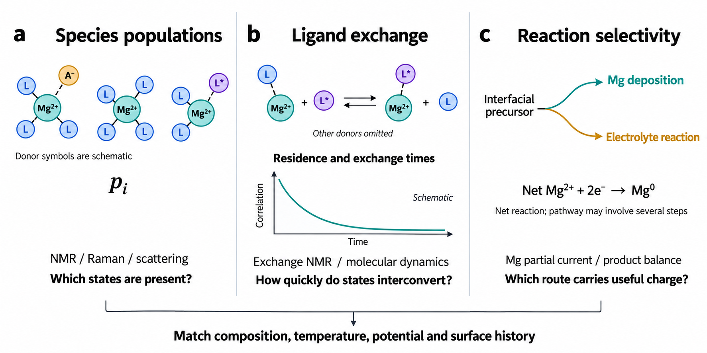

# Anion Regulation of Desolvation in Magnesium Electrolytes

## Abstract

Magnesium electrolytes expose a weakness in a familiar battery-design rule: bringing anions into the first solvation shell can help metal deposition, but excluding them can also work. The apparent contradiction arises because coordination abundance does not identify the reaction that limits magnesium transfer. This Perspective argues that the distinctive molecular value of a coordinating anion is its ability to reshape the energy pathway for ligand release and interfacial reorganization, before any interphase forms. Anions should therefore be assessed as desolvation energy regulators and, when their regeneration is demonstrated, as desolvation catalysts. Their possible conversion into a solid electrolyte interphase is a separate function. Following the differences between magnesium and lithium, we compare representative deposition results, distinguish molecular facilitation from surface activation, and assemble the measurements needed to connect solvation structure with useful metal-transfer rates. A proposed framework separates anion participation, kinetic effect and chemical fate. It explains why similar performance can emerge from different coordination environments and identifies experiments that can distinguish those mechanisms. The resulting design approach links accessible magnesium transfer to a stable metal interface and compatibility with the intended positive electrode.

Keywords: magnesium electrolytes; anion coordination; desolvation; reaction pathways; interfacial kinetics

## 1. Introduction

### 1.1. Why magnesium needs its own electrolyte logic

An electrolyte for a magnesium-metal battery must do more than dissolve a salt and carry charge. It must supply magnesium species that can lose or rearrange their ligands, accept electrons and join the metal without building an interface that stops the next transfer event. The early rechargeable magnesium prototype demonstrated this combination using an organohaloaluminate electrolyte and a Chevrel-phase cathode.[1,2,3] The subsequent history of magnesium electrochemistry shows how strongly the outcome depends on the solution and the exposed surface.[4,5] Recent assessments place electrolyte chemistry among the central constraints on magnesium and other multivalent batteries.[6,7,8,9] This makes the molecular route to metal deposition a design problem in its own right.

Lithium research provides useful comparisons, but its most common interphase narrative cannot be transferred directly. In many lithium electrolytes, anion participation and reduced free-solvent activity help determine which compounds are reduced and which interphase forms.[10,11,12] Concentrated and solvent-in-salt formulations show that changing collective solution structure can alter both reaction selectivity and electrode compatibility.[13,14,15] A useful lithium interphase limits electron leakage while supporting ionic transport.[16,17] Neither the chemical identity of its products nor that transport behaviour establishes that an analogous film will conduct magnesium adequately. Many magnesium interfaces instead become blocking, although carefully designed films can sustain cycling.[18,19,20] The transferable lesson is to connect solution chemistry with interfacial reactions; the preferred chemistry must be established for magnesium.

The difference begins with the ion. Mg²⁺ generally binds more strongly than Li⁺ to comparable donor environments and is more sensitive to changes in denticity, association and local polarization.[21,22] Removing one ligand can change the remaining shell, while counterion coordination can change the charge and geometry of the approaching complex. The electroactive species may therefore differ from the dominant bulk solvate. This creates a cognitive paradox: lithium-inspired arguments often favour anion-rich shells for interphase formation, whereas strong-binding arguments favour anion exclusion to simplify magnesium desolvation. Successful magnesium electrolytes have been reported on both sides.[23,24] Resolving the paradox requires identifying the molecular step that anion coordination changes, rather than assigning a universal advantage to either shell.

### 1.2. The missing link between a recipe and a transfer pathway

Magnesium electrolyte development has produced several distinct salt and solvent families, but a recipe that works well rarely supplies a complete mechanism.[25,26,27,28] Changing a solvent also changes salt dissolution, ion association, ligand exchange and the reactions available at the surface. A lower overpotential can reflect any combination of these effects. Donor number, average coordination number and isolated binding energy each describe part of the chemistry. They cannot independently identify the slow step or determine whether the current deposits magnesium. Calculations of magnesium–solvent and magnesium–anion interactions already show that stability, pairing and decomposition are connected.[22,29,30]

The relevant chemical system contains Mg²⁺–solvent, Mg²⁺–anion and anion–solvent interactions. A change in one can alter the other two. Chloride complexes provide a clear example: aggregation can ease one desolvation step while hindering electron transfer, so the fastest ligand release need not produce the fastest deposition.[31,32] The same coordination count can also conceal different donor identities and exchange routes. A useful descriptor should therefore specify the states being compared, their populations and the path connecting them to the electrode. This is more demanding than correlating a bulk spectrum with a cycling curve, but it is the level at which a design rule can be tested in another salt or solvent.

The development of organoboron, non-Grignard and alkoxide formulations shows why solution identity cannot be reduced to one cation–solvent pair.[33,34,35] Changes in the organic groups of a Grignard-derived electrolyte can also change its electrochemical behaviour.[36] These families differ in the equilibria that generate their carriers and in the ligands available near the electrode. Their diversity is useful for testing a mechanism: a descriptor that predicts behaviour in one family should be challenged in another without silently changing its meaning. The appropriate comparison is a defined coordination or reaction change, with the solvent and surface variables retained, rather than a salt name used as a proxy for the whole liquid.

### 1.3. The central argument and scope

We propose that the first-shell anion should be viewed primarily as a participant in magnesium transfer. Its distinctive value is the ability to change how a strongly solvated Mg²⁺ species releases ligands and reorganizes near the electrode. It can replace a restrictive donor arrangement, redistribute polarization or stabilize a useful intermediate. These effects occur at the molecular stage that precedes film formation. Describing the anion only as an SEI precursor therefore misses a possible source of kinetic control. Recent studies of counterpoised interactions, dynamic solvation and coordination beyond the primary shell make this broader energy-based interpretation experimentally relevant.[24,37,38]

The distinction between an energy regulator and a catalyst is important. A regulator changes the accessible pathway; a catalyst must also return to a state that can assist another event. Good cycling or an anion-derived surface product does not establish regeneration. The following sections compare weak-pairing and anion-containing electrolytes, examine the energy changes that could reconcile them, and define measurements that separate coordination effects from surface activation and film growth. We retain the progression from the participation paradox through quantitative tools to design and multiscale validation. The aim is a mechanism that explains both the kinetic benefit and the anion's subsequent fate.

## 2. The Anion Participation Paradox

Figure 1. Magnesium and lithium require different assessments of anion participation. a) A suitable lithium interphase can sustain ionic transport. b) Magnesium passivation can block transfer, although useful magnesium interphases are possible. c) Weak pairing and selected anion-containing shells can both support deposition. Dashed shell boundaries and donor icons indicate generic interactions, not measured coordination numbers. Mg²⁺ labels refer to the centre, not the total complex charge. Released ligands and counterions are omitted from panel c. The displayed Mg²⁺ + 2e⁻ → Mg⁰ equation specifies net reduction; it does not identify the elementary electron-transfer sequence or describe bare Mg²⁺ transport through a real film.

### 2.1. Weak pairing avoids an unproductive association

Weak pairing is attractive when a strongly associated precursor exchanges slowly or favours an unwanted reaction. A solvent-designed Mg(TFSI)₂ electrolyte demonstrates that facilitating pair dissociation can support magnesium deposition and operation with a high-voltage cathode.[23] Earlier work on TFSI-containing solutions shows why the salt label alone is insufficient: changing the donor environment and the cycling history changes the metal-facing behaviour.[39,40,41] Weak association can remove a difficulty from the transfer path, but the remaining solvent shell must still reorganize and survive reduction. A highly dissociated solution can conduct well while reacting poorly at magnesium.

Weakly coordinating salts offer a complementary route. Boron-cluster and carborane electrolytes expanded magnesium chemistry beyond the original organohalide formulations, while cluster modification provided ways to improve solubility without discarding the intended stability.[42,43,44,45] Fluorinated borates and alkoxyaluminates introduced further non-corrosive or high-voltage designs.[46,47,48,49,50] These are chemically different systems, not one low-pairing mechanism. A bulky anion may be weakly coordinating by design, but its actual first-shell population depends on the solvent, concentration and temperature. The solvent around magnesium remains an active part of the transfer problem.

Recent solvent strategies make that point explicit. Competitive ether coordination can loosen a borate electrolyte's solvent shell, and hydrofluoroether–diglyme mixtures explore another way of changing magnesium solvation.[51,52] The relevant comparison is between measured populations, exchange and interfacial rates within a controlled composition series. If dissociation increases but deposition slows, persistent solvent coordination or a surface reaction may have become limiting. Weak pairing is thus a route to accessible transfer, rather than a requirement that every counterion remain outside the first shell. Its success supplies a useful reference against which anion-assisted pathways should be judged.

Comparing a carborane electrolyte and a TFSI electrolyte at the magnesium interface provides a particularly useful starting point for separating anion identity from nominal salt concentration.[53] The comparison should retain the donor environment and follow how each solution reacts during cycling. If one maintains transfer with little continuing film growth while the other consumes electrolyte, the difference concerns selectivity and surface evolution as well as association. A weakly coordinating design becomes mechanistically informative when these accompanying changes are measured. That evidence is more transferable than assuming that every member of the same anion family must occupy the same fraction of the first shell.

### 2.2. Coordinating anions can help without one universal mechanism

Chloride chemistry supplies the clearest warning against equating anion coordination with poor magnesium kinetics. MgCl₂ can activate chloride-containing formulations, and structural studies identify magnesium chloride complexes with coordination and charges distinct from a solvent-only Mg²⁺ solvate.[54,55,56,57,58,59] Their behaviour depends on magnesium and aluminium speciation, ligand identity and conditioning.[60,61,62,63,64,65,66] Chloride is a coordinating ligand in the precursor and can also influence the exposed surface. This chemistry should not be treated as proof that any anion placed near Mg²⁺ will have the same effect.

Ligand-defined magnesium salts provide further examples. Phenolate, phenoxyimine, amido and Hauser-base formulations explore different local coordination and reactive-species chemistry.[67,68,69,70,71] Borohydride concentration and donor choice provide another way of changing metal compatibility.[72,73,74] Amine-containing cosolvents and redesigned solvent molecules show that a more strongly interacting donor can improve a complete transfer pathway even when simple weak-binding intuition predicts the opposite.[75,76,77,78] These results favour describing the coupled shell, rather than ranking isolated magnesium–ligand attractions.

A direct ion-pairing example is especially informative. In an amine electrolyte, introducing pairing into the primary shell was reported to weaken amine coordination and suppress solvent reduction and hydrogen evolution, enabling 99.6% Coulombic efficiency over 800 cycles.[79] This supports a useful role for anion coordination, but the demonstrated benefit concerns reaction selectivity; an independently reduced desolvation barrier requires additional evidence. Conversely, the counterpoised-electrolyte study connects magnesium–anion and magnesium–solvent interactions to a proposed synchronous desolvation route while also reporting an MgH₂-containing interface.[24] Both findings matter, but they describe separate possible contributions to performance.

The distinction also applies to chelating anions. MgEDTF was reported to form an anion-containing, unsaturated precursor and reduce the deposition/stripping overpotential relative to a non-chelating analogue; the authors also assign a role to anion-derived SEI formation.[80] Such a result is consistent with coupled coordination and interphase effects. It does not resolve which contribution produces the initial kinetic gain. Table 1 therefore places numerical results beside the reported interpretation and its limit. The table establishes that several coordination strategies can support useful deposition, while avoiding a ranking across different cells and protocols.

Table 1. Representative Mg deposition results across different solvation strategies

| Reported strategy and system | Reported Mg result | Interpretation and limit | Reference |
| --- | --- | --- | --- |
| Chloride complex; conditioning-free Mg electrolyte | 100% first-cycle CE | Coordinated chloride can coexist with reversible transfer | [63] P |
| Chloride complex; BTFE-assisted MLCC | 1200 h at 5 mA cm⁻²; reversible cycling at 20 mA cm⁻² | Charged clusters and interface formation both change | [81] P |
| Chloride complex; Mg(pftb)₂ + MgCl₂/THF | 99.7% CE over 3000 cycles | Coordination and a hybrid interphase coexist | [20] P |
| Ion-pairing amine electrolyte | 99.6% CE for 800 cycles | Pairing suppresses amine reduction; barrier reduction needs separate evidence | [79] P |
| Mixed shell; Mg(TFSI)₂ + LiOTf/DME–TMP | 98% CE | Association and phosphate-containing interface change together | [82] P |
| Counterpoised solvent–anion interactions | 0.06 V reported overpotential at 1 mA cm⁻² | Assisted desolvation and an MgH₂-containing interface coexist | [24] P |
| Chelating anion; MgEDTF/DME | Reported overpotential: 2.0 → 0.24 V; <0.20 V with halide | Authors also assign an SEI contribution | [80] P |
| Weakly coordinating anion design; Mg(CB₁₁H₁₂)₂/G4 | >94.4% CE | Anion design alone does not quantify shell occupancy | [43] S |
| Weakly coordinating anion design; Mg pinacolatoborate | >95% CE | No universal optimum anion fraction follows | [47] S |
| Weak ion pairing; Mg(TFSI)₂/DME–G2–BTFE–TEP | 95.2% CE; 7000 h reported cycling; 2 mAh cm⁻² deposition | Metrics come from distinct tests | [23] P/S |
| Competitive solvent coordination; borate/DME–THF | 120 mV at 10 mA cm⁻²; >1200 h reported separately | The 316 mV baseline used 8 mA cm⁻² | [51] P |
| Donor reorganization; Mg(TFSI)₂/DME–MOPA-1 | 99.5% CE; reported plating potential ≈ −0.1 V | Solvent reorganization does not establish anion catalysis | [75] S |
| Mixed coordination; Mg(OTf)₂/G2–MOEA | 98.3% average CE after 8200 cycles | Solvation and electrode-specific films both contribute | [83] P |
| Dipole regulation; EtMgCl/MOB | >1000 Mg\|\|Mo cycles at 5 mA cm⁻² | Ligand-energy regulation accompanies an organic–inorganic film | [84] P |
| Salt dissociation and interface regulation; OTf/Cl/DME–TEP | 99.4% CE after 3000 h; 0.5 mA cm⁻², 0.25 mAh cm⁻² | Mg\|\|Mo protocol; solvent and interface effects coexist | [85] P |
| Surface activation control; LiCl-assisted MgCl₂ solubilization | 140/140 mV plating/stripping overpotential at 0.5 mA cm⁻² | Removing blocking material can mimic faster desolvation | [86] P |

CE is Coulombic efficiency. P: numerical result verified in an accessed original-paper abstract; S: verified in the supplied Perspective, Table 1 or the surrounding text.[87] Plating potential is quoted as reported, not treated as overpotential. Unlisted current, capacity, temperature and reference conventions were not verified from the accessed source. Efficiencies, durations and capacities can describe different tests; rows are not a performance ranking. Strategy labels describe reported interpretations, not measured first-shell anion fractions.

### 2.3. From anion occupancy to energy regulation

Anion occupancy answers a structural question: how frequently does an anion coordinate magnesium? It does not specify how rapidly that state supplies metal. A stable, abundant precursor can be useful if it connects readily to a reactive interfacial state. It can instead become a reservoir that exchanges too slowly or feeds electrolyte decomposition.[22,29,30] The decisive variable is the barrier from the state actually populated under the operating conditions. A low absolute energy for a complex can deepen a trap rather than ease its escape. Figure 2 makes this distinction explicit.

A coordinating anion can regulate that path in several ways. It can replace solvent donors that are difficult to release, change the response of the remaining bonds to magnesium reduction, or help form a surface-bound intermediate. Anion–solvent interactions can also redistribute association without making the added solvent the dominant magnesium ligand.[81,82,88] These mechanisms do not require equal pairwise binding energies. Counterpoise is a composition-specific interpretation, not a universal numerical equality. Interactions outside the first shell can likewise change solvent mobility or activity, as illustrated by dual-site additive design and work on solvent–solvent interactions.[38,89] First-shell chemistry must therefore be understood within the liquid around it.

When local precursor states interconvert rapidly compared with their transfer, an effective rate can be approximated by a population-weighted sum:

k_eff(U) = Σᵢ pᵢ(U) kᵢ(U)

Here, pᵢ(U) is the population of near-interface state i at potential U, and kᵢ(U) its transfer rate. Bulk spectral populations are not automatically the relevant pᵢ(U). The expression also omits concentration gradients, surface coverage and competing reactions, and it becomes inadequate when interconversion is slow. Its value is conceptual: an electrolyte can accelerate deposition by changing the available states, their individual rates, or both. A lower first-shell anion fraction and a more reactive anion-containing state can therefore produce similar macroscopic outcomes through different mechanisms.

Desolvation catalysis adds a chemical requirement to this energy argument. The anion must facilitate the relevant rearrangement and be recovered for repeated use. For a fixed overall reaction, a catalyst changes the pathway rather than its equilibrium free-energy difference. An energy regulator can have a broader effect because changing solution composition also changes precursor stability and reaction selectivity. Dipole-regulated and amine-activation studies illustrate how these molecular effects can accompany evolving surface chemistry.[84,90] Tracking the anion's fate is what separates a reusable facilitator from a species consumed to form or repair a film. The core proposal is therefore to assess energy regulation first, then determine whether regeneration or decomposition follows.

Figure 2. Anion-assisted transfer as an energy mechanism with a separate chemical-fate test. a) Schematic profiles compare pathways for the same overall reaction at fixed potential; the escape barrier is the exit-peak energy minus the local intermediate minimum. No energy values or calculated profiles are implied. b) The illustrative net equation uses a monovalent A⁻ and neutral L, conserving magnesium, ligands, anion and charge. It does not apply unchanged to divalent chelating anions or identify elementary steps. The dashed recovery arrow is a hypothesis to test; decomposition is a competing branch without assumed regeneration.

The numerical examples in Table 1 make the interpretation concrete. The weak-pairing formulation reports 95.2% CE in the supplied review, while the ion-pairing amine formulation reports 99.6% CE for 800 cycles.[23,79,87] Both demonstrate useful deposition; their different protocols prevent ranking the intrinsic value of anion coordination. The counterpoised formulation reports 0.06 V overpotential at 1 mA cm⁻², whereas the chelating-anion study reports a reduction from 2.0 to 0.24 V within its own comparison.[24,80] These values are evidence of working formulations, not a shared energy scale. A quantitative explanation still needs to connect each improvement to the population, exchange, selectivity or surface change that was actually measured.

## 3. Quantitative Tools for the Transfer Mechanism

### 3.1. Measure the free-energy change that belongs to the claim

Energy regulation should be assessed for a defined chemical transformation. An ion-pairing free energy describes the relative stability of associated and dissociated states in a specified liquid. A ligand-exchange free energy compares a bound donor with its replacement and the released donor in the same environment. A desolvation barrier concerns the transition between those states. These quantities answer different questions. Their comparison requires consistent charge, composition, solvent activity and reference states. A more negative association energy cannot, by itself, demonstrate faster transfer. The relevant activation energy is measured from the precursor that is occupied, including a trapped intermediate where one forms.[22,31]

Cluster calculations can identify plausible donor arrangements and reaction sites, but they should be used within a liquid-state model. Comparing complexes with different charges or silently removing solvent molecules can produce a large apparent energy difference unrelated to the intended substitution. Surrounding solvent, conformational sampling and entropy are especially important for a multidentate shell. A calculation should follow a chemically balanced exchange or transfer route and report where its reference state lies. It should then predict an observable, such as a population change, a relative exchange rate or a change in the potential dependence of deposition. These are stronger validation targets than agreement with one selected structure.

Enhanced sampling provides a route from local structures to a free-energy surface.[91,92] For anion-assisted release, useful coordinates may include magnesium–solvent coordination, magnesium–anion coordination and distance from the surface. Sampling only one can miss a low-barrier route in another. Reweighting can combine sampled equilibrium states and estimate uncertainty when their distributions overlap; it cannot recover an unvisited transition.[93] The electrode potential also changes adsorption and redox energetics. Grand-canonical or suitable constant-potential approaches help account for that variable.[94,30] A convincing energy-based explanation should survive reasonable changes in coordination definitions and surface models, then reproduce the ordering of an independent experimental comparison. The purpose is a pathway that can be challenged, rather than an isolated number presented as a universal electrolyte descriptor.

### 3.2. Resolve a distribution rather than one preferred structure

Spectroscopy can connect a formulation to the species represented in the model. Raman and infrared bands distinguish anion and donor environments, while NMR can constrain coordination, association and motion. Magnesium-specific NMR and computational analysis have directly addressed solvation structures and dynamics in liquid electrolytes.[95] Chloride-complex and broader coordination studies show the value of combining methods across a composition series.[56,57,96,73] The desired result is a distribution with uncertainty: which ligands coordinate magnesium, how many donor atoms contribute, and how association changes when the solvent or salt is perturbed. Reporting only the lowest-energy cluster loses that distribution before the kinetic analysis begins.

Each measurement weights species differently. A Raman peak area depends on scattering response as well as abundance. An NMR shift can average environments that exchange rapidly. A fitted coordination number can be consistent with several structures, especially when multidentate donors contribute more than one atom per molecule. These effects can be managed with calibration, independently characterized standards, predicted spectra and complementary measurements. The analysis should retain alternative assignments where the data do not distinguish them. An apparent change from one fitted shell to another is persuasive only if the same assumptions remain valid across the series.

Chloride–lithium formulations illustrate why precursor charge deserves separate attention. Changes in cluster structure and ion–solvent organization can alter the abundance of charged carriers as well as their coordination.[97,81,59] The quantity needed for transport is therefore not simply the total concentration of magnesium. Mass spectrometry and crystal structures can identify plausible complexes, but ionization and crystallization select species. They do not provide an unperturbed population census of the working liquid. Likewise, a stable bulk species can be depleted near a polarized surface while a minor species becomes the preferred reactive precursor. The structure reported for a vial should be labelled as a bulk measurement unless an interface-sensitive method supports a stronger assignment.

The same discipline applies to a claim that anions have been excluded. A weakly coordinating salt or a changed vibrational band does not establish zero first-shell occupancy. A practical comparison can report the fraction assigned to associated states, its confidence interval and the exchange regime over which that assignment is valid. It can then ask whether transfer improves as the fraction changes within that specific family. If two structurally distinct solutions have similar performance, the result motivates measurements of exchange and reaction selectivity. It does not require choosing one structural model as the sole successful magnesium shell.

Figure 3. Measurements of populations, exchange and reaction selectivity answer different questions. a) Donor icons represent possible motifs without assigning real coordination numbers. b) The illustrated one-for-one exchange conserves both ligands: bound L plus free L* becomes bound L* plus free L; other donors are omitted. The decay is a schematic correlation function, not experimental data. c) Useful magnesium current is distinguished from electrolyte reaction. Net two-electron reduction is shown without assuming a concerted elementary event. Composition, temperature, potential and surface history must be connected across the measurements.

### 3.3. Connect exchange times to the rate at the electrode

An equilibrium population tells us what is present; a kinetic measurement tells us whether it can supply the required flux. Ligand residence, exchange, diffusion, adsorption, charge transfer and nucleation occur on different time scales. The limiting step can change with potential or surface history. A weakly associated complex may still exchange its solvent slowly, while an associated complex can reorganize rapidly at the surface. This is the experimental meaning of the participation paradox. Exchange-sensitive NMR, temperature-dependent measurements and molecular dynamics can constrain parts of the sequence, provided the measured process is identified rather than inferred from a generic relaxation signal.

Simulated residence times need a clear definition. Briefly crossing a distance cutoff and returning can produce different continuous and intermittent lifetimes. Reporting the cutoff, correlation function, treatment of rebinding and sampling length makes the comparison reproducible. Diffusion estimates also require finite-size and convergence checks.[98] Conductivity includes correlated motion, so an independent-ion estimate may misrepresent an associated electrolyte. A higher conductivity can lower cell polarization without changing the desolvation step. Measuring transport alongside interface kinetics is therefore part of a mechanistic comparison, not a secondary characterization task. The useful question is which rate changed after the contribution from bulk transport was constrained.

At the interface, impedance and current transients provide different constraints. A fitted resistance does not uniquely identify ligand release; adsorption, film transport and electron transfer can produce overlapping responses. Temperature-dependent electrochemistry gives apparent activation parameters, but populations and viscosity can change over the same range. Electron-transfer theory supplies concepts such as driving force and reorganization energy, while metal deposition also involves ligand rearrangement, adsorption and an evolving surface.[99] Measurements are most discriminating when the mechanism predicts how these responses change together. For example, faster molecular exchange combined with an unchanged film response would support a different explanation from unchanged exchange combined with progressive surface activation. Neither observation should be assumed from a lower overpotential alone.

A useful kinetic test deliberately keeps the proposed fast step separate from the overall rate. Suppose an associated precursor loses a donor more readily but adsorbs less favourably, or transfers electrons more slowly. The first barrier has improved while deposition may remain unchanged. Conversely, suppressing a side reaction can raise CE without accelerating ligand exchange. These possibilities explain why a universal correlation between binding energy and efficiency is unlikely. Measure at least one molecular rate and one metal-specific interfacial response, then test whether their relative change follows the proposed mechanism. The resulting mismatch can locate a missing step instead of being discarded as an inconvenient electrolyte.

### 3.4. Identify useful reduction and the chemical fate of the anion

An accessible coordination pathway is valuable only if it supplies magnesium rather than electrolyte products. Potential-dependent calculations show that coordinated solvent can react in the double layer before direct contact with the metal, and that useful deposition can compete with reactions favoured by thermodynamics.[30,29] This explains why a stability window needs an operational definition. Orbital energies can suggest likely reaction sites, but relaxed structures, solvent environment, bond cleavage and activation barriers determine the actual chemistry. A small cathodic onset or a low fitted barrier is not sufficient evidence of selective metal transfer.

Useful measurements connect current with material. Deposited magnesium, recovered charge, gas formation, soluble products and film growth constrain different losses. An instantaneous magnesium partial current differs from cycle-integrated Coulombic efficiency. Chemical corrosion can consume metal without appearing as the same faradaic current. Early organic-solvent plating studies and later dynamic-interphase work place these distinctions within the magnesium problem.[100,3,77] Operando mass-sensitive measurements are particularly informative when passivation grows, dissolves or changes during conditioning.[101] Their interpretation still needs controls for coupled solvent, porous layers and changes in surface area.

Anion recovery provides the additional test for catalysis. Measure whether the putative facilitator remains chemically available as magnesium throughput accumulates, and whether its presence continues to affect transfer after surface history is controlled. Low anion loss alone is insufficient: an inert spectator also survives cycling. Sustained rate enhancement alone is insufficient: a large reservoir can sustain sacrificial chemistry. The combination of pathway evidence, a persistent kinetic benefit and recovery of the active anion supports a catalytic description. Table 2 formalizes this distinction by separating where the anion participates, what rate or selectivity it changes, and whether it is recovered or consumed. These questions allow a multifunctional electrolyte to be described without forcing every benefit into either desolvation or SEI formation.

Table 2. A proposed framework separating anion participation, kinetic effect and chemical fate

| Proposed role | Defining function | Discriminating evidence | Relevant comparison |
| --- | --- | --- | --- |
| Outer-shell modifier or control | Changes solvent activity or mobility without dominant Mg coordination | Locate the additive; test exchange and transfer at matched conditions | [38] |
| Desolvation energy regulator | Changes the ligand-release or reorganization pathway | Population-resolved barriers or kinetics, independent of film growth | [24,75] |
| Desolvation catalyst | Facilitates transfer and returns to an active state | Rate enhancement plus anion recovery over repeated Mg throughput | Candidate role; not established by the cited comparisons |
| Selectivity regulator | Suppresses ligand or anion side reactions | Mg partial-current and gas/product balances, not CE alone | [79,30] |
| Sacrificial activator or SEI precursor | Is consumed to activate or protect the surface | Anion loss, film evolution and electrolyte-replacement controls | [20,80] |
| Kinetic trap | Stabilizes a state that cannot supply Mg rapidly | Long residence or a high escape/charge-transfer barrier | [31,22] |
| Dual function | Regulates coordination and also forms a useful interface | Separate early kinetics, anion consumption and persistent film effects | [85,84] |

These are proposed functional categories, not mutually exclusive electrolyte classes. References supply relevant examples or methodological comparisons; they do not establish every category. Catalysis requires regeneration. A regulator can affect transfer before its eventual chemical fate is known. The outer-shell comparison includes a neutral additive, not necessarily an anion.

## 4. Design Rules for Coupled Magnesium Anion and Solvent Chemistry

### 4.1. Open an accessible transfer route

The first design objective is to increase useful magnesium-transfer flux. This can involve a more available precursor, faster ligand rearrangement or a more selective interfacial reaction. Solvent redesign, amine assistance and phosphate-containing coordination environments demonstrate that improving the complete path can require more than reducing a single magnesium–donor attraction.[78,75,83,102] The pairing and weak-pairing examples show the same point from opposite directions.[79,23] A ligand must support dissolution and transport, yet leave or reorganize on a time scale compatible with the intended current. An anion is useful when it creates that connection while avoiding a new trap or a dominant decomposition route.

Denticity and steric structure offer controllable variables. A chelating donor can bind strongly while allowing sequential rearrangement through several conformations. A mixed shell can provide donor sites with different departure rates. Cyclic and linear ethers can therefore give different behaviour even when familiar donor descriptors appear similar.[51] Boronic-ester additives, synchronous solvation–interface strategies and more recent interface-kinetics studies explore related coupling between molecular organization and electrode response.[103,104,105] These studies should be compared through the chemical change they introduce. A common improvement in cycling does not establish a common elementary reaction or require all their dominant complexes to share the same coordination number.

Anion–solvent interactions create another design variable. A cosolvent can change the availability of a counterion without occupying most magnesium coordination sites. Ionization or proton-transfer chemistry can also create new charged species, especially in amine-containing formulations.[88,90] Such chemistry should be measured because it can affect both metal-transfer selectivity and hydrogen evolution. The shell is embedded in a chemically responsive liquid; selecting a preferred cluster while ignoring the surrounding component activities can miss the change that actually activates the interface. This is also why outer-shell regulation belongs beside first-shell design rather than being treated as an unrelated additive effect.

A useful screening series should include a weak-pairing formulation, a proposed assisted-transfer formulation and a deliberately persistent associated state. Measure their transport properties, populations and exchange before ranking their interfacial response. The proposed mechanism should predict a change in kinetic ordering with potential, temperature or donor substitution. A best-performing intermediate composition can then be interpreted through competing pathways. It should not be turned into a universal optimum anion fraction. This approach gives the term energy regulator a practical target: a controlled chemical modification that changes the rate-relevant route and predicts where the benefit ends.

The salt mixture provides a complementary perturbation to solvent redesign. Magnesium triflate formulations and a tetrabutylammonium triflate additive explore ways of activating solutions that would otherwise be difficult to use at magnesium.[106,107] Changing a salt or added ion can alter association, carrier charge and the amount of free donor simultaneously. A matched test should therefore identify which magnesium species changed and whether the introduced ion reaches either electrode. This is particularly important in mixed-metal formulations, where another cation can influence the cathode reaction. The useful design principle is the measured change in the transfer path, not the assumption that increasing anion supply must reproduce a first-shell energy benefit.

### 4.2. Preserve a magnesium interface that continues to transfer

The second objective is to retain metal compatibility as the surface evolves. A useful electrolyte can establish compatibility through selective adsorption, suppression of solvent reaction, removal of blocking material or formation of a persistent conducting film.[108,109,86,20] Artificial-interface and component-modifier strategies expand the available ways to manage the same problem.[110,111] These routes may coexist with solvation changes, but their contribution can be tested separately. If a kinetic improvement persists after the electrolyte is replaced, a retained surface structure deserves attention. If it requires the proposed coordinating species in solution, a continuing molecular contribution is more likely.

Impurity and conditioning controls are particularly important. Controlled water/chloride chemistry and operando layer measurements show that deposited products can form and disappear during the initial cycles.[112,101] Conditioning-free additives and mixed borohydride salts provide other examples in which an apparent kinetic improvement may involve surface activation.[113,114] A solution sampled before cycling can therefore differ from the electrolyte that supplies the reported steady-state performance. Compare fresh and conditioned surfaces, follow solution composition and account for the charge and material consumed during activation. Otherwise, rapid deposition after conditioning can be incorrectly attributed to the original bulk shell.

Useful films require evidence of transport and persistence, not only composition. Borohydride-based, gradient and hybrid-interface formulations report distinct approaches to sustaining magnesium cycling.[115,116,20] Transport in a heterogeneous layer can involve defects, boundaries or exposed metal rather than the bulk lattice of its dominant component. Identifying a nitrogen-, phosphate- or hydride-containing product does not establish its conducting role. A low migration barrier for an ideal crystal should therefore be tested against the evolving resistance and metal balance of the real film. The central claim concerns a functioning interface, not the presence of a favoured element in a surface spectrum.

Morphology introduces another independent cause of improvement. Surface-kinetic control, gradient scaffolds, facet-rich magnesium structures, horizontal platelets and orientation-selective additives can change nucleation and current distribution.[117,118,119,120,121] Work distinguishing kinetic- from diffusion-driven growth, together with reports of magnesium dendrites in glyme electrolytes, shows that morphology is not fixed by metal identity.[122,123] A smoother deposit cannot uniquely diagnose faster desolvation. Match deposited capacity and substrate preparation, then test whether the proposed molecular change predicts a morphology response after transport and surface effects are controlled. This preserves the distinction between electrolyte chemistry and the electrode structure on which that chemistry operates.

Impurity tolerance should be tested for the particular formulation. A hybrid AlCl₃/MgCl₂/Mg(TFSI)₂ electrolyte was reported to retain activity after introduction of 2000 ppm water.[124] That result demonstrates buffering or reaction chemistry in that system; it does not make water irrelevant in other magnesium electrolytes. A controlled impurity addition can test whether a proposed regulator still changes transfer or whether the observed benefit primarily comes from removing blocking products. Track the solution and the surface during the challenge. A molecular descriptor that works only after a specific purification or activation step should include that requirement in its scope rather than being reported as a composition-only rule.

### 4.3. Keep the same electrolyte useful at the positive electrode

The third objective is compatibility with both electrodes. Donors that activate magnesium can introduce oxidation liabilities, while highly stable salts can leave metal transfer too slow. Boron-based designs, non-nucleophilic electrolytes and fluorinated dialkoxide chemistry illustrate efforts to combine these constraints.[125,126,127,128,129] A weakly coordinating or chloride-free label cannot substitute for tests on the intended cathode and current collector. Corrosion, solvent oxidation and cathode-driven reactions should be separated wherever possible. The electrolyte must be evaluated after realistic exposure to the positive electrode, because that exposure can change the species returning to magnesium.

The reported anodic onset depends on electrode material, surface area, scan rate and the chosen current threshold. A high onset on an inert small electrode can coexist with continuing loss on a porous charged cathode. Voltage holds and chemical analysis help determine whether low current reflects stability, slow reaction or a growing resistive layer. Tetraglyme stability in chloride-complex electrolytes and cathode-interface coatings provide examples of how solvent and positive-electrode conditions can enter this assessment.[130,131] The relevant result is a bounded parasitic loss under the operating protocol, rather than the widest possible voltammetric window.

Cathode chemistry also changes what a successful electrolyte means. Sulfur conversion, organic carbonyl storage and enolization-based reactions present different transfer and solubility requirements.[132,133,134,135] Anion incorporation has been reported to improve the desolvation and charge transfer of a conversion-type magnesium cathode.[136] That observation supports assessing anion-assisted transfer at both interfaces, but cathode kinetics cannot be substituted for evidence of magnesium-metal deposition. Determine the stored species, possible co-insertion and contribution of other ions. A useful solvation design should retain its benefit in the intended cell chemistry while recognizing that it cannot remove every solid-state diffusion limitation of a cathode.

The final comparison should use one electrolyte at both electrodes, with known magnesium excess, electrolyte volume, positive-electrode loading and capacity limits. A high cathode-normalized capacity from a conversion or fluorinated-carbon demonstration answers a different question from rechargeable magnesium insertion or complete-cell energy density.[24,6] Similarly, a long symmetric-cell lifetime can consume a large metal inventory. Joint testing connects a molecular kinetic benefit to the operating cost of maintaining it. It is this connection that makes an energy regulator valuable for a battery, rather than only effective in an isolated deposition experiment.

## 5. Connecting Theory with Data Driven Design

Figure 4. A proposed design and validation loop. a) Coupled magnesium–anion–solvent chemistry must support accessible transfer, a functioning magnesium interface and positive-electrode compatibility. Triangle edges indicate interactions, not equal energies; film transport and barrier icons do not specify molecular reactions. b) Bulk measurements, interfacial kinetics and an inventory-limited full cell provide different validation targets before model revision. Small curves are schematic icons, not matched calculated profiles. Anion recovery and side-product loss help separate energy regulation from continuing film formation. The workflow does not imply established predictive accuracy.

### 5.1. Train models on a defined chemical question

Data-driven screening becomes useful when its target corresponds to a mechanism or a controlled performance test. A library of isolated solvent binding energies can provide chemical diversity, but it does not describe an electrolyte if anion identity, concentration and surface conditions are absent. Magnesium studies using dynamic-solvation models and counterpoised interactions show that molecular descriptors are entering practical screening.[37,24] The next question is whether those descriptors explain behaviour outside the formulations used to develop them. Predicting an association trend or a standardized kinetic ordering gives a clearer test than a single label of electrolyte quality.

Each experimental record should retain composition on a defined basis, temperature, impurity levels, substrate and conditioning. Current density, deposited capacity, stripping limit and the treatment of residual magnesium determine how a reported efficiency should be interpreted. Table 1 illustrates the consequences of missing or non-matched conditions: even verified numbers cannot be compared as if they measure one intrinsic property. Data should also preserve the distinction between bulk coordination, surface composition and the proposed mechanism. Otherwise, a regression can learn a particular laboratory protocol or salt family while appearing to learn desolvation chemistry.

Chemical generalization requires deliberate tests. Hold out complete anion or solvent families, rather than placing close analogues in both training and evaluation sets. Compare a mechanism-based model with composition-only and simpler physical baselines. Retain negative results, because a favourable bulk descriptor can fail at the surface. Active learning offers a way to select informative experiments, as demonstrated in battery optimization outside magnesium electrolyte discovery.[137] A magnesium implementation should seek candidates that discriminate weak pairing, assisted transfer and sacrificial activation, balancing expected performance with uncertainty and experimental cost. An uncertain prediction at a meaningful mechanistic boundary can be more valuable than another favourable prediction inside a familiar family.

### 5.2. Keep the reaction states explicit across scales

Molecular dynamics can provide populations, diffusion and exchange, but its treatment of divalent-ion polarization and reactive chemistry must be checked. Machine-learning interatomic potentials expand the accessible sampling when the training configurations cover the states of interest.[138] They have been applied to magnesium chloride–amine systems to examine stability and kinetics.[139] Accuracy in bulk liquid does not establish accuracy at a charged surface. Coordination changes, adsorption states and decomposition products should therefore enter both training and independent validation. A model should be able to reproduce a relevant spectrum or exchange trend before it supplies the population used in a metal-transfer calculation.

The next bridge is a reaction network. Bulk states connect to adsorbed precursors, ligand-rearranged intermediates, magnesium metal and side products. Potential-dependent energies and transition rates parameterize the links where they are known.[30,94] The population-weighted rate in Section 2.3 is a useful limiting approximation to this network, not a substitute for it. Explicit precursor charge matters: electrostatic exclusion of a free anion does not mean an anion cannot approach within a positively charged magnesium complex. The network should state whether the anion leaves before adsorption, remains during rearrangement, or reacts near the surface, because those alternatives predict different potential dependence and chemical fate.

At larger scales, the same links must remain connected to concentration gradients, surface area and changing interface resistance. A rate measured on a clean model electrode may lose its relevance as morphology and passivation evolve. The most efficient development path is therefore a small, chemically coherent series. Measure its populations and exchange, predict the kinetic ordering under controlled potential, and test a condition expected to reverse or erase that ordering. Then challenge the same electrolyte in the intended full cell. Agreement with a final efficiency is useful, but agreement with a predicted response to a chemical perturbation is stronger evidence that the model captures the pathway it claims to describe.

## 6. Conclusions and Outlook

### 6.1. Treat the first shell as part of the reaction

The first-shell anion is a component of the magnesium-transfer pathway before it is a possible source of an interphase. This is the central distinction from a design narrative focused mainly on decomposition products. Its molecular value lies in changing how magnesium coordination reorganizes and how readily useful transfer competes with unwanted reactions. An anion can open a lower-barrier route, suppress reaction of a bound solvent, or create a slowly exchanging trap. Its abundance alone cannot distinguish these outcomes. Weak-pairing and selected anion-containing electrolytes can therefore both succeed, because they remove or change different limits on the same overall transfer process.[23,79,24]

We favour desolvation energy regulator as the general mechanistic description when pathway evidence supports it. Desolvation catalyst is the stronger, testable description when the facilitating anion is recovered for repeated transfer. An SEI precursor is defined by another chemical fate: consumption into a surface product whose benefit depends on transport and persistence. These functions can coexist in one electrolyte. Separating them gives the central argument more explanatory power than choosing either molecular reorganization or film formation as the only acceptable mechanism. The novelty of the proposed framework is this separation of participation, kinetic effect and chemical fate into questions that can be measured independently.

### 6.2. Use measurements that can distinguish the proposed roles

A practical research standard should connect three kinds of evidence. First, quantify precursor populations and coordination under stated liquid conditions. Second, measure exchange or a relevant activation process and connect it to interfacial kinetics. Third, account for useful magnesium transfer, anion fate and competing losses. The methods can differ across laboratories, but the quantities should refer to the same formulation and compatible conditions. An averaged shell should not stand in for an exchange rate, and a cycling efficiency should not stand in for a barrier. The reporting standard is a proposal for future work, not an existing field-wide consensus.

For an anion-assisted mechanism, the most useful test compares a weak-pairing control and a proposed facilitating formulation on identically prepared surfaces. Follow kinetics before and after controlled conditioning, then change or replace the electrolyte while preserving the surface where possible. Track the active anion and its products as magnesium throughput accumulates. This experiment asks whether the benefit requires a continuing coordination environment, a retained film, a consumed activator, or a combination. Potential, donor substitution and controlled impurities provide additional perturbations. The mechanism should predict at least one response before it is measured. Reporting where that prediction fails is necessary for a design rule that can transfer to another chemical family.

### 6.3. Judge the mechanism by the cell it enables

Useful energy regulation must ultimately support both magnesium metal and the intended positive electrode. Better desolvation can still be offset by oxidation, corrosion, cumulative additive consumption or slow storage within the cathode.[140,6] The relevant achievement is a reproducible operating range with known metal and electrolyte inventories. Representative metal-transfer metrics help identify promising chemistry, but they do not establish complete-cell energy or long-term inventory efficiency. The same formulation should retain its molecular advantage after exposure to both electrodes and after the interface has evolved.

Progress will come from explanations that survive these changes. A first-shell anion should be selected for the transfer pathway it makes accessible, then evaluated for whether it returns, reacts or becomes trapped. That order of analysis places its role as a desolvation energy regulator at the centre of electrolyte design while giving interphase formation its proper, separately testable place. Demonstrating regeneration would then elevate a useful regulator to a desolvation catalyst. Linking that molecular function to a stable interface and a working positive electrode is the route from a persuasive coordination picture to an electrolyte that continues to do useful work in a magnesium battery.

## References

1. **Prototype systems for rechargeable magnesium batteries** D. Aurbach, Z. Lu, A. Schechter, Y. Gofer, H. Gizbar, R. Turgeman, Y. Cohen, M. Moshkovich, E. Levi, Nature 2000, 407, 724-727. https://doi.org/10.1038/35037553

2. **Electrolyte Solutions for Rechargeable Magnesium Batteries Based on Organomagnesium Chloroaluminate Complexes** D. Aurbach, H. Gizbar, A. Schechter, O. Chusid, H. E. Gottlieb, Y. Gofer, I. Goldberg, J. Electrochem. Soc. 2002, 149, A115-A121. https://doi.org/10.1149/1.1429925

3. **Nonaqueous Electrochemistry of Magnesium: Applications to Energy Storage** T. D. Gregory, R. J. Hoffman, R. C. Winterton, J. Electrochem. Soc. 1990, 137, 775-780. https://doi.org/10.1149/1.2086553

4. **Progress in nonaqueous magnesium electrochemistry** N. Amir, Y. Vestfrid, O. Chusid, Y. Gofer, D. Aurbach, J. Power Sources 2007, 174, 1234-1240. https://doi.org/10.1016/j.jpowsour.2007.06.206

5. **On the electrochemical behavior of magnesium electrodes in polar aprotic electrolyte solutions** Z. Lu, A. Schechter, M. Moshkovich, D. Aurbach, Journal of Electroanalytical Chemistry 1999, 466, 203-217. https://doi.org/10.1016/s0022-0728(99)00146-1

6. **Current status and future directions of multivalent metal-ion batteries** Y. Liang, H. Dong, D. Aurbach, Y. Yao, Nat. Energy 2020, 5, 646-656. https://doi.org/10.1038/s41560-020-0655-0

7. **Progress and perspective on rechargeable magnesium-ion batteries** G. Wang, Z. Wang, H. Shi, A. Du, M. Sun, G. Cui, Sci. China Chem. 2024, 67, 214-246. https://doi.org/10.1007/s11426-022-1454-0

8. **Research development on electrolytes for magnesium-ion batteries** Y. Man, P. Jaumaux, Y. Xu, Y. Fei, X. Mo, G. Wang, X. Zhou, Sci. Bull. 2023, 68, 1819-1842. https://doi.org/10.1016/j.scib.2023.07.027

9. **Current Design Strategies for Rechargeable Magnesium-Based Batteries** J. Zhang, Z. Chang, Z. Zhang, A. Du, S. Dong, Z. Li, G. Li, G. Cui, ACS Nano 2021, 15, 15594-15624. https://doi.org/10.1021/acsnano.1c06530

10. **Nonaqueous Liquid Electrolytes for Lithium-Based Rechargeable Batteries** K. Xu, Chem. Rev. 2004, 104, 4303-4418. https://doi.org/10.1021/cr030203g

11. **Electrolytes and Interphases in Li-Ion Batteries and Beyond** K. Xu, Chem. Rev. 2014, 114, 11503-11618. https://doi.org/10.1021/cr500003w

12. **Solvation Sheath of Li + in Nonaqueous Electrolytes and Its Implication of Graphite/Electrolyte Interface Chemistry** K. Xu, Y. Lam, S. S. Zhang, T. R. Jow, T. B. Curtis, J. Phys. Chem. C 2007, 111, 7411-7421. https://doi.org/10.1021/jp068691u

13. **A new class of Solvent-in-Salt electrolyte for high-energy rechargeable metallic lithium batteries** L. Suo, Y.-S. Hu, H. Li, M. Armand, L. Chen, Nat. Commun. 2013, 4, 1481. https://doi.org/10.1038/ncomms2513

14. **Unusual Stability of Acetonitrile-Based Superconcentrated Electrolytes for Fast-Charging Lithium-Ion Batteries** Y. Yamada, K. Furukawa, K. Sodeyama, K. Kikuchi, M. Yaegashi, Y. Tateyama, A. Yamada, J. Am. Chem. Soc. 2014, 136, 5039-5046. https://doi.org/10.1021/ja412807w

15. **Advances and issues in developing salt-concentrated battery electrolytes** Y. Yamada, J. Wang, S. Ko, E. Watanabe, A. Yamada, Nat. Energy 2019, 4, 269-280. https://doi.org/10.1038/s41560-019-0336-z

16. **The Electrochemical Behavior of Alkali and Alkaline Earth Metals in Nonaqueous Battery Systems—The Solid Electrolyte Interphase Model** E. Peled, J. Electrochem. Soc. 1979, 126, 2047-2051. https://doi.org/10.1149/1.2128859

17. **Review—SEI: Past, Present and Future** E. Peled, S. Menkin, J. Electrochem. Soc. 2017, 164, A1703-A1719. https://doi.org/10.1149/2.1441707jes

18. **The metamorphosis of rechargeable magnesium batteries** R. Mohtadi, O. Tutusaus, T. S. Arthur, Z. Zhao-Karger, M. Fichtner, Joule 2021, 5, 581-617. https://doi.org/10.1016/j.joule.2020.12.021

19. **The origin of anode–electrolyte interfacial passivation in rechargeable Mg-metal batteries** J. Zhang, J. Liu, M. Wang, Z. Zhang, Z. Zhou, X. Chen, A. Du, S. Dong, Z. Li, G. Li, G. Cui, Energy Environ. Sci. 2023, 16, 1111-1124. https://doi.org/10.1039/d2ee03270h

20. **Stable Solid Electrolyte Interphase In Situ Formed on Magnesium‐Metal Anode by using a Perfluorinated Alkoxide‐Based All‐Magnesium Salt Electrolyte** J. Xiao, X. Zhang, H. Fan, Y. Zhao, Y. Su, H. Liu, X. Li, Y. Su, H. Yuan, T. Pan, Q. Lin, L. Pan, Y. Zhang, Adv. Mater. 2022, 34, 2203783. https://doi.org/10.1002/adma.202203783

21. **Organic Electrolyte Design for Rechargeable Batteries: From Lithium to Magnesium** H. Zhang, L. Qiao, M. Armand, Angew. Chem., Int. Ed. 2022, 61, e202214054. https://doi.org/10.1002/anie.202214054

22. **The Coupling between Stability and Ion Pair Formation in Magnesium Electrolytes from First-Principles Quantum Mechanics and Classical Molecular Dynamics** N. N. Rajput, X. Qu, N. Sa, A. K. Burrell, K. A. Persson, J. Am. Chem. Soc. 2015, 137, 3411-3420. https://doi.org/10.1021/jacs.5b01004

23. **A weakly ion pairing electrolyte designed for high voltage magnesium batteries** C. Li, R. D. Guha, A. Shyamsunder, K. A. Persson, L. F. Nazar, Energy Environ. Sci. 2024, 17, 190-201. https://doi.org/10.1039/d3ee02861e

24. **Solvent–Anion Counterpoised Electrolyte Enables High‐Rate Magnesium Metal Batteries** M. Zhang, R. Li, W. Zhao, R. Li, Z. Fan, X. Yang, Angew. Chem., Int. Ed. 2026, 65, e2598559. https://doi.org/10.1002/anie.2598559

25. **Rechargeable magnesium battery: Current status and key challenges for the future** P. Saha, M. K. Datta, O. I. Velikokhatnyi, A. Manivannan, D. Alman, P. N. Kumta, Prog. Mater. Sci. 2014, 66, 1-86. https://doi.org/10.1016/j.pmatsci.2014.04.001

26. **Progress in retrospect of electrolytes for secondary magnesium batteries** H. Shuai, J. Xu, K. Huang, Coord. Chem. Rev. 2020, 422, 213478. https://doi.org/10.1016/j.ccr.2020.213478

27. **Progress in development of electrolytes for magnesium batteries** R. Deivanayagam, B. J. Ingram, R. Shahbazian-Yassar, Energy Storage Mater. 2019, 21, 136-153. https://doi.org/10.1016/j.ensm.2019.05.028

28. **Recent progress of magnesium electrolytes for rechargeable magnesium batteries** Q. Sun, S. Luo, R. Huang, S. Yan, X. Lin, Coord. Chem. Rev. 2024, 515, 215956. https://doi.org/10.1016/j.ccr.2024.215956

29. **Instability at the Electrode/Electrolyte Interface Induced by Hard Cation Chelation and Nucleophilic Attack** Y. Yu, A. Baskin, C. Valero-Vidal, N. T. Hahn, Q. Liu, K. R. Zavadil, B. W. Eichhorn, D. Prendergast, E. J. Crumlin, Chem. Mater. 2017, 29, 8504-8512. https://doi.org/10.1021/acs.chemmater.7b03404

30. **Electrolyte Reactivity in the Double Layer in Mg Batteries: An Interface Potential-Dependent DFT Study** A. Kopač Lautar, J. Bitenc, T. Rejec, R. Dominko, J.-S. Filhol, M.-L. Doublet, J. Am. Chem. Soc. 2020, 142, 5146-5153. https://doi.org/10.1021/jacs.9b12474

31. **Structure of Magnesium Chloride Complexes in Ethereal Systems: Computational Comparison of THF and Glymes as Solvents for Magnesium Battery Electrolytes** P. Jankowski, J. M. G. Lastra, T. Vegge, Batteries Supercaps 2020, 3, 1350-1359. https://doi.org/10.1002/batt.202000168

32. **Operating mechanisms of electrolytes in magnesium ion batteries: chemical equilibrium, magnesium deposition, and electrolyte oxidation** D. Y. Kim, Y. Lim, B. Roy, Y.-G. Ryu, S.-S. Lee, Phys. Chem. Chem. Phys. 2014, 16, 25789-25798. https://doi.org/10.1039/c4cp01259c

33. **Electrochemical performance of novel electrolyte solutions based on organoboron magnesium salts** Y. Guo, F. Zhang, J. Yang, F. Wang, Electrochem. Commun. 2012, 18, 24-27. https://doi.org/10.1016/j.elecom.2012.01.026

34. **A novel electrolyte system without a Grignard reagent for rechargeable magnesium batteries** F.-f. Wang, Y.-s. Guo, J. Yang, Y. Nuli, S.-i. Hirano, Chem. Commun. 2012, 48, 10763. https://doi.org/10.1039/c2cc35857c

35. **Highly soluble alkoxide magnesium salts for rechargeable magnesium batteries** C. Liao, B. Guo, D.-e. Jiang, R. Custelcean, S. M. Mahurin, X.-G. Sun, S. Dai, J. Mater. Chem. A 2014, 2, 581-584. https://doi.org/10.1039/c3ta13691d

36. **Study of electronic effect of Grignard reagents on their electrochemical behavior** Y. Guo, J. Yang, Y. NuLi, J. Wang, Electrochem. Commun. 2010, 12, 1671-1673. https://doi.org/10.1016/j.elecom.2010.08.015

37. **Data-driven design of advanced magnesium-battery electrolyte via dynamic solvation models** R. Li, W. Zhao, Z. Fan, M. Zhang, J. Li, R. Li, Z. Zuo, X. Yang, Energy Environ. Sci. 2025, 18, 6790-6798. https://doi.org/10.1039/d5ee01304f

38. **Dual‐Site Modulation of Mg 2+ Desolvation Beyond the Primary Solvation Shell in Magnesium Battery Electrolytes** Y. Deng, G. Li, R. Deng, B. Zhang, L. Cao, G. Huang, J. Wang, F. Pan, Angew. Chem., Int. Ed. 2025, 64, e202513213. https://doi.org/10.1002/anie.202513213

39. **Evaluation of (CF3SO2)2N−(TFSI) Based Electrolyte Solutions for Mg Batteries** I. Shterenberg, M. Salama, H. D. Yoo, Y. Gofer, J.-B. Park, Y.-K. Sun, D. Aurbach, J. Electrochem. Soc. 2015, 162, A7118-A7128. https://doi.org/10.1149/2.0161513jes

40. **Magnesium(II) Bis(trifluoromethane sulfonyl) Imide-Based Electrolytes with Wide Electrochemical Windows for Rechargeable Magnesium Batteries** S.-Y. Ha, Y.-W. Lee, S. W. Woo, B. Koo, J.-S. Kim, J. Cho, K. T. Lee, N.-S. Choi, ACS Appl. Mater. Interfaces 2014, 6, 4063-4073. https://doi.org/10.1021/am405619v

41. **Electrochemical cycling of Mg in Mg[TFSI] 2 /tetraglyme electrolytes** Z. Ma, M. Kar, C. Xiao, M. Forsyth, D. R. MacFarlane, Electrochem. Commun. 2017, 78, 29-32. https://doi.org/10.1016/j.elecom.2017.03.018

42. **Boron Clusters as Highly Stable Magnesium‐Battery Electrolytes** T. J. Carter, R. Mohtadi, T. S. Arthur, F. Mizuno, R. Zhang, S. Shirai, J. W. Kampf, Angew. Chem., Int. Ed. 2014, 53, 3173-3177. https://doi.org/10.1002/anie.201310317

43. **An Efficient Halogen‐Free Electrolyte for Use in Rechargeable Magnesium Batteries** O. Tutusaus, R. Mohtadi, T. S. Arthur, F. Mizuno, E. G. Nelson, Y. V. Sevryugina, Angew. Chem., Int. Ed. 2015, 54, 7900-7904. https://doi.org/10.1002/anie.201412202

44. **Below the 12-vertex: 10-vertex carborane anions as non-corrosive, halide free, electrolytes for rechargeable Mg batteries** S. G. McArthur, R. Jay, L. Geng, J. Guo, V. Lavallo, Chem. Commun. 2017, 53, 4453-4456. https://doi.org/10.1039/c7cc01570d

45. **Boron-vertex modification of carba- closo -dodecaborate for high-performance magnesium-ion battery electrolyte** M. Watanabe, J. Kanazawa, T. Hamamura, T. Shimokawa, K. Miyamoto, M. Hibino, K. Nakura, Y. Inatomi, Y. Kitazawa, M. Uchiyama, Mater. Adv. 2021, 2, 937-941. https://doi.org/10.1039/d0ma00925c

46. **A new class of non-corrosive, highly efficient electrolytes for rechargeable magnesium batteries** Z. Zhao-Karger, M. E. Gil Bardaji, O. Fuhr, M. Fichtner, J. Mater. Chem. A 2017, 5, 10815-10820. https://doi.org/10.1039/c7ta02237a

47. **A Stable, Non‐Corrosive Perfluorinated Pinacolatoborate Mg Electrolyte for Rechargeable Mg Batteries** J. Luo, Y. Bi, L. Zhang, X. Zhang, T. L. Liu, Angew. Chem., Int. Ed. 2019, 58, 6967-6971. https://doi.org/10.1002/anie.201902009

48. **An Efficient Bulky Mg[B(Otfe)4]2 Electrolyte and Its Derivatively General Design Strategy for Rechargeable Magnesium Batteries** W. Ren, D. Wu, Y. NuLi, D. Zhang, Y. Yang, Y. Wang, J. Yang, J. Wang, ACS Energy Lett. 2021, 6, 3212-3220. https://doi.org/10.1021/acsenergylett.1c01411

49. **A Fluorinated Alkoxyaluminate Electrolyte for Magnesium-Ion Batteries** J. T. Herb, C. A. Nist-Lund, C. B. Arnold, ACS Energy Lett. 2016, 1, 1227-1232. https://doi.org/10.1021/acsenergylett.6b00356

50. **Remarkable electrochemical and ion-transport characteristics of magnesium-fluorinated alkoxyaluminate–diglyme electrolytes for magnesium batteries** T. Mandai, Y. Youn, Y. Tateyama, Mater. Adv. 2021, 2, 6283-6296. https://doi.org/10.1039/d1ma00448d

51. **Tailoring Loose Mg 2+ Solvation Structure by Steric and Competitive Solvent Coordination for Fast‐Charging Magnesium Batteries** Y. Shen, K. Xu, Z. Zhao‐Karger, X. Zhao, ENERGY & ENVIRONMENTAL MATERIALS 2026, 9, e70124. https://doi.org/10.1002/eem2.70124

52. **Competitive solvation of magnesium cation by hydrofluoroether and diglyme in magnesium batteries** N. A. Andreeva, V. V. Chaban, Mater. Chem. Phys. 2026, 349, 131741. https://doi.org/10.1016/j.matchemphys.2025.131741

53. **Comparative Study of Mg(CB11H12)2 and Mg(TFSI)2 at the Magnesium/Electrolyte Interface** R. Jay, A. W. Tomich, J. Zhang, Y. Zhao, A. De Gorostiza, V. Lavallo, J. Guo, ACS Appl. Mater. Interfaces 2019, 11, 11414-11420. https://doi.org/10.1021/acsami.9b00037

54. **MgCl2: The Key Ingredient to Improve Chloride Containing Electrolytes for Rechargeable Magnesium-Ion Batteries** B. Pan, J. Huang, N. Sa, S. M. Brombosz, J. T. Vaughey, L. Zhang, A. K. Burrell, Z. Zhang, C. Liao, J. Electrochem. Soc. 2016, 163, A1672-A1677. https://doi.org/10.1149/2.0821608jes

55. **A facile approach using MgCl2 to formulate high performance Mg2+ electrolytes for rechargeable Mg batteries** T. Liu, Y. Shao, G. Li, M. Gu, J. Hu, S. Xu, Z. Nie, X. Chen, C. Wang, J. Liu, J. Mater. Chem. A 2014, 2, 3430. https://doi.org/10.1039/c3ta14825d

56. **Role of Chloride for a Simple, Non-Grignard Mg Electrolyte in Ether-Based Solvents** N. Sa, B. Pan, A. Saha-Shah, A. A. Hubaud, J. T. Vaughey, L. A. Baker, C. Liao, A. K. Burrell, ACS Appl. Mater. Interfaces 2016, 8, 16002-16008. https://doi.org/10.1021/acsami.6b03193

57. **Structural Analysis of Magnesium Chloride Complexes in Dimethoxyethane Solutions in the Context of Mg Batteries Research** M. Salama, I. Shterenberg, L. J.W. Shimon, K. Keinan-Adamsky, M. Afri, Y. Gofer, D. Aurbach, J. Phys. Chem. C 2017, 121, 24909-24918. https://doi.org/10.1021/acs.jpcc.7b05452

58. **Highly active electrolytes for rechargeable Mg batteries based on a [Mg 2 (μ-Cl) 2 ] 2+ cation complex in dimethoxyethane** Y. Cheng, R. M. Stolley, K. S. Han, Y. Shao, B. W. Arey, N. M. Washton, K. T. Mueller, M. L. Helm, V. L. Sprenkle, J. Liu, G. Li, Phys. Chem. Chem. Phys. 2015, 17, 13307-13314. https://doi.org/10.1039/c5cp00859j

59. **Elucidating the structure of the magnesium aluminum chloride complex electrolyte for magnesium-ion batteries** P. Canepa, S. Jayaraman, L. Cheng, N. N. Rajput, W. D. Richards, G. S. Gautam, L. A. Curtiss, K. A. Persson, G. Ceder, Energy Environ. Sci. 2015, 8, 3718-3730. https://doi.org/10.1039/c5ee02340h

60. **Electrolyte Solutions with a Wide Electrochemical Window for Rechargeable Magnesium Batteries** O. Mizrahi, N. Amir, E. Pollak, O. Chusid, V. Marks, H. Gottlieb, L. Larush, E. Zinigrad, D. Aurbach, J. Electrochem. Soc. 2008, 155, A103. https://doi.org/10.1149/1.2806175

61. **Novel, electrolyte solutions comprising fully inorganic salts with high anodic stability for rechargeable magnesium batteries** R. E. Doe, R. Han, J. Hwang, A. J. Gmitter, I. Shterenberg, H. D. Yoo, N. Pour, D. Aurbach, Chem. Commun. 2014, 50, 243-245. https://doi.org/10.1039/c3cc47896c

62. **The Interplay of Al and Mg Speciation in Advanced Mg Battery Electrolyte Solutions** K. A. See, K. W. Chapman, L. Zhu, K. M. Wiaderek, O. J. Borkiewicz, C. J. Barile, P. J. Chupas, A. A. Gewirth, J. Am. Chem. Soc. 2016, 138, 328-337. https://doi.org/10.1021/jacs.5b10987

63. **A conditioning-free magnesium chloride complex electrolyte for rechargeable magnesium batteries** J. H. Ha, B. Adams, J.-H. Cho, V. Duffort, J. H. Kim, K. Y. Chung, B. W. Cho, L. F. Nazar, S. H. Oh, J. Mater. Chem. A 2016, 4, 7160-7164. https://doi.org/10.1039/c6ta01684g

64. **The electrodeposition of magnesium using solutions of organomagnesium halides, amidomagnesium halides and magnesium organoborates** C. Liebenow, Z. Yang, P. Lobitz, Electrochem. Commun. 2000, 2, 641-645. https://doi.org/10.1016/s1388-2481(00)00094-1

65. **A Review of Magnesium Aluminum Chloride Complex Electrolytes for Mg Batteries** Y. Li, S. Guan, H. Huo, Y. Ma, Y. Gao, P. Zuo, G. Yin, Adv. Funct. Mater. 2021, 31, 2100650. https://doi.org/10.1002/adfm.202100650

66. **Recent advances on MgCl2 based electrolytes for rechargeable Mg batteries** S. He, K. V. Nielson, J. Luo, T. L. Liu, Energy Storage Mater. 2017, 8, 184-188. https://doi.org/10.1016/j.ensm.2016.12.001

67. **A Lewis acid-free and phenolate-based magnesium electrolyte for rechargeable magnesium batteries** B. Pan, J. Zhang, J. Huang, J. T. Vaughey, L. Zhang, S.-D. Han, A. K. Burrell, Z. Zhang, C. Liao, Chem. Commun. 2015, 51, 6214-6217. https://doi.org/10.1039/c5cc01225b

68. **Multi-dentate phenoxyimine magnesium chloride complex for magnesium battery electrolyte** M. Egashira, K. Hiratsuka, K. Matsubara, Y. Akita, H. Munakata, K. Kanamura, Mater. Today Energy 2018, 9, 279-284. https://doi.org/10.1016/j.mtener.2018.06.002

69. **A novel magnesium electrolyte containing a magnesium bis(diisopropyl)amide–magnesium chloride complex for rechargeable magnesium batteries** Y. Yang, Y. Qiu, Y. NuLi, W. Wang, J. Yang, J. Wang, J. Mater. Chem. A 2019, 7, 18295-18303. https://doi.org/10.1039/c9ta05769b

70. **An efficient Hauser-base electrolyte for rechargeable magnesium batteries** M. Cheng, Y. Wang, D. Zhang, S. Zhang, Y. Yang, X. Lv, J. Wang, Y. NuLi, J. Energy Chem. 2023, 76, 1-10. https://doi.org/10.1016/j.jechem.2022.08.037

71. **The unexpected discovery of the Mg(HMDS) 2 /MgCl 2 complex as a magnesium electrolyte for rechargeable magnesium batteries** C. Liao, N. Sa, B. Key, A. K. Burrell, L. Cheng, L. A. Curtiss, J. T. Vaughey, J.-J. Woo, L. Hu, B. Pan, Z. Zhang, J. Mater. Chem. A 2015, 3, 6082-6087. https://doi.org/10.1039/c5ta00118h

72. **Magnesium Borohydride: From Hydrogen Storage to Magnesium Battery** R. Mohtadi, M. Matsui, T. S. Arthur, S.-J. Hwang, Angew. Chem., Int. Ed. 2012, 51, 9780-9783. https://doi.org/10.1002/anie.201204913

73. **Coordination Chemistry in magnesium battery electrolytes: how ligands affect their performance** Y. Shao, T. Liu, G. Li, M. Gu, Z. Nie, M. Engelhard, J. Xiao, D. Lv, C. Wang, J.-G. Zhang, J. Liu, Sci. Rep. 2013, 3, 3130. https://doi.org/10.1038/srep03130

74. **High concentration magnesium borohydride/tetraglyme electrolyte for rechargeable magnesium batteries** F. Tuerxun, Y. Abulizi, Y. NuLi, S. Su, J. Yang, J. Wang, J. Power Sources 2015, 276, 255-261. https://doi.org/10.1016/j.jpowsour.2014.11.113

75. **Solvation sheath reorganization enables divalent metal batteries with fast interfacial charge transfer kinetics** S. Hou, X. Ji, K. Gaskell, P.-f. Wang, L. Wang, J. Xu, R. Sun, O. Borodin, C. Wang, Science 2021, 374, 172-178. https://doi.org/10.1126/science.abg3954

76. **A Simple Halogen-Free Magnesium Electrolyte for Reversible Magnesium Deposition through Cosolvent Assistance** S. Fan, G. M. Asselin, B. Pan, H. Wang, Y. Ren, J. T. Vaughey, N. Sa, ACS Appl. Mater. Interfaces 2020, 12, 10252-10260. https://doi.org/10.1021/acsami.9b18833

77. **Evolution of the Dynamic Solid Electrolyte Interphase in Mg Electrolytes for Rechargeable Mg-Ion Batteries** S. Fan, S. Cora, N. Sa, ACS Appl. Mater. Interfaces 2022, 14, 46635-46645. https://doi.org/10.1021/acsami.2c13037

78. **Solvent Molecule Design Enables Excellent Charge Transfer Kinetics for a Magnesium Metal Anode** F. Wang, H. Hua, D. Wu, J. Li, Y. Xu, X. Nie, Y. Zhuang, J. Zeng, J. Zhao, ACS Energy Lett. 2023, 8, 780-789. https://doi.org/10.1021/acsenergylett.2c02525

79. **Stable Cycling of Mg Metal Anodes by Regulating the Reactivity of Mg2+ Solvation Species** Z. Li, D.-T. Nguyen, J. D. Bazak, K. S. Han, Y. Chen, V. Prabhakaran, T. T. Le, Z. Cheng, M. Song, V. G. Pol, K. T. Mueller, V. Murugesan, Adv. Energy Mater. 2024, 14, 2301544. https://doi.org/10.1002/aenm.202301544

80. **Chelating Anion‐Mediated Solvation Structures for Rechargeable Magnesium Batteries** M. Pan, Y. Sun, Y. Zhao, X. Zeng, J. Yang, J. Wang, Y. NuLi, Angew. Chem., Int. Ed. 2026, 65, e6066611. https://doi.org/10.1002/anie.6066611

81. **Cosolvent‐Assisted Formation of Charged Ion‐Solvent Clusters and Solid Electrolyte Interphase for High‐Performance Magnesium Metal Batteries** J. Xiao, X. Zhang, H. Fan, Q. Lin, L. Pan, H. Liu, Y. Su, X. Li, Y. Su, S. Ren, Y. Lin, Y. Zhang, Adv. Energy Mater. 2022, 12, 2202602. https://doi.org/10.1002/aenm.202202602

82. **High‐entropy Electrolyte Enables High Reversibility and Long Lifespan for Magnesium Metal Anodes** S. Wang, K. Wang, Y. Zhang, Y. Jie, X. Li, Y. Pan, X. Gao, Q. Nian, R. Cao, Q. Li, S. Jiao, D. Xu, Angew. Chem., Int. Ed. 2023, 62, e202304411. https://doi.org/10.1002/anie.202304411

83. **Constructing Efficient Mg(CF3SO3)2 Electrolyte via Tailoring Solvation and Interface Chemistry for High‐Performance Rechargeable Magnesium Batteries** D. Zhang, Y. Wang, Y. Yang, Y. Zhang, Y. Zhao, M. Pan, Y. Sun, S. Chen, X. Liu, J. Wang, Y. NuLi, Adv. Energy Mater. 2023, 13, 2301795. https://doi.org/10.1002/aenm.202301795

84. **Dipole-Interaction-Tailored Solvation Structure and Interface Chemistry for B-Based Magnesium Electrolyte at High Current Density** J. Ji, X. Zhou, L. Zhang, S. Zhong, G. Huang, D. Zhang, C. Xu, Y. Liu, J. Phys. Chem. Lett. 2026, 17, 11295-11303. https://doi.org/10.1021/acs.jpclett.6c02608

85. **Triethyl Phosphate Enables Regulated Solvation Structure and Robust Anode Interphase in Dual-Salt Mg(OTf)2-MgCl2 Electrolytes for Rechargeable Magnesium Batteries** Y. Liu, L. Qian, X. Li, Y. Tian, J. Ma, S. Song, Y. Zhang, A. Yuan, H. Tian, ACS Cent. Sci. 2026, 12, 1526-1538. https://doi.org/10.1021/acscentsci.6c01164

86. **Extending Cycle Life of Mg/S Battery by Activation of Mg Anode/Electrolyte Interface through an LiCl‐Assisted MgCl 2 Solubilization Mechanism** H. Fan, Z. Zheng, L. Zhao, W. Li, J. Wang, M. Dai, Y. Zhao, J. Xiao, G. Wang, X. Ding, H. Xiao, J. Li, Y. Wu, Y. Zhang, Adv. Funct. Mater. 2020, 30, 1909370. https://doi.org/10.1002/adfm.201909370

87. **Critical Ingredients Revitalize Magnesium‐Metal Batteries: Rationality and Challenges** J. Zhang, Z. Zhang, H. Zhou, J. Liu, A. Du, S. Dong, X. Zhou, Q. Wang, G. Li, G. Cui, Adv. Mater. 2025, 37, 2417652. https://doi.org/10.1002/adma.202417652

88. **Synergy between the coordination and trace ionization of co-solvents enables reversible magnesium electroplating/stripping behavior** M. Wang, W. Sun, K. Zhang, Z. Zhang, A. Du, S. Dong, J. Zhang, J. Liu, X. Chen, Z. Zhou, F. Li, Z. Li, G. Li, G. Cui, Energy Environ. Sci. 2024, 17, 630-641. https://doi.org/10.1039/d3ee02450d

89. **Weak Solvent–Solvent Interaction Enables High Stability of Battery Electrolyte** Y. Wang, Z. Cao, Z. Ma, G. Liu, H. Cheng, Y. Zou, L. Cavallo, Q. Li, J. Ming, ACS Energy Lett. 2023, 8, 1477-1484. https://doi.org/10.1021/acsenergylett.3c00052

90. **Activation mechanism of conventional electrolytes with amine solvents: Species evolution and hydride-containing interphase formation** J. Zhang, N. Yuan, J. Liu, X. Guo, X. Chen, Z. Zhou, Z. Zhang, G. Li, J. Energy Chem. 2024, 98, 615-622. https://doi.org/10.1016/j.jechem.2024.07.015

91. **Nonphysical sampling distributions in Monte Carlo free-energy estimation: Umbrella sampling** G. Torrie, J. Valleau, J. Comput. Phys. 1977, 23, 187-199. https://doi.org/10.1016/0021-9991(77)90121-8

92. **Escaping free-energy minima** A. Laio, M. Parrinello, Proc. Natl. Acad. Sci. USA 2002, 99, 12562-12566. https://doi.org/10.1073/pnas.202427399

93. **Statistically optimal analysis of samples from multiple equilibrium states** M. R. Shirts, J. D. Chodera, J. Chem. Phys. 2008, 129, 124105. https://doi.org/10.1063/1.2978177

94. **Grand canonical electronic density-functional theory: Algorithms and applications to electrochemistry** R. Sundararaman, W. A. Goddard, T. A. Arias, J. Chem. Phys. 2017, 146, 114104. https://doi.org/10.1063/1.4978411

95. **25Mg NMR and computational modeling studies of the solvation structures and molecular dynamics in magnesium based liquid electrolytes** J. Z. Hu, N. N. Rajput, C. Wan, Y. Shao, X. Deng, N. R. Jaegers, M. Hu, Y. Chen, Y. Shin, J. Monk, Z. Chen, Z. Qin, K. T. Mueller, J. Liu, K. A. Persson, Nano Energy 2018, 46, 436-446. https://doi.org/10.1016/j.nanoen.2018.01.051

96. **Quantifying the Correlation between Coordination Chemistry, Interfacial Formation, and Electrochemical Performances for Mg Battery Electrolytes** Z. Yang, L. Gao, N. J. Leon, C. Liao, B. J. Ingram, L. Trahey, ACS Appl. Energy Mater. 2024, 7, 1666-1675. https://doi.org/10.1021/acsaem.3c03261

97. **Tailoring Mg2+ Solvation Structure in a Facile All‐Inorganic [MgxLiyCl2x+y·nTHF] Complex Electrolyte for High Rate and Long Cycle‐Life Mg Battery** H. Fan, X. Zhang, Y. Zhao, J. Xiao, H. Yuan, G. Wang, Y. Lin, J. Zhang, L. Pan, T. Pan, Y. Liu, Y. Zhang, ENERGY & ENVIRONMENTAL MATERIALS 2023, 6, e12327. https://doi.org/10.1002/eem2.12327

98. **System-Size Dependence of Diffusion Coefficients and Viscosities from Molecular Dynamics Simulations with Periodic Boundary Conditions** I.-C. Yeh, G. Hummer, J. Phys. Chem. B 2004, 108, 15873-15879. https://doi.org/10.1021/jp0477147

99. **On the Theory of Oxidation-Reduction Reactions Involving Electron Transfer. I** R. A. Marcus, J. Chem. Phys. 1956, 24, 966-978. https://doi.org/10.1063/1.1742723

100. **Plating of magnesium from organic solvents** L. P. Lossius, F. Emmenegger, Electrochim. Acta. 1996, 41, 445-447. https://doi.org/10.1016/0013-4686(95)00326-6

101. **Influence of Chloride and Electrolyte Stability on Passivation Layer Evolution at the Negative Electrode of Mg Batteries Revealed by operando EQCM‐D** B. W. Schick, V. Vanoppen, M. Uhl, M. Kruck, S. Riedel, Z. Zhao‐Karger, E. J. Berg, X. Hou, T. Jacob, Angew. Chem., Int. Ed. 2024, 63, e202413058. https://doi.org/10.1002/anie.202413058

102. **Tailoring Coordination in Conventional Ether‐Based Electrolytes for Reversible Magnesium‐Metal Anodes** W. Zhao, Z. Pan, Y. Zhang, Y. Liu, H. Dou, Y. Shi, Z. Zuo, B. Zhang, J. Chen, X. Zhao, X. Yang, Angew. Chem., Int. Ed. 2022, 61, e202205187. https://doi.org/10.1002/anie.202205187

103. **Regulating solvation sheath by introducing multifunctional fluoride boronic esters for highly efficient magnesium stripping/plating** C. Chen, J. Chen, S. Tan, X. Huang, Y. Du, B. Shang, B. Qu, G. Huang, X. Zhou, J. Wang, L. Li, F. Pan, Energy Storage Mater. 2023, 59, 102792. https://doi.org/10.1016/j.ensm.2023.102792

104. **Synchronous regulation on solvation structure and interface engineering to enable reversible magnesium metal batteries** W. Wang, S. Ju, H. Zhang, X. Zhou, X. Yu, Energy Storage Mater. 2024, 70, 103493. https://doi.org/10.1016/j.ensm.2024.103493

105. **Enhanced interphase kinetics via regulation of solvation structure for high performance magnesium metal batteries** Y. Mao, Y. Wang, J. Wang, H. Lin, X. Yang, W. Li, M. Liu, Chem. Eng. J. 2026, 529, 172981. https://doi.org/10.1016/j.cej.2026.172981

106. **A High-Performance Magnesium Triflate-based Electrolyte for Rechargeable Magnesium Batteries** D.-T. Nguyen, A. Y. S. Eng, M.-F. Ng, V. Kumar, Z. Sofer, A. D. Handoko, G. S. Subramanian, Z. W. Seh, Cell Rep. Phys. Sci. 2020, 1, 100265. https://doi.org/10.1016/j.xcrp.2020.100265

107. **Chloride-Free Electrolyte Based on Tetrabutylammonium Triflate Additive for Extended Anodic Stability in Magnesium Batteries** D. Chinnadurai, Y. Li, C. Zhang, G. Yang, W. Y. Lieu, S. Kumar, Z. Xing, W. Liu, Z. W. Seh, Nano Lett. 2023, 23, 11233-11242. https://doi.org/10.1021/acs.nanolett.3c03740

108. **Reversible Electrochemical Interface of Mg Metal and Conventional Electrolyte Enabled by Intermediate Adsorption** H. Wang, X. Feng, Y. Chen, Y.-S. Liu, K. S. Han, M. Zhou, M. H. Engelhard, V. Murugesan, R. S. Assary, T. L. Liu, W. Henderson, Z. Nie, M. Gu, J. Xiao, C. Wang, K. Persson, D. Mei, J.-G. Zhang, K. T. Mueller, J. Guo, K. Zavadil, Y. Shao, J. Liu, ACS Energy Lett. 2020, 5, 200-206. https://doi.org/10.1021/acsenergylett.9b02211

109. **Interfacial Engineering of Magnesiophilic Coordination Layer Stabilizes Mg Metal Anode** Y. Liu, W. Zhao, Z. Pan, Z. Fan, M. Zhang, X. Zhao, J. Chen, X. Yang, Angew. Chem., Int. Ed. 2023, 62, e202302617. https://doi.org/10.1002/anie.202302617

110. **Overcoming passivation in rechargeable magnesium batteries: Artificial solid-electrolyte interface for enhanced anode functionality** L. Luo, X. Yang, Z. Gao, X. Li, J. Xu, Y. Zhang, R. Deng, G. Huang, J. Wang, F. Pan, Electrochim. Acta. 2024, 478, 143815. https://doi.org/10.1016/j.electacta.2024.143815

111. **Reviving Multivalent‐Metal Anodes in Simple Salt Electrolytes via Component Modifier Design** H. Zhou, W. Sun, X. Su, M. Liu, Z. Zhou, A. Du, S. Dong, Q. Wang, Z. Zhang, G. Li, G. Cui, Angew. Chem., Int. Ed. 2025, 64, e202415540. https://doi.org/10.1002/anie.202415540

112. **Tuning the Reversibility of Mg Anodes via Controlled Surface Passivation by H2O/Cl– in Organic Electrolytes** J. G. Connell, B. Genorio, P. P. Lopes, D. Strmcnik, V. R. Stamenkovic, N. M. Markovic, Chem. Mater. 2016, 28, 8268-8277. https://doi.org/10.1021/acs.chemmater.6b03227

113. **Electrolyte Additive Enabling Conditioning-Free Electrolytes for Magnesium Batteries** S.-J. Kang, H. Kim, S. Hwang, M. Jo, M. Jang, C. Park, S.-T. Hong, H. Lee, ACS Appl. Mater. Interfaces 2019, 11, 517-524. https://doi.org/10.1021/acsami.8b13588

114. **Electrolyte Based on Easily Synthesized, Low Cost Triphenolate–Borohydride Salt for High Performance Mg(TFSI)2-Glyme Rechargeable Magnesium Batteries** S. Hebié, H. P. K. Ngo, J.-C. Leprêtre, C. Iojoiu, L. Cointeaux, R. Berthelot, F. Alloin, ACS Appl. Mater. Interfaces 2017, 9, 28377-28385. https://doi.org/10.1021/acsami.7b06022

115. **Borohydride-Based Interphase Enabling Reversible Magnesium Metal Anode in Conventional Electrolytes** D. Zhang, Y. Sun, X. Liu, Y. Zhang, R. Wang, Y. Zhao, M. Pan, Y. Wang, S. Chen, M. Zhou, Y. Chen, J. Yang, J. Wang, Y. NuLi, ACS Energy Lett. 2024, 9, 2685-2695. https://doi.org/10.1021/acsenergylett.4c00757

116. **Strong solvent coordination effect inducing gradient solid-electrolyte-interphase formation for highly efficient Mg plating/stripping** Y. Du, Y. Chen, S. Tan, J. Chen, X. Huang, L. Cui, J. Long, Z. Wang, X. Yao, B. Shang, G. Huang, X. Zhou, L. Li, J. Wang, F. Pan, Energy Storage Mater. 2023, 62, 102939. https://doi.org/10.1016/j.ensm.2023.102939

117. **Kinetic surface control for improved magnesium-electrolyte interfaces for magnesium ion batteries** B. Li, R. Masse, C. Liu, Y. Hu, W. Li, G. Zhang, G. Cao, Energy Storage Mater. 2019, 22, 96-104. https://doi.org/10.1016/j.ensm.2019.06.035

118. **Bottom‐Up Magnesium Deposition Induced by Paper‐Based Triple‐Gradient Scaffolds toward Flexible Magnesium Metal Batteries** J. Bi, Y. Liu, Z. Du, K. Wang, W. Guan, H. Wu, W. Ai, W. Huang, Adv. Mater. 2024, 36, 2309339. https://doi.org/10.1002/adma.202309339

119. **Enhancing Reversibility and Stability of Mg Metal Anodes: High‐Exposure (002) Facets and Nanosheet Arrays for Superior Mg Plating/Stripping** J. Bi, Z. Zhou, J. Li, B. Li, X. Sun, Y. Liu, K. Wang, G. Gao, Z. Du, W. Ai, W. Huang, Angew. Chem., Int. Ed. 2024, 63, e202407770. https://doi.org/10.1002/anie.202407770

120. **Realizing horizontal magnesium platelet deposition and suppressed surface passivation for high-performance magnesium metal batteries** G. Yang, Y. Li, J. Wang, Y. Lum, C. Y. J. Lim, M.-F. Ng, C. Zhang, Z. Chang, Z. Zhang, A. D. Handoko, T. Ghosh, S. Li, Z. Sofer, W. Liu, Y. Yao, Z. W. Seh, Energy Environ. Sci. 2024, 17, 1141-1152. https://doi.org/10.1039/d3ee02317f

121. **Customizing vertical electrodeposition orientation and interfacial solvation to endow magnesium metal anodes with ultrahigh areal capacity** G. Li, L. Cao, M. Lei, K. Chen, C. Li, Energy Environ. Sci. 2025, 18, 7254-7266. https://doi.org/10.1039/d5ee01011j

122. **Kinetic- versus Diffusion-Driven Three-Dimensional Growth in Magnesium Metal Battery Anodes** J. Eaves-Rathert, K. Moyer, M. Zohair, C. L. Pint, Joule 2020, 4, 1324-1336. https://doi.org/10.1016/j.joule.2020.05.007

123. **Dendrite Growth in Mg Metal Cells Containing Mg(TFSI)2/Glyme Electrolytes** M. S. Ding, T. Diemant, R. J. Behm, S. Passerini, G. A. Giffin, J. Electrochem. Soc. 2018, 165, A1983-A1990. https://doi.org/10.1149/2.1471809jes

124. **Electrochemical‐Conditioning‐Free and Water‐Resistant Hybrid AlCl 3 /MgCl 2 /Mg(TFSI) 2 Electrolytes for Rechargeable Magnesium Batteries** Y. He, Q. Li, L. Yang, C. Yang, D. Xu, Angew. Chem., Int. Ed. 2019, 58, 7615-7619. https://doi.org/10.1002/anie.201812824

125. **Novel Design Concepts of Efficient Mg‐Ion Electrolytes toward High‐Performance Magnesium–Selenium and Magnesium–Sulfur Batteries** Z. Zhang, Z. Cui, L. Qiao, J. Guan, H. Xu, X. Wang, P. Hu, H. Du, S. Li, X. Zhou, S. Dong, Z. Liu, G. Cui, L. Chen, Adv. Energy Mater. 2017, 7, 1602055. https://doi.org/10.1002/aenm.201602055

126. **Boron–Based Electrolytes for Rechargeable Magnesium Batteries: Biography and Perspective** W. Ren, M. Cheng, Y. Wang, D. Zhang, Y. Yang, J. Yang, J. Wang, Y. NuLi, Batteries Supercaps 2022, 5, e202200263. https://doi.org/10.1002/batt.202200263

127. **An efficient organic magnesium borate-based electrolyte with non-nucleophilic characteristics for magnesium–sulfur battery** A. Du, Z. Zhang, H. Qu, Z. Cui, L. Qiao, L. Wang, J. Chai, T. Lu, S. Dong, T. Dong, H. Xu, X. Zhou, G. Cui, Energy Environ. Sci. 2017, 10, 2616-2625. https://doi.org/10.1039/c7ee02304a

128. **A fluorinated dialkoxide-based magnesium-ion electrolyte** J. T. Herb, C. A. Nist-Lund, C. B. Arnold, J. Mater. Chem. A 2017, 5, 7801-7805. https://doi.org/10.1039/c7ta01578j

129. **Non-nucleophilic electrolyte with non-fluorinated hybrid solvents for long-life magnesium metal batteries** Y. Sun, Y. Wang, L. Jiang, D. Dong, W. Wang, J. Fan, Y.-C. Lu, Energy Environ. Sci. 2023, 16, 265-274. https://doi.org/10.1039/d2ee03235j

130. **Stability of Tetraglyme for Reversible Magnesium Deposition from a Magnesium Aluminum Chloride Complex** P. Hegemann, M. Hegemann, L. Zan, H. Baltruschat, J. Electrochem. Soc. 2019, 166, A245-A250. https://doi.org/10.1149/2.0871902jes

131. **Suppressing Electrolyte Decomposition at Cathode/Electrolyte Interface by Mg-Fe Binary Oxide Coating towards Room-Temperature Magnesium Rechargeable Battery Operation** R. IIMURA, H. KOBAYASHI, I. HONMA, Electrochemistry 2022, 90, 067002-067002. https://doi.org/10.5796/electrochemistry.22-00045

132. **Structure and compatibility of a magnesium electrolyte with a sulphur cathode** H. S. Kim, T. S. Arthur, G. D. Allred, J. Zajicek, J. G. Newman, A. E. Rodnyansky, A. G. Oliver, W. C. Boggess, J. Muldoon, Nat. Commun. 2011, 2, 427. https://doi.org/10.1038/ncomms1435

133. **Electrochemical Performance of Mg Metal‐Quinone Battery in Chloride‐Free Electrolyte** T. Pavčnik, J. Bitenc, K. Pirnat, R. Dominko, Batteries Supercaps 2021, 4, 815-822. https://doi.org/10.1002/batt.202000293

134. **Directing Mg-Storage Chemistry in Organic Polymers toward High-Energy Mg Batteries** H. Dong, Y. Liang, O. Tutusaus, R. Mohtadi, Y. Zhang, F. Hao, Y. Yao, Joule 2019, 3, 782-793. https://doi.org/10.1016/j.joule.2018.11.022

135. **High-power Mg batteries enabled by heterogeneous enolization redox chemistry and weakly coordinating electrolytes** H. Dong, O. Tutusaus, Y. Liang, Y. Zhang, Z. Lebens-Higgins, W. Yang, R. Mohtadi, Y. Yao, Nat. Energy 2020, 5, 1043-1050. https://doi.org/10.1038/s41560-020-00734-0

136. **Anion‐Incorporated Mg‐Ion Solvation Modulation Enables Fast Magnesium Storage Kinetics of Conversion‐Type Cathode Materials** Y. Shen, Y. Wang, Y. Miao, Q. Li, X. Zhao, X. Shen, Adv. Mater. 2023, 35, 2208289. https://doi.org/10.1002/adma.202208289

137. **Closed-loop optimization of fast-charging protocols for batteries with machine learning** P. M. Attia, A. Grover, N. Jin, K. A. Severson, T. M. Markov, Y.-H. Liao, M. H. Chen, B. Cheong, N. Perkins, Z. Yang, P. K. Herring, M. Aykol, S. J. Harris, R. D. Braatz, S. Ermon, W. C. Chueh, Nature 2020, 578, 397-402. https://doi.org/10.1038/s41586-020-1994-5

138. **Generalized Neural-Network Representation of High-Dimensional Potential-Energy Surfaces** J. Behler, M. Parrinello, Phys. Rev. Lett. 2007, 98, 146401. https://doi.org/10.1103/physrevlett.98.146401

139. **Machine learning molecular dynamics insight into high interface stability and fast kinetics of low-cost magnesium chloride amine electrolyte for rechargeable magnesium batteries** H. Hua, F. Wang, F. Wang, J. Wu, Y. Xu, Y. Zhuang, J. Zeng, J. Zhao, Energy Storage Mater. 2024, 70, 103470. https://doi.org/10.1016/j.ensm.2024.103470

140. **Chloride‐Free Electrolytes for High‐Voltage Magnesium Metal Batteries: Challenges, Strategies, and Perspectives** W. Zhao, Y. Liu, X. Zhao, Z. Pan, J. Chen, S. Zheng, L. Qu, X. Yang, Chem. Eur. J. 2023, 29, e202203334. https://doi.org/10.1002/chem.202203334
