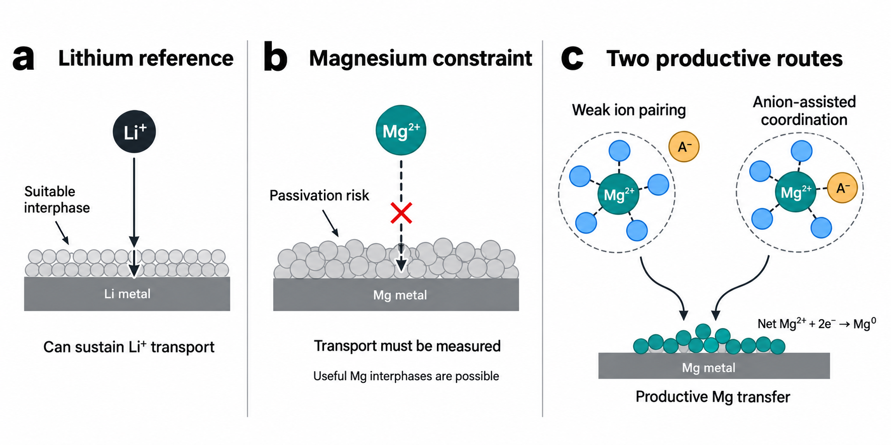
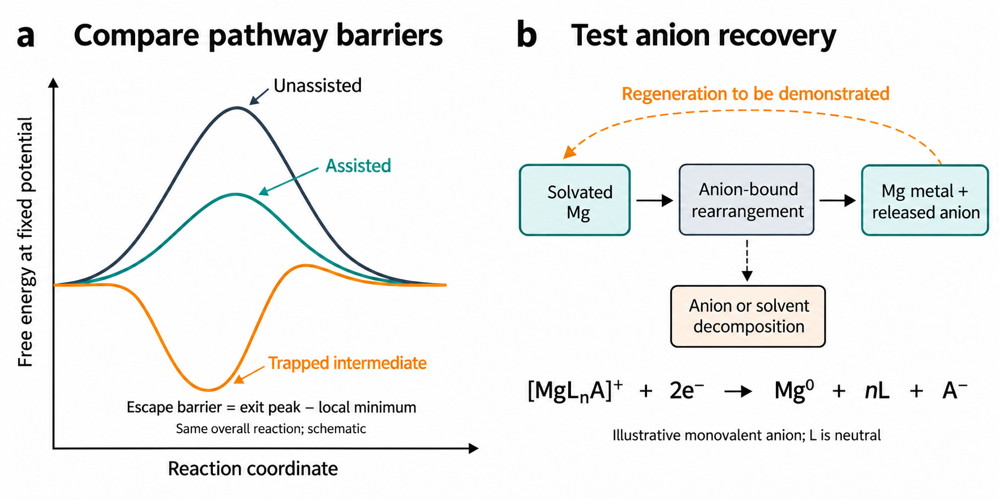
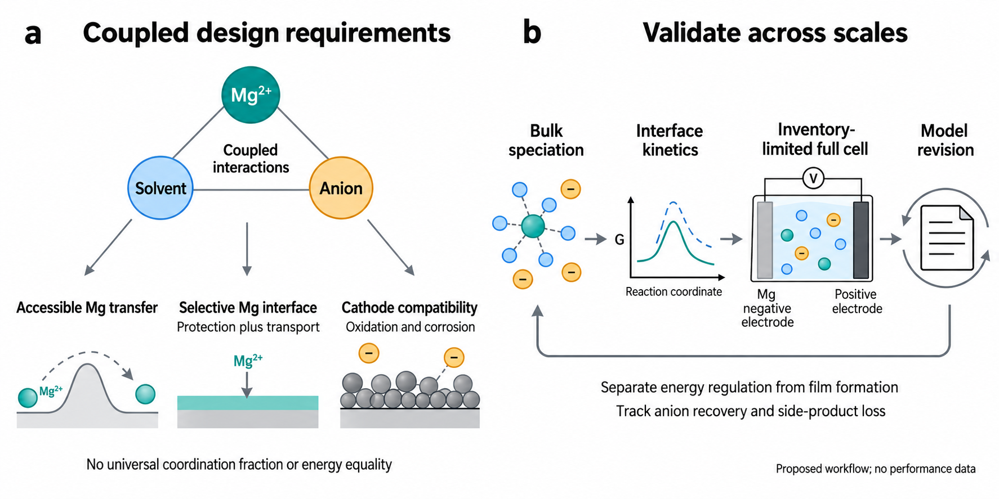

# Anion Regulation of Desolvation in Magnesium Electrolytes

## Abstract

Magnesium electrolytes challenge a familiar design rule: bringing anions into the first solvation shell can improve metal deposition, yet weak ion pairing can also work. We argue that the useful question is which step anion coordination changes. A coordinating anion can assist ligand release, change interfacial rearrangement or suppress solvent reduction before it becomes a possible source of an interphase. Its molecular role should therefore be assessed as desolvation energy regulation; the stronger term desolvation catalysis requires evidence that the active anion is recovered for repeated use. Representative electrolyte strategies suggest several routes to magnesium transfer, rather than one preferred shell. We use these results to set evidence thresholds, distinguish molecular effects from surface activation and propose a research sequence that connects controlled coordination changes to both electrodes. The decisive advance will be a mechanism that predicts how transfer responds to a new chemical condition. This Perspective calls for electrolyte discovery to focus on reaction pathways that can guide design beyond the formulation in which they were first observed.

Keywords: magnesium electrolytes; anion coordination; desolvation; reaction pathways; interfacial kinetics

## 1. Introduction

### 1.1. Why magnesium needs its own electrolyte logic

An electrolyte for a magnesium-metal battery must supply species that can release or rearrange their ligands, accept electrons and join the metal. It must sustain this reaction as the surface changes. The early rechargeable prototype combined an organohaloaluminate electrolyte with a Chevrel-phase cathode.[1,2,3] Later work showed how strongly deposition depends on both the liquid and the exposed surface.[4,5] Electrolyte chemistry remains a central constraint on magnesium and other multivalent batteries.[6,7,8,9] We see the next task as explaining how a working formulation delivers magnesium, so that its molecular advantage can guide the design of another formulation.

Lithium offers useful comparisons, but its familiar interphase logic needs to be reconsidered for magnesium. In many lithium electrolytes, anion participation and lower free-solvent activity help select the compounds that are reduced.[10,11,12] Concentrated formulations also change reaction selectivity and electrode compatibility.[13,14,15] A useful lithium interphase limits electron leakage while allowing ionic transport.[16,17] Similar surface products do not establish similar magnesium transport. Magnesium films often block transfer, although designed interphases can sustain cycling.[18,19,20] The design criterion is a functioning interface under the intended conditions; borrowing a favourable lithium film composition is insufficient.

The distinction begins with Mg²⁺. It generally binds more strongly than Li⁺ to comparable donors, and its coordination responds strongly to ligand denticity, ion association and local polarization.[21,22] Removing one donor can change the remaining shell; binding an anion can change the charge and geometry of the complex. The species that reacts may therefore differ from the most abundant bulk solvate. This creates the apparent paradox. Lithium-inspired reasoning favours anion participation to form an interphase, while strong-binding reasoning favours anion exclusion to ease desolvation. Both directions have produced successful magnesium electrolytes.[23,24] Neither is a general design rule without identifying the step it improves.

### 1.2. A working recipe needs a reaction mechanism

A successful recipe is not yet an explanation. Magnesium electrolyte development spans several salt and solvent families,[25,26,27,28] but changing a solvent changes dissolution, ion pairing, exchange and surface reactions together. A lower overpotential can reflect any of these effects. Donor number, mean coordination number and isolated binding energy describe parts of the liquid; none identifies the slow reaction by itself. Calculations already connect magnesium coordination with pairing and decomposition.[22,29,30] The priority is a prediction about a defined transfer step that can guide a composition change.

Mg²⁺–solvent, Mg²⁺–anion and anion–solvent interactions form a coupled chemical system. Changing one can change the others. Chloride complexes show why this matters: aggregation may ease ligand release while making electron transfer more difficult.[31,32] The fastest exchange need not give the fastest deposition. Even identical coordination counts can conceal different donors and exchange routes. A design descriptor should identify the starting species, its population and the reaction it undergoes. This information is needed to predict whether a coordination change remains useful when the donor, potential or surface is changed.

The diversity of magnesium electrolytes should be used to test a mechanism. Organoboron, non-Grignard and alkoxide formulations access different carriers,[33,34,35] while changes to the organic group in Grignard-derived electrolytes can alter electrochemical behaviour.[36] A descriptor developed in one family should therefore be challenged in another. The comparison must retain its chemical meaning: the same defined exchange or transfer step, with solvent and surface conditions stated.

### 1.3. Our position and the criterion for progress

We propose that a first-shell anion should be selected first for its role in magnesium transfer. Its molecular value is the ability to change how Mg²⁺ releases ligands and rearranges near the electrode. It may replace a donor that is difficult to release, redistribute polarization or stabilize an intermediate that leads to metal deposition. These effects can operate before a film forms. Counterpoised interactions, dynamic solvation and regulation outside the primary shell make this view relevant to current electrolyte design.[24,37,38] Treating the anion mainly as an SEI precursor overlooks a chemical handle on the transfer reaction itself.

We use desolvation energy regulator for an anion that changes the relevant release or rearrangement pathway. Desolvation catalyst makes an additional claim: the active anion returns and assists another transfer event. Good cycling and an anion-derived surface product do not demonstrate that return. This Perspective places molecular regulation first, then asks whether the anion is recovered, consumed or trapped. We compare evidence for different routes, set criteria for assigning a mechanism and propose experiments that can change a design decision. The aim is to predict useful magnesium transfer beyond the composition in which it was first demonstrated.

Here, transferable has a specific meaning. A mechanism should predict how a controlled change in donor, anion or potential affects the limiting reaction in a second chemical environment. The two electrolytes need not contain the same complex. They must preserve the meaning of the proposed design variable and the response used to test it. A mechanism can also have a restricted range: identifying that range is useful progress. What we seek is a rule that states when a coordination change helps, why it helps and when another reaction takes over. This criterion is more demanding than reproducing the composition with the best measured CE.

## 2. The Anion Participation Paradox

Figure 1. Magnesium and lithium require different assessments of anion participation. a) A suitable lithium interphase can sustain ionic transport. b) Magnesium passivation can block transfer, although useful magnesium interphases are possible. c) Weak pairing and selected anion-containing shells can both support deposition. Dashed shell boundaries and donor icons indicate generic interactions, not measured coordination numbers. Mg²⁺ labels refer to the centre, not the total complex charge. Released ligands and counterions are omitted from panel c. The displayed Mg²⁺ + 2e⁻ → Mg⁰ equation specifies net reduction; it does not identify the elementary electron-transfer sequence or describe bare Mg²⁺ transport through a real film.

### 2.1. Weak pairing avoids an unproductive association

Weak pairing helps when association creates a precursor that exchanges slowly or reacts unfavourably. A solvent-designed Mg(TFSI)₂ electrolyte shows that promoting ion-pair dissociation can support deposition and a high-voltage cathode.[23] Earlier TFSI studies also show that the donor environment and cycling history change the response at magnesium.[39,40,41] Weak pairing removes a particular obstacle. The remaining solvent shell still has to rearrange and avoid reduction. High dissociation and high conductivity are therefore useful observations, but they do not establish an accessible metal-transfer reaction.

Weakly coordinating salts test the same question from the anion side. Boron clusters and carboranes extended magnesium chemistry beyond organohalide formulations; modified clusters improved solubility while retaining the intended stability.[42,43,44,45] Fluorinated borates and alkoxyaluminates supplied further routes to less corrosive or high-voltage electrolytes.[46,47,48,49,50] These are distinct chemistries. A bulky anion does not establish a single mechanism or a zero first-shell population. We judge this strategy by whether the remaining solvent shell can deliver magnesium.

Solvent design remains central even with a weakly coordinating salt. Competitive ether coordination can loosen a borate electrolyte's shell, while hydrofluoroether–diglyme mixtures provide another way to alter magnesium solvation.[51,52] The useful test compares populations, exchange and interfacial rates within one controlled series. If dissociation increases while deposition slows, solvent release or a surface reaction may have become limiting. The result would define where weak pairing ceases to help. Finding that boundary is more informative for design than maximizing dissociation without measuring the next step.

A comparison between carborane and TFSI electrolytes at magnesium is especially useful because it separates anion identity from salt concentration alone.[53] Retain the donor environment and follow both solutions during cycling. If one sustains transfer while the other consumes electrolyte, the difference includes reaction selectivity and surface evolution. The design lesson depends on measuring those changes. The population and reaction must be established for the formulation being tested.

### 2.2. Coordinating anions can help without one universal mechanism

Chloride chemistry directly challenges the idea that anion coordination necessarily slows magnesium transfer. Structural studies identify chloride complexes whose coordination and charge differ from a solvent-only Mg²⁺ solvate.[54,55,56,57,58,59] Their behaviour depends on magnesium/aluminium speciation, donors and conditioning.[60,61,62,63,64,65,66] Chloride can participate in the approaching complex and alter the surface. We interpret these results as evidence that coordination must be judged within a reaction pathway. They do not imply that placing any anion near magnesium produces the same kinetic benefit.

Other ligand chemistries reinforce this judgement. Phenolate, phenoxyimine, amido and Hauser-base electrolytes change the identity and reactivity of magnesium species.[67,68,69,70,71] Borohydride concentration and donor choice also affect metal compatibility.[72,73,74] Amine cosolvents and redesigned solvent molecules can improve transfer even when they interact strongly with magnesium.[75,76,77,78] We take their common lesson to be that a binding strength has meaning only within the sequence of reactions it permits. Ranking isolated attractions cannot replace testing that sequence.

The ion-pairing amine electrolyte makes an important distinction explicit. Bringing anions into the primary shell weakened amine coordination, suppressed solvent reduction and hydrogen evolution, and enabled 99.6% Coulombic efficiency over 800 cycles.[79] The demonstrated gain concerns selectivity; a lower desolvation barrier needs separate evidence. The counterpoised-electrolyte study instead proposes synchronous desolvation while also reporting an MgH₂-containing interphase.[24] These findings support different roles for anion participation. They identify different benefits that must be separated if the first shell is to become a useful design variable.

Chelating anions raise the same issue. MgEDTF forms an anion-containing, unsaturated precursor and reduces plating/stripping overpotential relative to a non-chelating analogue; the authors also attribute a benefit to an anion-derived SEI.[80] Coordination and film effects may therefore operate together. The result does not isolate which effect causes the initial kinetic gain. Table 1 treats such examples as evidence for several possible routes to magnesium transfer. Its purpose is to expose what each strategy changes and what still needs to be tested, rather than rank electrolytes by unmatched performance values.

The table suggests a decision that a performance database cannot make. Pair dissociation is a plausible priority when association prevents access to reactive magnesium. Changing ligand departure is a different priority when the solvent shell remains persistent. When charge is diverted to solvent reduction or the surface becomes blocking, selectivity or activation may matter more than release. Several effects can coexist in one row. We therefore use the pathway column to state an interpretation to test, not to declare that the rate-limiting step has been identified in every system. The value of the comparison is the different experiment that each interpretation requires.

### 2.3. From anion occupancy to energy regulation

First-shell occupancy answers how often an anion coordinates magnesium. It does not answer how quickly that state supplies metal. An abundant, stable precursor is useful if it reaches a reactive interfacial state readily. It can instead exchange slowly or feed decomposition.[22,29,30] We therefore judge a coordination change by the barrier from the state actually occupied under operating conditions. Lowering the energy of that state can deepen a trap. Figure 2 shows why stabilization and faster transfer are different claims, and why a favourable coordination structure is an incomplete design target.

An anion can change the transfer route by replacing a persistent solvent donor, altering the remaining bonds during reduction or helping form a surface-bound intermediate. Anion–solvent interactions can also change association without making the cosolvent the dominant magnesium ligand.[81,82,83] None of these effects requires equal pairwise binding energies. Counterpoise is a proposed explanation for a particular composition, not a universal equality. Regulation outside the first shell and changes in solvent–solvent interactions extend the same reasoning to the surrounding liquid.[38,84] The relevant unit of design is the reacting electrolyte, not an isolated complex.

If local precursor states interconvert rapidly compared with magnesium transfer, their effective transfer rate can be approximated by a population-weighted sum:

k_eff(U) = Σᵢ pᵢ(U) kᵢ(U)

Here, pᵢ(U) is the population of state i near the interface at potential U, and kᵢ(U) is its transfer rate. Bulk spectral populations need not be those populations. The expression omits transport gradients, surface coverage and competing reactions, and fails when state exchange is slow. It nevertheless gives a clear design insight: deposition can improve because more reactive states become available, because a state reacts faster, or both. Different shell populations can therefore support similar performance through different routes.

Table 1. Representative electrolyte strategies reveal multiple kinetic pathways for magnesium transfer.

| Electrolyte composition | j (mA cm⁻²) | Q (mAh cm⁻²) | Eplate (V) | η (V) | CE (%) | Cycle lifespan | Pathway suggested | Ref. |
| --- | --- | --- | --- | --- | --- | --- | --- | --- |
| Mg–Al chloride electrolyte/THF | N.V. | N.V. | N.V. | N.V. | 100
(first cycle) | N.V. | D Surface activation without prolonged conditioning | [63] P |
| Mg–Li chloride complex + BTFE (MLCC) | 5 | N.V. | N.V. | N.V. | N.V. | 1200 h
(Mg\|\|Mg) | A/D Charged carriers and interphase formation | [81] P |
| Mg(pftb)₂ + MgCl₂/THF | N.V. | N.V. | N.V. | N.V. | 99.7 | 3000 cycles
(CE test) | D Transfer sustained by an organic/inorganic interphase | [20] P |
| Mg salt/weakly solvated amineᵃ | N.V. | N.V. | N.V. | N.V. | 99.6 | 800 cycles
(CE test) | C Pairing limits amine reduction and H₂ evolution | [79] P |
| 0.18 M Mg(TFSI)₂ + 0.1 M LiOTf/DME–TMP | N.V. | N.V. | −0.22 | N.V. | 98 | 450 hᵇ | B/D Modified coordination and phosphate-rich interphase | [82] P/S |
| Screened amine electrolyteᵃ | 1 | N.V. | N.V. | 0.060 | N.V. | N.V. | B/D Proposed synchronous release and MgH₂ interphase | [24] P |
| MgEDTF/DME;
MgEDTF + trace halide/DME | N.V. | N.V. | N.V. | 0.24;
<0.20ᶜ | N.V. | N.V. | B/D Chelating-anion pathway and SEI (control η = 2.0 V) | [80] P |
| Mg(CB₁₁H₁₂)₂/G4 | N.V. | N.V. | N.V. | N.V. | >94.4 | N.V. | A Weak coordination through carborane design | [43] S |
| Mg-FPB electrolyteᵃ | N.V. | N.V. | N.V. | 0.197 | 95 | N.V. | A Weak coordination through pinacolatoborate design | [47] P |
| 0.4 M Mg(TFSI)₂/DME–G2–BTFE–TEP | N.V. | 2ᵇ | −0.15 | N.V. | 95.2 | 7000 hᵇ | A Ion-pair dissociation | [23] P/S |
| Mg[B(hfip)₄]₂/DME–THF
(DME:THF = 1:1, v/v) | 10ᵇ | N.V. | N.V. | 0.120 | N.V. | >1200 hᵇ | B Competitive ether release (control: 0.316 V at 8 mA cm⁻²) | [51] P |
| 0.5 M Mg(TFSI)₂/DME–MOPA-1 | N.V. | N.V. | ≈−0.10 | N.V. | 99.5 | ≈190 hᵇ | B Solvent-shell rearrangement | [75] S |
| 0.25 M Mg(OTf)₂/G2–MOEA | N.V. | N.V. | −0.13 to
−0.26 | N.V. | 98.3
(average) | 8200 cycles (CE);
>5000 h (Mg\|\|Mg)ᵇ | B/D Mixed coordination and distinct electrode interphases | [85] P/S |
| 0.3 M EtMgCl/MOB
(1:2 molar ratio) | 5 | N.V. | N.V. | N.V. | N.V. | >1000 cycles
(Mg\|\|Mo) | B/D Dipole-regulated release and organic/inorganic film | [86] P |
| Mg(OTf)₂ + MgCl₂/DME–TEP | 0.5 | 0.25 | N.V. | N.V. | 99.4 | 3000 h
(Mg\|\|Mo) | A/D Dissociation and stable interphase | [87] P |
| [Mg(THF)₆][AlCl₄]₂ + LiCl/THF | 0.5 | N.V. | N.V. | 0.140/0.140ᵈ | N.V. | N.V. | D Removal of blocking MgCl₂ | [88] P |

Pathways: A, avoid persistent association; B, change ligand release or rearrangement; C, suppress side reactions; D, activate the surface or sustain transfer through an interphase. These overlapping assignments are interpretations to test, not proof of the rate-limiting step. P/S labels verify numerical sources, not every pathway assignment. j, current density; Q, areal capacity; Eplate, reported plating potential; η, reported overpotential; CE, Coulombic efficiency. N.V., value not verified in the accessed source. P, original-paper abstract; S, supplied AM Perspective [89] (DOI 10.1002/adma.202417652); P/S, combined sources. ᵃ Complete formulation or solvent identity unverified. ᵇ Values may describe separate tests; j and Q are not automatically the CE/lifetime conditions. In [51], j = 10 applies to η = 0.120 V; cycling j is N.V. In [85], CE and Mg||Mg lifetime are separate tests. Reversible cycling at 20 mA cm⁻² is also reported in [81]. ᶜ With trace Cl⁻/Br⁻. ᵈ Plating/stripping, respectively. Eplate reference conventions remain unverified. Each reference number links to its DOI. Abbreviations: THF, tetrahydrofuran; DME, 1,2-dimethoxyethane; G2/G4, diglyme/tetraglyme; BTFE, bis(2,2,2-trifluoroethyl) ether; TMP/TEP, trimethyl/triethyl phosphate; MOPA-1, 1-methoxy-2-propylamine; MOEA, 2-methoxyethylamine; MOB, 1,4-oxazinane borane; Mg-FPB, magnesium perfluorinated pinacolatoborate; MgEDTF, magnesium salt of EDTF²⁻; pftb, perfluorinated tert-butoxide; hfip, hexafluoroisopropoxide.

Catalysis adds a requirement to this energy argument. The anion must facilitate the relevant rearrangement and return in an active form. For the same overall reaction, a catalyst changes the pathway without changing its equilibrium free-energy difference. Energy regulation is broader because a composition change can also alter precursor stability and selectivity. Dipole regulation and amine activation illustrate how molecular changes accompany evolving surface chemistry.[86,90] A demonstrated pathway change supports regulation. Repeated assistance by the recovered anion supports the stronger catalytic claim.

Figure 2. Anion-assisted transfer as an energy mechanism with a separate chemical-fate test. a) Schematic profiles compare pathways for the same overall reaction at fixed potential; the escape barrier is the exit-peak energy minus the local intermediate minimum. No energy values or calculated profiles are implied. b) The illustrative net equation uses a monovalent A⁻ and neutral L, conserving magnesium, ligands, anion and charge. It does not apply unchanged to divalent chelating anions or identify elementary steps. The dashed recovery arrow is a hypothesis to test; decomposition is a competing branch without assumed regeneration.

Table 1 supports a clear judgement, even though its entries are not directly comparable. Weak pairing gave 95.2% CE in the supplied summary, whereas an ion-pairing amine formulation gave 99.6% CE over 800 cycles.[23,79,89] The counterpoised formulation reports 0.06 V overpotential at 1 mA cm⁻², and the chelating-anion comparison reduces it from 2.0 to 0.24 V.[24,80] Useful transfer is compatible with different coordination strategies. The next question is which population, exchange step, side reaction or surface change accounts for each gain. That question should determine the next experiment.

We would start that experiment by stating what observation could rule out the proposed explanation. If exchange accelerates but the magnesium partial current does not, faster release has not removed the overall limitation. If CE increases with no change in exchange, side-reaction suppression deserves priority. If the benefit persists after the active anion is removed while the surface remains stable, a retained interphase may dominate. These outcomes do not diminish a useful electrolyte. They change which chemical variable should be optimized next. The same apparent performance gain can therefore call for different chemistry.

## 3. Evidence Needed to Assign a Transfer Mechanism

### 3.1. Define the reaction before comparing energies

An energy claim needs a defined reaction. Ion-pairing free energy compares associated and dissociated states in a specified liquid. Exchange free energy compares a bound donor with its replacement and the released donor. A desolvation barrier describes the transition between such states. These quantities require consistent charge, composition, solvent activity and reference states. A more negative association energy alone cannot establish faster transfer. The relevant barrier starts from the occupied precursor, including a trapped intermediate if one forms.[22,31]

Cluster calculations identify plausible donors and reaction sites, but a release pathway must also include the liquid. Comparing differently charged complexes or removing solvent without accounting for it can create an irrelevant energy difference. Multidentate shells require conformational sampling and attention to entropy. A useful calculation follows a balanced reaction and states its reference conditions. It should then predict an observable change, such as exchange, population or potential-dependent deposition. We place greater weight on that prediction than on agreement with a single selected structure.

Enhanced sampling connects local configurations to free-energy surfaces.[91,92] For anion-assisted release, coordination to solvent and anion, together with distance from the surface, may all matter. Sampling one coordinate can miss a route along another. Reweighting estimates equilibrium properties and uncertainty where sampled distributions overlap; it cannot recover an unvisited transition.[93] Adsorption and reduction also depend on potential, which motivates suitable constant-potential or grand-canonical calculations.[94,30] Our criterion is a predicted experimental ordering that survives reasonable modelling choices. The reaction and reference state must remain explicit.

### 3.2. Identify the species that the kinetic model needs

Spectroscopy should establish which species the kinetic model needs to describe. Raman and infrared bands distinguish donor and anion environments; NMR constrains coordination, association and motion. Magnesium-specific NMR has directly addressed liquid solvation and dynamics.[95] Chloride-complex studies show why methods should be combined across a composition series.[56,57,96,73] The target is a distribution with uncertainty: donor identities, the number of participating atoms and changes in association. A single lowest-energy cluster cannot supply this information. It should be treated as a possible species until the measurements constrain its abundance.

Every method weights species differently. Raman intensity depends on scattering response as well as population. NMR averages environments that exchange rapidly. Several structures can fit a coordination number, especially when one donor molecule contributes several atoms. Calibration, standards, predicted spectra and complementary methods can constrain these ambiguities. A mechanism should retain assignments that the data cannot distinguish. A fitted-shell change becomes persuasive when consistent assumptions support a testable kinetic consequence.

Chloride–lithium formulations show why charge deserves the same attention as coordination. Changes in clusters alter both donor arrangements and the abundance of charged carriers.[97,81,59] Total magnesium concentration is therefore insufficient to describe transport. Mass spectrometry and crystal structures identify plausible complexes, but ionization and crystallization select species. Near a polarized electrode, a minor bulk species may also become the reactive precursor. Assigning a reacting complex requires evidence at controlled electrode potentials and surfaces, beyond the bulk measurement.

Claims of anion exclusion need comparable discipline. A weakly coordinating salt or a shifted vibrational band does not establish zero first-shell occupancy. Report the fraction assigned to associated states, its uncertainty and the exchange regime in which the assignment applies. Then test whether transfer changes with that fraction within the same family. Similar performance in two different shells is a reason to measure exchange and selectivity. A mechanism should explain the difference in molecular behaviour as well as the similarity in cycling.

Our evidence threshold rises with the strength of the claim. A shell assignment supports association. A matched change in exchange and magnesium-transfer kinetics supports a role in the pathway. Product and current balances show whether the improvement concerns useful transfer or fewer losses. Recovery of an active, kinetically effective anion supports catalysis. This sequence does not require every paper to measure every quantity. It requires the conclusion to stop at the level the evidence supports. The most valuable next measurement is the one that would change the assigned role, rather than repeat an already established structural observation.

### 3.3. Connect exchange times to the rate at the electrode

A population tells us what is present; a rate tells us whether it can meet the required current. Exchange, diffusion, adsorption, electron transfer and nucleation occur on different time scales. Potential and surface history can change which step is slowest. Weakly paired magnesium may retain solvent for a long time, while an associated complex may rearrange rapidly at the surface. Exchange-sensitive NMR, temperature-dependent measurements and molecular dynamics can test parts of this sequence. The measured process must be identified. A generic relaxation time should not be presented as the rate of desolvation without establishing that connection.

Residence time depends on its definition. Brief departure and rebinding give different continuous and intermittent lifetimes. Report the distance criterion, correlation function, rebinding treatment and sampling length. Diffusion also requires convergence and finite-size checks.[98] Conductivity includes correlated motion, and greater conductivity can reduce polarization without changing ligand release. Transport must therefore be constrained alongside interfacial kinetics. After constraining bulk transport, the remaining kinetic change needs a molecular or surface explanation.

Impedance and current transients constrain the interface, but a fitted resistance does not uniquely identify ligand release. Adsorption, film transport and electron transfer can produce overlapping responses. Temperature dependence gives apparent activation parameters while populations and viscosity change too. Electron-transfer theory helps describe driving force and reorganization,[99] but deposition also changes coordination and the surface. Measurements become decisive when a mechanism predicts how several responses change together. Faster exchange with an unchanged film response supports a different explanation from unchanged exchange with progressive surface activation. A lower overpotential alone selects neither explanation.

A faster molecular step can leave overall deposition unchanged. An associated precursor might release a donor more readily but adsorb less favourably or accept electrons more slowly. Suppressing a side reaction can likewise raise CE without accelerating exchange. These possibilities make a universal binding-energy–efficiency correlation unlikely. We propose measuring a molecular rate and a magnesium-specific interfacial response in the same series. Their joint change should follow a prediction made in advance. A mismatch is useful evidence: it can locate the missing step and show when a descriptor should no longer guide design.

Figure 3. Measurements of populations, exchange and reaction selectivity answer different questions. a) Donor icons represent possible motifs without assigning real coordination numbers. b) The illustrated one-for-one exchange conserves both ligands: bound L plus free L* becomes bound L* plus free L; other donors are omitted. The decay is a schematic correlation function, not experimental data. c) Useful magnesium current is distinguished from electrolyte reaction. Net two-electron reduction is shown without assuming a concerted elementary event. Composition, temperature, potential and surface history must be connected across the measurements.

### 3.4. Identify useful reduction and the chemical fate of the anion

A release pathway is valuable only if it supplies magnesium. Potential-dependent calculations show that coordinated solvent can react in the double layer and that deposition competes with thermodynamically favourable decomposition.[30,29] Orbital energies suggest possible reaction sites; molecular relaxation, surrounding solvent, bond cleavage and barriers determine which reaction occurs. We therefore judge a cathodic stability claim by the useful metal-transfer fraction under a stated protocol. A low fitted barrier or a cathodic current onset does not establish selective transfer. The products and the deposited metal must enter the assessment.

Current needs a material balance. Deposited magnesium, recovered charge, gas, soluble products and film growth constrain different losses. Instantaneous magnesium partial current differs from cycle-integrated CE, while chemical corrosion can consume metal without the same faradaic signal. Early plating studies and later interphase work make these distinctions important for magnesium.[100,3,77] Operando mass-sensitive measurements are useful when passivation forms or dissolves during conditioning.[101] Their interpretation must account for coupled solvent, porosity and changing surface area. The goal is to identify where charge and magnesium go during the proposed kinetic improvement.

Anion recovery is the additional test for catalysis. Follow the active anion and its products as magnesium throughput increases, then ask whether the recovered species still affects transfer after surface history is controlled. Survival alone can describe an inert spectator. Persistent enhancement can reflect continued consumption from a large reservoir. A catalytic assignment needs pathway evidence, sustained kinetic assistance and recovery of the active species. Table 2 sets out these thresholds. They allow a useful electrolyte to have several functions while preventing a high efficiency or a surface spectrum from deciding which function is responsible.

Table 2. Evidence thresholds for assigning anion functions in magnesium electrolyte design

| Function being claimed | Working interpretation | Evidence threshold | Relevant comparators |
| --- | --- | --- | --- |
| Outer-shell effect | Changes solvent activity or mobility without predominant Mg coordination | Locate the additive and test transfer at matched conditions; distinguish direct Mg coordination | [38] |
| Desolvation energy regulation | Changes ligand release or interfacial rearrangement | A defined pathway and matched kinetic change; separate effects of film growth | [24,75] |
| Desolvation catalysis | Assists repeated transfer and returns in an active form | Pathway evidence, sustained rate assistance and active-anion recovery; CE alone is insufficient | Candidate role; not established by these comparators |
| Reaction selectivity | Suppresses solvent or anion side reactions | Mg partial current and gas/product balance; exchange need not accelerate | [79,30] |
| Sacrificial activation or SEI formation | Is consumed to activate or protect the surface | Anion loss, retained surface effects and the cost of activation or continued consumption | [20,80] |
| Kinetic trapping | Stabilizes a precursor that escapes or transfers slowly | Residence and escape/transfer barriers from the occupied state; low energy alone is insufficient | [31,22] |
| Coupled molecular and film effects | Changes coordination and also builds a useful interphase | Independent evidence for molecular assistance and the retained film contribution | [87,86] |

These are proposed evidence thresholds, not mutually exclusive electrolyte classes or an existing consensus. References provide examples and comparators; they do not establish every function. Catalysis requires recovery of an active facilitator. The outer-shell comparator includes a neutral additive.

## 4. Design Rules for Coupled Magnesium Anion and Solvent Chemistry

### 4.1. Open an accessible transfer route

The first design objective is to increase useful magnesium transfer at the intended current. This may require more reactive precursors, faster rearrangement or fewer side reactions. Solvent redesign, amine assistance and phosphate-containing environments show that the whole pathway matters.[78,75,85,102] Pairing and weak pairing can both remove a limitation.[79,23] A ligand must support dissolution and transport, then release or rearrange when needed. An anion is useful if it improves that connection without creating a persistent trap or a dominant decomposition route. The target is the reaction sequence that supplies metal.

Denticity and steric structure can change that sequence. A chelating donor can bind strongly yet release through successive rearrangements. Mixed shells can offer donors with different departure rates. Cyclic and linear ethers can therefore behave differently despite similar familiar descriptors.[51] Boronic-ester additives and coupled solvation–interface strategies explore related effects.[103,104,105] The comparison should identify the chemical change and the step it improves. Similar cycling gains do not establish a shared elementary reaction or a common optimum coordination number.

The surrounding liquid also matters. A cosolvent can change counterion availability without occupying most magnesium sites. In amine electrolytes, ionization and proton transfer can create new charged species and affect hydrogen evolution.[83,90] These changes need to be measured. Selecting a favourable cluster while ignoring solution activities may miss the reaction that activates the interface. We therefore include regulation outside the shell within solvation design. The criterion is whether the perturbation changes a magnesium-transfer step or its selectivity, with its location and chemical fate established as far as the evidence allows.

We propose screening a weak-pairing control, an electrolyte with a proposed facilitating anion and a persistent associated state. First constrain transport, populations and exchange; then compare interfacial rates on matched surfaces. The mechanism should predict how their ordering changes with potential, temperature or donor substitution. An intermediate composition that performs best would identify a balance between competing processes. It would not establish a universal anion fraction. A useful energy regulator should improve an identified step and also predict the condition under which that improvement disappears.

Salt mixtures provide another controlled perturbation. Magnesium triflate formulations and tetrabutylammonium triflate additives activate solutions that otherwise transfer magnesium poorly.[106,107] Added ions can change association, carrier charge and free-donor availability at the same time. The test must identify which magnesium species changes and whether the added ion reaches either electrode. This is essential in mixed-metal formulations, where a second cation may contribute to cathode storage. Vary anion supply alongside carrier charge and possible contributions at the cathode.

### 4.2. Preserve a magnesium interface that continues to transfer

The second objective is to preserve transfer as the magnesium surface evolves. Adsorption, suppression of solvent reaction, removal of blocking material and persistent films offer different ways to do this.[108,109,88,20] Artificial interfaces and component modifiers add further options.[110,111] A molecular solvation effect can coexist with any of them. If improved kinetics survives electrolyte replacement, a retained surface contribution deserves attention. If it requires the proposed species in solution, continued molecular assistance is more plausible. This distinction should guide the next control experiment instead of being inferred from the original cycling curve.

Conditioning must enter the mechanism. Water/chloride control and operando measurements show that products form and disappear during early cycling.[112,101] Conditioning-free additives and mixed borohydride salts also highlight surface activation.[113,114] The liquid sampled before cycling may differ from the one that later supplies magnesium. Compare fresh and conditioned surfaces, follow composition and account for the charge and material consumed during activation. A mechanism must describe the electrolyte and surface actually used.

A useful film needs evidence of transport and persistence. Borohydride-based, gradient and hybrid-interface electrolytes approach this problem differently.[115,116,20] Real transport may involve defects, boundaries or exposed metal rather than the perfect lattice of the dominant compound. Detecting nitrogen, phosphate or hydride products does not establish their conducting role. A calculated migration barrier needs to be tested against the evolving resistance and magnesium balance of the real film. The design standard is a surface layer that sustains selective transfer.

Morphology can improve performance independently of desolvation. Surface kinetics, scaffolds, exposed facets, horizontal platelets and orientation-selective additives change nucleation and current distribution.[117,118,119,120,121] Studies of kinetic versus diffusion-controlled growth and magnesium dendrites in glymes show that metal identity does not fix deposit shape.[122,123] Match deposited capacity, transport and substrate preparation before interpreting a smoother deposit. The proposed molecular change should then predict how morphology responds. This protects a solvation argument from claiming an improvement that was produced mainly by the electrode structure.

Impurity tolerance also belongs to a specified formulation. A hybrid AlCl₃/MgCl₂/Mg(TFSI)₂ electrolyte retained activity after 2000 ppm water was introduced.[124] This result shows tolerance through that system's chemistry; it does not make water harmless elsewhere. A controlled impurity addition can test whether a regulator still changes transfer or mainly removes blocking products. Follow both the liquid and the surface. If a descriptor works only after purification or activation, that requirement should be part of its stated range of validity. Otherwise, a composition-only prediction will fail when the preparation history changes.

Electrolyte replacement is a useful future experiment, but it needs its own controls. A new liquid can dissolve or reconstruct a film, change adsorption or alter the surface area. Loss of a kinetic benefit after replacement would then be ambiguous. We propose paired exchange controls and measurements of the retained surface before assigning a continuing molecular contribution. Where a stable swap cannot be achieved, vary the active anion within a series that minimizes these surface changes. The purpose is to separate a need for the coordinating species in solution from a need for the surface that the original solution created.

### 4.3. Keep the same electrolyte useful at the positive electrode

The third objective is compatibility with the positive electrode. A donor that activates magnesium can introduce oxidation losses, while a stable salt can leave deposition slow. Boron-based designs, non-nucleophilic formulations and fluorinated dialkoxides seek to meet both requirements.[125,126,127,128,129] The intended cathode and current collector must still be tested. Separate corrosion, solvent oxidation and cathode-driven reactions where possible. Exposure to a charged cathode can also change the species returning to magnesium. A compatible formulation must sustain this two-electrode cycle.

Anodic onset depends on electrode, area, scan rate and current threshold. A high onset on a small inert electrode can coexist with sustained loss on a porous cathode. Voltage holds and product analysis help distinguish stability from slow reaction or a growing resistive layer. Tetraglyme stability and cathode coatings show how solvent and electrode conditions affect the result.[130,131] The useful design target is an acceptable parasitic loss over the intended protocol. The stability measurement should predict behaviour under that protocol.

Cathode chemistry changes the meaning of a successful electrolyte. Sulfur conversion, organic carbonyl storage and enolization require different transfer and solubility behaviour.[132,133,134,135] Anion incorporation has been reported to improve desolvation and charge transfer at a conversion-type magnesium cathode.[136] This supports testing anion assistance at both interfaces. It does not establish the mechanism of metal deposition. Identify the stored species, possible co-insertion and contributions from other ions. A useful electrolyte should retain its molecular advantage in the selected cell while accepting that solvation design cannot remove every limitation within a solid cathode.

The final comparison needs one electrolyte at both electrodes and known inventories: magnesium excess, electrolyte volume, cathode loading and capacity limits. Cathode-normalized capacities from conversion or fluorinated-carbon cells do not establish rechargeable insertion or complete-cell energy density.[24,6] Long symmetric cycling can likewise consume substantial metal. We propose comparing the cost of maintaining the kinetic benefit in magnesium and electrolyte loss. A regulator that works only with a large sacrificial reservoir has a different practical value from one that remains active at limited inventory. The complete cell should make that distinction visible.

There is no single CE or overpotential threshold that makes every magnesium chemistry practical. The tolerated loss depends on metal excess, electrolyte quantity, delivered capacity and required lifetime. We therefore favour reporting magnesium and electrolyte consumption alongside the useful charge delivered. This would make two otherwise similar kinetic gains distinguishable: one may persist with a small inventory, while the other may be sustained by consumption of excess material. Linking the mechanism to that cost would help choose between molecular regulation and a deliberately sacrificial strategy. Both can be useful, but their routes to a viable cell differ.

## 5. A Research Route from Mechanism to Prediction

Figure 4. A proposed design and validation loop. a) Coupled magnesium–anion–solvent chemistry must support accessible transfer, a functioning magnesium interface and positive-electrode compatibility. Triangle edges indicate interactions, not equal energies; film transport and barrier icons do not specify molecular reactions. b) Bulk measurements, interfacial kinetics and an inventory-limited full cell provide different validation targets before model revision. Small curves are schematic icons, not matched calculated profiles. Anion recovery and side-product loss help separate energy regulation from continuing film formation. The workflow does not imply established predictive accuracy.

### 5.1. Train models on a defined chemical question

Data-driven screening should answer a defined chemical question. A library of isolated solvent binding energies does not represent an electrolyte without anion identity, concentration and surface conditions. Dynamic-solvation and counterpoised-interaction studies bring molecular descriptors into magnesium screening.[37,24] Their next test is prediction outside the formulations used to develop them. Targets such as association, exchange or a kinetic ordering can be checked experimentally. A single score for electrolyte quality is less informative when the model has not identified which reaction produces the score.

A useful record includes composition, temperature, impurities, substrate and conditioning. Current, deposited capacity, stripping limit and residual magnesium determine how CE should be interpreted. Table 1 makes the missing conditions visible and separates potentials from overpotentials. Bulk coordination, film composition and the proposed mechanism should be separate data fields. Otherwise, a model can learn laboratory practice or salt-family membership while appearing to learn desolvation. The priority is a smaller collection of interpretable comparisons, not a larger collection whose numbers refer to incompatible reactions and protocols.

Prediction across chemical families needs a deliberate test. Hold out whole anion or solvent families, then compare the proposed mechanism-based model with composition-only and simple physical baselines. Retain failures and negative results. Active learning can select informative experiments, as demonstrated in battery optimization outside magnesium.[137] Here it should select conditions that distinguish dissociation, assisted release, side-reaction suppression and surface activation. Experimental cost and uncertainty remain relevant. A candidate that can disprove a proposed route may be more valuable at this stage than another high-performing composition within a familiar family.

### 5.2. Keep the reaction states explicit across scales

Molecular dynamics gives populations, diffusion and exchange, but divalent-ion polarization and reactive chemistry need validation. Machine-learning interatomic potentials extend sampling when their training configurations cover the relevant states.[138] Magnesium chloride–amine studies have used them to examine stability and kinetics.[139] Bulk accuracy does not establish surface accuracy. Coordination changes, adsorption and decomposition must enter the validation if the model is to describe them. It should reproduce an appropriate spectrum or exchange trend before its populations are used to predict metal transfer. The model's stated scope should follow the reactions it has actually been tested against.

A reaction network connects bulk species to adsorbed precursors, rearranged intermediates, metal and side products. Potential-dependent energies and rates specify the links where they are known.[30,94] The population-weighted expression in Section 2.3 is one limiting case. Precursor charge must remain explicit: repulsion of a free anion does not establish exclusion of an anion carried by a positively charged magnesium complex. The network should state when the anion leaves, rearranges or reacts. These alternatives predict different potential dependence and different products, giving experiment a way to distinguish them.

At larger scales, those reactions couple to concentration gradients, surface area and changing interfacial resistance. A rate on clean magnesium may stop describing the cell as deposition and passivation proceed. The efficient first step is a small, coherent composition series: measure populations and exchange, predict the kinetic ordering, and test a condition expected to erase or reverse it. Then use the same electrolyte in the intended full cell. Agreement with the predicted response to that perturbation provides stronger mechanistic evidence than fitting the final efficiency alone.

### 5.3. A research sequence for testing transferable pathways

The immediate priority is a common set of controlled comparisons. Select a weak-pairing electrolyte, a proposed anion-assisted electrolyte and a persistent associated control with compatible metal-surface preparation. Measure a molecular response and a magnesium-specific interfacial response under stated conditions. Include anion and product accounting where a catalytic claim is being tested. The outcome should identify which step is helped and which explanation has been ruled out. This work need not begin with an extensive electrolyte library. A small series that separates dissociation, release and surface activation would provide a firmer basis for design than many cycling records with incomplete conditions.

The next priority is prediction across chemistry. Change the donor or anion while keeping the proposed kinetic variable well defined, and test the predicted response before optimizing the new composition. A successful prediction would show that the mechanism provides guidance beyond its training or discovery set. A failed prediction should be used to locate the new limiting step and revise the range of the rule. Models should carry uncertainty for unmeasured surface states and competing reactions. This stage would turn descriptors from retrospective explanations into tools for selecting experiments and avoiding modifications that improve one step while worsening the complete transfer route.

The final priority is to make those predictions survive in cells with limited inventories. Challenge the selected electrolyte at both electrodes, then measure how its molecular benefit changes after cathode exposure, conditioning and repeated deposition. Retain composition and preparation details so that a failure can be traced to a reaction rather than dismissed as a formulation exception. A practical design rule should predict a usable operating range and the loss mechanism outside it. The sequence from a controlled molecular comparison to a new chemical family and then a finite-inventory cell is the research route we propose. Its success would be measured by better decisions about electrolyte chemistry.

## 6. Conclusions and Outlook

### 6.1. Choose an anion for the transfer reaction it enables

We argue that the first-shell anion should be evaluated as part of the magnesium-transfer reaction before it is evaluated as a possible film precursor. It can assist release, suppress solvent reaction or trap a precursor; its abundance does not distinguish those outcomes. Weak pairing and selected anion-containing shells can both work because they remove different limits on transfer.[23,79,24] The design priority is to identify that limit and the molecular change that relieves it. The resulting mechanism must explain why the benefit appears and predict where it will be lost.

Desolvation energy regulator is our preferred description when an anion changes the relevant release or rearrangement route. Desolvation catalyst requires recovery of the active anion for repeated assistance. An SEI precursor is consumed into a surface product whose benefit depends on its transport and persistence. These roles can coexist, but they lead to different design decisions. A regulator calls for control of coordination and exchange. A consumed precursor calls for control of film formation and inventory loss. Identifying the dominant role determines which chemical variables deserve the next optimization.

### 6.2. Make the next experiment distinguish the mechanism

We propose an evidence standard that connects coordination under stated liquid conditions to a measured kinetic change and a magnesium/product balance. The methods can differ, but the quantities must describe the same formulation under compatible conditions. A bulk shell assignment cannot substitute for a rate; CE cannot substitute for a desolvation barrier. This proposed standard would allow an apparent contradiction between two studies to be traced to a different limiting reaction, surface history or test condition, rather than attributed to incompatible structural preferences.

The near-term priority is a controlled comparison between weak pairing and proposed anion assistance on matched magnesium surfaces. Follow exchange, interfacial response and side products before and after conditioning. Replace or modify the electrolyte while checking that the surface itself has not changed. Track the active anion as magnesium throughput increases. The mechanism should predict a response to potential, donor substitution or anion removal before that response is measured. A prediction that fails defines the boundary of the proposed design rule. Such boundaries are essential if another chemical family is to use the rule.

### 6.3. Engineer pathways that remain useful in a cell

The longer-term test is an inventory-limited cell using the same electrolyte at both electrodes. Faster release can be offset by oxidation, corrosion, additive consumption or slow cathode storage.[140,6] A useful molecular effect should survive exposure to the cathode and evolution of the magnesium surface. Known metal and electrolyte inventories make its cost measurable. Progress should be judged by the operating range over which the proposed reaction pathway remains selective and useful.

A first-shell anion should be chosen for the reaction it enables, then assessed for whether it returns, reacts or becomes trapped. This puts desolvation energy regulation at the centre of molecular design while assigning film formation a separate, testable role. Recovery of the active anion would justify the stronger catalytic claim. The next advance should be a mechanism that correctly predicts a new electrolyte or a new operating condition and retains its benefit in a working cell. Future magnesium electrolyte discovery should move from searching for a favourable solvation structure towards engineering transferable reaction pathways.

## References

1. **Prototype systems for rechargeable magnesium batteries** D. Aurbach, Z. Lu, A. Schechter, Y. Gofer, H. Gizbar, R. Turgeman, Y. Cohen, M. Moshkovich, E. Levi, Nature 2000, 407, 724-727. https://doi.org/10.1038/35037553

2. **Electrolyte Solutions for Rechargeable Magnesium Batteries Based on Organomagnesium Chloroaluminate Complexes** D. Aurbach, H. Gizbar, A. Schechter, O. Chusid, H. E. Gottlieb, Y. Gofer, I. Goldberg, J. Electrochem. Soc. 2002, 149, A115-A121. https://doi.org/10.1149/1.1429925

3. **Nonaqueous Electrochemistry of Magnesium: Applications to Energy Storage** T. D. Gregory, R. J. Hoffman, R. C. Winterton, J. Electrochem. Soc. 1990, 137, 775-780. https://doi.org/10.1149/1.2086553

4. **Progress in nonaqueous magnesium electrochemistry** N. Amir, Y. Vestfrid, O. Chusid, Y. Gofer, D. Aurbach, J. Power Sources 2007, 174, 1234-1240. https://doi.org/10.1016/j.jpowsour.2007.06.206

5. **On the electrochemical behavior of magnesium electrodes in polar aprotic electrolyte solutions** Z. Lu, A. Schechter, M. Moshkovich, D. Aurbach, Journal of Electroanalytical Chemistry 1999, 466, 203-217. https://doi.org/10.1016/s0022-0728(99)00146-1

6. **Current status and future directions of multivalent metal-ion batteries** Y. Liang, H. Dong, D. Aurbach, Y. Yao, Nat. Energy 2020, 5, 646-656. https://doi.org/10.1038/s41560-020-0655-0

7. **Progress and perspective on rechargeable magnesium-ion batteries** G. Wang, Z. Wang, H. Shi, A. Du, M. Sun, G. Cui, Sci. China Chem. 2024, 67, 214-246. https://doi.org/10.1007/s11426-022-1454-0

8. **Research development on electrolytes for magnesium-ion batteries** Y. Man, P. Jaumaux, Y. Xu, Y. Fei, X. Mo, G. Wang, X. Zhou, Sci. Bull. 2023, 68, 1819-1842. https://doi.org/10.1016/j.scib.2023.07.027

9. **Current Design Strategies for Rechargeable Magnesium-Based Batteries** J. Zhang, Z. Chang, Z. Zhang, A. Du, S. Dong, Z. Li, G. Li, G. Cui, ACS Nano 2021, 15, 15594-15624. https://doi.org/10.1021/acsnano.1c06530

10. **Nonaqueous Liquid Electrolytes for Lithium-Based Rechargeable Batteries** K. Xu, Chem. Rev. 2004, 104, 4303-4418. https://doi.org/10.1021/cr030203g

11. **Electrolytes and Interphases in Li-Ion Batteries and Beyond** K. Xu, Chem. Rev. 2014, 114, 11503-11618. https://doi.org/10.1021/cr500003w

12. **Solvation Sheath of Li + in Nonaqueous Electrolytes and Its Implication of Graphite/Electrolyte Interface Chemistry** K. Xu, Y. Lam, S. S. Zhang, T. R. Jow, T. B. Curtis, J. Phys. Chem. C 2007, 111, 7411-7421. https://doi.org/10.1021/jp068691u

13. **A new class of Solvent-in-Salt electrolyte for high-energy rechargeable metallic lithium batteries** L. Suo, Y.-S. Hu, H. Li, M. Armand, L. Chen, Nat. Commun. 2013, 4, 1481. https://doi.org/10.1038/ncomms2513

14. **Unusual Stability of Acetonitrile-Based Superconcentrated Electrolytes for Fast-Charging Lithium-Ion Batteries** Y. Yamada, K. Furukawa, K. Sodeyama, K. Kikuchi, M. Yaegashi, Y. Tateyama, A. Yamada, J. Am. Chem. Soc. 2014, 136, 5039-5046. https://doi.org/10.1021/ja412807w

15. **Advances and issues in developing salt-concentrated battery electrolytes** Y. Yamada, J. Wang, S. Ko, E. Watanabe, A. Yamada, Nat. Energy 2019, 4, 269-280. https://doi.org/10.1038/s41560-019-0336-z

16. **The Electrochemical Behavior of Alkali and Alkaline Earth Metals in Nonaqueous Battery Systems—The Solid Electrolyte Interphase Model** E. Peled, J. Electrochem. Soc. 1979, 126, 2047-2051. https://doi.org/10.1149/1.2128859

17. **Review—SEI: Past, Present and Future** E. Peled, S. Menkin, J. Electrochem. Soc. 2017, 164, A1703-A1719. https://doi.org/10.1149/2.1441707jes

18. **The metamorphosis of rechargeable magnesium batteries** R. Mohtadi, O. Tutusaus, T. S. Arthur, Z. Zhao-Karger, M. Fichtner, Joule 2021, 5, 581-617. https://doi.org/10.1016/j.joule.2020.12.021

19. **The origin of anode–electrolyte interfacial passivation in rechargeable Mg-metal batteries** J. Zhang, J. Liu, M. Wang, Z. Zhang, Z. Zhou, X. Chen, A. Du, S. Dong, Z. Li, G. Li, G. Cui, Energy Environ. Sci. 2023, 16, 1111-1124. https://doi.org/10.1039/d2ee03270h

20. **Stable Solid Electrolyte Interphase In Situ Formed on Magnesium‐Metal Anode by using a Perfluorinated Alkoxide‐Based All‐Magnesium Salt Electrolyte** J. Xiao, X. Zhang, H. Fan, Y. Zhao, Y. Su, H. Liu, X. Li, Y. Su, H. Yuan, T. Pan, Q. Lin, L. Pan, Y. Zhang, Adv. Mater. 2022, 34, 2203783. https://doi.org/10.1002/adma.202203783

21. **Organic Electrolyte Design for Rechargeable Batteries: From Lithium to Magnesium** H. Zhang, L. Qiao, M. Armand, Angew. Chem., Int. Ed. 2022, 61, e202214054. https://doi.org/10.1002/anie.202214054

22. **The Coupling between Stability and Ion Pair Formation in Magnesium Electrolytes from First-Principles Quantum Mechanics and Classical Molecular Dynamics** N. N. Rajput, X. Qu, N. Sa, A. K. Burrell, K. A. Persson, J. Am. Chem. Soc. 2015, 137, 3411-3420. https://doi.org/10.1021/jacs.5b01004

23. **A weakly ion pairing electrolyte designed for high voltage magnesium batteries** C. Li, R. D. Guha, A. Shyamsunder, K. A. Persson, L. F. Nazar, Energy Environ. Sci. 2024, 17, 190-201. https://doi.org/10.1039/d3ee02861e

24. **Solvent–Anion Counterpoised Electrolyte Enables High‐Rate Magnesium Metal Batteries** M. Zhang, R. Li, W. Zhao, R. Li, Z. Fan, X. Yang, Angew. Chem., Int. Ed. 2026, 65, e2598559. https://doi.org/10.1002/anie.2598559

25. **Rechargeable magnesium battery: Current status and key challenges for the future** P. Saha, M. K. Datta, O. I. Velikokhatnyi, A. Manivannan, D. Alman, P. N. Kumta, Prog. Mater. Sci. 2014, 66, 1-86. https://doi.org/10.1016/j.pmatsci.2014.04.001

26. **Progress in retrospect of electrolytes for secondary magnesium batteries** H. Shuai, J. Xu, K. Huang, Coord. Chem. Rev. 2020, 422, 213478. https://doi.org/10.1016/j.ccr.2020.213478

27. **Progress in development of electrolytes for magnesium batteries** R. Deivanayagam, B. J. Ingram, R. Shahbazian-Yassar, Energy Storage Mater. 2019, 21, 136-153. https://doi.org/10.1016/j.ensm.2019.05.028

28. **Recent progress of magnesium electrolytes for rechargeable magnesium batteries** Q. Sun, S. Luo, R. Huang, S. Yan, X. Lin, Coord. Chem. Rev. 2024, 515, 215956. https://doi.org/10.1016/j.ccr.2024.215956

29. **Instability at the Electrode/Electrolyte Interface Induced by Hard Cation Chelation and Nucleophilic Attack** Y. Yu, A. Baskin, C. Valero-Vidal, N. T. Hahn, Q. Liu, K. R. Zavadil, B. W. Eichhorn, D. Prendergast, E. J. Crumlin, Chem. Mater. 2017, 29, 8504-8512. https://doi.org/10.1021/acs.chemmater.7b03404

30. **Electrolyte Reactivity in the Double Layer in Mg Batteries: An Interface Potential-Dependent DFT Study** A. Kopač Lautar, J. Bitenc, T. Rejec, R. Dominko, J.-S. Filhol, M.-L. Doublet, J. Am. Chem. Soc. 2020, 142, 5146-5153. https://doi.org/10.1021/jacs.9b12474

31. **Structure of Magnesium Chloride Complexes in Ethereal Systems: Computational Comparison of THF and Glymes as Solvents for Magnesium Battery Electrolytes** P. Jankowski, J. M. G. Lastra, T. Vegge, Batteries Supercaps 2020, 3, 1350-1359. https://doi.org/10.1002/batt.202000168

32. **Operating mechanisms of electrolytes in magnesium ion batteries: chemical equilibrium, magnesium deposition, and electrolyte oxidation** D. Y. Kim, Y. Lim, B. Roy, Y.-G. Ryu, S.-S. Lee, Phys. Chem. Chem. Phys. 2014, 16, 25789-25798. https://doi.org/10.1039/c4cp01259c

33. **Electrochemical performance of novel electrolyte solutions based on organoboron magnesium salts** Y. Guo, F. Zhang, J. Yang, F. Wang, Electrochem. Commun. 2012, 18, 24-27. https://doi.org/10.1016/j.elecom.2012.01.026

34. **A novel electrolyte system without a Grignard reagent for rechargeable magnesium batteries** F.-f. Wang, Y.-s. Guo, J. Yang, Y. Nuli, S.-i. Hirano, Chem. Commun. 2012, 48, 10763. https://doi.org/10.1039/c2cc35857c

35. **Highly soluble alkoxide magnesium salts for rechargeable magnesium batteries** C. Liao, B. Guo, D.-e. Jiang, R. Custelcean, S. M. Mahurin, X.-G. Sun, S. Dai, J. Mater. Chem. A 2014, 2, 581-584. https://doi.org/10.1039/c3ta13691d

36. **Study of electronic effect of Grignard reagents on their electrochemical behavior** Y. Guo, J. Yang, Y. NuLi, J. Wang, Electrochem. Commun. 2010, 12, 1671-1673. https://doi.org/10.1016/j.elecom.2010.08.015

37. **Data-driven design of advanced magnesium-battery electrolyte via dynamic solvation models** R. Li, W. Zhao, Z. Fan, M. Zhang, J. Li, R. Li, Z. Zuo, X. Yang, Energy Environ. Sci. 2025, 18, 6790-6798. https://doi.org/10.1039/d5ee01304f

38. **Dual‐Site Modulation of Mg 2+ Desolvation Beyond the Primary Solvation Shell in Magnesium Battery Electrolytes** Y. Deng, G. Li, R. Deng, B. Zhang, L. Cao, G. Huang, J. Wang, F. Pan, Angew. Chem., Int. Ed. 2025, 64, e202513213. https://doi.org/10.1002/anie.202513213

39. **Evaluation of (CF3SO2)2N−(TFSI) Based Electrolyte Solutions for Mg Batteries** I. Shterenberg, M. Salama, H. D. Yoo, Y. Gofer, J.-B. Park, Y.-K. Sun, D. Aurbach, J. Electrochem. Soc. 2015, 162, A7118-A7128. https://doi.org/10.1149/2.0161513jes

40. **Magnesium(II) Bis(trifluoromethane sulfonyl) Imide-Based Electrolytes with Wide Electrochemical Windows for Rechargeable Magnesium Batteries** S.-Y. Ha, Y.-W. Lee, S. W. Woo, B. Koo, J.-S. Kim, J. Cho, K. T. Lee, N.-S. Choi, ACS Appl. Mater. Interfaces 2014, 6, 4063-4073. https://doi.org/10.1021/am405619v

41. **Electrochemical cycling of Mg in Mg[TFSI] 2 /tetraglyme electrolytes** Z. Ma, M. Kar, C. Xiao, M. Forsyth, D. R. MacFarlane, Electrochem. Commun. 2017, 78, 29-32. https://doi.org/10.1016/j.elecom.2017.03.018

42. **Boron Clusters as Highly Stable Magnesium‐Battery Electrolytes** T. J. Carter, R. Mohtadi, T. S. Arthur, F. Mizuno, R. Zhang, S. Shirai, J. W. Kampf, Angew. Chem., Int. Ed. 2014, 53, 3173-3177. https://doi.org/10.1002/anie.201310317

43. **An Efficient Halogen‐Free Electrolyte for Use in Rechargeable Magnesium Batteries** O. Tutusaus, R. Mohtadi, T. S. Arthur, F. Mizuno, E. G. Nelson, Y. V. Sevryugina, Angew. Chem., Int. Ed. 2015, 54, 7900-7904. https://doi.org/10.1002/anie.201412202

44. **Below the 12-vertex: 10-vertex carborane anions as non-corrosive, halide free, electrolytes for rechargeable Mg batteries** S. G. McArthur, R. Jay, L. Geng, J. Guo, V. Lavallo, Chem. Commun. 2017, 53, 4453-4456. https://doi.org/10.1039/c7cc01570d

45. **Boron-vertex modification of carba- closo -dodecaborate for high-performance magnesium-ion battery electrolyte** M. Watanabe, J. Kanazawa, T. Hamamura, T. Shimokawa, K. Miyamoto, M. Hibino, K. Nakura, Y. Inatomi, Y. Kitazawa, M. Uchiyama, Mater. Adv. 2021, 2, 937-941. https://doi.org/10.1039/d0ma00925c

46. **A new class of non-corrosive, highly efficient electrolytes for rechargeable magnesium batteries** Z. Zhao-Karger, M. E. Gil Bardaji, O. Fuhr, M. Fichtner, J. Mater. Chem. A 2017, 5, 10815-10820. https://doi.org/10.1039/c7ta02237a

47. **A Stable, Non‐Corrosive Perfluorinated Pinacolatoborate Mg Electrolyte for Rechargeable Mg Batteries** J. Luo, Y. Bi, L. Zhang, X. Zhang, T. L. Liu, Angew. Chem., Int. Ed. 2019, 58, 6967-6971. https://doi.org/10.1002/anie.201902009

48. **An Efficient Bulky Mg[B(Otfe)4]2 Electrolyte and Its Derivatively General Design Strategy for Rechargeable Magnesium Batteries** W. Ren, D. Wu, Y. NuLi, D. Zhang, Y. Yang, Y. Wang, J. Yang, J. Wang, ACS Energy Lett. 2021, 6, 3212-3220. https://doi.org/10.1021/acsenergylett.1c01411

49. **A Fluorinated Alkoxyaluminate Electrolyte for Magnesium-Ion Batteries** J. T. Herb, C. A. Nist-Lund, C. B. Arnold, ACS Energy Lett. 2016, 1, 1227-1232. https://doi.org/10.1021/acsenergylett.6b00356

50. **Remarkable electrochemical and ion-transport characteristics of magnesium-fluorinated alkoxyaluminate–diglyme electrolytes for magnesium batteries** T. Mandai, Y. Youn, Y. Tateyama, Mater. Adv. 2021, 2, 6283-6296. https://doi.org/10.1039/d1ma00448d

51. **Tailoring Loose Mg 2+ Solvation Structure by Steric and Competitive Solvent Coordination for Fast‐Charging Magnesium Batteries** Y. Shen, K. Xu, Z. Zhao‐Karger, X. Zhao, ENERGY & ENVIRONMENTAL MATERIALS 2026, 9, e70124. https://doi.org/10.1002/eem2.70124

52. **Competitive solvation of magnesium cation by hydrofluoroether and diglyme in magnesium batteries** N. A. Andreeva, V. V. Chaban, Mater. Chem. Phys. 2026, 349, 131741. https://doi.org/10.1016/j.matchemphys.2025.131741

53. **Comparative Study of Mg(CB11H12)2 and Mg(TFSI)2 at the Magnesium/Electrolyte Interface** R. Jay, A. W. Tomich, J. Zhang, Y. Zhao, A. De Gorostiza, V. Lavallo, J. Guo, ACS Appl. Mater. Interfaces 2019, 11, 11414-11420. https://doi.org/10.1021/acsami.9b00037

54. **MgCl2: The Key Ingredient to Improve Chloride Containing Electrolytes for Rechargeable Magnesium-Ion Batteries** B. Pan, J. Huang, N. Sa, S. M. Brombosz, J. T. Vaughey, L. Zhang, A. K. Burrell, Z. Zhang, C. Liao, J. Electrochem. Soc. 2016, 163, A1672-A1677. https://doi.org/10.1149/2.0821608jes

55. **A facile approach using MgCl2 to formulate high performance Mg2+ electrolytes for rechargeable Mg batteries** T. Liu, Y. Shao, G. Li, M. Gu, J. Hu, S. Xu, Z. Nie, X. Chen, C. Wang, J. Liu, J. Mater. Chem. A 2014, 2, 3430. https://doi.org/10.1039/c3ta14825d

56. **Role of Chloride for a Simple, Non-Grignard Mg Electrolyte in Ether-Based Solvents** N. Sa, B. Pan, A. Saha-Shah, A. A. Hubaud, J. T. Vaughey, L. A. Baker, C. Liao, A. K. Burrell, ACS Appl. Mater. Interfaces 2016, 8, 16002-16008. https://doi.org/10.1021/acsami.6b03193

57. **Structural Analysis of Magnesium Chloride Complexes in Dimethoxyethane Solutions in the Context of Mg Batteries Research** M. Salama, I. Shterenberg, L. J.W. Shimon, K. Keinan-Adamsky, M. Afri, Y. Gofer, D. Aurbach, J. Phys. Chem. C 2017, 121, 24909-24918. https://doi.org/10.1021/acs.jpcc.7b05452

58. **Highly active electrolytes for rechargeable Mg batteries based on a [Mg 2 (μ-Cl) 2 ] 2+ cation complex in dimethoxyethane** Y. Cheng, R. M. Stolley, K. S. Han, Y. Shao, B. W. Arey, N. M. Washton, K. T. Mueller, M. L. Helm, V. L. Sprenkle, J. Liu, G. Li, Phys. Chem. Chem. Phys. 2015, 17, 13307-13314. https://doi.org/10.1039/c5cp00859j

59. **Elucidating the structure of the magnesium aluminum chloride complex electrolyte for magnesium-ion batteries** P. Canepa, S. Jayaraman, L. Cheng, N. N. Rajput, W. D. Richards, G. S. Gautam, L. A. Curtiss, K. A. Persson, G. Ceder, Energy Environ. Sci. 2015, 8, 3718-3730. https://doi.org/10.1039/c5ee02340h

60. **Electrolyte Solutions with a Wide Electrochemical Window for Rechargeable Magnesium Batteries** O. Mizrahi, N. Amir, E. Pollak, O. Chusid, V. Marks, H. Gottlieb, L. Larush, E. Zinigrad, D. Aurbach, J. Electrochem. Soc. 2008, 155, A103. https://doi.org/10.1149/1.2806175

61. **Novel, electrolyte solutions comprising fully inorganic salts with high anodic stability for rechargeable magnesium batteries** R. E. Doe, R. Han, J. Hwang, A. J. Gmitter, I. Shterenberg, H. D. Yoo, N. Pour, D. Aurbach, Chem. Commun. 2014, 50, 243-245. https://doi.org/10.1039/c3cc47896c

62. **The Interplay of Al and Mg Speciation in Advanced Mg Battery Electrolyte Solutions** K. A. See, K. W. Chapman, L. Zhu, K. M. Wiaderek, O. J. Borkiewicz, C. J. Barile, P. J. Chupas, A. A. Gewirth, J. Am. Chem. Soc. 2016, 138, 328-337. https://doi.org/10.1021/jacs.5b10987

63. **A conditioning-free magnesium chloride complex electrolyte for rechargeable magnesium batteries** J. H. Ha, B. Adams, J.-H. Cho, V. Duffort, J. H. Kim, K. Y. Chung, B. W. Cho, L. F. Nazar, S. H. Oh, J. Mater. Chem. A 2016, 4, 7160-7164. https://doi.org/10.1039/c6ta01684g

64. **The electrodeposition of magnesium using solutions of organomagnesium halides, amidomagnesium halides and magnesium organoborates** C. Liebenow, Z. Yang, P. Lobitz, Electrochem. Commun. 2000, 2, 641-645. https://doi.org/10.1016/s1388-2481(00)00094-1

65. **A Review of Magnesium Aluminum Chloride Complex Electrolytes for Mg Batteries** Y. Li, S. Guan, H. Huo, Y. Ma, Y. Gao, P. Zuo, G. Yin, Adv. Funct. Mater. 2021, 31, 2100650. https://doi.org/10.1002/adfm.202100650

66. **Recent advances on MgCl2 based electrolytes for rechargeable Mg batteries** S. He, K. V. Nielson, J. Luo, T. L. Liu, Energy Storage Mater. 2017, 8, 184-188. https://doi.org/10.1016/j.ensm.2016.12.001

67. **A Lewis acid-free and phenolate-based magnesium electrolyte for rechargeable magnesium batteries** B. Pan, J. Zhang, J. Huang, J. T. Vaughey, L. Zhang, S.-D. Han, A. K. Burrell, Z. Zhang, C. Liao, Chem. Commun. 2015, 51, 6214-6217. https://doi.org/10.1039/c5cc01225b

68. **Multi-dentate phenoxyimine magnesium chloride complex for magnesium battery electrolyte** M. Egashira, K. Hiratsuka, K. Matsubara, Y. Akita, H. Munakata, K. Kanamura, Mater. Today Energy 2018, 9, 279-284. https://doi.org/10.1016/j.mtener.2018.06.002

69. **A novel magnesium electrolyte containing a magnesium bis(diisopropyl)amide–magnesium chloride complex for rechargeable magnesium batteries** Y. Yang, Y. Qiu, Y. NuLi, W. Wang, J. Yang, J. Wang, J. Mater. Chem. A 2019, 7, 18295-18303. https://doi.org/10.1039/c9ta05769b

70. **An efficient Hauser-base electrolyte for rechargeable magnesium batteries** M. Cheng, Y. Wang, D. Zhang, S. Zhang, Y. Yang, X. Lv, J. Wang, Y. NuLi, J. Energy Chem. 2023, 76, 1-10. https://doi.org/10.1016/j.jechem.2022.08.037

71. **The unexpected discovery of the Mg(HMDS) 2 /MgCl 2 complex as a magnesium electrolyte for rechargeable magnesium batteries** C. Liao, N. Sa, B. Key, A. K. Burrell, L. Cheng, L. A. Curtiss, J. T. Vaughey, J.-J. Woo, L. Hu, B. Pan, Z. Zhang, J. Mater. Chem. A 2015, 3, 6082-6087. https://doi.org/10.1039/c5ta00118h

72. **Magnesium Borohydride: From Hydrogen Storage to Magnesium Battery** R. Mohtadi, M. Matsui, T. S. Arthur, S.-J. Hwang, Angew. Chem., Int. Ed. 2012, 51, 9780-9783. https://doi.org/10.1002/anie.201204913

73. **Coordination Chemistry in magnesium battery electrolytes: how ligands affect their performance** Y. Shao, T. Liu, G. Li, M. Gu, Z. Nie, M. Engelhard, J. Xiao, D. Lv, C. Wang, J.-G. Zhang, J. Liu, Sci. Rep. 2013, 3, 3130. https://doi.org/10.1038/srep03130

74. **High concentration magnesium borohydride/tetraglyme electrolyte for rechargeable magnesium batteries** F. Tuerxun, Y. Abulizi, Y. NuLi, S. Su, J. Yang, J. Wang, J. Power Sources 2015, 276, 255-261. https://doi.org/10.1016/j.jpowsour.2014.11.113

75. **Solvation sheath reorganization enables divalent metal batteries with fast interfacial charge transfer kinetics** S. Hou, X. Ji, K. Gaskell, P.-f. Wang, L. Wang, J. Xu, R. Sun, O. Borodin, C. Wang, Science 2021, 374, 172-178. https://doi.org/10.1126/science.abg3954

76. **A Simple Halogen-Free Magnesium Electrolyte for Reversible Magnesium Deposition through Cosolvent Assistance** S. Fan, G. M. Asselin, B. Pan, H. Wang, Y. Ren, J. T. Vaughey, N. Sa, ACS Appl. Mater. Interfaces 2020, 12, 10252-10260. https://doi.org/10.1021/acsami.9b18833

77. **Evolution of the Dynamic Solid Electrolyte Interphase in Mg Electrolytes for Rechargeable Mg-Ion Batteries** S. Fan, S. Cora, N. Sa, ACS Appl. Mater. Interfaces 2022, 14, 46635-46645. https://doi.org/10.1021/acsami.2c13037

78. **Solvent Molecule Design Enables Excellent Charge Transfer Kinetics for a Magnesium Metal Anode** F. Wang, H. Hua, D. Wu, J. Li, Y. Xu, X. Nie, Y. Zhuang, J. Zeng, J. Zhao, ACS Energy Lett. 2023, 8, 780-789. https://doi.org/10.1021/acsenergylett.2c02525

79. **Stable Cycling of Mg Metal Anodes by Regulating the Reactivity of Mg2+ Solvation Species** Z. Li, D.-T. Nguyen, J. D. Bazak, K. S. Han, Y. Chen, V. Prabhakaran, T. T. Le, Z. Cheng, M. Song, V. G. Pol, K. T. Mueller, V. Murugesan, Adv. Energy Mater. 2024, 14, 2301544. https://doi.org/10.1002/aenm.202301544

80. **Chelating Anion‐Mediated Solvation Structures for Rechargeable Magnesium Batteries** M. Pan, Y. Sun, Y. Zhao, X. Zeng, J. Yang, J. Wang, Y. NuLi, Angew. Chem., Int. Ed. 2026, 65, e6066611. https://doi.org/10.1002/anie.6066611

81. **Cosolvent‐Assisted Formation of Charged Ion‐Solvent Clusters and Solid Electrolyte Interphase for High‐Performance Magnesium Metal Batteries** J. Xiao, X. Zhang, H. Fan, Q. Lin, L. Pan, H. Liu, Y. Su, X. Li, Y. Su, S. Ren, Y. Lin, Y. Zhang, Adv. Energy Mater. 2022, 12, 2202602. https://doi.org/10.1002/aenm.202202602

82. **High‐entropy Electrolyte Enables High Reversibility and Long Lifespan for Magnesium Metal Anodes** S. Wang, K. Wang, Y. Zhang, Y. Jie, X. Li, Y. Pan, X. Gao, Q. Nian, R. Cao, Q. Li, S. Jiao, D. Xu, Angew. Chem., Int. Ed. 2023, 62, e202304411. https://doi.org/10.1002/anie.202304411

83. **Synergy between the coordination and trace ionization of co-solvents enables reversible magnesium electroplating/stripping behavior** M. Wang, W. Sun, K. Zhang, Z. Zhang, A. Du, S. Dong, J. Zhang, J. Liu, X. Chen, Z. Zhou, F. Li, Z. Li, G. Li, G. Cui, Energy Environ. Sci. 2024, 17, 630-641. https://doi.org/10.1039/d3ee02450d

84. **Weak Solvent–Solvent Interaction Enables High Stability of Battery Electrolyte** Y. Wang, Z. Cao, Z. Ma, G. Liu, H. Cheng, Y. Zou, L. Cavallo, Q. Li, J. Ming, ACS Energy Lett. 2023, 8, 1477-1484. https://doi.org/10.1021/acsenergylett.3c00052

85. **Constructing Efficient Mg(CF3SO3)2 Electrolyte via Tailoring Solvation and Interface Chemistry for High‐Performance Rechargeable Magnesium Batteries** D. Zhang, Y. Wang, Y. Yang, Y. Zhang, Y. Zhao, M. Pan, Y. Sun, S. Chen, X. Liu, J. Wang, Y. NuLi, Adv. Energy Mater. 2023, 13, 2301795. https://doi.org/10.1002/aenm.202301795

86. **Dipole-Interaction-Tailored Solvation Structure and Interface Chemistry for B-Based Magnesium Electrolyte at High Current Density** J. Ji, X. Zhou, L. Zhang, S. Zhong, G. Huang, D. Zhang, C. Xu, Y. Liu, J. Phys. Chem. Lett. 2026, 17, 11295-11303. https://doi.org/10.1021/acs.jpclett.6c02608

87. **Triethyl Phosphate Enables Regulated Solvation Structure and Robust Anode Interphase in Dual-Salt Mg(OTf)2-MgCl2 Electrolytes for Rechargeable Magnesium Batteries** Y. Liu, L. Qian, X. Li, Y. Tian, J. Ma, S. Song, Y. Zhang, A. Yuan, H. Tian, ACS Cent. Sci. 2026, 12, 1526-1538. https://doi.org/10.1021/acscentsci.6c01164

88. **Extending Cycle Life of Mg/S Battery by Activation of Mg Anode/Electrolyte Interface through an LiCl‐Assisted MgCl 2 Solubilization Mechanism** H. Fan, Z. Zheng, L. Zhao, W. Li, J. Wang, M. Dai, Y. Zhao, J. Xiao, G. Wang, X. Ding, H. Xiao, J. Li, Y. Wu, Y. Zhang, Adv. Funct. Mater. 2020, 30, 1909370. https://doi.org/10.1002/adfm.201909370

89. **Critical Ingredients Revitalize Magnesium‐Metal Batteries: Rationality and Challenges** J. Zhang, Z. Zhang, H. Zhou, J. Liu, A. Du, S. Dong, X. Zhou, Q. Wang, G. Li, G. Cui, Adv. Mater. 2025, 37, 2417652. https://doi.org/10.1002/adma.202417652

90. **Activation mechanism of conventional electrolytes with amine solvents: Species evolution and hydride-containing interphase formation** J. Zhang, N. Yuan, J. Liu, X. Guo, X. Chen, Z. Zhou, Z. Zhang, G. Li, J. Energy Chem. 2024, 98, 615-622. https://doi.org/10.1016/j.jechem.2024.07.015

91. **Nonphysical sampling distributions in Monte Carlo free-energy estimation: Umbrella sampling** G. Torrie, J. Valleau, J. Comput. Phys. 1977, 23, 187-199. https://doi.org/10.1016/0021-9991(77)90121-8

92. **Escaping free-energy minima** A. Laio, M. Parrinello, Proc. Natl. Acad. Sci. USA 2002, 99, 12562-12566. https://doi.org/10.1073/pnas.202427399

93. **Statistically optimal analysis of samples from multiple equilibrium states** M. R. Shirts, J. D. Chodera, J. Chem. Phys. 2008, 129, 124105. https://doi.org/10.1063/1.2978177

94. **Grand canonical electronic density-functional theory: Algorithms and applications to electrochemistry** R. Sundararaman, W. A. Goddard, T. A. Arias, J. Chem. Phys. 2017, 146, 114104. https://doi.org/10.1063/1.4978411

95. **25Mg NMR and computational modeling studies of the solvation structures and molecular dynamics in magnesium based liquid electrolytes** J. Z. Hu, N. N. Rajput, C. Wan, Y. Shao, X. Deng, N. R. Jaegers, M. Hu, Y. Chen, Y. Shin, J. Monk, Z. Chen, Z. Qin, K. T. Mueller, J. Liu, K. A. Persson, Nano Energy 2018, 46, 436-446. https://doi.org/10.1016/j.nanoen.2018.01.051

96. **Quantifying the Correlation between Coordination Chemistry, Interfacial Formation, and Electrochemical Performances for Mg Battery Electrolytes** Z. Yang, L. Gao, N. J. Leon, C. Liao, B. J. Ingram, L. Trahey, ACS Appl. Energy Mater. 2024, 7, 1666-1675. https://doi.org/10.1021/acsaem.3c03261

97. **Tailoring Mg2+ Solvation Structure in a Facile All‐Inorganic [MgxLiyCl2x+y·nTHF] Complex Electrolyte for High Rate and Long Cycle‐Life Mg Battery** H. Fan, X. Zhang, Y. Zhao, J. Xiao, H. Yuan, G. Wang, Y. Lin, J. Zhang, L. Pan, T. Pan, Y. Liu, Y. Zhang, ENERGY & ENVIRONMENTAL MATERIALS 2023, 6, e12327. https://doi.org/10.1002/eem2.12327

98. **System-Size Dependence of Diffusion Coefficients and Viscosities from Molecular Dynamics Simulations with Periodic Boundary Conditions** I.-C. Yeh, G. Hummer, J. Phys. Chem. B 2004, 108, 15873-15879. https://doi.org/10.1021/jp0477147

99. **On the Theory of Oxidation-Reduction Reactions Involving Electron Transfer. I** R. A. Marcus, J. Chem. Phys. 1956, 24, 966-978. https://doi.org/10.1063/1.1742723

100. **Plating of magnesium from organic solvents** L. P. Lossius, F. Emmenegger, Electrochim. Acta. 1996, 41, 445-447. https://doi.org/10.1016/0013-4686(95)00326-6

101. **Influence of Chloride and Electrolyte Stability on Passivation Layer Evolution at the Negative Electrode of Mg Batteries Revealed by operando EQCM‐D** B. W. Schick, V. Vanoppen, M. Uhl, M. Kruck, S. Riedel, Z. Zhao‐Karger, E. J. Berg, X. Hou, T. Jacob, Angew. Chem., Int. Ed. 2024, 63, e202413058. https://doi.org/10.1002/anie.202413058

102. **Tailoring Coordination in Conventional Ether‐Based Electrolytes for Reversible Magnesium‐Metal Anodes** W. Zhao, Z. Pan, Y. Zhang, Y. Liu, H. Dou, Y. Shi, Z. Zuo, B. Zhang, J. Chen, X. Zhao, X. Yang, Angew. Chem., Int. Ed. 2022, 61, e202205187. https://doi.org/10.1002/anie.202205187

103. **Regulating solvation sheath by introducing multifunctional fluoride boronic esters for highly efficient magnesium stripping/plating** C. Chen, J. Chen, S. Tan, X. Huang, Y. Du, B. Shang, B. Qu, G. Huang, X. Zhou, J. Wang, L. Li, F. Pan, Energy Storage Mater. 2023, 59, 102792. https://doi.org/10.1016/j.ensm.2023.102792

104. **Synchronous regulation on solvation structure and interface engineering to enable reversible magnesium metal batteries** W. Wang, S. Ju, H. Zhang, X. Zhou, X. Yu, Energy Storage Mater. 2024, 70, 103493. https://doi.org/10.1016/j.ensm.2024.103493

105. **Enhanced interphase kinetics via regulation of solvation structure for high performance magnesium metal batteries** Y. Mao, Y. Wang, J. Wang, H. Lin, X. Yang, W. Li, M. Liu, Chem. Eng. J. 2026, 529, 172981. https://doi.org/10.1016/j.cej.2026.172981

106. **A High-Performance Magnesium Triflate-based Electrolyte for Rechargeable Magnesium Batteries** D.-T. Nguyen, A. Y. S. Eng, M.-F. Ng, V. Kumar, Z. Sofer, A. D. Handoko, G. S. Subramanian, Z. W. Seh, Cell Rep. Phys. Sci. 2020, 1, 100265. https://doi.org/10.1016/j.xcrp.2020.100265

107. **Chloride-Free Electrolyte Based on Tetrabutylammonium Triflate Additive for Extended Anodic Stability in Magnesium Batteries** D. Chinnadurai, Y. Li, C. Zhang, G. Yang, W. Y. Lieu, S. Kumar, Z. Xing, W. Liu, Z. W. Seh, Nano Lett. 2023, 23, 11233-11242. https://doi.org/10.1021/acs.nanolett.3c03740

108. **Reversible Electrochemical Interface of Mg Metal and Conventional Electrolyte Enabled by Intermediate Adsorption** H. Wang, X. Feng, Y. Chen, Y.-S. Liu, K. S. Han, M. Zhou, M. H. Engelhard, V. Murugesan, R. S. Assary, T. L. Liu, W. Henderson, Z. Nie, M. Gu, J. Xiao, C. Wang, K. Persson, D. Mei, J.-G. Zhang, K. T. Mueller, J. Guo, K. Zavadil, Y. Shao, J. Liu, ACS Energy Lett. 2020, 5, 200-206. https://doi.org/10.1021/acsenergylett.9b02211

109. **Interfacial Engineering of Magnesiophilic Coordination Layer Stabilizes Mg Metal Anode** Y. Liu, W. Zhao, Z. Pan, Z. Fan, M. Zhang, X. Zhao, J. Chen, X. Yang, Angew. Chem., Int. Ed. 2023, 62, e202302617. https://doi.org/10.1002/anie.202302617

110. **Overcoming passivation in rechargeable magnesium batteries: Artificial solid-electrolyte interface for enhanced anode functionality** L. Luo, X. Yang, Z. Gao, X. Li, J. Xu, Y. Zhang, R. Deng, G. Huang, J. Wang, F. Pan, Electrochim. Acta. 2024, 478, 143815. https://doi.org/10.1016/j.electacta.2024.143815

111. **Reviving Multivalent‐Metal Anodes in Simple Salt Electrolytes via Component Modifier Design** H. Zhou, W. Sun, X. Su, M. Liu, Z. Zhou, A. Du, S. Dong, Q. Wang, Z. Zhang, G. Li, G. Cui, Angew. Chem., Int. Ed. 2025, 64, e202415540. https://doi.org/10.1002/anie.202415540

112. **Tuning the Reversibility of Mg Anodes via Controlled Surface Passivation by H2O/Cl– in Organic Electrolytes** J. G. Connell, B. Genorio, P. P. Lopes, D. Strmcnik, V. R. Stamenkovic, N. M. Markovic, Chem. Mater. 2016, 28, 8268-8277. https://doi.org/10.1021/acs.chemmater.6b03227

113. **Electrolyte Additive Enabling Conditioning-Free Electrolytes for Magnesium Batteries** S.-J. Kang, H. Kim, S. Hwang, M. Jo, M. Jang, C. Park, S.-T. Hong, H. Lee, ACS Appl. Mater. Interfaces 2019, 11, 517-524. https://doi.org/10.1021/acsami.8b13588

114. **Electrolyte Based on Easily Synthesized, Low Cost Triphenolate–Borohydride Salt for High Performance Mg(TFSI)2-Glyme Rechargeable Magnesium Batteries** S. Hebié, H. P. K. Ngo, J.-C. Leprêtre, C. Iojoiu, L. Cointeaux, R. Berthelot, F. Alloin, ACS Appl. Mater. Interfaces 2017, 9, 28377-28385. https://doi.org/10.1021/acsami.7b06022

115. **Borohydride-Based Interphase Enabling Reversible Magnesium Metal Anode in Conventional Electrolytes** D. Zhang, Y. Sun, X. Liu, Y. Zhang, R. Wang, Y. Zhao, M. Pan, Y. Wang, S. Chen, M. Zhou, Y. Chen, J. Yang, J. Wang, Y. NuLi, ACS Energy Lett. 2024, 9, 2685-2695. https://doi.org/10.1021/acsenergylett.4c00757

116. **Strong solvent coordination effect inducing gradient solid-electrolyte-interphase formation for highly efficient Mg plating/stripping** Y. Du, Y. Chen, S. Tan, J. Chen, X. Huang, L. Cui, J. Long, Z. Wang, X. Yao, B. Shang, G. Huang, X. Zhou, L. Li, J. Wang, F. Pan, Energy Storage Mater. 2023, 62, 102939. https://doi.org/10.1016/j.ensm.2023.102939

117. **Kinetic surface control for improved magnesium-electrolyte interfaces for magnesium ion batteries** B. Li, R. Masse, C. Liu, Y. Hu, W. Li, G. Zhang, G. Cao, Energy Storage Mater. 2019, 22, 96-104. https://doi.org/10.1016/j.ensm.2019.06.035

118. **Bottom‐Up Magnesium Deposition Induced by Paper‐Based Triple‐Gradient Scaffolds toward Flexible Magnesium Metal Batteries** J. Bi, Y. Liu, Z. Du, K. Wang, W. Guan, H. Wu, W. Ai, W. Huang, Adv. Mater. 2024, 36, 2309339. https://doi.org/10.1002/adma.202309339

119. **Enhancing Reversibility and Stability of Mg Metal Anodes: High‐Exposure (002) Facets and Nanosheet Arrays for Superior Mg Plating/Stripping** J. Bi, Z. Zhou, J. Li, B. Li, X. Sun, Y. Liu, K. Wang, G. Gao, Z. Du, W. Ai, W. Huang, Angew. Chem., Int. Ed. 2024, 63, e202407770. https://doi.org/10.1002/anie.202407770

120. **Realizing horizontal magnesium platelet deposition and suppressed surface passivation for high-performance magnesium metal batteries** G. Yang, Y. Li, J. Wang, Y. Lum, C. Y. J. Lim, M.-F. Ng, C. Zhang, Z. Chang, Z. Zhang, A. D. Handoko, T. Ghosh, S. Li, Z. Sofer, W. Liu, Y. Yao, Z. W. Seh, Energy Environ. Sci. 2024, 17, 1141-1152. https://doi.org/10.1039/d3ee02317f

121. **Customizing vertical electrodeposition orientation and interfacial solvation to endow magnesium metal anodes with ultrahigh areal capacity** G. Li, L. Cao, M. Lei, K. Chen, C. Li, Energy Environ. Sci. 2025, 18, 7254-7266. https://doi.org/10.1039/d5ee01011j

122. **Kinetic- versus Diffusion-Driven Three-Dimensional Growth in Magnesium Metal Battery Anodes** J. Eaves-Rathert, K. Moyer, M. Zohair, C. L. Pint, Joule 2020, 4, 1324-1336. https://doi.org/10.1016/j.joule.2020.05.007

123. **Dendrite Growth in Mg Metal Cells Containing Mg(TFSI)2/Glyme Electrolytes** M. S. Ding, T. Diemant, R. J. Behm, S. Passerini, G. A. Giffin, J. Electrochem. Soc. 2018, 165, A1983-A1990. https://doi.org/10.1149/2.1471809jes

124. **Electrochemical‐Conditioning‐Free and Water‐Resistant Hybrid AlCl 3 /MgCl 2 /Mg(TFSI) 2 Electrolytes for Rechargeable Magnesium Batteries** Y. He, Q. Li, L. Yang, C. Yang, D. Xu, Angew. Chem., Int. Ed. 2019, 58, 7615-7619. https://doi.org/10.1002/anie.201812824

125. **Novel Design Concepts of Efficient Mg‐Ion Electrolytes toward High‐Performance Magnesium–Selenium and Magnesium–Sulfur Batteries** Z. Zhang, Z. Cui, L. Qiao, J. Guan, H. Xu, X. Wang, P. Hu, H. Du, S. Li, X. Zhou, S. Dong, Z. Liu, G. Cui, L. Chen, Adv. Energy Mater. 2017, 7, 1602055. https://doi.org/10.1002/aenm.201602055

126. **Boron–Based Electrolytes for Rechargeable Magnesium Batteries: Biography and Perspective** W. Ren, M. Cheng, Y. Wang, D. Zhang, Y. Yang, J. Yang, J. Wang, Y. NuLi, Batteries Supercaps 2022, 5, e202200263. https://doi.org/10.1002/batt.202200263

127. **An efficient organic magnesium borate-based electrolyte with non-nucleophilic characteristics for magnesium–sulfur battery** A. Du, Z. Zhang, H. Qu, Z. Cui, L. Qiao, L. Wang, J. Chai, T. Lu, S. Dong, T. Dong, H. Xu, X. Zhou, G. Cui, Energy Environ. Sci. 2017, 10, 2616-2625. https://doi.org/10.1039/c7ee02304a

128. **A fluorinated dialkoxide-based magnesium-ion electrolyte** J. T. Herb, C. A. Nist-Lund, C. B. Arnold, J. Mater. Chem. A 2017, 5, 7801-7805. https://doi.org/10.1039/c7ta01578j

129. **Non-nucleophilic electrolyte with non-fluorinated hybrid solvents for long-life magnesium metal batteries** Y. Sun, Y. Wang, L. Jiang, D. Dong, W. Wang, J. Fan, Y.-C. Lu, Energy Environ. Sci. 2023, 16, 265-274. https://doi.org/10.1039/d2ee03235j

130. **Stability of Tetraglyme for Reversible Magnesium Deposition from a Magnesium Aluminum Chloride Complex** P. Hegemann, M. Hegemann, L. Zan, H. Baltruschat, J. Electrochem. Soc. 2019, 166, A245-A250. https://doi.org/10.1149/2.0871902jes

131. **Suppressing Electrolyte Decomposition at Cathode/Electrolyte Interface by Mg-Fe Binary Oxide Coating towards Room-Temperature Magnesium Rechargeable Battery Operation** R. IIMURA, H. KOBAYASHI, I. HONMA, Electrochemistry 2022, 90, 067002-067002. https://doi.org/10.5796/electrochemistry.22-00045

132. **Structure and compatibility of a magnesium electrolyte with a sulphur cathode** H. S. Kim, T. S. Arthur, G. D. Allred, J. Zajicek, J. G. Newman, A. E. Rodnyansky, A. G. Oliver, W. C. Boggess, J. Muldoon, Nat. Commun. 2011, 2, 427. https://doi.org/10.1038/ncomms1435

133. **Electrochemical Performance of Mg Metal‐Quinone Battery in Chloride‐Free Electrolyte** T. Pavčnik, J. Bitenc, K. Pirnat, R. Dominko, Batteries Supercaps 2021, 4, 815-822. https://doi.org/10.1002/batt.202000293

134. **Directing Mg-Storage Chemistry in Organic Polymers toward High-Energy Mg Batteries** H. Dong, Y. Liang, O. Tutusaus, R. Mohtadi, Y. Zhang, F. Hao, Y. Yao, Joule 2019, 3, 782-793. https://doi.org/10.1016/j.joule.2018.11.022

135. **High-power Mg batteries enabled by heterogeneous enolization redox chemistry and weakly coordinating electrolytes** H. Dong, O. Tutusaus, Y. Liang, Y. Zhang, Z. Lebens-Higgins, W. Yang, R. Mohtadi, Y. Yao, Nat. Energy 2020, 5, 1043-1050. https://doi.org/10.1038/s41560-020-00734-0

136. **Anion‐Incorporated Mg‐Ion Solvation Modulation Enables Fast Magnesium Storage Kinetics of Conversion‐Type Cathode Materials** Y. Shen, Y. Wang, Y. Miao, Q. Li, X. Zhao, X. Shen, Adv. Mater. 2023, 35, 2208289. https://doi.org/10.1002/adma.202208289

137. **Closed-loop optimization of fast-charging protocols for batteries with machine learning** P. M. Attia, A. Grover, N. Jin, K. A. Severson, T. M. Markov, Y.-H. Liao, M. H. Chen, B. Cheong, N. Perkins, Z. Yang, P. K. Herring, M. Aykol, S. J. Harris, R. D. Braatz, S. Ermon, W. C. Chueh, Nature 2020, 578, 397-402. https://doi.org/10.1038/s41586-020-1994-5

138. **Generalized Neural-Network Representation of High-Dimensional Potential-Energy Surfaces** J. Behler, M. Parrinello, Phys. Rev. Lett. 2007, 98, 146401. https://doi.org/10.1103/physrevlett.98.146401

139. **Machine learning molecular dynamics insight into high interface stability and fast kinetics of low-cost magnesium chloride amine electrolyte for rechargeable magnesium batteries** H. Hua, F. Wang, F. Wang, J. Wu, Y. Xu, Y. Zhuang, J. Zeng, J. Zhao, Energy Storage Mater. 2024, 70, 103470. https://doi.org/10.1016/j.ensm.2024.103470

140. **Chloride‐Free Electrolytes for High‐Voltage Magnesium Metal Batteries: Challenges, Strategies, and Perspectives** W. Zhao, Y. Liu, X. Zhao, Z. Pan, J. Chen, S. Zheng, L. Qu, X. Yang, Chem. Eur. J. 2023, 29, e202203334. https://doi.org/10.1002/chem.202203334
