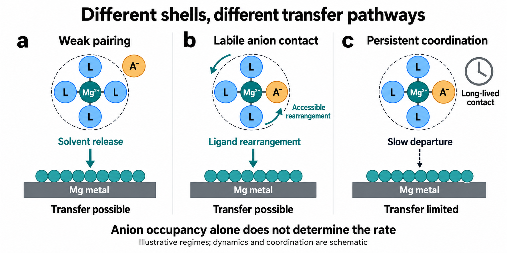
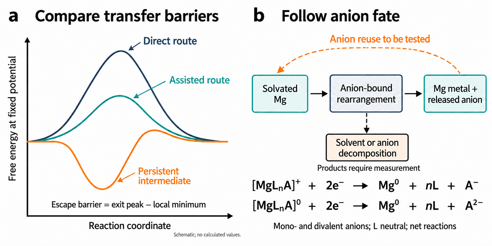
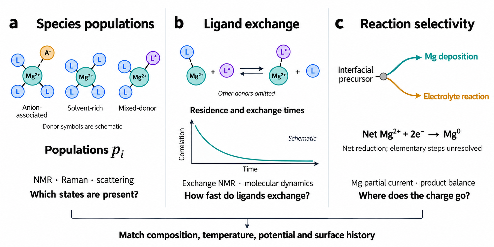
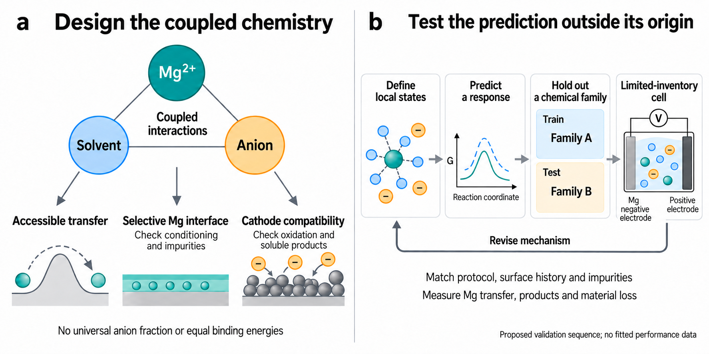

# Anion Coordination and Magnesium Transfer Pathways

## Abstract

Magnesium electrolyte design faces an apparent contradiction: both weak ion pairing and selected anion-containing solvation shells can support reversible metal deposition. We argue that coordination should be judged by the reaction it enables. A bound anion can alter solvent attachment, ligand departure and interfacial rearrangement, or suppress a competing reduction. These effects are distinct from its later incorporation into a surface film. Their value depends on whether the occupied precursor reaches metal selectively, whether the anion returns or is consumed, and whether the same liquid remains useful at the positive electrode. We compare representative electrolyte strategies, distinguish what their reported efficiencies establish, and set out experiments that separate molecular assistance from conditioning and retained surface effects. A normalized, two-state rate example shows why population and reactivity must be measured separately. We then propose a magnesium-specific route for data collection, chemical-family validation and finite-inventory cell testing. Progress should be measured by a reaction mechanism that predicts a new chemical condition, rather than by reproducing one favourable solvation structure.

Keywords: magnesium electrolytes; anion coordination; desolvation; reaction pathways; interfacial kinetics

## 1. Introduction

### 1.1. Why magnesium needs its own electrolyte logic

A magnesium-metal electrolyte must deliver species that rearrange their ligands, accept electrons and join the metal as the surface evolves. The early rechargeable prototype paired an organohaloaluminate electrolyte with a Chevrel-phase cathode.[1,2,3] Subsequent work established the importance of both liquid chemistry and surface preparation.[4,5] These constraints remain central to magnesium and other multivalent batteries.[6,7,8,9] We ask how a working formulation supplies magnesium, and which part of that explanation can guide another formulation.

Lithium provides a useful comparison, but its interphase logic is insufficient for magnesium. In lithium electrolytes, anion participation and reduced free-solvent activity change reduction selectivity and electrode compatibility.[10,11,12,13,14,15] A useful lithium SEI restricts electronic leakage while sustaining ionic transport.[16,17] Magnesium films can instead impede transfer; selected artificial or electrolyte-derived interfaces can nevertheless work.[18,19,20] An identified decomposition product is therefore a starting point for testing protection and magnesium transport, rather than evidence that lithium-like behaviour has been reproduced.

A hybrid organic/inorganic interphase offers a concrete magnesium example. After formation in its original electrolyte, the treated Mg surface also suppresses side reactions in a TFSI-containing liquid.[20] This shows that retained surface chemistry can supply a benefit even when the liquid is changed. It does not prove that anion coordination in the replacement liquid facilitates release. The example prevents two opposite shortcuts: rejecting all Mg films because many passivate, or assigning every useful film to an improved molecular transfer pathway. Surface persistence and continuing molecular assistance need separate controls.

Mg²⁺ generally binds more strongly than Li⁺ to comparable donors, with ligand denticity, association and polarization reshaping its coordination.[21,22] Here, denticity means the number of donor atoms from one ligand that bind the metal. Anion binding changes the complex charge and geometry, while the metal remains formally Mg(II) until reduction. The reacting species may differ from the dominant bulk solvate. The apparent paradox follows: reasoning from film formation encourages anion participation; reasoning from persistent binding encourages exclusion. Both directions have produced working electrolytes.[23,24] Identifying the reaction affected by each resolves the contradiction.

### 1.2. A working recipe needs a reaction mechanism

A favourable recipe does not identify its mechanism. Magnesium salt and solvent families span diverse chemistries,[25,26,27,28] and changing a donor alters dissolution, association, exchange and surface reactions together. Coordination number and isolated binding energy describe parts of the liquid, but do not identify the slow transfer step.[22,29,30] Chloride calculations illustrate the distinction: one computational comparison found easier desolvation from clusters alongside more difficult electron transfer.[31,32] This is a system-dependent result, not an experimentally established rule that aggregation always accelerates exchange. A useful descriptor must predict a defined response to a controlled chemical change.

Mg²⁺–solvent, Mg²⁺–anion and anion–solvent interactions are coupled. Organoboron, non-Grignard and alkoxide formulations access different carriers, while organic-group changes affect Grignard-derived electrolytes.[33,34,35,36] Comparing these families can test whether a descriptor retains its meaning. Specify the precursor, the reaction it undergoes and the conditions controlling its population. Agreement in CE without that information can conceal different kinetic routes. The aim is to predict which interaction should be changed next, and when the proposed change will cease to help.

### 1.3. Our position and the criterion for progress

We propose choosing a first-shell anion for its effect on magnesium transfer. Binding may replace a persistent solvent donor, redistribute electron density and change the geometry through which remaining ligands depart. These effects can precede film formation. Studies of competing solvent–anion interactions, dynamic solvation and changes outside the primary shell motivate this view.[24,37,38] We distinguish direct anion coordination, meaning a Mg–anion donor contact, from the broader term ion association. A contact ion pair has such a contact; a solvent-separated pair has intervening solvent. Neither pairing nor dissociation implies a bare Mg²⁺ ion in solution.

This Perspective asks which reaction coordination changes, how that change affects useful transfer and what happens to the anion afterwards. An occupied precursor is the solution or interfacial state populated before the step being examined; it need not be the lowest-energy isolated cluster. Release permits reuse, decomposition spends inventory and may produce a film, and persistent binding may obstruct transfer. We connect these possibilities to measurements that distinguish them. A transferable mechanism should predict the response to a donor, anion or potential change in another chemical environment, with its useful range and failure condition stated.

## 2. The Anion Participation Paradox

Figure 1. Different solvation shells can support, or limit, magnesium transfer. a) Weak pairing leaves solvent release to determine access to a reactive state. b) An anion-containing shell can offer a more accessible rearrangement. c) Persistent coordination can restrict departure and transfer. These are illustrative regimes, not assignments to specific electrolytes. Similar icons in b and c do not imply identical donor chemistry or barriers. Curved arrows and the clock indicate qualitative rearrangement and persistence, not measured rotations or times. Component sizes and coordination counts are schematic; Mg²⁺ denotes the centre, not total complex charge. Released ligands and counterions are omitted. Arrows summarize a transfer sequence and do not imply bare Mg²⁺ crossing a film or a concerted two-electron step.

### 2.1. Weak pairing avoids an unproductive association

Weak pairing helps when persistent Mg–anion association obstructs a reactive precursor or promotes unwanted chemistry. A solvent-designed Mg(TFSI)₂ electrolyte reports improved dissociation and reversible deposition, while earlier TFSI studies show the importance of donor environment and cycling history.[23,39,40,41] Here, weak pairing denotes reduced or less persistent direct association, not a prescribed solvent-separated population or bare-ion transport. The solvent shell still has to rearrange. Dissociation and conductivity should be measured independently: correlated motion, viscosity and carrier mobility can make either an incomplete guide to metal transfer.

Weakly coordinating salts test the same question from the anion side. Boron clusters and carboranes extended magnesium chemistry beyond organohalide formulations; modified clusters improved solubility while retaining the intended stability.[42,43,44,45] Fluorinated borates and alkoxyaluminates supplied further routes to less corrosive or high-voltage electrolytes.[46,47,48,49,50] These are distinct chemistries. A bulky anion does not establish a single mechanism or a zero first-shell population. We judge this strategy by whether the remaining solvent shell can deliver magnesium.

Even a weakly coordinating salt requires suitable solvent dynamics. Competitive ethers can loosen a borate shell; hydrofluoroether–diglyme mixtures offer another perturbation.[51,52] Within a controlled series, follow populations, exchange and interfacial rates. If association falls while deposition slows, solvent release, adsorption or a surface reaction may have become limiting. Such a result locates the boundary of a dissociation-based design rule. Maximizing one bulk descriptor cannot replace measuring the next reaction in the sequence.

Carborane–TFSI comparisons help test anion identity beyond concentration alone.[53] Match donor environment and surface history, then follow both liquids during cycling. Different metal recovery or product formation can reveal selectivity and surface evolution even when the initial shell assignments appear similar. The mechanistic inference belongs to the formulation and protocol tested; it should not be extended to every electrolyte carrying the same anion label.

### 2.2. Coordinating anions can help without one universal mechanism

Chloride chemistry directly challenges the idea that anion coordination necessarily slows magnesium transfer. Structural studies identify chloride complexes whose coordination and charge differ from a solvent-only Mg²⁺ solvate.[54,55,56,57,58,59] Their behaviour depends on magnesium/aluminium speciation, donors and conditioning.[60,61,62,63,64,65,66] Chloride can participate in the approaching complex and alter the surface. We interpret these results as evidence that coordination must be judged within a reaction pathway. They do not imply that placing any anion near magnesium produces the same kinetic benefit.

Other ligand chemistries reinforce this judgement. Phenolate, phenoxyimine, amido and Hauser-base electrolytes change the identity and reactivity of magnesium species.[67,68,69,70,71] Borohydride concentration and donor choice also affect metal compatibility.[72,73,74] Amine cosolvents and redesigned solvent molecules can improve transfer even when they interact strongly with magnesium.[75,76,77,78] We take their common lesson to be that a binding strength has meaning only within the sequence of reactions it permits. Ranking isolated attractions cannot replace testing that sequence.

The amine study assigns a specific benefit to primary-shell ion pairing: weakened amine coordination suppresses reduction and H₂ evolution, with CE reported across 800 cycles.[79] This supports improved selectivity; it does not independently establish a faster ligand-release step. The solvent–anion balance study instead proposes synchronous desolvation and reports an MgH₂-containing interphase.[24] The phase assignment does not establish that bulk MgH₂ conducts magnesium in the operating film. Exchange kinetics, surface transport and side-product formation must be separated before either result becomes a general design rule.

Chelating anions provide a third case. MgEDTF is the magnesium salt of (1R,2R)-1,2-diphenylethane-1,2-diylbis(trifluoromethylsulfonylamide), whose EDTF²⁻ anion forms an unsaturated Mg–anion–DME complex.[80] Compared with the non-chelating analogue, the authors report lower plating/stripping polarization and an anion-derived SEI. These observations leave molecular and film contributions coupled. A useful control would vary the coordinating species on identically conditioned surfaces, then compare the initial exchange response with any benefit retained after liquid replacement. Table 1 records reversibility under independent protocols and identifies this type of discriminating question.

Table 1 asks what to test next. When association limits access to a reactive precursor, test dissociation. When donors remain persistent, test departure. When current is lost to decomposition or passivation, test selectivity and surface activation. Several contributions can coexist. Reported CE demonstrates charge recovery in a particular protocol; it neither ranks unmatched electrolytes nor establishes the proposed rate-limiting step. The useful inference is a different experiment, not a numerical ordering.

### 2.3. How coordination changes the transfer barrier

First-shell occupancy describes association, not metal delivery. An abundant precursor may reach a reactive interfacial state, exchange slowly or feed decomposition.[22,29,30] The relevant barrier starts from the state occupied under operating conditions. Stabilizing that state can deepen a trap even when a transition state is also stabilized. Figure 2 separates these possibilities. The design target is an accessible route from the occupied precursor; lowering the energy of one selected complex is insufficient. A release barrier and an association free energy answer different questions.

A bound anion can redistribute electron density, modify solvent attachment and change the coordination geometry required for donor departure. Partial charges are model-dependent descriptors, and the formal Mg oxidation state does not change merely because the anion binds. Anion–solvent interactions may also change association without making a cosolvent the dominant ligand.[81,82,83] The authors’ solvent–anion “counterpoised” design concerns competing coordination interactions, not the counterpoise correction for basis-set superposition error.[24] It establishes no universal equality of pairwise binding energies. Effects outside the shell further connect local release to the surrounding liquid.[38,84]

The path can change without a simple weakening of every Mg–donor interaction. A donor may depart after another ligand enters, after a chelate opens, or after surface adsorption changes the geometry. Those alternatives have different intermediates and entropic costs.[22,31] Stronger association can increase access to a reactive arrangement or stabilize an unproductive one. The calculation must therefore follow the ligand, released species and charge through the proposed sequence. Neither a smaller assigned Mg partial charge nor a more negative cluster energy identifies that sequence or supplies its activation barrier.

For rapidly interconverting local precursor states, a limiting pre-equilibrium model relates their fractions to a productive exit rate:

k_eff(U) = Σᵢ pᵢ(U) kᵢ(U)

Here, pᵢ(U) is the local fraction of precursor i at potential U, with Σᵢpᵢ(U) = 1, and kᵢ(U) is its effective first-order rate constant for productive transfer. Interconversion must be fast relative to those exits. These fractions are not automatically bulk spectral fractions; adsorption, coverage, gradients and side reactions are outside this simple model. If exchange between the included states is slow, their time-dependent populations require a reaction network. The expression does not establish that electron transfer is universally the limiting step.

An illustrative two-state calculation makes the distinction explicit. Let k₁ = 1 s⁻¹ and k₂ = 10 s⁻¹. Fractions p₁ = 0.9 and p₂ = 0.1 give an effective rate of 1.9 s⁻¹; setting p₁ = p₂ = 0.5 gives 5.5 s⁻¹ with unchanged state-specific rates. The gain comes from population redistribution. Alternatively, changing k₂ at fixed fractions would test a pathway effect. These numbers illustrate the model and are not measured magnesium-electrolyte rates.

Table 1. Representative electrolyte strategies reveal multiple kinetic pathways for magnesium transfer.

| Design strategy | Representative chemistry | Reported Mg CE (%) | Reported readout context | Mechanistic question to test | Refs. |
| --- | --- | --- | --- | --- | --- |
| Weakly coordinating anion | Mg(CB₁₁H₁₂)₂/G4 | >94.4 | Mg reversibility; value compiled by Zhang et al. | Does solvent rearrangement remain accessible as persistent anion association is reduced? | [43] |
| Weakly coordinating anion | Mg perfluorinated pinacolatoborate (Mg-FPB) | 95 | Original report of reversible Mg deposition | Does weak anion association leave solvent rearrangement as the main limitation? | [47] |
| Promote pair dissociation | Mg(TFSI)₂/DME–G2–BTFE–TEP | 95.2 | Mg plating/stripping; value compiled by Zhang et al. | Does dissociation increase reactive precursor availability independently of surface and growth changes? | [23] |
| Introduce primary-shell pairing | Weakly solvated amine + strongly coordinating Mg salt | 99.6 | CE reported for 800 cycles | Pairing suppresses amine reduction and H₂ evolution; does ligand exchange also change? | [79] |
| Reshape solvent coordination | Mg(TFSI)₂/DME–MOPA-1 | 99.5 | Mg plating/stripping; value compiled by Zhang et al. | Does modified solvent coordination speed rearrangement, charge transfer or both? | [75] |
| Mixed-ion coordination | Mg(TFSI)₂ + LiOTf/DME–TMP | 98 | Original report of Mg-metal reversibility | How much comes from altered Mg–DME interaction versus the phosphate-rich interface? | [82] |
| Coordinate salt and solvent | Mg(OTf)₂/G2–MOEA | 98.3 | Reported average CE after 8200 cycles; symmetric lifetime is separate | How do coordination and distinct electrode interphases share the contribution to reversibility? | [85] |
| Chloride complexes + interphase | Mg(pftb)₂ + MgCl₂/THF | 99.7 | CE reported over 3000 cycles; symmetric lifetime is separate | Does a retained hybrid interphase sustain transfer when solution coordination is changed? | [20] |
| Dissociation + interphase | Mg(OTf)₂ + MgCl₂/DME–TEP | 99.4 | Mg\|\|Mo: 0.5 mA cm⁻², 0.25 mAh cm⁻²; CE reported after 3000 h | Can a molecular transfer gain be separated from suppressed losses at the interphase? | [86] |

Reported efficiencies describe independent protocols and are not a performance ranking or measurements of a desolvation barrier. Readout windows are retained where reported, without recasting unspecified statistics as averages or terminal values. First-cycle-only, symmetric-lifetime and full-cell efficiency claims are excluded from the CE column. Match current, deposited capacity, substrate, temperature and conditioning before testing a cross-system kinetic ordering. The chemistry identifies the design rather than a complete recipe. Mechanistic questions are proposed tests, not established limiting steps. CE for the carborane, solvent-designed TFSI and MOPA-1 cases is quoted from the compilation by Zhang et al. [87]; original-study references are retained. Numerical provenance and protocol-verification limits are provided separately. Reference numbers link to DOI records. THF: tetrahydrofuran; DME: 1,2-dimethoxyethane; G2/G4: diglyme/tetraglyme; BTFE: bis(2,2,2-trifluoroethyl) ether; TMP/TEP: trimethyl/triethyl phosphate; MOPA-1: 1-methoxy-2-propylamine; MOEA: 2-methoxyethylamine; pftb: perfluorinated tert-butoxide; OTf: triflate; TFSI: bis(trifluoromethanesulfonyl)imide. TMP denotes the phosphate here, not the piperidide ligand used in some Hauser bases.

Anion fate then determines whether assistance can persist. Release in an active form permits another interaction; consumption changes both inventory and the interface.[88,89] A catalytic description would require repeated kinetic assistance with regeneration and no net consumption of the active facilitator, beyond survival or high CE. No turnover count follows from the CE endpoints in Table 1. This distinction is useful even before regeneration is established: it changes the controls and the inventory cost to measure. For a fixed overall reaction, a catalyst does not change its equilibrium free energy; changing electrolyte composition may change that quantity as well as the pathway.

Figure 2. Occupied-state barriers and anion fate answer separate questions. a) Schematic pathways share the same overall reaction, potential and endpoint definition. Escape from a persistent intermediate requires the exit-peak energy minus its local minimum; no calculated values are implied. b) Separate net equations for mono- and divalent anions conserve charge, Mg and ligands with neutral L. They describe overall reduction, not elementary electron-transfer steps. The dashed arrow tests reuse of the released anion, not metal redissolution. The decomposition branch has no assigned products or stoichiometry because these require measurement.

The independent reports show that reversible deposition has been achieved with different coordination strategies.[23,79,87] Their CE values do not establish which molecular step explains the gain. The amine case suggests testing suppression of reduction against faster exchange; the chelating case suggests separating coordination from the retained film. Lower polarization alone selects neither explanation. We therefore use the literature to choose a perturbation that can distinguish mechanisms, with comparison current, deposited capacity, surface and conditioning fixed.

State the outcome that would weaken the proposed explanation. Faster exchange without a larger Mg partial current means release has not removed the overall limitation. Higher CE without faster exchange directs attention to suppressed losses. A benefit retained after removal of the active species, with the surface independently shown to persist, supports a surface contribution. None of these outcomes makes the electrolyte useless. They identify the chemistry worth changing next and the step that still prevents a transferable prediction.

## 3. Evidence Needed to Assign a Transfer Mechanism

### 3.1. Define the reaction before comparing energies

An energy claim needs a defined reaction. Ion-pairing free energy compares associated and dissociated states in a specified liquid. Exchange free energy compares a bound donor with its replacement and the released donor. A desolvation barrier describes the transition between such states. These quantities require consistent charge, composition, solvent activity and reference states. A more negative association energy alone cannot establish faster transfer. The relevant barrier starts from the occupied precursor, including a trapped intermediate if one forms.[22,31]

Cluster calculations identify plausible donors and reaction sites, but a release pathway must also include the liquid. Comparing differently charged complexes or removing solvent without accounting for it can create an irrelevant energy difference. Multidentate shells require conformational sampling and attention to entropy. A useful calculation follows a balanced reaction and states its reference conditions. It should then predict an observable change, such as exchange, population or potential-dependent deposition. We place greater weight on that prediction than on agreement with a single selected structure.

Enhanced sampling connects local configurations to free-energy surfaces.[90,91] For anion-assisted release, coordination to solvent and anion, together with distance from the surface, may all matter. Sampling one coordinate can miss a route along another. Reweighting estimates equilibrium properties and uncertainty where sampled distributions overlap; it cannot recover an unvisited transition.[92] Adsorption and reduction also depend on potential, which motivates suitable constant-potential or grand-canonical calculations.[93,30] Our criterion is a predicted experimental ordering that survives reasonable modelling choices. The reaction and reference state must remain explicit.

### 3.2. Identify the species that the kinetic model needs

Spectroscopy should constrain the species required by the kinetic model. Raman and IR distinguish donor and anion environments, while magnesium-sensitive NMR probes solvation and dynamics.[94] Chloride studies show why several methods should be combined across a composition series.[56,57,95,73] Specify donor identities, participating atoms and association distributions with uncertainty. One donor molecule can supply several coordination sites. A calculated cluster remains a candidate species until data constrain its abundance and changes with composition.

A peak shift is not a universal marker of faster desolvation. Raman intensity depends on scattering response, and NMR averages rapidly exchanging environments. Compare calibrated spectra with predicted bands, concentration trends and exchange-sensitive measurements. If the anion-contact fraction changes but donor-exchange time does not, the data support a structural change without demonstrating accelerated release. If a film develops simultaneously, an additional surface control is needed. Carry unresolved assignments into the kinetic test instead of converting a fitted spectrum into a unique shell.

Chloride–lithium formulations also require carrier charge to be resolved.[96,81,59] Equal total magnesium concentrations can have different transport because clusters differ in charge and abundance. Mass spectrometry and crystal structures identify plausible complexes but select species during ionization or crystallization. A minor bulk species may become important at a polarized electrode. Its assignment as the reacting precursor needs a potential-dependent response on a controlled surface, rather than a bulk structure alone.

Anion exclusion deserves the same discipline. Neither a bulky salt nor one shifted vibrational band establishes zero first-shell occupancy. Report the associated fraction, uncertainty and exchange regime, then ask whether a controlled change in that fraction predicts transfer. Similar cycling in different shells is a reason to separate exchange and selectivity. The proposed mechanism must explain both the differing molecular behaviour and the similar electrochemical outcome.

The evidence should match the claim. A shell assignment establishes association. A matched change in exchange and magnesium-transfer kinetics supports a pathway contribution. Product and current balances distinguish faster transfer from fewer losses. Tracking the active anion tests whether the effect continues through recovery or consumption. Each study need not measure everything, but its conclusion must stop where its evidence stops. The next measurement should distinguish the remaining explanations.

### 3.3. Connect exchange times to the rate at the electrode

Exchange, diffusion, adsorption, reduction and nucleation can occur on different time scales, with the slowest step changing as potential and surface history change. A weakly associated ion may retain solvent, while a bound precursor may rearrange at the electrode. Exchange-sensitive NMR, temperature dependence and molecular dynamics probe parts of this sequence. Identify the measured process and its conditions. A relaxation time becomes evidence for desolvation only when the reaction model connects it to ligand departure and the required metal-transfer rate.

Residence time depends on its definition. Brief departure and rebinding give different continuous and intermittent lifetimes. Report the distance criterion, correlation function, rebinding treatment and sampling length. Diffusion also requires convergence and finite-size checks.[97] Conductivity includes correlated motion, and greater conductivity can reduce polarization without changing ligand release. Transport must therefore be constrained alongside interfacial kinetics. After constraining bulk transport, the remaining kinetic change needs a molecular or surface explanation.

Impedance and transients can help distinguish time scales, especially when perturbations are chosen to change one process and independent measurements constrain the others. They do not give a universal mapping from high-, middle- or low-frequency features to film transport, electron transfer or diffusion. Adsorption, nucleation and evolving films can overlap. Compare potential and temperature dependence with transport controls and metal-specific current. Reorganization enters electron-transfer theory,[98] but magnesium deposition also changes coordination and the surface. Faster exchange with an unchanged film response supports a different explanation from unchanged exchange with progressive activation.

A faster molecular step can leave deposition unchanged if adsorption, reduction or surface incorporation remains slow. Suppressing decomposition can also raise CE without changing exchange. A universal binding-energy–efficiency correlation is therefore unlikely. Measure a molecular rate and a magnesium-specific response within the same series, and predict their joint response to a donor or potential change. A mismatch identifies a missing limitation; it should delimit the descriptor’s useful range rather than be hidden by fitting the final cycling efficiency.

Figure 3. Measurements of populations, exchange and reaction selectivity answer different questions. a) Donor icons represent possible motifs without assigning real coordination numbers. b) The illustrated one-for-one exchange conserves both ligands: bound L plus free L* becomes bound L* plus free L; other donors are omitted. The decay is a schematic correlation function, not experimental data. c) Useful magnesium current is distinguished from electrolyte reaction. Net two-electron reduction is shown without assuming a concerted elementary event. Composition, temperature, potential and surface history must be connected across the measurements.

### 3.4. Identify useful reduction and the chemical fate of the anion

An accessible release route matters only if it supplies magnesium selectively. Potential-dependent DFT finds decomposition of solvated species in the double layer competing with metal deposition.[30,29] Electron transfer requires electronic coupling to the electrode; it does not require complete desolvation or direct physical adsorption of every reacting molecule. These calculations concern electrochemical reactivity near an electrode, not reduction disconnected from it. Orbital energies suggest reaction sites, whereas relaxation, surrounding liquid, bond cleavage and barriers determine products. A cathodic onset or low fitted barrier must therefore be checked against deposited metal and competing chemistry.

Current needs a material balance. Deposited magnesium, recovered charge, gas, soluble products and film growth constrain different losses. Instantaneous magnesium partial current differs from cycle-integrated CE, while chemical corrosion can consume metal without the same faradaic signal. Early plating studies and later interphase work make these distinctions important for magnesium.[99,3,77] Operando mass-sensitive measurements are useful when passivation forms or dissolves during conditioning.[100] Their interpretation must account for coupled solvent, porosity and changing surface area. The goal is to identify where charge and magnesium go during the proposed kinetic improvement.

Track active anion, gas, soluble products and surface growth as Mg throughput increases. Survival alone is compatible with an inert spectator; a long-lived benefit can rely on slow consumption from a large reservoir. Recovery is meaningful only if the recovered species still affects transfer after surface history is controlled. Table 2 connects each possible contribution to a perturbation and an observation that supports or limits it. The contributions overlap because a single ligand can alter release and reduction, then leave or react. The experiment must identify which contribution explains the gain.

Table 2. Perturbations and outcomes that distinguish contributions to magnesium transfer

| Possible contribution | Matched perturbation | Observation favouring or limiting the explanation | Relevant studies |
| --- | --- | --- | --- |
| Precursor availability | Change association while constraining bulk transport and the surface | Favoured when a reaction-relevant population tracks Mg transfer without faster exchange; limited if film or conductivity explains the response | [38,23] |
| Ligand departure or rearrangement | Change donor/anion identity on compatibly conditioned surfaces | Favoured by a matched exchange and Mg-rate response; faster exchange with unchanged Mg current leaves another step limiting | [24,75] |
| Suppression of unwanted reduction | Follow Mg-specific current, gas and soluble/film products | Favoured by fewer losses at unchanged exchange; a donor can instead become more reactive, so a shell assignment alone is insufficient | [79,30] |
| Repeated molecular assistance | Track active anion and products with increasing Mg throughput | Favoured by recovery plus a persistent kinetic effect without net active-species consumption; survival alone can describe a spectator | [20,80] |
| Persistent intermediate | Measure residence and escape from the occupied state | Favoured by a long-lived state and a high relevant escape barrier; a low state energy alone does not establish trapping | [31,22] |
| Retained surface benefit | Change liquid while verifying persistence of the treated surface | Favoured when enhancement follows the intact surface; loss after film dissolution is ambiguous, not proof of molecular assistance | [20,86] |
| Coupled molecular and film effects | Separate the initial liquid response from the retained-surface response | Favoured when independent responses require both contributions; CE alone cannot apportion them | [86,88] |

These are overlapping contributions and proposed discrimination tests. An observation favours or limits an explanation under its controls; it need not prove one unique mechanism. Studies supply relevant examples, not evidence for every test listed. The outer-shell example includes a neutral additive. A single electrolyte may occupy several rows.

## 4. Design Rules for Coupled Magnesium Anion and Solvent Chemistry

### 4.1. Open an accessible transfer route

The first design objective is to increase useful magnesium transfer at the intended current. This may require more reactive precursors, faster rearrangement or fewer side reactions. Solvent redesign, amine assistance and phosphate-containing environments show that the whole pathway matters.[78,75,85,101] Pairing and weak pairing can both remove a limitation.[79,23] A ligand must support dissolution and transport, then release or rearrange when needed. An anion is useful if it improves that connection without creating a persistent trap or a dominant decomposition route. The target is the reaction sequence that supplies metal.

Denticity and steric structure can change that sequence. A chelating donor can bind strongly yet release through successive rearrangements. Mixed shells can offer donors with different departure rates. Cyclic and linear ethers can therefore behave differently despite similar familiar descriptors.[51] Boronic-ester additives and coupled solvation–interface strategies explore related effects.[102,103,104] The comparison should identify the chemical change and the step it improves. Similar cycling gains do not establish a shared elementary reaction or a common optimum coordination number.

The surrounding liquid also matters. A cosolvent can change counterion availability without occupying most magnesium sites. In amine electrolytes, ionization and proton transfer can create new charged species and affect hydrogen evolution.[83,89] These changes need to be measured. Selecting a favourable cluster while ignoring solution activities may miss the reaction that activates the interface. We therefore include regulation outside the shell within solvation design. The criterion is whether the perturbation changes a magnesium-transfer step or its selectivity, with its location and chemical fate established as far as the evidence allows.

A useful comparison starts with weak pairing, proposed anion assistance and a persistent associated control. Constrain transport, populations and exchange before measuring interfacial rates on matched surfaces. Ask whether the mechanism predicts a change in their ordering with potential, temperature or donor substitution. An intermediate composition that performs best identifies competing processes, not a universal anion fraction. The proposed coordination effect should also predict when its advantage disappears. This test makes molecular design accountable to the reaction it is intended to improve.

Salt mixtures provide another controlled perturbation. Magnesium triflate formulations and tetrabutylammonium triflate additives activate solutions that otherwise transfer magnesium poorly.[105,106] Added ions can change association, carrier charge and free-donor availability at the same time. The test must identify which magnesium species changes and whether the added ion reaches either electrode. This is essential in mixed-metal formulations, where a second cation may contribute to cathode storage. Vary anion supply alongside carrier charge and possible contributions at the cathode.

### 4.2. Preserve a magnesium interface that continues to transfer

Surface preservation is a distinct design objective. Adsorption, suppression of solvent reduction, removal of blocking compounds and persistent films can all sustain transfer.[107,108,109,20] Artificial interfaces and component modifiers extend these options.[110,111] To test molecular assistance, compare a fresh and a conditioned surface in the same liquid, then vary the liquid on surfaces whose retained state is measured. A benefit that follows the surface is different from one requiring the coordinating species in solution. Both can coexist; a cycling curve alone cannot assign their shares.

Conditioning can create the apparent solvation effect. Water/chloride control and operando EQCM-D show passivation layers forming and disappearing, with chloride accelerating currentless dissolution in the studied systems.[112,100] Conditioning-free additives and mixed borohydride salts provide other activation routes.[113,114] These are measured surface processes, but chloride also changes magnesium speciation. Treat liquid chemistry and surface history as separate experimental factors. Compare deposition before and after conditioning, quantify activation charge and products, and sample the liquid after treatment. A mechanism must describe the electrolyte actually supplying magnesium, not only the freshly mixed composition.

A useful film requires transport and persistence to be tested. Borohydride-based, gradient and hybrid interfaces illustrate different approaches.[115,116,20] Detecting a hydride, nitride or phosphate does not identify the conducting phase or path. A real mixed film may transfer Mg through defects, boundaries, other phases or exposed metal. Check phase assignments against complementary measurements, then connect resistance evolution to Mg recovery. Avoid assigning a numerical bulk conductivity to a proposed phase without an applicable source. Film composition, molecular release and continued material loss are separate quantities.

Morphology can improve performance independently of desolvation. Surface kinetics, scaffolds, exposed facets, horizontal platelets and orientation-selective additives change nucleation and current distribution.[117,118,119,120,121] Studies of kinetic versus diffusion-controlled growth and magnesium dendrites in glymes show that metal identity does not fix deposit shape.[122,123] Match deposited capacity, transport and substrate preparation before interpreting a smoother deposit. The proposed molecular change should then predict how morphology responds. This protects a solvation argument from claiming an improvement that was produced mainly by the electrode structure.

Water, oxygen exposure and salt-batch impurities need to be recorded rather than treated as a single purity label. A water-resistant hybrid AlCl₃/MgCl₂/Mg(TFSI)₂ formulation demonstrates system-specific tolerance.[124] The reported addition should not become a universal impurity threshold. Measure water content and state the ppm basis, document handling and oxygen exposure, and control halide content. A donor substitution can alter impurity uptake or activation chemistry without improving release. Use dry and deliberately dosed liquids on fresh and preconditioned surfaces. Follow spectra, gas and interfacial response so that impurity-driven changes are distinguished from the intended coordination perturbation.

A practical minimum is a two-by-two liquid/surface comparison: control and modified electrolyte, each on fresh and preconditioned Mg. Hold substrate preparation, current, capacity, temperature and activation history fixed within the series. A benefit only after conditioning points towards a retained surface contribution; a reproducible initial molecular response on both surfaces motivates further testing of coordination. Electrolyte swaps need paired controls because replacement can dissolve a film or change adsorption and area. If the retained surface changes, disappearance of the benefit cannot establish that continued molecular assistance was required. The factorial comparison is a proposal, not an existing standardized protocol.

### 4.3. Keep the same electrolyte useful at the positive electrode

The same liquid must connect both electrodes. A donor that activates Mg may increase oxidation losses; a stable salt can leave metal transfer slow. Boron-based, non-nucleophilic and fluorinated dialkoxide formulations pursue both requirements.[125,126,127,128,129] At the positive electrode, ligand release may precede charge transfer, after which host diffusion or phase conversion can become limiting. The relevant sequence depends on cathode chemistry and potential. Test the intended cathode and collector together, because corrosion, oxidation and species released during cycling can change the liquid returning to magnesium.

The CuSe example makes the solvation connection concrete. Its authors add OTf⁻ to an ether electrolyte and assign a change from [Mg(DME)₃]²⁺ to an anion-containing average solvation motif, proposing easier desolvation and cathode charge transfer.[130] Here, “anion-incorporated” refers to the Mg solvation shell, not anion insertion into CuSe. Conversion within the solid can still limit storage after the interfacial step improves. Test the interpretation by combining solution speciation with potential-dependent interfacial response and phase evolution. The example supports examining coordination at a conversion cathode; it does not establish the route at Mg metal or a universal cathode limitation.

Organic storage provides another boundary. In a Mg-FPB/quinone study, spectroscopy detects reduced carbonyl groups coordinated with Mg²⁺ and also incompletely dissociated MgFPB⁺ pairs.[131] Thus, electrolyte association can change the species reaching a storage site, not merely the energy of a bare cation. Polymer-storage and enolization studies likewise motivate identifying the stored species and remaining solid-state limitation.[132,133] Match state of charge when comparing liquid and cathode measurements. A larger capacity does not alone distinguish faster interfacial transfer, improved host access or participation of another ion.

Solubility couples cathode chemistry back to the liquid. In sulfur conversion, an electrolyte that stabilizes soluble intermediates can improve access to reaction sites while also permitting loss or shuttle to Mg.[134] Coordination, solvent activity and adsorbed layers may all affect that trade-off; no single effect should be assumed across sulfur electrolytes. Separate dissolved active material from electrolyte products, then compare positive-electrode phase evolution with self-discharge and reactions at the negative electrode. Low solubility is useful only if conversion still proceeds. A transfer pathway must therefore be judged by the useful reaction it supports and the chemistry it enables elsewhere in the cell.

A matched cell experiment should distinguish these possibilities before claiming a positive-electrode advantage. Compare anion modification at fixed cathode loading, capacity and state of charge; measure electrolyte products, dissolved active material and phase evolution alongside the interfacial response. If transfer improves while the solid reaction remains unchanged, a surface limitation is plausible. If more active material dissolves or an additional cation stores charge, capacity has another explanation. Mixed-metal electrolytes require an elemental and charge balance, because storage by an added ion is not automatically Mg storage. The test must connect the proposed liquid species to the species recovered from the electrode.

Oxidation onset is also insufficient. Electrode area, scan rate and current criterion affect it; voltage holds at the intended porous cathode reveal sustained losses and growing resistance.[135,136] Test matched liquids before and after charged-cathode exposure, then reassess Mg transfer. Report metal excess, electrolyte volume, loading and capacity limits. Cathode-specific capacities and long symmetric cycling do not determine complete-cell energy or material consumption.[24,6] The practical question is whether one liquid preserves selective transfer at both electrodes with limited inventories, rather than whether each electrode performs well in separate excess-electrolyte tests.

## 5. A Research Route from Mechanism to Prediction

Figure 4. A proposed sequence for testing a transferable electrolyte mechanism. a) Coupled Mg–anion–solvent chemistry must support accessible transfer, a selective Mg interface and cathode compatibility. Triangle edges denote interactions, not equal energies; icons specify no microscopic film transport path. b) Defined local states motivate a predicted response, followed by a chemical-family holdout and a limited-inventory cell test. Matched protocol, surface history and impurities connect the stages; Mg-specific transfer, products and material loss test the prediction. The curves are schematic, and the workflow does not imply established model accuracy.

### 5.1. Train models on a defined chemical question

A magnesium-specific model should predict a defined chemical response. Candidate inputs include concentration-dependent contact fractions, ligand residence times, donor denticity, complex charge and the barrier from an occupied state; none is interchangeable with isolated binding energy. Dynamic-solvation and competing-interaction studies show how molecular descriptors enter screening.[37,24] A first target could be the ordering of Mg partial rates within a matched electrolyte series. Keep CE and side-product yield as separate outputs. A composition that changes conductivity or conditioning may improve cycling without validating the proposed release descriptor.

Each record should identify salt and donor amounts, temperature, measured water, handling, substrate, conditioning and batch. Attach spectra and their assignment uncertainty, the definition of an exchange time, current and deposited capacity, stripping limit, CE statistic and sampling window. Preserve fresh and conditioned records separately. Table 1 is a literature evidence comparison, not a protocol-normalized training set. Unreported fields are missing data, not zero. Units and source provenance must survive aggregation; an average CE must not be relabelled as an end-cycle value or mixed with a full-cell efficiency.

The main traps are leakage and confounding. Randomly splitting points from the same concentration series, salt family or conditioned electrode can make interpolation look transferable. Hold out entire donor or anion families and experimental batches, fit preprocessing on training data only, and compare with composition-only and conductivity baselines. A model that uses an isolated gas-phase binding energy must not be described as predicting an interfacial barrier. Track uncertainty outside its chemical range. Missing negative results and selective reporting of successful formulations can bias the learned rule even when every retained DOI is correct.

One feasible pilot design would use three donor ratios and three anion-supply levels within a verified single-phase region, while retaining total Mg concentration and recording all other ions. This gives nine liquids; fresh and preconditioned Mg create two surface conditions for each. Replicates and impurity measurements establish the spread that a predicted rate ordering must exceed. Conductivity and viscosity remain measured covariates rather than assumed constants. This matrix is an experimental proposal, not a dataset reported here. Its value is to test whether the prediction follows coordination, surface treatment or their interaction before a model is extended to a new chemical family.

### 5.2. Keep the reaction states explicit across scales

Molecular dynamics can sample populations, diffusion and exchange, provided polarization and force-field errors are checked for divalent coordination. Machine-learning potentials extend accessible sampling,[137] and have been used for magnesium chloride–amine systems.[138] Their validity must include the reactions being predicted. Validate coordination against spectra and residence times against defined experimental or simulation measures. Add adsorption, changing charge and decomposition only when training configurations and electronic treatment cover them. A potential accurate in the bulk cannot be assumed to reproduce reduction at Mg or oxidation near a charged cathode.

A reaction network then links liquid states, adsorbed precursors, rearranged intermediates, metal and products.[30,93] Preserve the charge and chemical inventory of every node. A positively charged Mg complex can carry a bound anion towards a negative electrode; electrostatic repulsion of a free anion does not exclude that route. State whether the anion departs, stays through rearrangement or reacts. Fast exchange gives the limiting expression in Section 2.3; slow exchange or changing surface coverage needs explicit kinetic evolution. Competing branches should predict products and potential dependence, not only a fitted overall efficiency.

For an initial learning experiment, vary one donor ratio and one anion-supply variable on compatibly prepared surfaces. The model should predict both the exchange trend and the Mg-specific rate ordering, then a potential or temperature at which the ordering changes. Choose the next measurement where release and surface-activation explanations predict different outcomes. Active learning can reduce experiment count, as shown in battery optimization,[139] but selecting the largest expected CE would not serve this mechanistic task. Validate the predicted response before optimizing a new electrolyte family, and carry failures into the dataset.

### 5.3. A research sequence for testing transferable pathways

The immediate priority is a small controlled series that distinguishes access to reactive precursors, ligand departure and suppressed losses. Measure populations, exchange, Mg recovery and products, with fresh/conditioned surfaces and impurity controls. A useful result eliminates an alternative explanation and specifies which chemical variable should change. This is the minimum evidence needed before expanding a library or fitting a broad solvation descriptor. It does not require every method on every formulation; it requires compatible measurements of the quantities that distinguish the proposed routes.

Next, predict a perturbation outside the discovery family before optimizing that electrolyte. Preserve the meaning of the rate and molecular variable, and state uncertainty for unmeasured surface states. Success provides guidance beyond the original composition; failure identifies a new limitation. Finally, use one liquid at both electrodes with known inventories and test it after conditioning and cathode exposure. These stages turn a structural explanation into a design rule with an operating range and a measurable cost.

The reasoning also connects to solution electron transfer, where reorganization contributes to reactivity beyond reactant stability.[98] Calcium offers a related metal-transfer problem, but its interphase and exchange kinetics require their own tests.[140,6] Aluminium systems can use chloroaluminate carriers rather than an ether-solvated Al³⁺ ion, so carrier charge and reaction stoichiometry must be redefined before importing a Mg descriptor.[141] The transferable idea is to identify the populated carrier, its productive route and its material fate; a numerical binding-energy threshold is not expected to apply across these chemistries.

## 6. Conclusions and Outlook

### 6.1. Choose an anion for the transfer reaction it enables

A first-shell anion should be judged through the reaction it changes. It can alter solvent attachment, open a rearrangement or suppress reduction; it can also stabilize a persistent precursor. Weak pairing and selected anion-containing shells therefore need not be opposing design rules.[23,79,24] Occupancy alone cannot identify their benefits. The useful molecular insight is the connection between a measured coordination change and selective transfer from the occupied state. Anion recovery or consumption then determines whether that benefit can persist and at what inventory cost.

### 6.2. Make the next experiment distinguish the mechanism

The next experiment should distinguish explanations rather than repeat a structural assignment. Pair a molecular response with Mg-specific kinetics and products on controlled surfaces, while accounting for conditioning and impurities. Table 2 identifies outcomes that favour or limit each contribution. The mechanism should predict a response to donor substitution, anion supply or potential before it is measured. A failed prediction locates the rule’s boundary. Data-driven screening becomes useful when it selects such tests and survives chemical-family and batch holdouts, rather than reproducing the best reported CE.

### 6.3. Engineer pathways that remain useful in a cell

The decisive test uses the same electrolyte at both electrodes with limited metal and liquid inventories.[142,6] A molecular advantage must survive cathode exposure, surface evolution and repeated transfer without unacceptable loss. Identifying the populated carrier, productive reaction and chemical fate connects coordination to that test. This would make solvation a predictive basis for choosing chemistry, with its costs and limits explicit. Future magnesium electrolyte discovery should move from searching for a favourable solvation structure towards engineering transferable reaction pathways.

## References

1. **Prototype systems for rechargeable magnesium batteries** D. Aurbach, Z. Lu, A. Schechter, Y. Gofer, H. Gizbar, R. Turgeman, Y. Cohen, M. Moshkovich, E. Levi, Nature 2000, 407, 724–727. https://doi.org/10.1038/35037553

2. **Electrolyte Solutions for Rechargeable Magnesium Batteries Based on Organomagnesium Chloroaluminate Complexes** D. Aurbach, H. Gizbar, A. Schechter, O. Chusid, H. E. Gottlieb, Y. Gofer, I. Goldberg, J. Electrochem. Soc. 2002, 149, A115–A121. https://doi.org/10.1149/1.1429925

3. **Nonaqueous Electrochemistry of Magnesium: Applications to Energy Storage** T. D. Gregory, R. J. Hoffman, R. C. Winterton, J. Electrochem. Soc. 1990, 137, 775–780. https://doi.org/10.1149/1.2086553

4. **Progress in nonaqueous magnesium electrochemistry** N. Amir, Y. Vestfrid, O. Chusid, Y. Gofer, D. Aurbach, J. Power Sources 2007, 174, 1234–1240. https://doi.org/10.1016/j.jpowsour.2007.06.206

5. **On the electrochemical behavior of magnesium electrodes in polar aprotic electrolyte solutions** Z. Lu, A. Schechter, M. Moshkovich, D. Aurbach, J. Electroanal. Chem. 1999, 466, 203–217. https://doi.org/10.1016/s0022-0728(99)00146-1

6. **Current status and future directions of multivalent metal-ion batteries** Y. Liang, H. Dong, D. Aurbach, Y. Yao, Nat. Energy 2020, 5, 646–656. https://doi.org/10.1038/s41560-020-0655-0

7. **Progress and perspective on rechargeable magnesium-ion batteries** G. Wang, Z. Wang, H. Shi, A. Du, M. Sun, G. Cui, Sci. China Chem. 2024, 67, 214–246. https://doi.org/10.1007/s11426-022-1454-0

8. **Research development on electrolytes for magnesium-ion batteries** Y. Man, P. Jaumaux, Y. Xu, Y. Fei, X. Mo, G. Wang, X. Zhou, Sci. Bull. 2023, 68, 1819–1842. https://doi.org/10.1016/j.scib.2023.07.027

9. **Current Design Strategies for Rechargeable Magnesium-Based Batteries** J. Zhang, Z. Chang, Z. Zhang, A. Du, S. Dong, Z. Li, G. Li, G. Cui, ACS Nano 2021, 15, 15594–15624. https://doi.org/10.1021/acsnano.1c06530

10. **Nonaqueous Liquid Electrolytes for Lithium-Based Rechargeable Batteries** K. Xu, Chem. Rev. 2004, 104, 4303–4418. https://doi.org/10.1021/cr030203g

11. **Electrolytes and Interphases in Li-Ion Batteries and Beyond** K. Xu, Chem. Rev. 2014, 114, 11503–11618. https://doi.org/10.1021/cr500003w

12. **Solvation Sheath of Li + in Nonaqueous Electrolytes and Its Implication of Graphite/Electrolyte Interface Chemistry** K. Xu, Y. Lam, S. S. Zhang, T. R. Jow, T. B. Curtis, J. Phys. Chem. C 2007, 111, 7411–7421. https://doi.org/10.1021/jp068691u

13. **A new class of Solvent-in-Salt electrolyte for high-energy rechargeable metallic lithium batteries** L. Suo, Y.-S. Hu, H. Li, M. Armand, L. Chen, Nat. Commun. 2013, 4, 1481. https://doi.org/10.1038/ncomms2513

14. **Unusual Stability of Acetonitrile-Based Superconcentrated Electrolytes for Fast-Charging Lithium-Ion Batteries** Y. Yamada, K. Furukawa, K. Sodeyama, K. Kikuchi, M. Yaegashi, Y. Tateyama, A. Yamada, J. Am. Chem. Soc. 2014, 136, 5039–5046. https://doi.org/10.1021/ja412807w

15. **Advances and issues in developing salt-concentrated battery electrolytes** Y. Yamada, J. Wang, S. Ko, E. Watanabe, A. Yamada, Nat. Energy 2019, 4, 269–280. https://doi.org/10.1038/s41560-019-0336-z

16. **The Electrochemical Behavior of Alkali and Alkaline Earth Metals in Nonaqueous Battery Systems—The Solid Electrolyte Interphase Model** E. Peled, J. Electrochem. Soc. 1979, 126, 2047–2051. https://doi.org/10.1149/1.2128859

17. **Review—SEI: Past, Present and Future** E. Peled, S. Menkin, J. Electrochem. Soc. 2017, 164, A1703–A1719. https://doi.org/10.1149/2.1441707jes

18. **The metamorphosis of rechargeable magnesium batteries** R. Mohtadi, O. Tutusaus, T. S. Arthur, Z. Zhao-Karger, M. Fichtner, Joule 2021, 5, 581–617. https://doi.org/10.1016/j.joule.2020.12.021

19. **The origin of anode–electrolyte interfacial passivation in rechargeable Mg-metal batteries** J. Zhang, J. Liu, M. Wang, Z. Zhang, Z. Zhou, X. Chen, A. Du, S. Dong, Z. Li, G. Li, G. Cui, Energy Environ. Sci. 2023, 16, 1111–1124. https://doi.org/10.1039/d2ee03270h

20. **Stable Solid Electrolyte Interphase In Situ Formed on Magnesium‐Metal Anode by using a Perfluorinated Alkoxide‐Based All‐Magnesium Salt Electrolyte** J. Xiao, X. Zhang, H. Fan, Y. Zhao, Y. Su, H. Liu, X. Li, Y. Su, H. Yuan, T. Pan, Q. Lin, L. Pan, Y. Zhang, Adv. Mater. 2022, 34, 2203783. https://doi.org/10.1002/adma.202203783

21. **Organic Electrolyte Design for Rechargeable Batteries: From Lithium to Magnesium** H. Zhang, L. Qiao, M. Armand, Angew. Chem., Int. Ed. 2022, 61, e202214054. https://doi.org/10.1002/anie.202214054

22. **The Coupling between Stability and Ion Pair Formation in Magnesium Electrolytes from First-Principles Quantum Mechanics and Classical Molecular Dynamics** N. N. Rajput, X. Qu, N. Sa, A. K. Burrell, K. A. Persson, J. Am. Chem. Soc. 2015, 137, 3411–3420. https://doi.org/10.1021/jacs.5b01004

23. **A weakly ion pairing electrolyte designed for high voltage magnesium batteries** C. Li, R. D. Guha, A. Shyamsunder, K. A. Persson, L. F. Nazar, Energy Environ. Sci. 2024, 17, 190–201. https://doi.org/10.1039/d3ee02861e

24. **Solvent–Anion Counterpoised Electrolyte Enables High‐Rate Magnesium Metal Batteries** M. Zhang, R. Li, W. Zhao, R. Li, Z. Fan, X. Yang, Angew. Chem., Int. Ed. 2026, 65, e2598559. https://doi.org/10.1002/anie.2598559

25. **Rechargeable magnesium battery: Current status and key challenges for the future** P. Saha, M. K. Datta, O. I. Velikokhatnyi, A. Manivannan, D. Alman, P. N. Kumta, Prog. Mater. Sci. 2014, 66, 1–86. https://doi.org/10.1016/j.pmatsci.2014.04.001

26. **Progress in retrospect of electrolytes for secondary magnesium batteries** H. Shuai, J. Xu, K. Huang, Coord. Chem. Rev. 2020, 422, 213478. https://doi.org/10.1016/j.ccr.2020.213478

27. **Progress in development of electrolytes for magnesium batteries** R. Deivanayagam, B. J. Ingram, R. Shahbazian-Yassar, Energy Storage Mater. 2019, 21, 136–153. https://doi.org/10.1016/j.ensm.2019.05.028

28. **Recent progress of magnesium electrolytes for rechargeable magnesium batteries** Q. Sun, S. Luo, R. Huang, S. Yan, X. Lin, Coord. Chem. Rev. 2024, 515, 215956. https://doi.org/10.1016/j.ccr.2024.215956

29. **Instability at the Electrode/Electrolyte Interface Induced by Hard Cation Chelation and Nucleophilic Attack** Y. Yu, A. Baskin, C. Valero-Vidal, N. T. Hahn, Q. Liu, K. R. Zavadil, B. W. Eichhorn, D. Prendergast, E. J. Crumlin, Chem. Mater. 2017, 29, 8504–8512. https://doi.org/10.1021/acs.chemmater.7b03404

30. **Electrolyte Reactivity in the Double Layer in Mg Batteries: An Interface Potential-Dependent DFT Study** A. Kopač Lautar, J. Bitenc, T. Rejec, R. Dominko, J.-S. Filhol, M.-L. Doublet, J. Am. Chem. Soc. 2020, 142, 5146–5153. https://doi.org/10.1021/jacs.9b12474

31. **Structure of Magnesium Chloride Complexes in Ethereal Systems: Computational Comparison of THF and Glymes as Solvents for Magnesium Battery Electrolytes** P. Jankowski, J. M. G. Lastra, T. Vegge, Batteries Supercaps 2020, 3, 1350–1359. https://doi.org/10.1002/batt.202000168

32. **Operating mechanisms of electrolytes in magnesium ion batteries: chemical equilibrium, magnesium deposition, and electrolyte oxidation** D. Y. Kim, Y. Lim, B. Roy, Y.-G. Ryu, S.-S. Lee, Phys. Chem. Chem. Phys. 2014, 16, 25789–25798. https://doi.org/10.1039/c4cp01259c

33. **Electrochemical performance of novel electrolyte solutions based on organoboron magnesium salts** Y. Guo, F. Zhang, J. Yang, F. Wang, Electrochem. Commun. 2012, 18, 24–27. https://doi.org/10.1016/j.elecom.2012.01.026

34. **A novel electrolyte system without a Grignard reagent for rechargeable magnesium batteries** F.-f. Wang, Y.-s. Guo, J. Yang, Y. Nuli, S.-i. Hirano, Chem. Commun. 2012, 48, 10763. https://doi.org/10.1039/c2cc35857c

35. **Highly soluble alkoxide magnesium salts for rechargeable magnesium batteries** C. Liao, B. Guo, D.-e. Jiang, R. Custelcean, S. M. Mahurin, X.-G. Sun, S. Dai, J. Mater. Chem. A 2014, 2, 581–584. https://doi.org/10.1039/c3ta13691d

36. **Study of electronic effect of Grignard reagents on their electrochemical behavior** Y. Guo, J. Yang, Y. NuLi, J. Wang, Electrochem. Commun. 2010, 12, 1671–1673. https://doi.org/10.1016/j.elecom.2010.08.015

37. **Data-driven design of advanced magnesium-battery electrolyte via dynamic solvation models** R. Li, W. Zhao, Z. Fan, M. Zhang, J. Li, R. Li, Z. Zuo, X. Yang, Energy Environ. Sci. 2025, 18, 6790–6798. https://doi.org/10.1039/d5ee01304f

38. **Dual‐Site Modulation of Mg 2+ Desolvation Beyond the Primary Solvation Shell in Magnesium Battery Electrolytes** Y. Deng, G. Li, R. Deng, B. Zhang, L. Cao, G. Huang, J. Wang, F. Pan, Angew. Chem., Int. Ed. 2025, 64, e202513213. https://doi.org/10.1002/anie.202513213

39. **Evaluation of (CF3SO2)2N−(TFSI) Based Electrolyte Solutions for Mg Batteries** I. Shterenberg, M. Salama, H. D. Yoo, Y. Gofer, J.-B. Park, Y.-K. Sun, D. Aurbach, J. Electrochem. Soc. 2015, 162, A7118–A7128. https://doi.org/10.1149/2.0161513jes

40. **Magnesium(II) Bis(trifluoromethane sulfonyl) Imide-Based Electrolytes with Wide Electrochemical Windows for Rechargeable Magnesium Batteries** S.-Y. Ha, Y.-W. Lee, S. W. Woo, B. Koo, J.-S. Kim, J. Cho, K. T. Lee, N.-S. Choi, ACS Appl. Mater. Interfaces 2014, 6, 4063–4073. https://doi.org/10.1021/am405619v

41. **Electrochemical cycling of Mg in Mg[TFSI] 2 /tetraglyme electrolytes** Z. Ma, M. Kar, C. Xiao, M. Forsyth, D. R. MacFarlane, Electrochem. Commun. 2017, 78, 29–32. https://doi.org/10.1016/j.elecom.2017.03.018

42. **Boron Clusters as Highly Stable Magnesium‐Battery Electrolytes** T. J. Carter, R. Mohtadi, T. S. Arthur, F. Mizuno, R. Zhang, S. Shirai, J. W. Kampf, Angew. Chem., Int. Ed. 2014, 53, 3173–3177. https://doi.org/10.1002/anie.201310317

43. **An Efficient Halogen‐Free Electrolyte for Use in Rechargeable Magnesium Batteries** O. Tutusaus, R. Mohtadi, T. S. Arthur, F. Mizuno, E. G. Nelson, Y. V. Sevryugina, Angew. Chem., Int. Ed. 2015, 54, 7900–7904. https://doi.org/10.1002/anie.201412202

44. **Below the 12-vertex: 10-vertex carborane anions as non-corrosive, halide free, electrolytes for rechargeable Mg batteries** S. G. McArthur, R. Jay, L. Geng, J. Guo, V. Lavallo, Chem. Commun. 2017, 53, 4453–4456. https://doi.org/10.1039/c7cc01570d

45. **Boron-vertex modification of carba- closo -dodecaborate for high-performance magnesium-ion battery electrolyte** M. Watanabe, J. Kanazawa, T. Hamamura, T. Shimokawa, K. Miyamoto, M. Hibino, K. Nakura, Y. Inatomi, Y. Kitazawa, M. Uchiyama, Mater. Adv. 2021, 2, 937–941. https://doi.org/10.1039/d0ma00925c

46. **A new class of non-corrosive, highly efficient electrolytes for rechargeable magnesium batteries** Z. Zhao-Karger, M. E. Gil Bardaji, O. Fuhr, M. Fichtner, J. Mater. Chem. A 2017, 5, 10815–10820. https://doi.org/10.1039/c7ta02237a

47. **A Stable, Non‐Corrosive Perfluorinated Pinacolatoborate Mg Electrolyte for Rechargeable Mg Batteries** J. Luo, Y. Bi, L. Zhang, X. Zhang, T. L. Liu, Angew. Chem., Int. Ed. 2019, 58, 6967–6971. https://doi.org/10.1002/anie.201902009

48. **An Efficient Bulky Mg[B(Otfe)4]2 Electrolyte and Its Derivatively General Design Strategy for Rechargeable Magnesium Batteries** W. Ren, D. Wu, Y. NuLi, D. Zhang, Y. Yang, Y. Wang, J. Yang, J. Wang, ACS Energy Lett. 2021, 6, 3212–3220. https://doi.org/10.1021/acsenergylett.1c01411

49. **A Fluorinated Alkoxyaluminate Electrolyte for Magnesium-Ion Batteries** J. T. Herb, C. A. Nist-Lund, C. B. Arnold, ACS Energy Lett. 2016, 1, 1227–1232. https://doi.org/10.1021/acsenergylett.6b00356

50. **Remarkable electrochemical and ion-transport characteristics of magnesium-fluorinated alkoxyaluminate–diglyme electrolytes for magnesium batteries** T. Mandai, Y. Youn, Y. Tateyama, Mater. Adv. 2021, 2, 6283–6296. https://doi.org/10.1039/d1ma00448d

51. **Tailoring Loose Mg 2+ Solvation Structure by Steric and Competitive Solvent Coordination for Fast‐Charging Magnesium Batteries** Y. Shen, K. Xu, Z. Zhao‐Karger, X. Zhao, Energy Environ. Mater. 2026, 9, e70124. https://doi.org/10.1002/eem2.70124

52. **Competitive solvation of magnesium cation by hydrofluoroether and diglyme in magnesium batteries** N. A. Andreeva, V. V. Chaban, Mater. Chem. Phys. 2026, 349, 131741. https://doi.org/10.1016/j.matchemphys.2025.131741

53. **Comparative Study of Mg(CB11H12)2 and Mg(TFSI)2 at the Magnesium/Electrolyte Interface** R. Jay, A. W. Tomich, J. Zhang, Y. Zhao, A. De Gorostiza, V. Lavallo, J. Guo, ACS Appl. Mater. Interfaces 2019, 11, 11414–11420. https://doi.org/10.1021/acsami.9b00037

54. **MgCl2: The Key Ingredient to Improve Chloride Containing Electrolytes for Rechargeable Magnesium-Ion Batteries** B. Pan, J. Huang, N. Sa, S. M. Brombosz, J. T. Vaughey, L. Zhang, A. K. Burrell, Z. Zhang, C. Liao, J. Electrochem. Soc. 2016, 163, A1672–A1677. https://doi.org/10.1149/2.0821608jes

55. **A facile approach using MgCl2 to formulate high performance Mg2+ electrolytes for rechargeable Mg batteries** T. Liu, Y. Shao, G. Li, M. Gu, J. Hu, S. Xu, Z. Nie, X. Chen, C. Wang, J. Liu, J. Mater. Chem. A 2014, 2, 3430. https://doi.org/10.1039/c3ta14825d

56. **Role of Chloride for a Simple, Non-Grignard Mg Electrolyte in Ether-Based Solvents** N. Sa, B. Pan, A. Saha-Shah, A. A. Hubaud, J. T. Vaughey, L. A. Baker, C. Liao, A. K. Burrell, ACS Appl. Mater. Interfaces 2016, 8, 16002–16008. https://doi.org/10.1021/acsami.6b03193

57. **Structural Analysis of Magnesium Chloride Complexes in Dimethoxyethane Solutions in the Context of Mg Batteries Research** M. Salama, I. Shterenberg, L. J.W. Shimon, K. Keinan-Adamsky, M. Afri, Y. Gofer, D. Aurbach, J. Phys. Chem. C 2017, 121, 24909–24918. https://doi.org/10.1021/acs.jpcc.7b05452

58. **Highly active electrolytes for rechargeable Mg batteries based on a [Mg 2 (μ-Cl) 2 ] 2+ cation complex in dimethoxyethane** Y. Cheng, R. M. Stolley, K. S. Han, Y. Shao, B. W. Arey, N. M. Washton, K. T. Mueller, M. L. Helm, V. L. Sprenkle, J. Liu, G. Li, Phys. Chem. Chem. Phys. 2015, 17, 13307–13314. https://doi.org/10.1039/c5cp00859j

59. **Elucidating the structure of the magnesium aluminum chloride complex electrolyte for magnesium-ion batteries** P. Canepa, S. Jayaraman, L. Cheng, N. N. Rajput, W. D. Richards, G. S. Gautam, L. A. Curtiss, K. A. Persson, G. Ceder, Energy Environ. Sci. 2015, 8, 3718–3730. https://doi.org/10.1039/c5ee02340h

60. **Electrolyte Solutions with a Wide Electrochemical Window for Rechargeable Magnesium Batteries** O. Mizrahi, N. Amir, E. Pollak, O. Chusid, V. Marks, H. Gottlieb, L. Larush, E. Zinigrad, D. Aurbach, J. Electrochem. Soc. 2008, 155, A103. https://doi.org/10.1149/1.2806175

61. **Novel, electrolyte solutions comprising fully inorganic salts with high anodic stability for rechargeable magnesium batteries** R. E. Doe, R. Han, J. Hwang, A. J. Gmitter, I. Shterenberg, H. D. Yoo, N. Pour, D. Aurbach, Chem. Commun. 2014, 50, 243–245. https://doi.org/10.1039/c3cc47896c

62. **The Interplay of Al and Mg Speciation in Advanced Mg Battery Electrolyte Solutions** K. A. See, K. W. Chapman, L. Zhu, K. M. Wiaderek, O. J. Borkiewicz, C. J. Barile, P. J. Chupas, A. A. Gewirth, J. Am. Chem. Soc. 2016, 138, 328–337. https://doi.org/10.1021/jacs.5b10987

63. **A conditioning-free magnesium chloride complex electrolyte for rechargeable magnesium batteries** J. H. Ha, B. Adams, J.-H. Cho, V. Duffort, J. H. Kim, K. Y. Chung, B. W. Cho, L. F. Nazar, S. H. Oh, J. Mater. Chem. A 2016, 4, 7160–7164. https://doi.org/10.1039/c6ta01684g

64. **The electrodeposition of magnesium using solutions of organomagnesium halides, amidomagnesium halides and magnesium organoborates** C. Liebenow, Z. Yang, P. Lobitz, Electrochem. Commun. 2000, 2, 641–645. https://doi.org/10.1016/s1388-2481(00)00094-1

65. **A Review of Magnesium Aluminum Chloride Complex Electrolytes for Mg Batteries** Y. Li, S. Guan, H. Huo, Y. Ma, Y. Gao, P. Zuo, G. Yin, Adv. Funct. Mater. 2021, 31, 2100650. https://doi.org/10.1002/adfm.202100650

66. **Recent advances on MgCl2 based electrolytes for rechargeable Mg batteries** S. He, K. V. Nielson, J. Luo, T. L. Liu, Energy Storage Mater. 2017, 8, 184–188. https://doi.org/10.1016/j.ensm.2016.12.001

67. **A Lewis acid-free and phenolate-based magnesium electrolyte for rechargeable magnesium batteries** B. Pan, J. Zhang, J. Huang, J. T. Vaughey, L. Zhang, S.-D. Han, A. K. Burrell, Z. Zhang, C. Liao, Chem. Commun. 2015, 51, 6214–6217. https://doi.org/10.1039/c5cc01225b

68. **Multi-dentate phenoxyimine magnesium chloride complex for magnesium battery electrolyte** M. Egashira, K. Hiratsuka, K. Matsubara, Y. Akita, H. Munakata, K. Kanamura, Mater. Today Energy 2018, 9, 279–284. https://doi.org/10.1016/j.mtener.2018.06.002

69. **A novel magnesium electrolyte containing a magnesium bis(diisopropyl)amide–magnesium chloride complex for rechargeable magnesium batteries** Y. Yang, Y. Qiu, Y. NuLi, W. Wang, J. Yang, J. Wang, J. Mater. Chem. A 2019, 7, 18295–18303. https://doi.org/10.1039/c9ta05769b

70. **An efficient Hauser-base electrolyte for rechargeable magnesium batteries** M. Cheng, Y. Wang, D. Zhang, S. Zhang, Y. Yang, X. Lv, J. Wang, Y. NuLi, J. Energy Chem. 2023, 76, 1–10. https://doi.org/10.1016/j.jechem.2022.08.037

71. **The unexpected discovery of the Mg(HMDS) 2 /MgCl 2 complex as a magnesium electrolyte for rechargeable magnesium batteries** C. Liao, N. Sa, B. Key, A. K. Burrell, L. Cheng, L. A. Curtiss, J. T. Vaughey, J.-J. Woo, L. Hu, B. Pan, Z. Zhang, J. Mater. Chem. A 2015, 3, 6082–6087. https://doi.org/10.1039/c5ta00118h

72. **Magnesium Borohydride: From Hydrogen Storage to Magnesium Battery** R. Mohtadi, M. Matsui, T. S. Arthur, S.-J. Hwang, Angew. Chem., Int. Ed. 2012, 51, 9780–9783. https://doi.org/10.1002/anie.201204913

73. **Coordination Chemistry in magnesium battery electrolytes: how ligands affect their performance** Y. Shao, T. Liu, G. Li, M. Gu, Z. Nie, M. Engelhard, J. Xiao, D. Lv, C. Wang, J.-G. Zhang, J. Liu, Sci. Rep. 2013, 3, 3130. https://doi.org/10.1038/srep03130

74. **High concentration magnesium borohydride/tetraglyme electrolyte for rechargeable magnesium batteries** F. Tuerxun, Y. Abulizi, Y. NuLi, S. Su, J. Yang, J. Wang, J. Power Sources 2015, 276, 255–261. https://doi.org/10.1016/j.jpowsour.2014.11.113

75. **Solvation sheath reorganization enables divalent metal batteries with fast interfacial charge transfer kinetics** S. Hou, X. Ji, K. Gaskell, P.-f. Wang, L. Wang, J. Xu, R. Sun, O. Borodin, C. Wang, Science 2021, 374, 172–178. https://doi.org/10.1126/science.abg3954

76. **A Simple Halogen-Free Magnesium Electrolyte for Reversible Magnesium Deposition through Cosolvent Assistance** S. Fan, G. M. Asselin, B. Pan, H. Wang, Y. Ren, J. T. Vaughey, N. Sa, ACS Appl. Mater. Interfaces 2020, 12, 10252–10260. https://doi.org/10.1021/acsami.9b18833

77. **Evolution of the Dynamic Solid Electrolyte Interphase in Mg Electrolytes for Rechargeable Mg-Ion Batteries** S. Fan, S. Cora, N. Sa, ACS Appl. Mater. Interfaces 2022, 14, 46635–46645. https://doi.org/10.1021/acsami.2c13037

78. **Solvent Molecule Design Enables Excellent Charge Transfer Kinetics for a Magnesium Metal Anode** F. Wang, H. Hua, D. Wu, J. Li, Y. Xu, X. Nie, Y. Zhuang, J. Zeng, J. Zhao, ACS Energy Lett. 2023, 8, 780–789. https://doi.org/10.1021/acsenergylett.2c02525

79. **Stable Cycling of Mg Metal Anodes by Regulating the Reactivity of Mg2+ Solvation Species** Z. Li, D.-T. Nguyen, J. D. Bazak, K. S. Han, Y. Chen, V. Prabhakaran, T. T. Le, Z. Cheng, M. Song, V. G. Pol, K. T. Mueller, V. Murugesan, Adv. Energy Mater. 2024, 14, 2301544. https://doi.org/10.1002/aenm.202301544

80. **Chelating Anion‐Mediated Solvation Structures for Rechargeable Magnesium Batteries** M. Pan, Y. Sun, Y. Zhao, X. Zeng, J. Yang, J. Wang, Y. NuLi, Angew. Chem., Int. Ed. 2026, 65, e6066611. https://doi.org/10.1002/anie.6066611

81. **Cosolvent‐Assisted Formation of Charged Ion‐Solvent Clusters and Solid Electrolyte Interphase for High‐Performance Magnesium Metal Batteries** J. Xiao, X. Zhang, H. Fan, Q. Lin, L. Pan, H. Liu, Y. Su, X. Li, Y. Su, S. Ren, Y. Lin, Y. Zhang, Adv. Energy Mater. 2022, 12, 2202602. https://doi.org/10.1002/aenm.202202602

82. **High‐entropy Electrolyte Enables High Reversibility and Long Lifespan for Magnesium Metal Anodes** S. Wang, K. Wang, Y. Zhang, Y. Jie, X. Li, Y. Pan, X. Gao, Q. Nian, R. Cao, Q. Li, S. Jiao, D. Xu, Angew. Chem., Int. Ed. 2023, 62, e202304411. https://doi.org/10.1002/anie.202304411

83. **Synergy between the coordination and trace ionization of co-solvents enables reversible magnesium electroplating/stripping behavior** M. Wang, W. Sun, K. Zhang, Z. Zhang, A. Du, S. Dong, J. Zhang, J. Liu, X. Chen, Z. Zhou, F. Li, Z. Li, G. Li, G. Cui, Energy Environ. Sci. 2024, 17, 630–641. https://doi.org/10.1039/d3ee02450d

84. **Weak Solvent–Solvent Interaction Enables High Stability of Battery Electrolyte** Y. Wang, Z. Cao, Z. Ma, G. Liu, H. Cheng, Y. Zou, L. Cavallo, Q. Li, J. Ming, ACS Energy Lett. 2023, 8, 1477–1484. https://doi.org/10.1021/acsenergylett.3c00052

85. **Constructing Efficient Mg(CF3SO3)2 Electrolyte via Tailoring Solvation and Interface Chemistry for High‐Performance Rechargeable Magnesium Batteries** D. Zhang, Y. Wang, Y. Yang, Y. Zhang, Y. Zhao, M. Pan, Y. Sun, S. Chen, X. Liu, J. Wang, Y. NuLi, Adv. Energy Mater. 2023, 13, 2301795. https://doi.org/10.1002/aenm.202301795

86. **Triethyl Phosphate Enables Regulated Solvation Structure and Robust Anode Interphase in Dual-Salt Mg(OTf)2-MgCl2 Electrolytes for Rechargeable Magnesium Batteries** Y. Liu, L. Qian, X. Li, Y. Tian, J. Ma, S. Song, Y. Zhang, A. Yuan, H. Tian, ACS Cent. Sci. 2026, 12, 1526–1538. https://doi.org/10.1021/acscentsci.6c01164

87. **Critical Ingredients Revitalize Magnesium‐Metal Batteries: Rationality and Challenges** J. Zhang, Z. Zhang, H. Zhou, J. Liu, A. Du, S. Dong, X. Zhou, Q. Wang, G. Li, G. Cui, Adv. Mater. 2025, 37, 2417652. https://doi.org/10.1002/adma.202417652

88. **Dipole-Interaction-Tailored Solvation Structure and Interface Chemistry for B-Based Magnesium Electrolyte at High Current Density** J. Ji, X. Zhou, L. Zhang, S. Zhong, G. Huang, D. Zhang, C. Xu, Y. Liu, J. Phys. Chem. Lett. 2026, 17, 11295–11303. https://doi.org/10.1021/acs.jpclett.6c02608

89. **Activation mechanism of conventional electrolytes with amine solvents: Species evolution and hydride-containing interphase formation** J. Zhang, N. Yuan, J. Liu, X. Guo, X. Chen, Z. Zhou, Z. Zhang, G. Li, J. Energy Chem. 2024, 98, 615–622. https://doi.org/10.1016/j.jechem.2024.07.015

90. **Nonphysical sampling distributions in Monte Carlo free-energy estimation: Umbrella sampling** G. Torrie, J. Valleau, J. Comput. Phys. 1977, 23, 187–199. https://doi.org/10.1016/0021-9991(77)90121-8

91. **Escaping free-energy minima** A. Laio, M. Parrinello, Proc. Natl. Acad. Sci. USA 2002, 99, 12562–12566. https://doi.org/10.1073/pnas.202427399

92. **Statistically optimal analysis of samples from multiple equilibrium states** M. R. Shirts, J. D. Chodera, J. Chem. Phys. 2008, 129, 124105. https://doi.org/10.1063/1.2978177

93. **Grand canonical electronic density-functional theory: Algorithms and applications to electrochemistry** R. Sundararaman, W. A. Goddard, T. A. Arias, J. Chem. Phys. 2017, 146, 114104. https://doi.org/10.1063/1.4978411

94. **25Mg NMR and computational modeling studies of the solvation structures and molecular dynamics in magnesium based liquid electrolytes** J. Z. Hu, N. N. Rajput, C. Wan, Y. Shao, X. Deng, N. R. Jaegers, M. Hu, Y. Chen, Y. Shin, J. Monk, Z. Chen, Z. Qin, K. T. Mueller, J. Liu, K. A. Persson, Nano Energy 2018, 46, 436–446. https://doi.org/10.1016/j.nanoen.2018.01.051

95. **Quantifying the Correlation between Coordination Chemistry, Interfacial Formation, and Electrochemical Performances for Mg Battery Electrolytes** Z. Yang, L. Gao, N. J. Leon, C. Liao, B. J. Ingram, L. Trahey, ACS Appl. Energy Mater. 2024, 7, 1666–1675. https://doi.org/10.1021/acsaem.3c03261

96. **Tailoring Mg2+ Solvation Structure in a Facile All‐Inorganic [MgxLiyCl2x+y·nTHF] Complex Electrolyte for High Rate and Long Cycle‐Life Mg Battery** H. Fan, X. Zhang, Y. Zhao, J. Xiao, H. Yuan, G. Wang, Y. Lin, J. Zhang, L. Pan, T. Pan, Y. Liu, Y. Zhang, Energy Environ. Mater. 2023, 6, e12327. https://doi.org/10.1002/eem2.12327

97. **System-Size Dependence of Diffusion Coefficients and Viscosities from Molecular Dynamics Simulations with Periodic Boundary Conditions** I.-C. Yeh, G. Hummer, J. Phys. Chem. B 2004, 108, 15873–15879. https://doi.org/10.1021/jp0477147

98. **On the Theory of Oxidation-Reduction Reactions Involving Electron Transfer. I** R. A. Marcus, J. Chem. Phys. 1956, 24, 966–978. https://doi.org/10.1063/1.1742723

99. **Plating of magnesium from organic solvents** L. P. Lossius, F. Emmenegger, Electrochim. Acta. 1996, 41, 445–447. https://doi.org/10.1016/0013-4686(95)00326-6

100. **Influence of Chloride and Electrolyte Stability on Passivation Layer Evolution at the Negative Electrode of Mg Batteries Revealed by operando EQCM‐D** B. W. Schick, V. Vanoppen, M. Uhl, M. Kruck, S. Riedel, Z. Zhao‐Karger, E. J. Berg, X. Hou, T. Jacob, Angew. Chem., Int. Ed. 2024, 63, e202413058. https://doi.org/10.1002/anie.202413058

101. **Tailoring Coordination in Conventional Ether‐Based Electrolytes for Reversible Magnesium‐Metal Anodes** W. Zhao, Z. Pan, Y. Zhang, Y. Liu, H. Dou, Y. Shi, Z. Zuo, B. Zhang, J. Chen, X. Zhao, X. Yang, Angew. Chem., Int. Ed. 2022, 61, e202205187. https://doi.org/10.1002/anie.202205187

102. **Regulating solvation sheath by introducing multifunctional fluoride boronic esters for highly efficient magnesium stripping/plating** C. Chen, J. Chen, S. Tan, X. Huang, Y. Du, B. Shang, B. Qu, G. Huang, X. Zhou, J. Wang, L. Li, F. Pan, Energy Storage Mater. 2023, 59, 102792. https://doi.org/10.1016/j.ensm.2023.102792

103. **Synchronous regulation on solvation structure and interface engineering to enable reversible magnesium metal batteries** W. Wang, S. Ju, H. Zhang, X. Zhou, X. Yu, Energy Storage Mater. 2024, 70, 103493. https://doi.org/10.1016/j.ensm.2024.103493

104. **Enhanced interphase kinetics via regulation of solvation structure for high performance magnesium metal batteries** Y. Mao, Y. Wang, J. Wang, H. Lin, X. Yang, W. Li, M. Liu, Chem. Eng. J. 2026, 529, 172981. https://doi.org/10.1016/j.cej.2026.172981

105. **A High-Performance Magnesium Triflate-based Electrolyte for Rechargeable Magnesium Batteries** D.-T. Nguyen, A. Y. S. Eng, M.-F. Ng, V. Kumar, Z. Sofer, A. D. Handoko, G. S. Subramanian, Z. W. Seh, Cell Rep. Phys. Sci. 2020, 1, 100265. https://doi.org/10.1016/j.xcrp.2020.100265

106. **Chloride-Free Electrolyte Based on Tetrabutylammonium Triflate Additive for Extended Anodic Stability in Magnesium Batteries** D. Chinnadurai, Y. Li, C. Zhang, G. Yang, W. Y. Lieu, S. Kumar, Z. Xing, W. Liu, Z. W. Seh, Nano Lett. 2023, 23, 11233–11242. https://doi.org/10.1021/acs.nanolett.3c03740

107. **Reversible Electrochemical Interface of Mg Metal and Conventional Electrolyte Enabled by Intermediate Adsorption** H. Wang, X. Feng, Y. Chen, Y.-S. Liu, K. S. Han, M. Zhou, M. H. Engelhard, V. Murugesan, R. S. Assary, T. L. Liu, W. Henderson, Z. Nie, M. Gu, J. Xiao, C. Wang, K. Persson, D. Mei, J.-G. Zhang, K. T. Mueller, J. Guo, K. Zavadil, Y. Shao, J. Liu, ACS Energy Lett. 2020, 5, 200–206. https://doi.org/10.1021/acsenergylett.9b02211

108. **Interfacial Engineering of Magnesiophilic Coordination Layer Stabilizes Mg Metal Anode** Y. Liu, W. Zhao, Z. Pan, Z. Fan, M. Zhang, X. Zhao, J. Chen, X. Yang, Angew. Chem., Int. Ed. 2023, 62, e202302617. https://doi.org/10.1002/anie.202302617

109. **Extending Cycle Life of Mg/S Battery by Activation of Mg Anode/Electrolyte Interface through an LiCl‐Assisted MgCl 2 Solubilization Mechanism** H. Fan, Z. Zheng, L. Zhao, W. Li, J. Wang, M. Dai, Y. Zhao, J. Xiao, G. Wang, X. Ding, H. Xiao, J. Li, Y. Wu, Y. Zhang, Adv. Funct. Mater. 2020, 30, 1909370. https://doi.org/10.1002/adfm.201909370

110. **Overcoming passivation in rechargeable magnesium batteries: Artificial solid-electrolyte interface for enhanced anode functionality** L. Luo, X. Yang, Z. Gao, X. Li, J. Xu, Y. Zhang, R. Deng, G. Huang, J. Wang, F. Pan, Electrochim. Acta. 2024, 478, 143815. https://doi.org/10.1016/j.electacta.2024.143815

111. **Reviving Multivalent‐Metal Anodes in Simple Salt Electrolytes via Component Modifier Design** H. Zhou, W. Sun, X. Su, M. Liu, Z. Zhou, A. Du, S. Dong, Q. Wang, Z. Zhang, G. Li, G. Cui, Angew. Chem., Int. Ed. 2025, 64, e202415540. https://doi.org/10.1002/anie.202415540

112. **Tuning the Reversibility of Mg Anodes via Controlled Surface Passivation by H2O/Cl– in Organic Electrolytes** J. G. Connell, B. Genorio, P. P. Lopes, D. Strmcnik, V. R. Stamenkovic, N. M. Markovic, Chem. Mater. 2016, 28, 8268–8277. https://doi.org/10.1021/acs.chemmater.6b03227

113. **Electrolyte Additive Enabling Conditioning-Free Electrolytes for Magnesium Batteries** S.-J. Kang, H. Kim, S. Hwang, M. Jo, M. Jang, C. Park, S.-T. Hong, H. Lee, ACS Appl. Mater. Interfaces 2019, 11, 517–524. https://doi.org/10.1021/acsami.8b13588

114. **Electrolyte Based on Easily Synthesized, Low Cost Triphenolate–Borohydride Salt for High Performance Mg(TFSI)2-Glyme Rechargeable Magnesium Batteries** S. Hebié, H. P. K. Ngo, J.-C. Leprêtre, C. Iojoiu, L. Cointeaux, R. Berthelot, F. Alloin, ACS Appl. Mater. Interfaces 2017, 9, 28377–28385. https://doi.org/10.1021/acsami.7b06022

115. **Borohydride-Based Interphase Enabling Reversible Magnesium Metal Anode in Conventional Electrolytes** D. Zhang, Y. Sun, X. Liu, Y. Zhang, R. Wang, Y. Zhao, M. Pan, Y. Wang, S. Chen, M. Zhou, Y. Chen, J. Yang, J. Wang, Y. NuLi, ACS Energy Lett. 2024, 9, 2685–2695. https://doi.org/10.1021/acsenergylett.4c00757

116. **Strong solvent coordination effect inducing gradient solid-electrolyte-interphase formation for highly efficient Mg plating/stripping** Y. Du, Y. Chen, S. Tan, J. Chen, X. Huang, L. Cui, J. Long, Z. Wang, X. Yao, B. Shang, G. Huang, X. Zhou, L. Li, J. Wang, F. Pan, Energy Storage Mater. 2023, 62, 102939. https://doi.org/10.1016/j.ensm.2023.102939

117. **Kinetic surface control for improved magnesium-electrolyte interfaces for magnesium ion batteries** B. Li, R. Masse, C. Liu, Y. Hu, W. Li, G. Zhang, G. Cao, Energy Storage Mater. 2019, 22, 96–104. https://doi.org/10.1016/j.ensm.2019.06.035

118. **Bottom‐Up Magnesium Deposition Induced by Paper‐Based Triple‐Gradient Scaffolds toward Flexible Magnesium Metal Batteries** J. Bi, Y. Liu, Z. Du, K. Wang, W. Guan, H. Wu, W. Ai, W. Huang, Adv. Mater. 2024, 36, 2309339. https://doi.org/10.1002/adma.202309339

119. **Enhancing Reversibility and Stability of Mg Metal Anodes: High‐Exposure (002) Facets and Nanosheet Arrays for Superior Mg Plating/Stripping** J. Bi, Z. Zhou, J. Li, B. Li, X. Sun, Y. Liu, K. Wang, G. Gao, Z. Du, W. Ai, W. Huang, Angew. Chem., Int. Ed. 2024, 63, e202407770. https://doi.org/10.1002/anie.202407770

120. **Realizing horizontal magnesium platelet deposition and suppressed surface passivation for high-performance magnesium metal batteries** G. Yang, Y. Li, J. Wang, Y. Lum, C. Y. J. Lim, M.-F. Ng, C. Zhang, Z. Chang, Z. Zhang, A. D. Handoko, T. Ghosh, S. Li, Z. Sofer, W. Liu, Y. Yao, Z. W. Seh, Energy Environ. Sci. 2024, 17, 1141–1152. https://doi.org/10.1039/d3ee02317f

121. **Customizing vertical electrodeposition orientation and interfacial solvation to endow magnesium metal anodes with ultrahigh areal capacity** G. Li, L. Cao, M. Lei, K. Chen, C. Li, Energy Environ. Sci. 2025, 18, 7254–7266. https://doi.org/10.1039/d5ee01011j

122. **Kinetic- versus Diffusion-Driven Three-Dimensional Growth in Magnesium Metal Battery Anodes** J. Eaves-Rathert, K. Moyer, M. Zohair, C. L. Pint, Joule 2020, 4, 1324–1336. https://doi.org/10.1016/j.joule.2020.05.007

123. **Dendrite Growth in Mg Metal Cells Containing Mg(TFSI)2/Glyme Electrolytes** M. S. Ding, T. Diemant, R. J. Behm, S. Passerini, G. A. Giffin, J. Electrochem. Soc. 2018, 165, A1983–A1990. https://doi.org/10.1149/2.1471809jes

124. **Electrochemical‐Conditioning‐Free and Water‐Resistant Hybrid AlCl 3 /MgCl 2 /Mg(TFSI) 2 Electrolytes for Rechargeable Magnesium Batteries** Y. He, Q. Li, L. Yang, C. Yang, D. Xu, Angew. Chem., Int. Ed. 2019, 58, 7615–7619. https://doi.org/10.1002/anie.201812824

125. **Novel Design Concepts of Efficient Mg‐Ion Electrolytes toward High‐Performance Magnesium–Selenium and Magnesium–Sulfur Batteries** Z. Zhang, Z. Cui, L. Qiao, J. Guan, H. Xu, X. Wang, P. Hu, H. Du, S. Li, X. Zhou, S. Dong, Z. Liu, G. Cui, L. Chen, Adv. Energy Mater. 2017, 7, 1602055. https://doi.org/10.1002/aenm.201602055

126. **Boron–Based Electrolytes for Rechargeable Magnesium Batteries: Biography and Perspective** W. Ren, M. Cheng, Y. Wang, D. Zhang, Y. Yang, J. Yang, J. Wang, Y. NuLi, Batteries Supercaps 2022, 5, e202200263. https://doi.org/10.1002/batt.202200263

127. **An efficient organic magnesium borate-based electrolyte with non-nucleophilic characteristics for magnesium–sulfur battery** A. Du, Z. Zhang, H. Qu, Z. Cui, L. Qiao, L. Wang, J. Chai, T. Lu, S. Dong, T. Dong, H. Xu, X. Zhou, G. Cui, Energy Environ. Sci. 2017, 10, 2616–2625. https://doi.org/10.1039/c7ee02304a

128. **A fluorinated dialkoxide-based magnesium-ion electrolyte** J. T. Herb, C. A. Nist-Lund, C. B. Arnold, J. Mater. Chem. A 2017, 5, 7801–7805. https://doi.org/10.1039/c7ta01578j

129. **Non-nucleophilic electrolyte with non-fluorinated hybrid solvents for long-life magnesium metal batteries** Y. Sun, Y. Wang, L. Jiang, D. Dong, W. Wang, J. Fan, Y.-C. Lu, Energy Environ. Sci. 2023, 16, 265–274. https://doi.org/10.1039/d2ee03235j

130. **Anion‐Incorporated Mg‐Ion Solvation Modulation Enables Fast Magnesium Storage Kinetics of Conversion‐Type Cathode Materials** Y. Shen, Y. Wang, Y. Miao, Q. Li, X. Zhao, X. Shen, Adv. Mater. 2023, 35, 2208289. https://doi.org/10.1002/adma.202208289

131. **Electrochemical Performance of Mg Metal‐Quinone Battery in Chloride‐Free Electrolyte** T. Pavčnik, J. Bitenc, K. Pirnat, R. Dominko, Batteries Supercaps 2021, 4, 815–822. https://doi.org/10.1002/batt.202000293

132. **Directing Mg-Storage Chemistry in Organic Polymers toward High-Energy Mg Batteries** H. Dong, Y. Liang, O. Tutusaus, R. Mohtadi, Y. Zhang, F. Hao, Y. Yao, Joule 2019, 3, 782–793. https://doi.org/10.1016/j.joule.2018.11.022

133. **High-power Mg batteries enabled by heterogeneous enolization redox chemistry and weakly coordinating electrolytes** H. Dong, O. Tutusaus, Y. Liang, Y. Zhang, Z. Lebens-Higgins, W. Yang, R. Mohtadi, Y. Yao, Nat. Energy 2020, 5, 1043–1050. https://doi.org/10.1038/s41560-020-00734-0

134. **Structure and compatibility of a magnesium electrolyte with a sulphur cathode** H. S. Kim, T. S. Arthur, G. D. Allred, J. Zajicek, J. G. Newman, A. E. Rodnyansky, A. G. Oliver, W. C. Boggess, J. Muldoon, Nat. Commun. 2011, 2, 427. https://doi.org/10.1038/ncomms1435

135. **Stability of Tetraglyme for Reversible Magnesium Deposition from a Magnesium Aluminum Chloride Complex** P. Hegemann, M. Hegemann, L. Zan, H. Baltruschat, J. Electrochem. Soc. 2019, 166, A245–A250. https://doi.org/10.1149/2.0871902jes

136. **Suppressing Electrolyte Decomposition at Cathode/Electrolyte Interface by Mg-Fe Binary Oxide Coating towards Room-Temperature Magnesium Rechargeable Battery Operation** R. Iimura, H. Kobayashi, I. Honma, Electrochemistry 2022, 90, 067002. https://doi.org/10.5796/electrochemistry.22-00045

137. **Generalized Neural-Network Representation of High-Dimensional Potential-Energy Surfaces** J. Behler, M. Parrinello, Phys. Rev. Lett. 2007, 98, 146401. https://doi.org/10.1103/physrevlett.98.146401

138. **Machine learning molecular dynamics insight into high interface stability and fast kinetics of low-cost magnesium chloride amine electrolyte for rechargeable magnesium batteries** H. Hua, F. Wang, F. Wang, J. Wu, Y. Xu, Y. Zhuang, J. Zeng, J. Zhao, Energy Storage Mater. 2024, 70, 103470. https://doi.org/10.1016/j.ensm.2024.103470

139. **Closed-loop optimization of fast-charging protocols for batteries with machine learning** P. M. Attia, A. Grover, N. Jin, K. A. Severson, T. M. Markov, Y.-H. Liao, M. H. Chen, B. Cheong, N. Perkins, Z. Yang, P. K. Herring, M. Aykol, S. J. Harris, R. D. Braatz, S. Ermon, W. C. Chueh, Nature 2020, 578, 397–402. https://doi.org/10.1038/s41586-020-1994-5

140. **Towards a calcium-based rechargeable battery** A. Ponrouch, C. Frontera, F. Bardé, M. R. Palacín, Nat. Mater. 2016, 15, 169–172. https://doi.org/10.1038/nmat4462

141. **An ultrafast rechargeable aluminium-ion battery** M.-C. Lin, M. Gong, B. Lu, Y. Wu, D.-Y. Wang, M. Guan, M. Angell, C. Chen, J. Yang, B.-J. Hwang, H. Dai, Nature 2015, 520, 324–328. https://doi.org/10.1038/nature14340

142. **Chloride‐Free Electrolytes for High‐Voltage Magnesium Metal Batteries: Challenges, Strategies, and Perspectives** W. Zhao, Y. Liu, X. Zhao, Z. Pan, J. Chen, S. Zheng, L. Qu, X. Yang, Chem. Eur. J. 2023, 29, e202203334. https://doi.org/10.1002/chem.202203334
