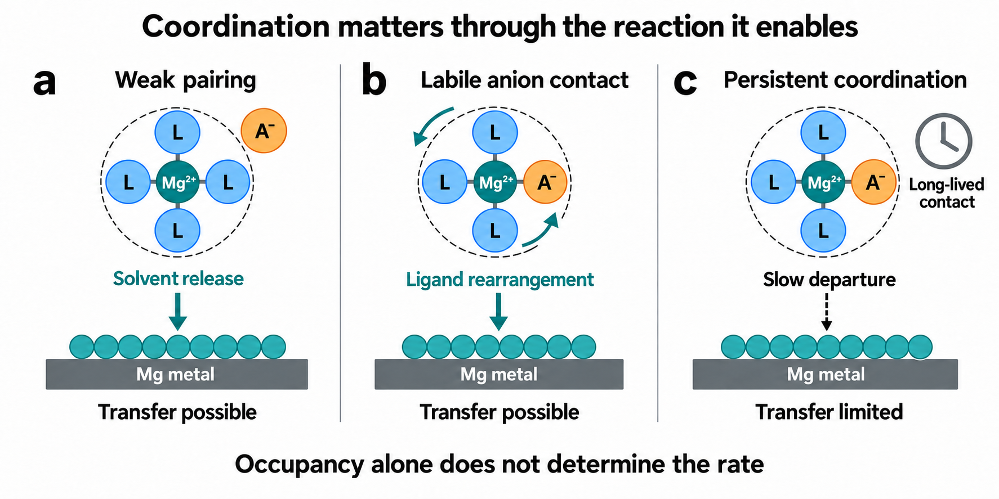
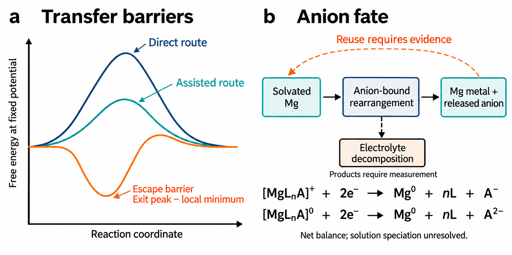
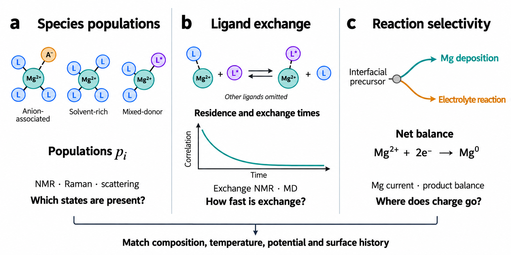
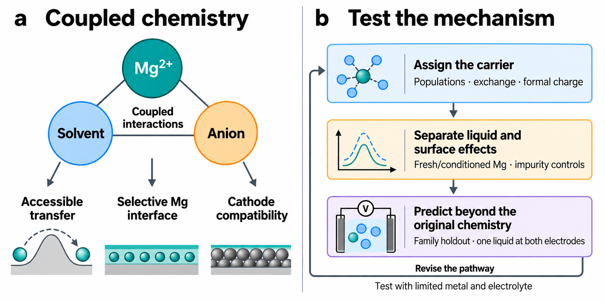

# Anion Coordination and Magnesium Transfer Pathways

## Abstract

Reversible magnesium deposition has been achieved both by weakening ion pairing and by bringing selected anions into the primary solvation shell. This apparent contradiction exposes a limitation of structure-based electrolyte design: occupancy does not identify the reaction that controls metal transfer. We argue that a coordinating anion matters because it changes solvent attachment, the route of ligand departure and the competition between magnesium reduction and electrolyte decomposition. These effects can precede, accompany or persist independently of film formation. Representative studies illustrate distinct benefits, from suppressing amine reduction to opening a rearrangement pathway or preserving an active interface. We use these cases to define the evidence that separates population changes, molecular kinetics and retained surface effects. A two-state example clarifies why the abundance of a solvate and its reactivity are different quantities. We then propose controlled experiments and magnesium-specific modelling tests that connect local chemistry to both electrodes and material consumption. The aim is a reaction pathway that predicts electrolyte behaviour beyond the formulation in which it was discovered.

Keywords: magnesium electrolytes; solvation structure; anion coordination; desolvation; interphase; multivalent batteries

## 1. Introduction

### 1.1. Why magnesium needs its own electrolyte logic

A working magnesium electrolyte delivers more than dissolved Mg²⁺. It supplies a carrier whose ligands can rearrange, whose reduction produces recoverable metal, and whose reactions leave the surface active. The early rechargeable prototype combined an organohaloaluminate liquid with a Chevrel-phase cathode.[1,2,3] Subsequent studies established how strongly reversibility depends on donor chemistry and electrode preparation.[4,5] Those dependencies still constrain magnesium and other multivalent batteries.[6,7,8,9] The central design question is therefore how a formulation transfers magnesium, and which part of that mechanism survives a change in chemistry.

Lithium offers a valuable starting point, but magnesium requires a different interpretation of the interface. In lithium electrolytes, salt concentration and anion participation can redirect reduction and improve electrode compatibility.[10,11,12,13,14,15] A functional lithium SEI limits electronic leakage while allowing ion transport.[16,17] Magnesium often develops blocking films, although selected artificial and electrolyte-derived interfaces sustain cycling.[18,19,20] Comparative work on Li and Mg emphasizes that the same film-building strategy can have different transport consequences.[21] Identifying a familiar SEI compound is thus less informative than establishing how magnesium passes through the resulting interface.

The distinction is visible in a hybrid organic/inorganic Mg interphase. A surface formed in its original electrolyte suppresses side reactions after transfer into a TFSI-containing liquid.[20] Part of the benefit therefore resides in the retained surface. Its persistence says little about ligand departure in the replacement liquid. This experiment captures an essential separation: solution coordination determines which carrier arrives, while the surface determines how that carrier reacts. A useful film and an accessible molecular pathway can reinforce one another, but neither establishes the other.

The divalent charge of Mg generally strengthens its interaction with comparable donors relative to Li, making polarisation, ion association and ligand geometry especially consequential.[22,23] Denticity denotes the number of donor atoms from one ligand bound to the metal; it is not the number of ligand molecules. Anion contact changes carrier charge and geometry while Mg remains formally Mg(II) before reduction. This creates a design paradox. Anion-rich shells can favour interfacial chemistry, yet persistent association can obstruct release. Electrolytes developed in both directions work.[24,25] Their success becomes intelligible once coordination is connected to the particular reaction it improves.

### 1.2. A working recipe needs a reaction mechanism

A successful recipe is not yet an explanation. Magnesium electrolytes span organometallic complexes, simple salts and mixed-donor liquids,[26,27,28,29] and each substitution changes several processes at once. Coordination number and isolated binding energy describe the starting environment; they do not identify the slow step.[23,30,31] A chloride-complex calculation provides a concrete counterexample to a single-descriptor ranking: clustering facilitates calculated desolvation but hinders electron transfer.[32] Chemical equilibria and oxidation introduce further constraints.[33] A descriptor is useful when it predicts a defined response, including a condition under which its apparent advantage disappears.

Mg–solvent, Mg–anion and anion–solvent interactions belong to the same chemical system. Organoboron, non-Grignard and alkoxide electrolytes access different carriers,[34,35,36] while substituent changes alter the electrochemistry of Grignard-derived formulations.[37] Comparing these families requires a common reaction definition rather than a common-looking cluster. The relevant information is the populated precursor, its route to the electrode product, and the competing route that consumes electrolyte. Similar Coulombic efficiencies can conceal differences in all three. The design rule worth transferring identifies which interaction to change next.

### 1.3. Our position and the criterion for progress

Our position is that first-shell anions should be selected for the transfer pathway they make accessible. An anion can displace a persistent donor, redistribute electron density or create a geometry from which remaining ligands leave more readily. Its contribution can therefore arise before any solid film exists. Studies of competing interactions, dynamic solvation and modulation beyond the primary shell provide complementary starting points.[25,38,39] We use direct coordination for a Mg–anion donor contact. A contact ion pair contains such a contact; a solvent-separated pair has solvent between the ions. Both remain solvated species.

This Perspective examines the reaction changed by coordination, the evidence for its effect on useful Mg transfer, and the subsequent fate of the anion. The occupied precursor is the solution or interfacial state populated before the step of interest, rather than necessarily the most stable isolated cluster. Release makes further interactions possible; decomposition spends inventory and may build a film; persistent binding can retain Mg in an unproductive state. These outcomes demand different measurements. We regard a mechanism as transferable when it predicts a donor, anion or potential perturbation in another chemical environment and identifies its operating limits.

## 2. The Anion Participation Paradox

Figure 1. Coordination influences magnesium transfer through the pathway available to the occupied carrier. a) Weak pairing retains a solvent-release requirement. b) Labile anion contact can permit rearrangement. c) Persistent coordination can impede departure. The regimes are schematic rather than assignments to specific liquids; ligand counts are illustrative and Mg²⁺ labels the centre, not total complex charge. The arrows summarize a sequence of transfer events, with released species omitted.

### 2.1. Weak pairing avoids an unproductive association

Weak pairing is advantageous when Mg–anion association removes reactive carriers or promotes unwanted chemistry. A solvent-designed Mg(TFSI)₂ formulation combines increased pair dissociation with reversible deposition,[24] whereas earlier TFSI studies show substantial dependence on donor environment and cycling history.[40,41,42] Reduced contact does not remove the solvent shell. It shifts attention to solvent rearrangement, carrier supply and the surface reaction. Conductivity and dissociation consequently answer different questions: correlated motion, viscosity and carrier mobility can change the former without producing a corresponding change in molecular release.

Weakly coordinating salts approach this problem from the anion side. Boron clusters and carboranes extended Mg chemistry beyond organohalide liquids, with cluster modification addressing solubility and stability.[43,44,45,46] Fluorinated borates and alkoxyaluminates added less corrosive and high-voltage options.[47,48,49,50,51] The common design intent is to reduce disruptive association, not to establish identical shells across these chemistries. Even a bulky anion can associate under some conditions. Its practical value rests on whether the remaining donor environment delivers Mg to an active interface.

The solvent can become the limitation after persistent anion contacts are reduced. Competitive ethers loosen a borate solvation environment,[52] and hydrofluoroether–diglyme mixtures provide another way to change Mg coordination.[53] Within a controlled series, an association decrease accompanied by slower deposition would redirect the investigation towards solvent departure, adsorption or surface conversion. That response would delimit a dissociation-based rule rather than invalidate weak pairing itself. The benefit of removing one obstruction depends on the next step in the sequence.

A direct carborane–TFSI comparison is particularly useful because it examines the Mg/electrolyte interface alongside anion identity.[54] Initial shell assignments alone miss the chemical divergence that develops during cycling. Metal recovery, soluble products and surface evolution locate that divergence. Matched donor composition and surface history then reveal whether the important difference is carrier reactivity, suppressed decomposition or a retained interface. An anion family is a chemical starting point for such a comparison, not a mechanism that can be assigned from its name.

### 2.2. Coordinating anions can help without one universal mechanism

Chloride electrolytes demonstrate that direct anion coordination is compatible with Mg transfer. Structural studies identify chloride-containing carriers with coordination and charge unlike a solvent-only Mg²⁺ solvate.[55,56,57,58,59,60] Magnesium/aluminium speciation, donor choice and conditioning determine their electrochemical behaviour.[61,62,63,64,65,66,67] Chloride can act within the approaching complex and at the surface. These coupled functions explain why neither excluding all anions nor maximizing contact pairs offers a general rule. The relevant contact is the one that participates in a productive sequence under the operating conditions.

Phenolate, phenoxyimine, amido and Hauser-base electrolytes further broaden the chemistry of Mg carriers.[68,69,70,71,72] Borohydride systems are likewise sensitive to concentration and donor choice.[73,74,75] Amine cosolvents and redesigned solvent molecules enable transfer despite substantial Mg–donor interaction.[76,77,78,79] These examples weaken the premise that the smallest attraction inevitably gives the fastest overall deposition. Strong binding can support dissolution and stabilize a useful precursor while a later rearrangement permits release. The equilibrium interaction and the activation process have to be considered together.

The amine example identifies one specific benefit of primary-shell pairing. Weakened amine coordination suppresses reduction and H₂ evolution, with 99.6% CE reported for 800 cycles.[80] This result establishes improved reversibility and supports a selectivity argument. The competing solvent–anion study instead proposes synchronous ligand release and reports 0.06 V reduction overpotential at 1 mA cm⁻² together with an MgH₂-containing interphase.[25] Its molecular and surface benefits remain coupled. These are independent protocols, not a kinetic ranking. In particular, identifying MgH₂ does not determine which phase, boundary or defect transports Mg through the operating film.

Chelating anions provide a third route. MgEDTF is magnesium (1R,2R)-1,2-diphenylethane-1,2-diylbis(trifluoromethylsulfonylamide); its EDTF²⁻ anion forms an unsaturated Mg–anion–DME complex.[81] Relative to the non-chelating analogue, the authors report a decrease in plating/stripping overpotential from 2.0 to 0.24 V and attribute a substantial benefit to the anion-derived SEI. This within-study comparison is not directly comparable with the preceding reduction-overpotential report. It motivates a sharper experiment: vary the coordinating species on similarly conditioned surfaces, then compare the initial molecular response with the effect retained after liquid replacement.

Table 1 translates these reports into mechanistic choices. Dissociation is the appropriate target when association restricts carrier availability. Ligand departure becomes the target when donors persist, and selectivity or surface activation becomes the target when charge is lost to decomposition. The reported CE provides a common readout but preserves each study's context; it is not a common-rate measurement. We use the differences between successful strategies to identify the experiment that would resolve their mechanisms, rather than to order unmatched formulations by performance.

### 2.3. How coordination changes the transfer barrier

First-shell occupancy measures association; transfer requires a route out of that associated state. An abundant precursor can feed deposition, exchange slowly or undergo decomposition.[23,30,31] Its abundance alone gives no ordering of those outcomes. The activation barrier is measured from the state occupied under operating conditions. Stabilizing this state more than the transition state raises the barrier, even if both absolute energies decrease. Figure 2 illustrates why the energetic benefit of an anion depends on the relative stabilisation along the pathway, not on the depth of one selected cluster minimum.

Anion contact can alter Mg–solvent attachment through electron redistribution and coordination geometry. It need not weaken every interaction simultaneously. Computed partial charges depend on the electronic model, whereas the formal Mg oxidation state remains unchanged by binding. Anion–solvent interactions also influence carrier populations without placing every cosolvent in the primary shell.[82,83,84] The published solvent–anion “counterpoised” design refers to competing coordination interactions, rather than a basis-set counterpoise correction.[25] It supplies no universal equality of binding energies. Work on weak solvent–solvent interactions in battery electrolytes offers a broader context for these surrounding-liquid effects.[85]

The 7-aminoindole example makes an outer-shell contribution explicit.[39] The additive is predominantly noncoordinating; its reported CH–π and hydrogen-bonding interactions involve both Mg-bound and free ether molecules. The authors connect these interactions to weakened Mg–solvent attachment, enhanced mobility and a lower release barrier. The example expands the design variable beyond first-shell occupancy without making the additive a coordinating anion. It also suggests a discriminating comparison: retain similar primary-shell populations while perturbing the surrounding donor network, then test the predicted exchange and Mg-transfer response.

For local precursors that interconvert rapidly relative to productive exits, a pre-equilibrium limit separates their populations from their transfer rates:

k_eff(U) = Σᵢ pᵢ(U) kᵢ(U)

Here pᵢ(U) is the local precursor fraction at potential U, with Σᵢpᵢ(U) = 1, and kᵢ(U) is its effective first-order productive-transfer rate constant. The fractions refer to reaction-relevant local states, not automatically bulk spectral fractions. Mutual exchange is fast relative to the included exits. Slow exchange, changing coverage and coupled side reactions require explicit kinetic evolution. The apparent rate can thus change through population redistribution, a faster exit, or both.

Illustrative arithmetic separates these effects. For k₁ = 1 s⁻¹ and k₂ = 10 s⁻¹, p₁ = 0.9 and p₂ = 0.1 give 1.9 s⁻¹. Changing only the fractions to p₁ = p₂ = 0.5 gives 5.5 s⁻¹: more reactive precursor is supplied without changing its exit rate. Conversely, changing k₂ at fixed fractions tests a pathway effect. These assumed values are not Mg measurements; they identify the quantity to constrain before attributing faster transfer to easier release.

Table 1. Representative electrolyte strategies reveal multiple kinetic pathways for magnesium transfer.

| Design strategy | Representative chemistry | Reported Mg CE (%) | Reported readout context | Mechanistic question to test | Source refs. |
| --- | --- | --- | --- | --- | --- |
| Weakly coordinating anion | Mg(CB₁₁H₁₂)₂/G4 | >94.4 | Mg reversibility; value compiled by Zhang et al. | Does solvent rearrangement remain accessible as persistent anion association is reduced? | [44] via [86] |
| Weakly coordinating anion | Mg perfluorinated pinacolatoborate (Mg-FPB) | 95 | Original report of reversible Mg deposition | Does weak anion association leave solvent rearrangement as the main limitation? | [48] |
| Promote pair dissociation | Mg(TFSI)₂/DME–G2–BTFE–TEP | 95.2 | Mg plating/stripping; value compiled by Zhang et al. | Does dissociation increase reactive precursor availability independently of surface and growth changes? | [24] via [86] |
| Introduce primary-shell pairing | Weakly solvated amine + strongly coordinating Mg salt | 99.6 | CE reported for 800 cycles | Pairing suppresses amine reduction and H₂ evolution; does ligand exchange also change? | [80] |
| Reshape solvent coordination | Mg(TFSI)₂/DME–MOPA-1 | 99.5 | Mg plating/stripping; value compiled by Zhang et al. | Does modified solvent coordination speed rearrangement, charge transfer or both? | [76] via [86] |
| Mixed-ion coordination | Mg(TFSI)₂ + LiOTf/DME–TMP | 98 | Original report of Mg-metal reversibility | How much comes from altered Mg–DME interaction versus the phosphate-rich interface? | [83] |
| Coordinate salt and solvent | Mg(OTf)₂/G2–MOEA | 98.3 | Asymmetric-cell average CE after 8200 cycles; symmetric lifetime reported separately | How do coordination and distinct electrode interphases share the contribution to reversibility? | [87] |
| Chloride complexes + interphase | Mg(pftb)₂ + MgCl₂/THF | 99.7 | CE reported over 3000 cycles; symmetric lifetime is separate | Does a retained hybrid interphase sustain transfer when solution coordination is changed? | [20] |
| Dissociation + interphase | Mg(OTf)₂ + MgCl₂/DME–TEP | 99.4 | Mg\|\|Mo: 0.5 mA cm⁻², 0.25 mAh cm⁻²; CE reported after 3000 h | Can a molecular transfer gain be separated from suppressed losses at the interphase? | [88] |
| Mixed donors + chloride carrier | Mg(OTf)₂ + MgCl₂/DME–MOEA | >92.3 | Reported Mg CE; donor ratio MOEA:DME = 1:6 (v/v) | Does the gain follow the modified carrier, the surface layer or both when cathode chemistry changes? | [89] |

CE is the shared reported endpoint, not a rate or barrier measurement. Independent protocols and unspecified averaging windows prevent a performance ranking. The readout retains each source's reported context; symmetric lifetime and full-cell efficiency are excluded. Cross-system kinetics require matched current, capacity, substrate, temperature and conditioning. The chemistry identifies the design, not a complete recipe. Mechanistic questions are proposed tests. For the carborane, solvent-designed TFSI and MOPA-1 rows, “via” identifies Zhang et al. [86] as the accessed numerical source; the original study identifies the chemistry. The other values were checked in original abstracts. Protocol and source-access limits are recorded separately. Reference numbers link to DOI records. THF: tetrahydrofuran; DME: 1,2-dimethoxyethane; G2/G4: diglyme/tetraglyme; BTFE: bis(2,2,2-trifluoroethyl) ether; TMP/TEP: trimethyl/triethyl phosphate; MOPA-1: 1-methoxy-2-propylamine; MOEA: 2-methoxyethylamine; pftb: perfluorinated tert-butoxide; OTf: triflate; TFSI: bis(trifluoromethanesulfonyl)imide. TMP denotes the phosphate here, not the piperidide ligand used in some Hauser bases.

Anion fate determines the duration and inventory cost of an assisted pathway. Release in an active form allows another interaction, whereas consumption changes both liquid composition and the surface.[90,91] Calling the effect catalytic requires repeated kinetic assistance with regeneration and no net consumption of the active facilitator. High CE and anion survival establish neither turnover nor causation. For a fixed overall reaction, catalysis changes the route rather than its equilibrium free energy; changing electrolyte composition can also change reactant activities and equilibrium. This boundary guides the measurements without requiring a catalytic label for a useful coordination effect.

Figure 2. Transfer barriers and anion fate. a) Schematic free-energy paths share the overall reaction and potential; escape from an occupied intermediate is referenced to its local minimum. b) Balanced net equations treat monovalent and divalent anions separately, with neutral L. Released A denotes the anion inventory in the net balance, not an isolated unsolvated ion: reassociation, protonation or reaction requires measurement. The dashed loop proposes a test of reuse; it does not establish a catalytic cycle.

The representative strategies already constrain the interpretation. The amine study supports suppression of unwanted reduction,[80] the weak-pairing electrolyte reports dissociation and altered Mg growth,[24] and the chelating salt couples a new carrier with an anion-derived film.[81] A compilation can expose these distinct explanations,[86] but it cannot supply the missing matched rate measurements. In each case, the next comparison is chosen by the unresolved contribution. A molecular descriptor earns predictive value by distinguishing these contributions within a defined series.

Three possible outcomes lead to different design decisions. Faster exchange with unchanged Mg current indicates a remaining bottleneck in adsorption, reduction or incorporation. Higher CE with unchanged exchange directs attention to reduced losses. A benefit that follows an intact treated surface after liquid replacement identifies a retained surface contribution. These interpretations retain the value of the electrolyte while locating the chemistry that deserves further optimisation. A pathway claim is strongest when it predicts one of these outcomes before the perturbation is made.

## 3. Evidence Needed to Assign a Transfer Mechanism

### 3.1. Define the reaction before comparing energies

An energy comparison begins with a balanced chemical reaction. Ion-pairing free energy compares associated and dissociated states in a specified liquid. Exchange free energy compares a bound donor, its replacement and the released donor. An activation barrier concerns the intervening transition state. Charge, solvent activity, composition and reference conditions give each quantity its meaning. More favourable association can increase the population of a carrier while slowing its escape.[23,32] Treating association energy as a release barrier erases precisely the competition that electrolyte design needs to resolve.

A useful calculation follows the species beyond an isolated minimum. If an anion replaces a donor, the free donor and the incoming anion belong in the balance. If a chelate opens, conformational states and entropy affect the available route. Comparing complexes with different charges requires an appropriate chemical or electrode reservoir. These choices are not numerical refinements to an otherwise fixed barrier; they define the reaction being calculated. The resulting pathway gains credibility when it predicts an exchange trend or potential-dependent Mg response that can be tested independently.

Enhanced sampling connects local coordination to free-energy surfaces.[92,93] Solvent contacts, anion contacts and distance from the electrode can provide complementary coordinates; restricting sampling to one may exclude the productive route. Reweighting estimates equilibrium properties where sampled distributions overlap, but cannot reconstruct an unvisited transition.[94] Adsorption and reduction add a potential dependence that calls for suitable constant-potential or grand-canonical treatment.[95,31] The comparison of interest is a reproducible ordering of balanced pathways, with sampling uncertainty carried into the experimental prediction.

### 3.2. Identify the species that the kinetic model needs

Spectroscopy constrains the carrier rather than directly measuring its transfer barrier. Raman and IR resolve donor and anion environments; ²⁵Mg NMR, combined with computation, probes Mg solvation and dynamics.[96] Composition-dependent chloride studies demonstrate the benefit of combining methods.[57,58,97,74] Assignments specify donor atoms as well as molecules, because a multidentate ligand supplies several contacts. The resulting species distribution is a constraint on a kinetic model. A selected calculated cluster becomes a credible precursor only when measurements support its occurrence under the relevant conditions.

The choice of NMR experiment depends on the accessible time scale and spectral resolution. Quadrupolar broadening and low sensitivity complicate ²⁵Mg measurements. Ligand-resolved EXSY can test exchange where separate environments are resolved, but cross-peaks need separation from nuclear Overhauser effects. DOSY constrains diffusion and association, not ligand-release rates by itself. Raman intensities likewise require response factors before being converted into populations. These boundaries make a combined assignment more useful than a nominally definitive method: several observables constrain the same species model from different directions.

Mixed chloride/lithium formulations make carrier charge an additional variable.[98,82,60] Two liquids with equal total Mg can transport differently because their complexes differ in charge, size and population. Mass spectrometry and crystallography help identify candidate carriers, while ionisation and crystallisation can select species unlike those dominating the liquid. A minor bulk state may nevertheless react preferentially at a polarized surface. Connecting that state to deposition requires a compatible potential-dependent response, not simply detection of the complex outside the operating interface.

Anion exclusion deserves equally quantitative treatment. A bulky salt or a shifted vibrational band does not establish zero primary-shell contact. An associated fraction with an uncertainty range is more informative than a binary shell assignment. Comparing that fraction with donor exchange determines whether a structural perturbation also changes dynamics. Comparing both with metal recovery then tests its electrochemical consequence. If surface chemistry evolves during the same interval, the liquid and surface contributions remain unresolved until an additional control separates them.

The useful evidence is cumulative. Association measurements identify possible carriers; exchange measurements establish how quickly their ligands rearrange; Mg-specific current and products reveal which route actually operates. None is a substitute for the others. The important advance is often the measurement that rejects the nearest alternative explanation, rather than the addition of another technique to the same structural assignment. In practice, this means choosing spectroscopy and electrochemistry around the reaction model, including conditions under which the proposed active carrier is expected to disappear.

### 3.3. Connect exchange times to the rate at the electrode

Exchange, diffusion, adsorption, reduction and nucleation occupy different time scales. Their ordering can change with potential and surface history, so the fastest bulk donor exchange need not produce the fastest deposition. Exchange-sensitive NMR, temperature dependence and molecular dynamics each probe part of this sequence. A measured relaxation becomes evidence for a release step when the reaction model connects the observable to ligand departure. That connection also defines whether the measurement concerns the dominant carrier or a small population responsible for most of the productive current.

Residence time is particularly sensitive to its definition. A brief departure followed by rebinding produces different continuous and intermittent lifetimes. The distance criterion, correlation function, rebinding treatment and sampling duration therefore belong with the reported time. Diffusion requires convergence and finite-size checks,[99] while conductivity includes correlated motion. These quantities matter experimentally because improved conductivity can lower polarisation without accelerating release. Constraining transport removes one explanation for a rate change and makes a subsequent exchange–current comparison chemically interpretable.

Impedance and current transients become more informative when a controlled perturbation changes one candidate process. A frequency feature has no universal assignment to film transport, electron transfer or diffusion: adsorption, nucleation and evolving surfaces can overlap. Potential and temperature dependences, constrained by transport and Mg-specific current, narrow the interpretation. Reorganization contributes to electron-transfer kinetics,[100] but Mg deposition also changes coordination and the metal surface. Faster exchange at similar film response points to a different contribution from progressive activation at unchanged exchange.

This is why a universal binding-energy–CE correlation is an unsuitable objective. CE integrates the recovery of deposited charge, whereas an exchange barrier concerns one molecular step. Adsorption or incorporation can remain limiting after that step accelerates; suppressing decomposition can raise CE while its rate stays fixed. A better initial target is the joint response of exchange and Mg-specific transfer to one donor or potential change. Agreement defines the descriptor's useful range. A mismatch identifies the missing process instead of becoming another point in a pooled performance fit.

Figure 3. Populations, exchange and selectivity constrain different parts of the mechanism. a) Schematic donor motifs represent candidate states. b) One-for-one ligand exchange conserves L and L*; other donors are omitted. The decay illustrates a correlation function, without experimental values. c) Mg deposition competes with electrolyte reaction; the equation is a net two-electron balance. Measurements are compared at connected composition, temperature, potential and surface history.

### 3.4. Identify useful reduction and the chemical fate of the anion

An accessible molecular route is valuable only if it leads selectively to Mg. Potential-dependent calculations identify decomposition of solvated species in the double layer as a competing reaction.[31,30] Electron transfer requires electronic coupling, not complete desolvation or direct physical adsorption of every reacting molecule. Orbital energies suggest susceptible sites, while liquid reorganization, bond cleavage and activation barriers determine products. A cathodic onset can therefore reflect electrolyte reaction as well as metal reduction. Deposited Mg and the accompanying chemical products identify which interpretation is relevant.

A material balance gives current its chemical meaning. Deposited Mg, recovered charge, gas, soluble products and film growth constrain different losses. Instantaneous Mg partial current differs from cycle-integrated CE, and chemical corrosion can consume metal without an equivalent deposition current. Early plating studies and later interphase work make these distinctions essential.[101,3,78] Operando EQCM-D tracks coupled mass and dissipation changes during conditioning and passivation.[102] Solvent coupling, porosity and changing surface area affect the signal, so mass uptake alone is not automatically the mass of a compact SEI.

The same balance determines anion fate. A surviving anion may be an inert spectator, while a persistent benefit can consume active species slowly from a large reservoir. Recovery becomes evidence for repeated assistance only when the recovered form retains a kinetic effect on a controlled surface. Table 2 links each contribution to a matched perturbation and a discriminating observation. Its rows overlap: one ligand can alter donor departure, suppress a competing reduction and subsequently react into a film. Resolving those functions makes the result more useful than assigning a single descriptive role.

Table 2. Perturbations and outcomes that distinguish contributions to magnesium transfer

| Possible contribution | Matched perturbation | Observation favouring or limiting the explanation | Studies motivating the test |
| --- | --- | --- | --- |
| Precursor availability | Change association while constraining bulk transport and the surface | Population-resolved Raman/NMR plus transport controls: a reactive-carrier increase tracks Mg current at unchanged exchange; conductivity or film changes leave the assignment unresolved | [24,82] |
| Ligand departure or rearrangement | Change donor/anion identity on compatibly conditioned surfaces | Resolved-ligand exchange NMR or validated MD plus Mg-specific current: matched exchange and rate responses support rearrangement; unchanged Mg current locates a later limitation | [25,76,39] |
| Suppression of unwanted reduction | Follow Mg-specific current, gas and soluble/film products | Gas analysis and soluble/film-product balance: reduced H₂ or decomposition at unchanged exchange favours selectivity; a shell assignment alone does not establish it | [80,31] |
| Repeated molecular assistance | Track active anion and products with increasing Mg throughput | Calibrated anion assay and products versus Mg throughput: active-species recovery with a repeated kinetic effect supports reuse; survival alone is compatible with a spectator | [20,81] |
| Persistent intermediate | Measure residence and escape from the occupied state | Residence analysis and sampled free-energy path: a persistent state with a large barrier from its local minimum supports trapping; a low cluster energy alone does not | [32,23] |
| Retained surface benefit | Change liquid while verifying persistence of the treated surface | Paired liquid replacement with surface/impedance checks: a benefit following an intact film favours surface retention; film dissolution makes a lost benefit ambiguous | [20,88] |
| Coupled molecular and film effects | Separate the initial liquid response from the retained-surface response | Initial response, product balance and retained-surface test: separate changes requiring both liquid and film favour coupling; CE alone cannot apportion them | [88,90] |

Rows describe overlapping contributions and proposed tests. The cited studies motivate the discrimination; they do not demonstrate every listed measurement or establish anion regeneration. A resolved exchange signal requires a suitable NMR time scale; complementary methods constrain ambiguous assignments. The outer-shell example uses a neutral additive. One electrolyte can contribute through several routes.

## 4. Design Rules for Coupled Magnesium Anion and Solvent Chemistry

### 4.1. Open an accessible transfer route

The first design priority is to remove the limitation on useful Mg transfer at the intended current. Solvent redesign, amine assistance and phosphate-containing environments illustrate changes in release and interfacial chemistry.[79,76,87,103] Pairing and reduced pairing can each address a limitation.[80,24] Dissolution and transport require sufficient stabilisation; deposition requires a subsequent rearrangement or release. An appropriate anion connects those requirements without retaining Mg in an inaccessible state or opening a dominant decomposition branch. This reaction sequence is the design target, rather than a prescribed shell composition.

Denticity and steric structure determine how that sequence can unfold. A strongly bound chelate may open one contact at a time, and mixed donors can provide more than one departure route. Steric and competitive ether coordination therefore offer alternatives to simply lowering donor affinity.[52] Fluoride boronic esters and coupled solvation–interface strategies explore further modifications.[104,105,106] The transferable information is the changed step and its response to another perturbation. Similar cycling improvements across these formulations do not identify a common elementary reaction or an optimum coordination number.

The surrounding liquid supplies additional design variables. A cosolvent can change anion availability without becoming a dominant Mg ligand. Coordination and trace ionisation in amine-containing electrolytes generate active species,[84] while later activation studies connect species evolution to hydride-containing interfaces.[91] Selecting one favourable cluster overlooks these reactions and the activities that drive them. Outer-shell interactions belong in a solvation argument when they predict a measurable change in the transfer sequence. Their chemical location and products then distinguish them from direct first-shell binding.

A productive comparison begins with a proposed active arrangement and a chemically plausible control, rather than a search for the largest contact fraction. Measure association and transport, then compare exchange and initial Mg response on matched surfaces. A potential or donor perturbation is especially useful when it predicts a reversal in rate ordering. An intermediate composition with the best CE identifies competing processes; it does not by itself define a universal balance. The value of the mechanism is the reason it gives for that optimum and the condition it predicts beyond it.

Salt mixtures offer a practical perturbation. Magnesium triflate formulations and tetrabutylammonium triflate additives activate otherwise poorly reversible liquids.[107,108] An added non-Mg salt can vary anion supply at fixed total Mg, but its counter-cation and ionic-strength changes are additional variables. The carrier assignment therefore includes every added ion. This is particularly important with Li-containing mixtures, because another cation can participate at the cathode. A useful comparison varies anion supply while measuring the consequent speciation and testing whether the counter-cation contributes to the observed response.

### 4.2. Preserve a magnesium interface that continues to transfer

Preserving an active Mg surface is a distinct objective. Adsorption, suppressed solvent reduction, removal of blocking compounds and persistent films all provide routes to sustained transfer.[109,110,111,20] Artificial interfaces and component modifiers extend this chemistry.[112,113] Anion–solvent coordination has also been used to promote a beneficial interphase through a perfluorinated pinacolatoaluminate salt.[114] This concerns coordination involving the anion and solvent, rather than proof that the anion accelerates Mg ligand release. Together, these cases motivate controlling the retained surface when testing a proposed liquid-phase contribution.

Conditioning can otherwise be mistaken for a solvation benefit. Controlled H₂O/Cl⁻ experiments establish a surface-passivation contribution to Mg reversibility.[115] Separately, operando EQCM-D reveals contaminant-associated layers forming and degrading during conditioning in the studied borate liquids, and chloride accelerating dissolution of passivation layers without applied current in the studied TFSI systems.[102] The mass-sensitive method belongs to the latter report. Conditioning-free additives and triphenolate–borohydride salts offer additional activation routes.[116,117] Sampling the liquid and quantifying activation products connects the mechanism to the composition actually operating after treatment.

A film's composition does not identify its conducting path. Borohydride-derived, gradient and hybrid interphases demonstrate distinct approaches to preserving transfer.[118,119,20] A multifunctional diamine also couples an in situ cross-linked gel with an Mg–N-containing interphase for elevated-temperature operation.[120] In such mixed films, transport may involve defects, boundaries, other phases or exposed metal. Phase identification, resistance evolution and Mg recovery provide complementary constraints. The distinction is especially important when a hydride or nitride is detected: assigning a bulk conductivity to that phase cannot explain the film without applicable transport evidence.

Deposit morphology introduces another independent contribution. Kinetic surface control, scaffolds, exposed facets, horizontal platelets and orientation-selective additives change nucleation and current distribution.[121,122,123,124,125] Studies of diffusion-dependent growth and dendrites in glyme electrolytes establish that magnesium metal is not intrinsically immune to rough deposition.[126,127] Matched capacity, transport and substrate preparation separate these effects from molecular release. A solvation interpretation gains force when it predicts a morphology response after those variables are constrained, rather than attributing a smoother deposit to coordination alone.

Water content, oxygen exposure and salt-batch impurities belong in the mechanism. A water-resistant AlCl₃/MgCl₂/Mg(TFSI)₂ formulation demonstrates tolerance in a particular liquid,[128] not a transferable impurity threshold. Donor substitution can change impurity uptake or activation chemistry as well as binding. Measured water with a stated ppm basis, documented handling and halide controls make those alternatives testable. Comparing dry and deliberately dosed liquids on fresh and conditioned Mg then connects changes in spectra, gas and current to the intended perturbation or to impurity-driven surface chemistry.

We recommend beginning with the smallest factorial control: original and modified liquids on fresh and preconditioned Mg, at matched substrate preparation, current, capacity and temperature. This separates a surface-history interaction from a reproducible initial liquid response. Liquid replacement is a further test only if the retained film is shown to persist; a swap that dissolves the film cannot distinguish its contribution from continued molecular assistance. Section 5 expands this same control into a composition series. It is a proposed experimental design, with decision thresholds set by replicate uncertainty rather than an assumed universal rate gain.

### 4.3. Judge anion benefits and costs at the positive electrode

An anion selected for the Mg surface also reaches the positive electrode. Coordination can assist carrier release there, while the same formulation can oxidize, corrode a collector or dissolve active material. Boron-based, non-nucleophilic and fluorinated dialkoxide electrolytes address parts of this compatibility problem.[129,130,131,132,133] High-voltage phenolic electrolyte design provides another chemically distinct approach.[134] The relevant sequence depends on the cathode: interfacial release may precede electron transfer, followed by host diffusion or phase conversion. Consequently, a metal-side improvement is incomplete until its benefit and chemical cost are tested at the intended cathode.

CuSe provides a direct connection between anion contact and cathode response.[135] Adding OTf⁻ changes the assigned Mg environment from [Mg(DME)₃]²⁺ to an anion-containing average motif, [Mg(DME)₂.₅OTf]⁺. The authors link easier desolvation to faster cathode charge transfer and report 228 to 357 mAh g⁻¹ at 0.1 A g⁻¹. These capacities are a within-study comparison, not a metal-deposition metric. “Anion-incorporated” describes the Mg solvation environment rather than insertion of OTf⁻ into CuSe. Fractional ligand counts describe an average assignment, not a literal discrete complex. Phase evolution remains necessary to separate the interfacial gain from conversion within the solid.

Organic storage shows why carrier identity also matters after arrival. In a Mg-FPB/quinone battery, ATR-IR supports carbonyl reduction and coordination with Mg²⁺, while incompletely dissociated MgFPB⁺ pairs are also detected.[136] Anion association thus changes the species available to a storage site, not only the energy required to release a bare cation. Polymer-storage and enolization studies further demonstrate chemically distinct storage routes.[137,138] State-of-charge-matched measurements can identify the stored species and locate the remaining host limitation. Capacity alone leaves improved interfacial access, solid-state reaction and participation of another ion unresolved.

Sulfur exposes the cost of stabilising reactive species in solution. Electrolyte–sulfur compatibility was already central to an early Mg–S demonstration.[139] More recently, an MOEA-containing Mg(OTf)₂–MgCl₂/DME liquid was tested with Mo₆S₈, CuS and S–CNT cathodes, connecting donor modification to several sulfur-containing storage chemistries.[89] A liquid that makes soluble intermediates accessible can also enable active-material loss or shuttle to Mg. The design objective is therefore selective conversion with tolerable dissolution, not simply low solubility or a high initial capacity. Dissolved cathode species and electrolyte products require separate balances.

A matched cell comparison links these molecular choices to their consequences. At fixed cathode loading, capacity and state of charge, measure interfacial response together with phase evolution, dissolved active material and electrolyte products. An improved rate at unchanged solid conversion supports an interfacial contribution. Increased dissolution or charge storage by an added cation gives capacity a different origin. In mixed-metal electrolytes, elemental and charge balances identify which ion is recovered from the electrode. Cathode exposure can then be followed by a Mg-transfer test in the same liquid, revealing whether a local benefit survives chemical cross-talk.

Oxidation onset is only an initial screen. Electrode area, scan rate and the current criterion affect the reported value; voltage holds reveal sustained loss and resistance growth at the intended porous cathode.[140,141] The full-cell comparison also retains metal excess, electrolyte volume, loading and capacity limits. Cathode-specific capacity and long symmetric cycling do not determine whole-cell energy or inventory consumption.[25,6] We favour electrolyte designs whose molecular advantage remains useful at both electrodes after conditioning and cathode exposure, with the material cost visible in the same experiment.

## 5. A Research Route from Mechanism to Prediction

Figure 4. A proposed route from coupled chemistry to a testable mechanism. a) Mg–solvent–anion interactions affect accessible transfer, the Mg interface and cathode compatibility; the icons are schematic. b) Carrier assignment precedes separation of liquid and surface effects, followed by a prediction in another chemical family and testing of one liquid at both electrodes. The feedback loop revises the pathway after a failed prediction. Limited metal and electrolyte inventories reveal the cost of maintaining transfer.

### 5.1. Train models on a defined chemical question

A magnesium-specific model begins with a defined chemical response. Contact fractions, residence times, donor denticity, carrier charge and the barrier from an occupied state can constrain that response. Here carrier charge means formal integer complex charge, distinct from a computed Mg partial charge. Dynamic-solvation and competing-interaction studies motivate screening with molecular descriptors.[38,25] A useful first target is the ordering of Mg-specific rates in a matched series, with CE and side-product yield treated separately. This avoids asking a release descriptor to explain gains that originate primarily in conductivity or conditioning.

Each record preserves composition, temperature, measured water, handling, substrate, conditioning and reagent batch. Spectra retain assignment uncertainty; exchange times retain their definition; electrochemical records retain current, deposited capacity, stripping limit, CE statistic and sampling window. Fresh and conditioned measurements remain distinct. Table 1 is an evidence comparison, not a protocol-normalised training set. Missing fields stay missing. In particular, an unspecified CE statistic cannot become an average or an end-cycle value, and full-cell efficiency cannot replace metal plating/stripping efficiency simply because both are percentages.

Chemical similarity creates an especially misleading form of model success. Randomly separating points from one concentration series, salt family or conditioned electrode tests interpolation within shared chemistry. Family and batch holdouts test whether the learned response survives a genuine change. Preprocessing is fitted only to training data, and composition-only and conductivity baselines reveal how much the molecular descriptor adds. Uncertainty increases outside the training range. Selective publication of successful liquids and missing negative results remain biases even when every retained DOI and numerical value is correct.

A feasible pilot extends the surface control in Section 4.2 to three donor ratios and three anion-supply levels within a verified single-phase region. A chemically compatible non-Mg salt, such as a tetrabutylammonium salt where applicable,[108] varies anion supply while holding total Mg fixed. Counter-cation controls and measured ionic strength are essential; substituting Mg salts is an alternative only if composition and charge balance are explicitly preserved. Nine liquids, each on fresh and preconditioned surfaces, separate coordination from surface-history effects. Replicates define the resolvable rate difference, while conductivity and viscosity remain measured covariates. This is a proposed design, not a reported dataset.

### 5.2. Keep the reaction states explicit across scales

Magnesium imposes three chemical requirements on multiscale modelling. First, bulk sampling needs an adequate treatment of divalent polarisation and association, checked against measured coordination and transport. Machine-learning potentials extend the accessible sampling,[142] including Mg chloride–amine systems,[143] but their fitted domain sets the limit. Second, reactive models need configurations that cover ligand rearrangement, bond cleavage and relevant decomposition. Third, electrode reactions need an electronic treatment appropriate to changing charge and potential. Accurate bulk dynamics alone cannot supply any of these missing reaction states.

A reaction network links solvated carriers, adsorbed precursors, rearranged intermediates, metal and products.[31,95] Charge and chemical inventory are conserved at each transition. A positively charged complex can transport a bound anion towards a negative electrode, so the electrostatics of a free anion do not exclude that route. The model then specifies whether the anion leaves, remains during rearrangement or reacts. Fast exchange gives the limit in Section 2.3; slow exchange or evolving coverage requires time-dependent populations. Predicted products and potential dependence provide independent tests beyond a fitted cycling efficiency.

The next learning experiment is chosen where alternative mechanisms predict different outcomes. For example, ligand-release assistance and retained surface activation may give distinct responses to donor substitution after conditioning. The model predicts exchange and Mg-rate ordering, then a potential or temperature that changes the ordering. Closed-loop battery optimisation demonstrates the value of selecting informative experiments,[144] although it does not validate such a Mg mechanism. For this task, selecting only the highest predicted CE would hide the distinction. Failed predictions and negative formulations remain part of the evidence used to revise the pathway.

### 5.3. A research sequence for testing transferable pathways

The immediate priority is a small series that separates reactive-carrier supply, ligand departure and suppressed losses. Connected population, exchange, Mg-recovery and product measurements establish that separation, with surface and impurity controls chosen for the alternatives under consideration. The useful result identifies a chemical variable whose next perturbation has a predictable consequence. This gives a manageable entry point for mechanistic studies: compatible measurements of the decisive quantities, rather than every available technique applied to a single successful liquid. A larger library becomes valuable after the response being learned is chemically defined.

The next stage tests that prediction outside the discovery family before optimising the new composition. The molecular variable and rate retain the same definition, and uncertainty includes unmeasured surface states. Success extends the design rule; failure identifies a new limiting process. Finally, one liquid is tested at both electrodes with known inventories, after conditioning and cathode exposure. These stages connect a local explanation to an operating range and a measurable material cost. They also make a negative result informative: it marks the boundary of a pathway rather than simply another electrolyte that failed to cycle.

This reasoning connects Mg electrolyte design to solution electron transfer, where reorganization influences reactivity beyond reactant stability.[100] Calcium presents a related metal-transfer problem but requires its own interphase and exchange tests.[145,6] Aluminium batteries can employ chloroaluminate carriers instead of ether-solvated Al³⁺, changing the relevant charge and reaction stoichiometry.[146] The shared design question is how a populated carrier reaches a useful product and what chemistry accompanies that transfer. Binding-energy thresholds and optimum shell compositions are not expected to carry unchanged between these systems.

## 6. Conclusions and Outlook

### 6.1. Choose an anion for the transfer reaction it enables

An anion gains value through the reaction it enables. Its contact with Mg can alter donor attachment, permit a rearrangement or suppress unwanted reduction; persistent contact can instead obstruct transfer. Weak pairing and useful anion-containing shells are therefore compatible design strategies when they remove different limitations.[24,80,25] The mechanistic advance lies in connecting a coordination change to selective transfer from the occupied carrier. Establishing whether the anion returns, reacts or accumulates then gives that benefit a duration and an inventory cost.

### 6.2. Make the next experiment distinguish the mechanism

The most useful next experiment distinguishes molecular release from carrier redistribution and retained surface activation. Connected measurements of exchange, Mg transfer and products make that distinction, with conditioning and impurities treated as chemical variables. The proposed pathway earns predictive status by anticipating a donor, anion or potential perturbation before it is measured. A failed prediction identifies its boundary. Data-driven screening serves this purpose when it tests chemical-family transfer and selects measurements that resolve an alternative mechanism, rather than only reproducing the largest published efficiency.

### 6.3. Engineer pathways that remain useful in a cell

The decisive test keeps the same electrolyte useful at both electrodes with limited metal and liquid inventories.[147,6] A molecular advantage has to survive cathode exposure, surface evolution and repeated transfer without excessive material loss. Connecting the populated carrier to its productive reaction and chemical fate gives solvation a predictive role in choosing that chemistry. Future magnesium electrolyte discovery should move from searching for a favourable solvation structure towards engineering transferable reaction pathways.

## References

1. **Prototype systems for rechargeable magnesium batteries** D. Aurbach, Z. Lu, A. Schechter, Y. Gofer, H. Gizbar, R. Turgeman, Y. Cohen, M. Moshkovich, E. Levi, Nature 2000, 407, 724–727. https://doi.org/10.1038/35037553

2. **Electrolyte Solutions for Rechargeable Magnesium Batteries Based on Organomagnesium Chloroaluminate Complexes** D. Aurbach, H. Gizbar, A. Schechter, O. Chusid, H. E. Gottlieb, Y. Gofer, I. Goldberg, J. Electrochem. Soc. 2002, 149, A115–A121. https://doi.org/10.1149/1.1429925

3. **Nonaqueous Electrochemistry of Magnesium: Applications to Energy Storage** T. D. Gregory, R. J. Hoffman, R. C. Winterton, J. Electrochem. Soc. 1990, 137, 775–780. https://doi.org/10.1149/1.2086553

4. **Progress in nonaqueous magnesium electrochemistry** N. Amir, Y. Vestfrid, O. Chusid, Y. Gofer, D. Aurbach, J. Power Sources 2007, 174, 1234–1240. https://doi.org/10.1016/j.jpowsour.2007.06.206

5. **On the electrochemical behavior of magnesium electrodes in polar aprotic electrolyte solutions** Z. Lu, A. Schechter, M. Moshkovich, D. Aurbach, J. Electroanal. Chem. 1999, 466, 203–217. https://doi.org/10.1016/s0022-0728(99)00146-1

6. **Current status and future directions of multivalent metal-ion batteries** Y. Liang, H. Dong, D. Aurbach, Y. Yao, Nat. Energy 2020, 5, 646–656. https://doi.org/10.1038/s41560-020-0655-0

7. **Progress and perspective on rechargeable magnesium-ion batteries** G. Wang, Z. Wang, H. Shi, A. Du, M. Sun, G. Cui, Sci. China Chem. 2024, 67, 214–246. https://doi.org/10.1007/s11426-022-1454-0

8. **Research development on electrolytes for magnesium-ion batteries** Y. Man, P. Jaumaux, Y. Xu, Y. Fei, X. Mo, G. Wang, X. Zhou, Sci. Bull. 2023, 68, 1819–1842. https://doi.org/10.1016/j.scib.2023.07.027

9. **Current Design Strategies for Rechargeable Magnesium-Based Batteries** J. Zhang, Z. Chang, Z. Zhang, A. Du, S. Dong, Z. Li, G. Li, G. Cui, ACS Nano 2021, 15, 15594–15624. https://doi.org/10.1021/acsnano.1c06530

10. **Nonaqueous Liquid Electrolytes for Lithium-Based Rechargeable Batteries** K. Xu, Chem. Rev. 2004, 104, 4303–4418. https://doi.org/10.1021/cr030203g

11. **Electrolytes and Interphases in Li-Ion Batteries and Beyond** K. Xu, Chem. Rev. 2014, 114, 11503–11618. https://doi.org/10.1021/cr500003w

12. **Solvation Sheath of Li + in Nonaqueous Electrolytes and Its Implication of Graphite/Electrolyte Interface Chemistry** K. Xu, Y. Lam, S. S. Zhang, T. R. Jow, T. B. Curtis, J. Phys. Chem. C 2007, 111, 7411–7421. https://doi.org/10.1021/jp068691u

13. **A new class of Solvent-in-Salt electrolyte for high-energy rechargeable metallic lithium batteries** L. Suo, Y.-S. Hu, H. Li, M. Armand, L. Chen, Nat. Commun. 2013, 4, 1481. https://doi.org/10.1038/ncomms2513

14. **Unusual Stability of Acetonitrile-Based Superconcentrated Electrolytes for Fast-Charging Lithium-Ion Batteries** Y. Yamada, K. Furukawa, K. Sodeyama, K. Kikuchi, M. Yaegashi, Y. Tateyama, A. Yamada, J. Am. Chem. Soc. 2014, 136, 5039–5046. https://doi.org/10.1021/ja412807w

15. **Advances and issues in developing salt-concentrated battery electrolytes** Y. Yamada, J. Wang, S. Ko, E. Watanabe, A. Yamada, Nat. Energy 2019, 4, 269–280. https://doi.org/10.1038/s41560-019-0336-z

16. **The Electrochemical Behavior of Alkali and Alkaline Earth Metals in Nonaqueous Battery Systems—The Solid Electrolyte Interphase Model** E. Peled, J. Electrochem. Soc. 1979, 126, 2047–2051. https://doi.org/10.1149/1.2128859

17. **Review—SEI: Past, Present and Future** E. Peled, S. Menkin, J. Electrochem. Soc. 2017, 164, A1703–A1719. https://doi.org/10.1149/2.1441707jes

18. **The metamorphosis of rechargeable magnesium batteries** R. Mohtadi, O. Tutusaus, T. S. Arthur, Z. Zhao-Karger, M. Fichtner, Joule 2021, 5, 581–617. https://doi.org/10.1016/j.joule.2020.12.021

19. **The origin of anode–electrolyte interfacial passivation in rechargeable Mg-metal batteries** J. Zhang, J. Liu, M. Wang, Z. Zhang, Z. Zhou, X. Chen, A. Du, S. Dong, Z. Li, G. Li, G. Cui, Energy Environ. Sci. 2023, 16, 1111–1124. https://doi.org/10.1039/d2ee03270h

20. **Stable Solid Electrolyte Interphase In Situ Formed on Magnesium‐Metal Anode by using a Perfluorinated Alkoxide‐Based All‐Magnesium Salt Electrolyte** J. Xiao, X. Zhang, H. Fan, Y. Zhao, Y. Su, H. Liu, X. Li, Y. Su, H. Yuan, T. Pan, Q. Lin, L. Pan, Y. Zhang, Adv. Mater. 2022, 34, 2203783. https://doi.org/10.1002/adma.202203783

21. **Comparison of Construction Strategies of Solid Electrolyte Interface (SEI) in Li Battery and Mg Battery—A Review** Z. Wang, R. Deng, Y. Wang, F. Pan, Molecules 2024, 29, 4761. https://doi.org/10.3390/molecules29194761

22. **Organic Electrolyte Design for Rechargeable Batteries: From Lithium to Magnesium** H. Zhang, L. Qiao, M. Armand, Angew. Chem., Int. Ed. 2022, 61, e202214054. https://doi.org/10.1002/anie.202214054

23. **The Coupling between Stability and Ion Pair Formation in Magnesium Electrolytes from First-Principles Quantum Mechanics and Classical Molecular Dynamics** N. N. Rajput, X. Qu, N. Sa, A. K. Burrell, K. A. Persson, J. Am. Chem. Soc. 2015, 137, 3411–3420. https://doi.org/10.1021/jacs.5b01004

24. **A weakly ion pairing electrolyte designed for high voltage magnesium batteries** C. Li, R. D. Guha, A. Shyamsunder, K. A. Persson, L. F. Nazar, Energy Environ. Sci. 2024, 17, 190–201. https://doi.org/10.1039/d3ee02861e

25. **Solvent–Anion Counterpoised Electrolyte Enables High‐Rate Magnesium Metal Batteries** M. Zhang, R. Li, W. Zhao, R. Li, Z. Fan, X. Yang, Angew. Chem., Int. Ed. 2026, 65, e2598559. https://doi.org/10.1002/anie.2598559

26. **Rechargeable magnesium battery: Current status and key challenges for the future** P. Saha, M. K. Datta, O. I. Velikokhatnyi, A. Manivannan, D. Alman, P. N. Kumta, Prog. Mater. Sci. 2014, 66, 1–86. https://doi.org/10.1016/j.pmatsci.2014.04.001

27. **Progress in retrospect of electrolytes for secondary magnesium batteries** H. Shuai, J. Xu, K. Huang, Coord. Chem. Rev. 2020, 422, 213478. https://doi.org/10.1016/j.ccr.2020.213478

28. **Progress in development of electrolytes for magnesium batteries** R. Deivanayagam, B. J. Ingram, R. Shahbazian-Yassar, Energy Storage Mater. 2019, 21, 136–153. https://doi.org/10.1016/j.ensm.2019.05.028

29. **Recent progress of magnesium electrolytes for rechargeable magnesium batteries** Q. Sun, S. Luo, R. Huang, S. Yan, X. Lin, Coord. Chem. Rev. 2024, 515, 215956. https://doi.org/10.1016/j.ccr.2024.215956

30. **Instability at the Electrode/Electrolyte Interface Induced by Hard Cation Chelation and Nucleophilic Attack** Y. Yu, A. Baskin, C. Valero-Vidal, N. T. Hahn, Q. Liu, K. R. Zavadil, B. W. Eichhorn, D. Prendergast, E. J. Crumlin, Chem. Mater. 2017, 29, 8504–8512. https://doi.org/10.1021/acs.chemmater.7b03404

31. **Electrolyte Reactivity in the Double Layer in Mg Batteries: An Interface Potential-Dependent DFT Study** A. Kopač Lautar, J. Bitenc, T. Rejec, R. Dominko, J.-S. Filhol, M.-L. Doublet, J. Am. Chem. Soc. 2020, 142, 5146–5153. https://doi.org/10.1021/jacs.9b12474

32. **Structure of Magnesium Chloride Complexes in Ethereal Systems: Computational Comparison of THF and Glymes as Solvents for Magnesium Battery Electrolytes** P. Jankowski, J. M. G. Lastra, T. Vegge, Batteries Supercaps 2020, 3, 1350–1359. https://doi.org/10.1002/batt.202000168

33. **Operating mechanisms of electrolytes in magnesium ion batteries: chemical equilibrium, magnesium deposition, and electrolyte oxidation** D. Y. Kim, Y. Lim, B. Roy, Y.-G. Ryu, S.-S. Lee, Phys. Chem. Chem. Phys. 2014, 16, 25789–25798. https://doi.org/10.1039/c4cp01259c

34. **Electrochemical performance of novel electrolyte solutions based on organoboron magnesium salts** Y. Guo, F. Zhang, J. Yang, F. Wang, Electrochem. Commun. 2012, 18, 24–27. https://doi.org/10.1016/j.elecom.2012.01.026

35. **A novel electrolyte system without a Grignard reagent for rechargeable magnesium batteries** F.-f. Wang, Y.-s. Guo, J. Yang, Y. Nuli, S.-i. Hirano, Chem. Commun. 2012, 48, 10763. https://doi.org/10.1039/c2cc35857c

36. **Highly soluble alkoxide magnesium salts for rechargeable magnesium batteries** C. Liao, B. Guo, D.-e. Jiang, R. Custelcean, S. M. Mahurin, X.-G. Sun, S. Dai, J. Mater. Chem. A 2014, 2, 581–584. https://doi.org/10.1039/c3ta13691d

37. **Study of electronic effect of Grignard reagents on their electrochemical behavior** Y. Guo, J. Yang, Y. NuLi, J. Wang, Electrochem. Commun. 2010, 12, 1671–1673. https://doi.org/10.1016/j.elecom.2010.08.015

38. **Data-driven design of advanced magnesium-battery electrolyte via dynamic solvation models** R. Li, W. Zhao, Z. Fan, M. Zhang, J. Li, R. Li, Z. Zuo, X. Yang, Energy Environ. Sci. 2025, 18, 6790–6798. https://doi.org/10.1039/d5ee01304f

39. **Dual‐Site Modulation of Mg 2+ Desolvation Beyond the Primary Solvation Shell in Magnesium Battery Electrolytes** Y. Deng, G. Li, R. Deng, B. Zhang, L. Cao, G. Huang, J. Wang, F. Pan, Angew. Chem., Int. Ed. 2025, 64, e202513213. https://doi.org/10.1002/anie.202513213

40. **Evaluation of (CF3SO2)2N−(TFSI) Based Electrolyte Solutions for Mg Batteries** I. Shterenberg, M. Salama, H. D. Yoo, Y. Gofer, J.-B. Park, Y.-K. Sun, D. Aurbach, J. Electrochem. Soc. 2015, 162, A7118–A7128. https://doi.org/10.1149/2.0161513jes

41. **Magnesium(II) Bis(trifluoromethane sulfonyl) Imide-Based Electrolytes with Wide Electrochemical Windows for Rechargeable Magnesium Batteries** S.-Y. Ha, Y.-W. Lee, S. W. Woo, B. Koo, J.-S. Kim, J. Cho, K. T. Lee, N.-S. Choi, ACS Appl. Mater. Interfaces 2014, 6, 4063–4073. https://doi.org/10.1021/am405619v

42. **Electrochemical cycling of Mg in Mg[TFSI] 2 /tetraglyme electrolytes** Z. Ma, M. Kar, C. Xiao, M. Forsyth, D. R. MacFarlane, Electrochem. Commun. 2017, 78, 29–32. https://doi.org/10.1016/j.elecom.2017.03.018

43. **Boron Clusters as Highly Stable Magnesium‐Battery Electrolytes** T. J. Carter, R. Mohtadi, T. S. Arthur, F. Mizuno, R. Zhang, S. Shirai, J. W. Kampf, Angew. Chem., Int. Ed. 2014, 53, 3173–3177. https://doi.org/10.1002/anie.201310317

44. **An Efficient Halogen‐Free Electrolyte for Use in Rechargeable Magnesium Batteries** O. Tutusaus, R. Mohtadi, T. S. Arthur, F. Mizuno, E. G. Nelson, Y. V. Sevryugina, Angew. Chem., Int. Ed. 2015, 54, 7900–7904. https://doi.org/10.1002/anie.201412202

45. **Below the 12-vertex: 10-vertex carborane anions as non-corrosive, halide free, electrolytes for rechargeable Mg batteries** S. G. McArthur, R. Jay, L. Geng, J. Guo, V. Lavallo, Chem. Commun. 2017, 53, 4453–4456. https://doi.org/10.1039/c7cc01570d

46. **Boron-vertex modification of carba- closo -dodecaborate for high-performance magnesium-ion battery electrolyte** M. Watanabe, J. Kanazawa, T. Hamamura, T. Shimokawa, K. Miyamoto, M. Hibino, K. Nakura, Y. Inatomi, Y. Kitazawa, M. Uchiyama, Mater. Adv. 2021, 2, 937–941. https://doi.org/10.1039/d0ma00925c

47. **A new class of non-corrosive, highly efficient electrolytes for rechargeable magnesium batteries** Z. Zhao-Karger, M. E. Gil Bardaji, O. Fuhr, M. Fichtner, J. Mater. Chem. A 2017, 5, 10815–10820. https://doi.org/10.1039/c7ta02237a

48. **A Stable, Non‐Corrosive Perfluorinated Pinacolatoborate Mg Electrolyte for Rechargeable Mg Batteries** J. Luo, Y. Bi, L. Zhang, X. Zhang, T. L. Liu, Angew. Chem., Int. Ed. 2019, 58, 6967–6971. https://doi.org/10.1002/anie.201902009

49. **An Efficient Bulky Mg[B(Otfe)4]2 Electrolyte and Its Derivatively General Design Strategy for Rechargeable Magnesium Batteries** W. Ren, D. Wu, Y. NuLi, D. Zhang, Y. Yang, Y. Wang, J. Yang, J. Wang, ACS Energy Lett. 2021, 6, 3212–3220. https://doi.org/10.1021/acsenergylett.1c01411

50. **A Fluorinated Alkoxyaluminate Electrolyte for Magnesium-Ion Batteries** J. T. Herb, C. A. Nist-Lund, C. B. Arnold, ACS Energy Lett. 2016, 1, 1227–1232. https://doi.org/10.1021/acsenergylett.6b00356

51. **Remarkable electrochemical and ion-transport characteristics of magnesium-fluorinated alkoxyaluminate–diglyme electrolytes for magnesium batteries** T. Mandai, Y. Youn, Y. Tateyama, Mater. Adv. 2021, 2, 6283–6296. https://doi.org/10.1039/d1ma00448d

52. **Tailoring Loose Mg 2+ Solvation Structure by Steric and Competitive Solvent Coordination for Fast‐Charging Magnesium Batteries** Y. Shen, K. Xu, Z. Zhao‐Karger, X. Zhao, Energy Environ. Mater. 2026, 9, e70124. https://doi.org/10.1002/eem2.70124

53. **Competitive solvation of magnesium cation by hydrofluoroether and diglyme in magnesium batteries** N. A. Andreeva, V. V. Chaban, Mater. Chem. Phys. 2026, 349, 131741. https://doi.org/10.1016/j.matchemphys.2025.131741

54. **Comparative Study of Mg(CB11H12)2 and Mg(TFSI)2 at the Magnesium/Electrolyte Interface** R. Jay, A. W. Tomich, J. Zhang, Y. Zhao, A. De Gorostiza, V. Lavallo, J. Guo, ACS Appl. Mater. Interfaces 2019, 11, 11414–11420. https://doi.org/10.1021/acsami.9b00037

55. **MgCl2: The Key Ingredient to Improve Chloride Containing Electrolytes for Rechargeable Magnesium-Ion Batteries** B. Pan, J. Huang, N. Sa, S. M. Brombosz, J. T. Vaughey, L. Zhang, A. K. Burrell, Z. Zhang, C. Liao, J. Electrochem. Soc. 2016, 163, A1672–A1677. https://doi.org/10.1149/2.0821608jes

56. **A facile approach using MgCl2 to formulate high performance Mg2+ electrolytes for rechargeable Mg batteries** T. Liu, Y. Shao, G. Li, M. Gu, J. Hu, S. Xu, Z. Nie, X. Chen, C. Wang, J. Liu, J. Mater. Chem. A 2014, 2, 3430. https://doi.org/10.1039/c3ta14825d

57. **Role of Chloride for a Simple, Non-Grignard Mg Electrolyte in Ether-Based Solvents** N. Sa, B. Pan, A. Saha-Shah, A. A. Hubaud, J. T. Vaughey, L. A. Baker, C. Liao, A. K. Burrell, ACS Appl. Mater. Interfaces 2016, 8, 16002–16008. https://doi.org/10.1021/acsami.6b03193

58. **Structural Analysis of Magnesium Chloride Complexes in Dimethoxyethane Solutions in the Context of Mg Batteries Research** M. Salama, I. Shterenberg, L. J.W. Shimon, K. Keinan-Adamsky, M. Afri, Y. Gofer, D. Aurbach, J. Phys. Chem. C 2017, 121, 24909–24918. https://doi.org/10.1021/acs.jpcc.7b05452

59. **Highly active electrolytes for rechargeable Mg batteries based on a [Mg 2 (μ-Cl) 2 ] 2+ cation complex in dimethoxyethane** Y. Cheng, R. M. Stolley, K. S. Han, Y. Shao, B. W. Arey, N. M. Washton, K. T. Mueller, M. L. Helm, V. L. Sprenkle, J. Liu, G. Li, Phys. Chem. Chem. Phys. 2015, 17, 13307–13314. https://doi.org/10.1039/c5cp00859j

60. **Elucidating the structure of the magnesium aluminum chloride complex electrolyte for magnesium-ion batteries** P. Canepa, S. Jayaraman, L. Cheng, N. N. Rajput, W. D. Richards, G. S. Gautam, L. A. Curtiss, K. A. Persson, G. Ceder, Energy Environ. Sci. 2015, 8, 3718–3730. https://doi.org/10.1039/c5ee02340h

61. **Electrolyte Solutions with a Wide Electrochemical Window for Rechargeable Magnesium Batteries** O. Mizrahi, N. Amir, E. Pollak, O. Chusid, V. Marks, H. Gottlieb, L. Larush, E. Zinigrad, D. Aurbach, J. Electrochem. Soc. 2008, 155, A103. https://doi.org/10.1149/1.2806175

62. **Novel, electrolyte solutions comprising fully inorganic salts with high anodic stability for rechargeable magnesium batteries** R. E. Doe, R. Han, J. Hwang, A. J. Gmitter, I. Shterenberg, H. D. Yoo, N. Pour, D. Aurbach, Chem. Commun. 2014, 50, 243–245. https://doi.org/10.1039/c3cc47896c

63. **The Interplay of Al and Mg Speciation in Advanced Mg Battery Electrolyte Solutions** K. A. See, K. W. Chapman, L. Zhu, K. M. Wiaderek, O. J. Borkiewicz, C. J. Barile, P. J. Chupas, A. A. Gewirth, J. Am. Chem. Soc. 2016, 138, 328–337. https://doi.org/10.1021/jacs.5b10987

64. **A conditioning-free magnesium chloride complex electrolyte for rechargeable magnesium batteries** J. H. Ha, B. Adams, J.-H. Cho, V. Duffort, J. H. Kim, K. Y. Chung, B. W. Cho, L. F. Nazar, S. H. Oh, J. Mater. Chem. A 2016, 4, 7160–7164. https://doi.org/10.1039/c6ta01684g

65. **The electrodeposition of magnesium using solutions of organomagnesium halides, amidomagnesium halides and magnesium organoborates** C. Liebenow, Z. Yang, P. Lobitz, Electrochem. Commun. 2000, 2, 641–645. https://doi.org/10.1016/s1388-2481(00)00094-1

66. **A Review of Magnesium Aluminum Chloride Complex Electrolytes for Mg Batteries** Y. Li, S. Guan, H. Huo, Y. Ma, Y. Gao, P. Zuo, G. Yin, Adv. Funct. Mater. 2021, 31, 2100650. https://doi.org/10.1002/adfm.202100650

67. **Recent advances on MgCl2 based electrolytes for rechargeable Mg batteries** S. He, K. V. Nielson, J. Luo, T. L. Liu, Energy Storage Mater. 2017, 8, 184–188. https://doi.org/10.1016/j.ensm.2016.12.001

68. **A Lewis acid-free and phenolate-based magnesium electrolyte for rechargeable magnesium batteries** B. Pan, J. Zhang, J. Huang, J. T. Vaughey, L. Zhang, S.-D. Han, A. K. Burrell, Z. Zhang, C. Liao, Chem. Commun. 2015, 51, 6214–6217. https://doi.org/10.1039/c5cc01225b

69. **Multi-dentate phenoxyimine magnesium chloride complex for magnesium battery electrolyte** M. Egashira, K. Hiratsuka, K. Matsubara, Y. Akita, H. Munakata, K. Kanamura, Mater. Today Energy 2018, 9, 279–284. https://doi.org/10.1016/j.mtener.2018.06.002

70. **A novel magnesium electrolyte containing a magnesium bis(diisopropyl)amide–magnesium chloride complex for rechargeable magnesium batteries** Y. Yang, Y. Qiu, Y. NuLi, W. Wang, J. Yang, J. Wang, J. Mater. Chem. A 2019, 7, 18295–18303. https://doi.org/10.1039/c9ta05769b

71. **An efficient Hauser-base electrolyte for rechargeable magnesium batteries** M. Cheng, Y. Wang, D. Zhang, S. Zhang, Y. Yang, X. Lv, J. Wang, Y. NuLi, J. Energy Chem. 2023, 76, 1–10. https://doi.org/10.1016/j.jechem.2022.08.037

72. **The unexpected discovery of the Mg(HMDS) 2 /MgCl 2 complex as a magnesium electrolyte for rechargeable magnesium batteries** C. Liao, N. Sa, B. Key, A. K. Burrell, L. Cheng, L. A. Curtiss, J. T. Vaughey, J.-J. Woo, L. Hu, B. Pan, Z. Zhang, J. Mater. Chem. A 2015, 3, 6082–6087. https://doi.org/10.1039/c5ta00118h

73. **Magnesium Borohydride: From Hydrogen Storage to Magnesium Battery** R. Mohtadi, M. Matsui, T. S. Arthur, S.-J. Hwang, Angew. Chem., Int. Ed. 2012, 51, 9780–9783. https://doi.org/10.1002/anie.201204913

74. **Coordination Chemistry in magnesium battery electrolytes: how ligands affect their performance** Y. Shao, T. Liu, G. Li, M. Gu, Z. Nie, M. Engelhard, J. Xiao, D. Lv, C. Wang, J.-G. Zhang, J. Liu, Sci. Rep. 2013, 3, 3130. https://doi.org/10.1038/srep03130

75. **High concentration magnesium borohydride/tetraglyme electrolyte for rechargeable magnesium batteries** F. Tuerxun, Y. Abulizi, Y. NuLi, S. Su, J. Yang, J. Wang, J. Power Sources 2015, 276, 255–261. https://doi.org/10.1016/j.jpowsour.2014.11.113

76. **Solvation sheath reorganization enables divalent metal batteries with fast interfacial charge transfer kinetics** S. Hou, X. Ji, K. Gaskell, P.-f. Wang, L. Wang, J. Xu, R. Sun, O. Borodin, C. Wang, Science 2021, 374, 172–178. https://doi.org/10.1126/science.abg3954

77. **A Simple Halogen-Free Magnesium Electrolyte for Reversible Magnesium Deposition through Cosolvent Assistance** S. Fan, G. M. Asselin, B. Pan, H. Wang, Y. Ren, J. T. Vaughey, N. Sa, ACS Appl. Mater. Interfaces 2020, 12, 10252–10260. https://doi.org/10.1021/acsami.9b18833

78. **Evolution of the Dynamic Solid Electrolyte Interphase in Mg Electrolytes for Rechargeable Mg-Ion Batteries** S. Fan, S. Cora, N. Sa, ACS Appl. Mater. Interfaces 2022, 14, 46635–46645. https://doi.org/10.1021/acsami.2c13037

79. **Solvent Molecule Design Enables Excellent Charge Transfer Kinetics for a Magnesium Metal Anode** F. Wang, H. Hua, D. Wu, J. Li, Y. Xu, X. Nie, Y. Zhuang, J. Zeng, J. Zhao, ACS Energy Lett. 2023, 8, 780–789. https://doi.org/10.1021/acsenergylett.2c02525

80. **Stable Cycling of Mg Metal Anodes by Regulating the Reactivity of Mg2+ Solvation Species** Z. Li, D.-T. Nguyen, J. D. Bazak, K. S. Han, Y. Chen, V. Prabhakaran, T. T. Le, Z. Cheng, M. Song, V. G. Pol, K. T. Mueller, V. Murugesan, Adv. Energy Mater. 2024, 14, 2301544. https://doi.org/10.1002/aenm.202301544

81. **Chelating Anion‐Mediated Solvation Structures for Rechargeable Magnesium Batteries** M. Pan, Y. Sun, Y. Zhao, X. Zeng, J. Yang, J. Wang, Y. NuLi, Angew. Chem., Int. Ed. 2026, 65, e6066611. https://doi.org/10.1002/anie.6066611

82. **Cosolvent‐Assisted Formation of Charged Ion‐Solvent Clusters and Solid Electrolyte Interphase for High‐Performance Magnesium Metal Batteries** J. Xiao, X. Zhang, H. Fan, Q. Lin, L. Pan, H. Liu, Y. Su, X. Li, Y. Su, S. Ren, Y. Lin, Y. Zhang, Adv. Energy Mater. 2022, 12, 2202602. https://doi.org/10.1002/aenm.202202602

83. **High‐entropy Electrolyte Enables High Reversibility and Long Lifespan for Magnesium Metal Anodes** S. Wang, K. Wang, Y. Zhang, Y. Jie, X. Li, Y. Pan, X. Gao, Q. Nian, R. Cao, Q. Li, S. Jiao, D. Xu, Angew. Chem., Int. Ed. 2023, 62, e202304411. https://doi.org/10.1002/anie.202304411

84. **Synergy between the coordination and trace ionization of co-solvents enables reversible magnesium electroplating/stripping behavior** M. Wang, W. Sun, K. Zhang, Z. Zhang, A. Du, S. Dong, J. Zhang, J. Liu, X. Chen, Z. Zhou, F. Li, Z. Li, G. Li, G. Cui, Energy Environ. Sci. 2024, 17, 630–641. https://doi.org/10.1039/d3ee02450d

85. **Weak Solvent–Solvent Interaction Enables High Stability of Battery Electrolyte** Y. Wang, Z. Cao, Z. Ma, G. Liu, H. Cheng, Y. Zou, L. Cavallo, Q. Li, J. Ming, ACS Energy Lett. 2023, 8, 1477–1484. https://doi.org/10.1021/acsenergylett.3c00052

86. **Critical Ingredients Revitalize Magnesium‐Metal Batteries: Rationality and Challenges** J. Zhang, Z. Zhang, H. Zhou, J. Liu, A. Du, S. Dong, X. Zhou, Q. Wang, G. Li, G. Cui, Adv. Mater. 2025, 37, 2417652. https://doi.org/10.1002/adma.202417652

87. **Constructing Efficient Mg(CF3SO3)2 Electrolyte via Tailoring Solvation and Interface Chemistry for High‐Performance Rechargeable Magnesium Batteries** D. Zhang, Y. Wang, Y. Yang, Y. Zhang, Y. Zhao, M. Pan, Y. Sun, S. Chen, X. Liu, J. Wang, Y. NuLi, Adv. Energy Mater. 2023, 13, 2301795. https://doi.org/10.1002/aenm.202301795

88. **Triethyl Phosphate Enables Regulated Solvation Structure and Robust Anode Interphase in Dual-Salt Mg(OTf)2-MgCl2 Electrolytes for Rechargeable Magnesium Batteries** Y. Liu, L. Qian, X. Li, Y. Tian, J. Ma, S. Song, Y. Zhang, A. Yuan, H. Tian, ACS Cent. Sci. 2026, 12, 1526–1538. https://doi.org/10.1021/acscentsci.6c01164

89. **A Simple Mg(SO3CF3)2-Based Electrolyte with Additive of 2-Methoxyethylamine for Performance Enhancement in Rechargeable Magnesium–Sulfur Batteries** J. Wen, Q. Qu, J. Yang, X. Zhang, X. Yin, X. Liu, L. Li, X. Zhou, Langmuir 2026, 42, 28905–28918. https://doi.org/10.1021/acs.langmuir.6c03054

90. **Dipole-Interaction-Tailored Solvation Structure and Interface Chemistry for B-Based Magnesium Electrolyte at High Current Density** J. Ji, X. Zhou, L. Zhang, S. Zhong, G. Huang, D. Zhang, C. Xu, Y. Liu, J. Phys. Chem. Lett. 2026, 17, 11295–11303. https://doi.org/10.1021/acs.jpclett.6c02608

91. **Activation mechanism of conventional electrolytes with amine solvents: Species evolution and hydride-containing interphase formation** J. Zhang, N. Yuan, J. Liu, X. Guo, X. Chen, Z. Zhou, Z. Zhang, G. Li, J. Energy Chem. 2024, 98, 615–622. https://doi.org/10.1016/j.jechem.2024.07.015

92. **Nonphysical sampling distributions in Monte Carlo free-energy estimation: Umbrella sampling** G. Torrie, J. Valleau, J. Comput. Phys. 1977, 23, 187–199. https://doi.org/10.1016/0021-9991(77)90121-8

93. **Escaping free-energy minima** A. Laio, M. Parrinello, Proc. Natl. Acad. Sci. USA 2002, 99, 12562–12566. https://doi.org/10.1073/pnas.202427399

94. **Statistically optimal analysis of samples from multiple equilibrium states** M. R. Shirts, J. D. Chodera, J. Chem. Phys. 2008, 129, 124105. https://doi.org/10.1063/1.2978177

95. **Grand canonical electronic density-functional theory: Algorithms and applications to electrochemistry** R. Sundararaman, W. A. Goddard, T. A. Arias, J. Chem. Phys. 2017, 146, 114104. https://doi.org/10.1063/1.4978411

96. **25Mg NMR and computational modeling studies of the solvation structures and molecular dynamics in magnesium based liquid electrolytes** J. Z. Hu, N. N. Rajput, C. Wan, Y. Shao, X. Deng, N. R. Jaegers, M. Hu, Y. Chen, Y. Shin, J. Monk, Z. Chen, Z. Qin, K. T. Mueller, J. Liu, K. A. Persson, Nano Energy 2018, 46, 436–446. https://doi.org/10.1016/j.nanoen.2018.01.051

97. **Quantifying the Correlation between Coordination Chemistry, Interfacial Formation, and Electrochemical Performances for Mg Battery Electrolytes** Z. Yang, L. Gao, N. J. Leon, C. Liao, B. J. Ingram, L. Trahey, ACS Appl. Energy Mater. 2024, 7, 1666–1675. https://doi.org/10.1021/acsaem.3c03261

98. **Tailoring Mg2+ Solvation Structure in a Facile All‐Inorganic [MgxLiyCl2x+y·nTHF] Complex Electrolyte for High Rate and Long Cycle‐Life Mg Battery** H. Fan, X. Zhang, Y. Zhao, J. Xiao, H. Yuan, G. Wang, Y. Lin, J. Zhang, L. Pan, T. Pan, Y. Liu, Y. Zhang, Energy Environ. Mater. 2023, 6, e12327. https://doi.org/10.1002/eem2.12327

99. **System-Size Dependence of Diffusion Coefficients and Viscosities from Molecular Dynamics Simulations with Periodic Boundary Conditions** I.-C. Yeh, G. Hummer, J. Phys. Chem. B 2004, 108, 15873–15879. https://doi.org/10.1021/jp0477147

100. **On the Theory of Oxidation-Reduction Reactions Involving Electron Transfer. I** R. A. Marcus, J. Chem. Phys. 1956, 24, 966–978. https://doi.org/10.1063/1.1742723

101. **Plating of magnesium from organic solvents** L. P. Lossius, F. Emmenegger, Electrochim. Acta 1996, 41, 445–447. https://doi.org/10.1016/0013-4686(95)00326-6

102. **Influence of Chloride and Electrolyte Stability on Passivation Layer Evolution at the Negative Electrode of Mg Batteries Revealed by operando EQCM‐D** B. W. Schick, V. Vanoppen, M. Uhl, M. Kruck, S. Riedel, Z. Zhao‐Karger, E. J. Berg, X. Hou, T. Jacob, Angew. Chem., Int. Ed. 2024, 63, e202413058. https://doi.org/10.1002/anie.202413058

103. **Tailoring Coordination in Conventional Ether‐Based Electrolytes for Reversible Magnesium‐Metal Anodes** W. Zhao, Z. Pan, Y. Zhang, Y. Liu, H. Dou, Y. Shi, Z. Zuo, B. Zhang, J. Chen, X. Zhao, X. Yang, Angew. Chem., Int. Ed. 2022, 61, e202205187. https://doi.org/10.1002/anie.202205187

104. **Regulating solvation sheath by introducing multifunctional fluoride boronic esters for highly efficient magnesium stripping/plating** C. Chen, J. Chen, S. Tan, X. Huang, Y. Du, B. Shang, B. Qu, G. Huang, X. Zhou, J. Wang, L. Li, F. Pan, Energy Storage Mater. 2023, 59, 102792. https://doi.org/10.1016/j.ensm.2023.102792

105. **Synchronous regulation on solvation structure and interface engineering to enable reversible magnesium metal batteries** W. Wang, S. Ju, H. Zhang, X. Zhou, X. Yu, Energy Storage Mater. 2024, 70, 103493. https://doi.org/10.1016/j.ensm.2024.103493

106. **Enhanced interphase kinetics via regulation of solvation structure for high performance magnesium metal batteries** Y. Mao, Y. Wang, J. Wang, H. Lin, X. Yang, W. Li, M. Liu, Chem. Eng. J. 2026, 529, 172981. https://doi.org/10.1016/j.cej.2026.172981

107. **A High-Performance Magnesium Triflate-based Electrolyte for Rechargeable Magnesium Batteries** D.-T. Nguyen, A. Y. S. Eng, M.-F. Ng, V. Kumar, Z. Sofer, A. D. Handoko, G. S. Subramanian, Z. W. Seh, Cell Rep. Phys. Sci. 2020, 1, 100265. https://doi.org/10.1016/j.xcrp.2020.100265

108. **Chloride-Free Electrolyte Based on Tetrabutylammonium Triflate Additive for Extended Anodic Stability in Magnesium Batteries** D. Chinnadurai, Y. Li, C. Zhang, G. Yang, W. Y. Lieu, S. Kumar, Z. Xing, W. Liu, Z. W. Seh, Nano Lett. 2023, 23, 11233–11242. https://doi.org/10.1021/acs.nanolett.3c03740

109. **Reversible Electrochemical Interface of Mg Metal and Conventional Electrolyte Enabled by Intermediate Adsorption** H. Wang, X. Feng, Y. Chen, Y.-S. Liu, K. S. Han, M. Zhou, M. H. Engelhard, V. Murugesan, R. S. Assary, T. L. Liu, W. Henderson, Z. Nie, M. Gu, J. Xiao, C. Wang, K. Persson, D. Mei, J.-G. Zhang, K. T. Mueller, J. Guo, K. Zavadil, Y. Shao, J. Liu, ACS Energy Lett. 2020, 5, 200–206. https://doi.org/10.1021/acsenergylett.9b02211

110. **Interfacial Engineering of Magnesiophilic Coordination Layer Stabilizes Mg Metal Anode** Y. Liu, W. Zhao, Z. Pan, Z. Fan, M. Zhang, X. Zhao, J. Chen, X. Yang, Angew. Chem., Int. Ed. 2023, 62, e202302617. https://doi.org/10.1002/anie.202302617

111. **Extending Cycle Life of Mg/S Battery by Activation of Mg Anode/Electrolyte Interface through an LiCl‐Assisted MgCl 2 Solubilization Mechanism** H. Fan, Z. Zheng, L. Zhao, W. Li, J. Wang, M. Dai, Y. Zhao, J. Xiao, G. Wang, X. Ding, H. Xiao, J. Li, Y. Wu, Y. Zhang, Adv. Funct. Mater. 2020, 30, 1909370. https://doi.org/10.1002/adfm.201909370

112. **Overcoming passivation in rechargeable magnesium batteries: Artificial solid-electrolyte interface for enhanced anode functionality** L. Luo, X. Yang, Z. Gao, X. Li, J. Xu, Y. Zhang, R. Deng, G. Huang, J. Wang, F. Pan, Electrochim. Acta 2024, 478, 143815. https://doi.org/10.1016/j.electacta.2024.143815

113. **Reviving Multivalent‐Metal Anodes in Simple Salt Electrolytes via Component Modifier Design** H. Zhou, W. Sun, X. Su, M. Liu, Z. Zhou, A. Du, S. Dong, Q. Wang, Z. Zhang, G. Li, G. Cui, Angew. Chem., Int. Ed. 2025, 64, e202415540. https://doi.org/10.1002/anie.202415540

114. **A Novel Regulation Strategy of Solid Electrolyte Interphase Based on Anion‐Solvent Coordination for Magnesium Metal Anode** K. Tang, A. Du, X. Du, S. Dong, C. Lu, Z. Cui, L. Li, G. Ding, F. Chen, X. Zhou, G. Cui, Small 2020, 16, 2005424. https://doi.org/10.1002/smll.202005424

115. **Tuning the Reversibility of Mg Anodes via Controlled Surface Passivation by H2O/Cl– in Organic Electrolytes** J. G. Connell, B. Genorio, P. P. Lopes, D. Strmcnik, V. R. Stamenkovic, N. M. Markovic, Chem. Mater. 2016, 28, 8268–8277. https://doi.org/10.1021/acs.chemmater.6b03227

116. **Electrolyte Additive Enabling Conditioning-Free Electrolytes for Magnesium Batteries** S.-J. Kang, H. Kim, S. Hwang, M. Jo, M. Jang, C. Park, S.-T. Hong, H. Lee, ACS Appl. Mater. Interfaces 2019, 11, 517–524. https://doi.org/10.1021/acsami.8b13588

117. **Electrolyte Based on Easily Synthesized, Low Cost Triphenolate–Borohydride Salt for High Performance Mg(TFSI)2-Glyme Rechargeable Magnesium Batteries** S. Hebié, H. P. K. Ngo, J.-C. Leprêtre, C. Iojoiu, L. Cointeaux, R. Berthelot, F. Alloin, ACS Appl. Mater. Interfaces 2017, 9, 28377–28385. https://doi.org/10.1021/acsami.7b06022

118. **Borohydride-Based Interphase Enabling Reversible Magnesium Metal Anode in Conventional Electrolytes** D. Zhang, Y. Sun, X. Liu, Y. Zhang, R. Wang, Y. Zhao, M. Pan, Y. Wang, S. Chen, M. Zhou, Y. Chen, J. Yang, J. Wang, Y. NuLi, ACS Energy Lett. 2024, 9, 2685–2695. https://doi.org/10.1021/acsenergylett.4c00757

119. **Strong solvent coordination effect inducing gradient solid-electrolyte-interphase formation for highly efficient Mg plating/stripping** Y. Du, Y. Chen, S. Tan, J. Chen, X. Huang, L. Cui, J. Long, Z. Wang, X. Yao, B. Shang, G. Huang, X. Zhou, L. Li, J. Wang, F. Pan, Energy Storage Mater. 2023, 62, 102939. https://doi.org/10.1016/j.ensm.2023.102939

120. **In Situ Cross‐Linking and Interfacial Engineering via Multifunctional Diamine Additive for High‐Temperature Magnesium Metal Batteries** M. Chen, S. Zhang, X. Ge, Z. Yang, G. Sun, A. Du, J. Zhao, S. Li, J. Xiao, H. Li, G. Cui, Adv. Mater. 2025, 37, 2418761. https://doi.org/10.1002/adma.202418761

121. **Kinetic surface control for improved magnesium-electrolyte interfaces for magnesium ion batteries** B. Li, R. Masse, C. Liu, Y. Hu, W. Li, G. Zhang, G. Cao, Energy Storage Mater. 2019, 22, 96–104. https://doi.org/10.1016/j.ensm.2019.06.035

122. **Bottom‐Up Magnesium Deposition Induced by Paper‐Based Triple‐Gradient Scaffolds toward Flexible Magnesium Metal Batteries** J. Bi, Y. Liu, Z. Du, K. Wang, W. Guan, H. Wu, W. Ai, W. Huang, Adv. Mater. 2024, 36, 2309339. https://doi.org/10.1002/adma.202309339

123. **Enhancing Reversibility and Stability of Mg Metal Anodes: High‐Exposure (002) Facets and Nanosheet Arrays for Superior Mg Plating/Stripping** J. Bi, Z. Zhou, J. Li, B. Li, X. Sun, Y. Liu, K. Wang, G. Gao, Z. Du, W. Ai, W. Huang, Angew. Chem., Int. Ed. 2024, 63, e202407770. https://doi.org/10.1002/anie.202407770

124. **Realizing horizontal magnesium platelet deposition and suppressed surface passivation for high-performance magnesium metal batteries** G. Yang, Y. Li, J. Wang, Y. Lum, C. Y. J. Lim, M.-F. Ng, C. Zhang, Z. Chang, Z. Zhang, A. D. Handoko, T. Ghosh, S. Li, Z. Sofer, W. Liu, Y. Yao, Z. W. Seh, Energy Environ. Sci. 2024, 17, 1141–1152. https://doi.org/10.1039/d3ee02317f

125. **Customizing vertical electrodeposition orientation and interfacial solvation to endow magnesium metal anodes with ultrahigh areal capacity** G. Li, L. Cao, M. Lei, K. Chen, C. Li, Energy Environ. Sci. 2025, 18, 7254–7266. https://doi.org/10.1039/d5ee01011j

126. **Kinetic- versus Diffusion-Driven Three-Dimensional Growth in Magnesium Metal Battery Anodes** J. Eaves-Rathert, K. Moyer, M. Zohair, C. L. Pint, Joule 2020, 4, 1324–1336. https://doi.org/10.1016/j.joule.2020.05.007

127. **Dendrite Growth in Mg Metal Cells Containing Mg(TFSI)2/Glyme Electrolytes** M. S. Ding, T. Diemant, R. J. Behm, S. Passerini, G. A. Giffin, J. Electrochem. Soc. 2018, 165, A1983–A1990. https://doi.org/10.1149/2.1471809jes

128. **Electrochemical‐Conditioning‐Free and Water‐Resistant Hybrid AlCl 3 /MgCl 2 /Mg(TFSI) 2 Electrolytes for Rechargeable Magnesium Batteries** Y. He, Q. Li, L. Yang, C. Yang, D. Xu, Angew. Chem., Int. Ed. 2019, 58, 7615–7619. https://doi.org/10.1002/anie.201812824

129. **Novel Design Concepts of Efficient Mg‐Ion Electrolytes toward High‐Performance Magnesium–Selenium and Magnesium–Sulfur Batteries** Z. Zhang, Z. Cui, L. Qiao, J. Guan, H. Xu, X. Wang, P. Hu, H. Du, S. Li, X. Zhou, S. Dong, Z. Liu, G. Cui, L. Chen, Adv. Energy Mater. 2017, 7, 1602055. https://doi.org/10.1002/aenm.201602055

130. **Boron–Based Electrolytes for Rechargeable Magnesium Batteries: Biography and Perspective** W. Ren, M. Cheng, Y. Wang, D. Zhang, Y. Yang, J. Yang, J. Wang, Y. NuLi, Batteries Supercaps 2022, 5, e202200263. https://doi.org/10.1002/batt.202200263

131. **An efficient organic magnesium borate-based electrolyte with non-nucleophilic characteristics for magnesium–sulfur battery** A. Du, Z. Zhang, H. Qu, Z. Cui, L. Qiao, L. Wang, J. Chai, T. Lu, S. Dong, T. Dong, H. Xu, X. Zhou, G. Cui, Energy Environ. Sci. 2017, 10, 2616–2625. https://doi.org/10.1039/c7ee02304a

132. **A fluorinated dialkoxide-based magnesium-ion electrolyte** J. T. Herb, C. A. Nist-Lund, C. B. Arnold, J. Mater. Chem. A 2017, 5, 7801–7805. https://doi.org/10.1039/c7ta01578j

133. **Non-nucleophilic electrolyte with non-fluorinated hybrid solvents for long-life magnesium metal batteries** Y. Sun, Y. Wang, L. Jiang, D. Dong, W. Wang, J. Fan, Y.-C. Lu, Energy Environ. Sci. 2023, 16, 265–274. https://doi.org/10.1039/d2ee03235j

134. **Fluorine-based localization effect for stabilized high-voltage magnesium phenolic electrolyte** P. Liu, J. Long, R. Wang, Y. Zhou, B. Qu, L. Zhang, X. Zhou, Q. An, Energy Storage Mater. 2024, 71, 103679. https://doi.org/10.1016/j.ensm.2024.103679

135. **Anion‐Incorporated Mg‐Ion Solvation Modulation Enables Fast Magnesium Storage Kinetics of Conversion‐Type Cathode Materials** Y. Shen, Y. Wang, Y. Miao, Q. Li, X. Zhao, X. Shen, Adv. Mater. 2023, 35, 2208289. https://doi.org/10.1002/adma.202208289

136. **Electrochemical Performance of Mg Metal‐Quinone Battery in Chloride‐Free Electrolyte** T. Pavčnik, J. Bitenc, K. Pirnat, R. Dominko, Batteries Supercaps 2021, 4, 815–822. https://doi.org/10.1002/batt.202000293

137. **Directing Mg-Storage Chemistry in Organic Polymers toward High-Energy Mg Batteries** H. Dong, Y. Liang, O. Tutusaus, R. Mohtadi, Y. Zhang, F. Hao, Y. Yao, Joule 2019, 3, 782–793. https://doi.org/10.1016/j.joule.2018.11.022

138. **High-power Mg batteries enabled by heterogeneous enolization redox chemistry and weakly coordinating electrolytes** H. Dong, O. Tutusaus, Y. Liang, Y. Zhang, Z. Lebens-Higgins, W. Yang, R. Mohtadi, Y. Yao, Nat. Energy 2020, 5, 1043–1050. https://doi.org/10.1038/s41560-020-00734-0

139. **Structure and compatibility of a magnesium electrolyte with a sulphur cathode** H. S. Kim, T. S. Arthur, G. D. Allred, J. Zajicek, J. G. Newman, A. E. Rodnyansky, A. G. Oliver, W. C. Boggess, J. Muldoon, Nat. Commun. 2011, 2, 427. https://doi.org/10.1038/ncomms1435

140. **Stability of Tetraglyme for Reversible Magnesium Deposition from a Magnesium Aluminum Chloride Complex** P. Hegemann, M. Hegemann, L. Zan, H. Baltruschat, J. Electrochem. Soc. 2019, 166, A245–A250. https://doi.org/10.1149/2.0871902jes

141. **Suppressing Electrolyte Decomposition at Cathode/Electrolyte Interface by Mg-Fe Binary Oxide Coating towards Room-Temperature Magnesium Rechargeable Battery Operation** R. Iimura, H. Kobayashi, I. Honma, Electrochemistry 2022, 90, 067002. https://doi.org/10.5796/electrochemistry.22-00045

142. **Generalized Neural-Network Representation of High-Dimensional Potential-Energy Surfaces** J. Behler, M. Parrinello, Phys. Rev. Lett. 2007, 98, 146401. https://doi.org/10.1103/physrevlett.98.146401

143. **Machine learning molecular dynamics insight into high interface stability and fast kinetics of low-cost magnesium chloride amine electrolyte for rechargeable magnesium batteries** H. Hua, F. Wang, F. Wang, J. Wu, Y. Xu, Y. Zhuang, J. Zeng, J. Zhao, Energy Storage Mater. 2024, 70, 103470. https://doi.org/10.1016/j.ensm.2024.103470

144. **Closed-loop optimization of fast-charging protocols for batteries with machine learning** P. M. Attia, A. Grover, N. Jin, K. A. Severson, T. M. Markov, Y.-H. Liao, M. H. Chen, B. Cheong, N. Perkins, Z. Yang, P. K. Herring, M. Aykol, S. J. Harris, R. D. Braatz, S. Ermon, W. C. Chueh, Nature 2020, 578, 397–402. https://doi.org/10.1038/s41586-020-1994-5

145. **Towards a calcium-based rechargeable battery** A. Ponrouch, C. Frontera, F. Bardé, M. R. Palacín, Nat. Mater. 2016, 15, 169–172. https://doi.org/10.1038/nmat4462

146. **An ultrafast rechargeable aluminium-ion battery** M.-C. Lin, M. Gong, B. Lu, Y. Wu, D.-Y. Wang, M. Guan, M. Angell, C. Chen, J. Yang, B.-J. Hwang, H. Dai, Nature 2015, 520, 324–328. https://doi.org/10.1038/nature14340

147. **Chloride‐Free Electrolytes for High‐Voltage Magnesium Metal Batteries: Challenges, Strategies, and Perspectives** W. Zhao, Y. Liu, X. Zhao, Z. Pan, J. Chen, S. Zheng, L. Qu, X. Yang, Chem. Eur. J. 2023, 29, e202203334. https://doi.org/10.1002/chem.202203334
